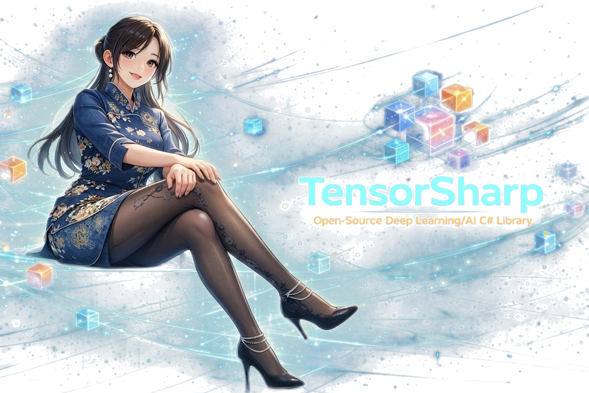
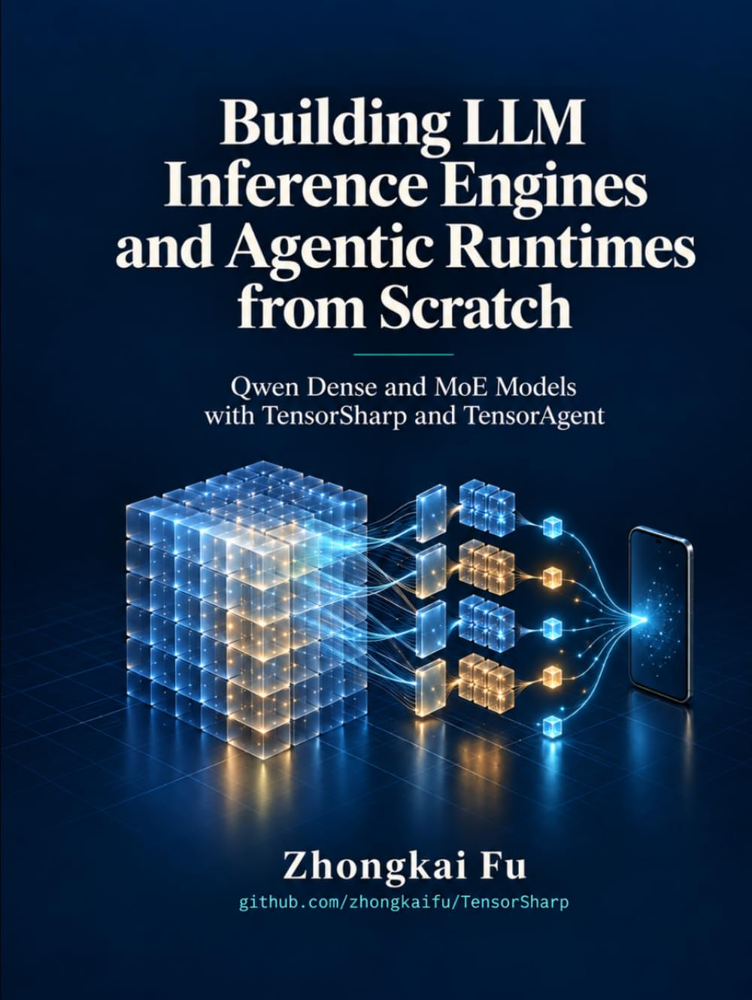

# TensorSharp

<p align="center">
  
</p>

[English](README.md) | [中文](README_zh-cn.md)

**Run local AI from C# — from GGUF inference to agent workflows.** TensorSharp brings local model serving, multimodal workloads and tool-using agents into a native .NET stack.

**Get started:** [Download a release](https://github.com/zhongkaifu/TensorSharp/releases/latest) · [Install and run](docs/getting_started.md) · [See benchmarks](docs/benchmarks.md) · [Supported models and backends](docs/supported_models.md) · [Known limitations](docs/PROJECT_STATUS.md)

| If you want to… | Start here |
|---|---|
| Build local AI features into a C# application | [Getting started](docs/getting_started.md) and [API/CLI usage](USAGE.md) |
| Serve GGUF models through compatible APIs | [Server quick start](#tensorsharp-cli-and-server) |
| Explore local agents, skills and personal knowledge | [Agent skills](docs/agent_skills.md) and [knowledge collections](docs/knowledge-system.md) |
| Generate or edit images, or experiment with video | [Qwen-Image 2.1](docs/models/qwenimage21.md) and [LTX 2.5](docs/models/ltx-2.5.md) |
| Compare measured speed and memory behavior | [Reproducible benchmark details](docs/benchmarks.md) |

*Model support, acceleration, memory requirements and validation vary by architecture and platform; check the linked status and model documentation before choosing hardware.*

**TensorSharp is a .NET 10 inference engine for local GGUF models.** Run it on Windows, macOS or Linux through the CLI, browser chat, or Ollama/OpenAI-compatible APIs, or embed it in your own .NET application. Use managed C# CPU kernels or native CUDA, Metal and Vulkan backends, with support that varies by model.

Current source covers text and reasoning, multimodal input, embeddings, image generation/editing, video with audio, personal knowledge collections, and Agent Skills with code tools. TensorSharp also powers [TensorAgent](TensorAgent/README.md), the local app for iPhone, iPad, Mac and Windows. Start below, or check the [project status](docs/PROJECT_STATUS.md) for capabilities and validation limits; LTX 2.5, EmbeddingGemma 2 and native skill discovery require source newer than `v2026.10.11`.

## Highlights

- **Local models, several interfaces.** One engine for CLI use, browser chat and Ollama/OpenAI-compatible APIs, across managed CPU and native accelerator backends.
- **Text and multimodal models.** Dense and MoE GGUF models, reasoning, image/audio input and document questions. See [Supported models](docs/supported_models.md) for each family's capabilities.
- **Embeddings and media generation.** [EmbeddingGemma 2](docs/embeddings.md) provides text/code embeddings and optional image, audio and video inputs. Generate and edit images with [Qwen-Image-2.1 and Turbo](docs/models/qwenimage21.md), or generate video with stereo audio using [LTX 2.5 Distilled](docs/models/ltx-2.5.md) (48 kHz) and [MiniMax-H3](docs/models/minimax-h3.md) (32 kHz).
- **Efficient serving.** Continuous batching and a paged, Radix prefix-shared KV cache are on by default. Speculative decoding and multi-GPU placement are available for supported models. See [Features](FEATURES.md).
- **Agent Skills and code tools.** `TensorSharp.AgentHost` adds file, shell and document workflows. The [17 bundled skills](docs/agent_skills.md) include research, documents, TDD, design interviews and handoff; `find-skills` searches, inspects and installs additional skills when network access is enabled. Server and TensorAgent chats also support [bounded sub-agent delegation](docs/multi_agent.md) with private workspaces and read-only defaults.
- **Personal knowledge collections.** [Upload files or nested folders, and import saved chats with their attachments and artifacts](docs/knowledge-system.md). Select collections per chat, retrieve cited excerpts with page/row/time locations, preview originals, or let code agents open full datasets. Local BM25 works by default; optional GGUF embeddings add semantic search, and compatible media models index images, audio and sampled video. Extraction status and warnings show coverage limits.
- **Steer an active response.** Submit a new instruction while the CLI, server Web UI or TensorAgent is reasoning or answering. The next response uses the conversation, partial output and your guidance; Stop remains available.
- **Recorded comparisons.** Benchmarks against `llama.cpp` use identical GGUF files and hardware; results apply to the measured model, backend and workload. See [Benchmarks](docs/benchmarks.md).
- **TensorAgent apps.** Local chat, attachments, skills and saved work on phones and desktops. See the [Mac/Windows installation guide](docs/tensoragent_desktop.md) and [app coverage notes](TensorAgent/README.md).

## Quick Start

### TensorSharp CLI and server

The [Releases page](https://github.com/zhongkaifu/TensorSharp/releases) provides self-contained CLI and Server archives for Windows x64 (CPU/CUDA), Linux x64 (CPU/CUDA), and macOS arm64.

To build from source you need the full **.NET 10 SDK** ([how to install it](docs/getting_started.md#install-and-first-run)), `git`, `curl`, [CMake](https://cmake.org/download/) 3.20+, and the toolchain for your GPU. Then run the verified [Gemma 4 E4B](https://huggingface.co/ggml-org/gemma-4-E4B-it-GGUF/blob/main/gemma-4-E4B-it-Q8_0.gguf) model (7.48 GiB). On Windows with an NVIDIA GPU (PowerShell):

```powershell
git clone https://github.com/zhongkaifu/TensorSharp.git; Set-Location TensorSharp
New-Item -ItemType Directory -Force models | Out-Null
curl.exe -L --fail "https://huggingface.co/ggml-org/gemma-4-E4B-it-GGUF/resolve/main/gemma-4-E4B-it-Q8_0.gguf?download=true" -o models\gemma-4-E4B-it-Q8_0.gguf
'Answer in one short sentence: what is TensorSharp?' | Set-Content prompt.txt
$env:TENSORSHARP_GGML_NATIVE_ENABLE_CUDA = 'ON'
dotnet run --project TensorSharp.Cli -c Release -p:TensorSharpSkipMlxNative=true -- --model models\gemma-4-E4B-it-Q8_0.gguf --input prompt.txt --max-tokens 128 --backend ggml_cuda
```

On other machines, change the backend (see [Pick a backend](#pick-a-backend)):

- **macOS (Apple Silicon):** drop the CUDA environment variable and use `--backend ggml_metal`.
- **Linux + NVIDIA:** prefix the `dotnet run` with `TENSORSHARP_GGML_NATIVE_ENABLE_CUDA=ON` and use `--backend ggml_cuda`.
- **AMD / Intel / NVIDIA Vulkan:** set `TENSORSHARP_GGML_NATIVE_ENABLE_VULKAN=ON` and use `--backend ggml_vulkan`.

Host the same model as a server: a browser chat at <http://localhost:5000> plus Ollama- and OpenAI-compatible APIs.

```bash
dotnet run --project TensorSharp.Server.Host -c Release -p:TensorSharpSkipMlxNative=true -- --model models/gemma-4-E4B-it-Q8_0.gguf --backend ggml_cuda --max-tokens 512
```

> The server listens on `0.0.0.0:5000` with no built-in authentication or TLS; keep it behind a firewall or an authenticated HTTPS reverse proxy.

### Pick a backend

| Your hardware | Backend |
|---|---|
| Apple Silicon (Mac) | `--backend ggml_metal` |
| Windows / Linux + NVIDIA GPU | `--backend ggml_cuda` |
| Windows / Linux + AMD / Intel / NVIDIA GPU | `--backend ggml_vulkan` |
| No GPU | `--backend ggml_cpu` (native kernels), or `--backend cpu` (pure C#, no native dependencies) |

The [Getting started guide](docs/getting_started.md) has the rest: installing the SDK on each platform, multi-GPU and multi-node runs, NVIDIA DGX Spark, multimodal input, embeddings, and making it fast. Every option is in the [CLI](USAGE.md#console-application) and [Server](USAGE.md#web-application) references, and both programs print them with `--help`.

`dotnet build TensorSharp.slnx` also builds TensorAgent's available desktop heads and the iOS simulator head on Apple Silicon when the selected SDK has the required MAUI workloads and staged native/Python files. Missing prerequisites skip the affected app head with a warning; see [TensorAgent build instructions](TensorAgent/README.md#build-and-run).

### TensorAgent Desktop: download, install, chat

**[Download the latest release](https://github.com/zhongkaifu/TensorSharp/releases/latest)** and expand **Assets**. Choose a file beginning with `tensoragent-desktop-`:

| Platform | Download and install |
|---|---|
| **macOS 14+ on Apple Silicon** | `tensoragent-desktop-<version>-osx-arm64.dmg`: open and drag TensorAgent to Applications. A PKG installer and ZIP are also available. |
| **Windows x64** | `tensoragent-desktop-<version>-win-x64-cpu.msi`, or `win-x64-cuda.msi` for a compatible NVIDIA GPU/driver: install and open TensorAgent from Start. ZIPs are also available. |

The app includes its .NET runtime and native engine. Windows needs [WebView2 Evergreen Runtime](https://developer.microsoft.com/en-us/microsoft-edge/webview2/) if missing; Python/Node are optional tools for skills. The current built-in catalog needs at least **12 GB system RAM**, and model weights download separately. Open **☰ → Models → Download → Use**, then type a message. The [Desktop user guide](docs/tensoragent_desktop.md) covers package verification, unsigned-app prompts, first-run setup, attachments, skills, updates and troubleshooting. Historical releases may have no Desktop assets until a release runs the updated workflow; iPhone/iPad remain [source builds](TensorAgent/README.md#build-and-run).

## Supported model families at a glance

- **Text, reasoning, and multimodal LLMs:** [DeepSeek V4 Flash](docs/models/deepseek4.md) / [V4.1 Flash](docs/models/deepseek41.md), [GLM 5.x](docs/models/glm.md), [Gemma 4](docs/models/gemma4.md), [Qwen 3.5 / 3.6 / 3.8 27B](docs/models/qwen35.md), [Qwen 3.8 Flash Next](docs/models/qwen38-flash-next.md), [Bonsai2](docs/models/bonsai2.md) (Qwen family), [GPT OSS](docs/models/gptoss.md), [Nemotron-H](docs/models/nemotron.md), [Mistral 3](docs/models/mistral3.md), [Hunyuan Dense](docs/models/hunyuan-dense.md), and [Muse-Glimmer](docs/models/muse-glimmer.md).
- **Text diffusion:** [DiffusionGemma](docs/models/diffusiongemma.md), including [Jev typed decision inference](docs/models/jev.md) at `/v1/systemone`, over text, images, uploaded documents, sampled video frames and audio transcripts (configured ASR companion).
- **Image generation/editing and video generation:** [Qwen-Image-2.1](docs/models/qwenimage21.md), [LTX 2.5 Distilled (video + 48 kHz stereo audio)](docs/models/ltx-2.5.md), [MiniMax-H3 (video + stereo audio)](docs/models/minimax-h3.md), and [Wan 2.1 / 2.2](docs/models/wan.md).
- **Embeddings:** [EmbeddingGemma 2](docs/embeddings.md), including text/code and optional image, audio, and video inputs; BERT / XLM-R encoders including Snowflake Arctic Embed L v2.0 and all-MiniLM-L6-v2.

Backend, modality, feature support, and validation coverage vary by model. See the [supported models](docs/supported_models.md) tables, the [model cards](docs/models/README.md), and the [embedding guide](docs/embeddings.md) for details.

TensorAgent's current catalog has 39 entries, grouped into searchable model families with memory and download filters, including LTX 2.5 Distilled at an experimental 48 GB memory tier, Qwen-Image-2.1 Turbo at 4-bit and 8-bit quantizations and fourteen image LoRA plug-ins. The expanded catalog includes experimental entries whose memory tiers and app/device behavior have not all been measured. Qwen3.8 Flash Next uses SSD-backed weights; its Q2 package was measured on a 48 GB Mac, and IQ1_M has separate Windows catalog-host validation. Multi-GPU `--layer-split` and `--tp` are separate controls; support and performance depend on the architecture and quantization. See [TensorAgent's coverage notes](TensorAgent/README.md#what-has-not-been-verified) and the model cards. Desktop installers appear in releases built with the updated Release Binaries workflow, while older releases may lack them.

## See it in action

One engine, four ways to use it, each an unedited capture of a real run.

<table>
  <tr>
    <td align="center" width="50%"><br><b>TensorSharp.Cli</b><br>Models in your terminal</td>
    <td align="center" width="50%"><br><b>TensorSharp.Server.Host</b><br>Web UI chat and Ollama/OpenAI-compatible APIs</td>
  </tr>
  <tr>
    <td align="center"><br><b>TensorAgent · iPhone simulator</b><br>CPU inference and in-app Python; this is a simulator capture</td>
    <td align="center"><br><b>TensorAgent on Mac</b><br>A saved Qwen-Image 2.1 edit in the Mac app</td>
  </tr>
</table>

What each run shows, step by step: [Screenshots](docs/showcase.md).

## Benchmarks

TensorSharp and `llama.cpp` run identical GGUF files on the same NVIDIA RTX 3080 Laptop GPU (16 GB), each on its GGML CUDA and Vulkan builds. Each number is TensorSharp's speedup over llama.cpp on the same backend (geomean, single-stream, greedy, MTP off); above 1.0× means TensorSharp is faster.

| Model | Backend | decode | prefill | TTFT |
|---|---|---:|---:|---:|
| Gemma 4 E4B it (Q8_0, dense multimodal) | CUDA | 1.02× | **1.28×** | **1.27×** |
| Gemma 4 E4B it (Q8_0, dense multimodal) | Vulkan | 1.00× | 1.05× | 1.03× |
| Gemma 4 12B it (QAT UD-Q4_K_XL, dense) | CUDA | 1.04× | **1.17×** | **1.16×** |
| Gemma 4 12B it (QAT UD-Q4_K_XL, dense) | Vulkan | **1.21×** | 1.04× | 1.03× |
| Qwen 3.6 35B-A3B (UD-IQ2_XXS, MoE) | CUDA | 0.98× | **1.28×** | **1.27×** |
| Qwen 3.6 35B-A3B (UD-IQ2_XXS, MoE) | Vulkan | 0.87× | 1.04× | 1.03× |
| Qwen 3.6 27B (UD-IQ2_XXS, dense) | CUDA | **1.07×** | 0.96× | 0.95× |
| Qwen 3.6 27B (UD-IQ2_XXS, dense) | Vulkan | 1.02× | 0.85× | 0.84× |

What these numbers mean, how to rerun them, and the head-to-heads of models too large for this GPU: [Benchmarks](docs/benchmarks.md).

## Documentation

New here? The sections above are all you need to get running. Everything else is detailed reference:

| Doc | What's inside |
|---|---|
| [TensorAgent Desktop user guide](docs/tensoragent_desktop.md) | Mac/Windows downloads, DMG/PKG/MSI/ZIP installation, model setup, first chat, attachments, skills, updates and troubleshooting |
| [TensorSharp and TensorAgent book guide](docs/BOOK.md) | Building LLM Inference Engines and Agentic Runtimes from Scratch, plus From Tensors to Tokens: introductions, Amazon links, and repository reading paths |
| [Getting started](docs/getting_started.md) | The full first-run guide: the .NET SDK on each platform, every backend, multi-GPU and multi-node runs, NVIDIA DGX Spark, embeddings, choosing a backend, and making it fast |
| [Supported models](docs/supported_models.md) | Implemented model families and their validation scope: example GGUFs, modalities, thinking, tools, and speculative decoding |
| [Benchmarks](docs/benchmarks.md) | TensorSharp against llama.cpp on the same GPU and files, and the head-to-heads of larger models |
| [Screenshots](docs/showcase.md) | The CLI, the Web UI, and TensorAgent on iPhone and Mac at work, with what each run did |
| [Model Downloads](MODEL_DOWNLOADS.md) | Per-model `huggingface-cli` download + run quick reference (quant tiers, projectors, companions) |
| [Usage](USAGE.md) | Full CLI reference (options, interactive REPL, JSONL batch), server hosting, logging, HTTP API examples, backends, and the env-var matrix |
| [Features](FEATURES.md) | Deep dives on continuous batching, speculative decoding, tool calling, thinking mode, multimodal, MoE, KV codecs, and more |
| [Configuration files](config/README.md) | Put options in a reusable JSON file with `${variables}` and auto-downloading models |
| [Development](DEVELOPMENT.md) | Prerequisites, building the native GGML/MLX libraries, repository layout, package boundaries, internal architecture, and the test harness |
| [Per-model architecture cards](docs/models/README.md) | End-to-end docs of each architecture (forward graph, components, parameters, prefill/decode optimizations) |
| [Paged attention & continuous batching](docs/PAGED_ATTENTION_AND_CONTINUOUS_BATCHING.md) | The vLLM-style paged KV cache, prefix sharing, and iteration-level scheduler |
| [Agent Skills & agentic work](docs/agent_skills.md) | The `SKILL.md` format, progressive disclosure and its budget, the in-process tool loop, sandboxed code execution, workspaces and artifacts, the path/ZIP/exec security model, and the HTTP + C# surfaces |
| [Multiple agents](docs/multi_agent.md) | Automatic task delegation, private child workspaces, dependency scheduling, permission limits, server controls, and reproducible evaluation |
| [Personal knowledge](docs/knowledge-system.md) | Collections, folder and saved-chat imports, document/PDF/media extraction, local retrieval, cited previews, dataset tools, APIs and validation limits |
| [Browser automation skill (Playwright)](docs/playwright_agent.md) | Running the bundled `playwright` skill, which drives a browser through `@playwright/cli` via `skills_run`: the flags it needs, the macOS Chromium-sandbox config, account handoff, and TensorAgent desktop hosting (not iOS) |
| [Speculative decoding](docs/speculative_decoding.md) | The three-layer design (model adapter / algorithm / speculator weights), the shipped `auto` / `draft-head` / `block` / `ngram` algorithms, and what to write to add a new one |
| [Environment variable feature matrix](docs/env_var_feature_matrix.md) | Which high-impact runtime flags affect which models, backends, and prompt types |
| [Engine comparison report](docs/engine_comparison_report.md) | Full per-scenario TensorSharp vs llama.cpp tables |
| [ggml_metal vs llama.cpp](docs/perf/metal-vs-llama-cpp.md) | Head-to-head prefill/decode on Apple Silicon, the four graph-construction gaps it found, and what each was worth |
| [Test/benchmark matrix runner](TensorSharp.TestMatrix/README.md) | Sweep model × backend × feature × env-var cells and generate regression reports |
| [Server API examples](TensorSharp.Server.Host/API_EXAMPLES.md) | Complete curl and Python examples for the server surface |

## Current Status

Actively developed, and the source tree runs ahead of the published packages.

| Area | Where it stands |
|---|---|
| Models | A dozen autoregressive families plus text diffusion, image generation and editing, and video with audio. See [Supported models](docs/supported_models.md). |
| Inference hosts | CLI, Web UI, Ollama- and OpenAI-compatible APIs, and TensorAgent for iPhone, iPad, Mac and Windows. The release workflow packages Mac/Windows Desktop; historical releases may lack those assets. iPhone/iPad use source builds. |
| Backends | Pure C# CPU, direct CUDA/cuBLAS, MLX Metal, and GGML CPU/Metal/CUDA/Vulkan, with per-architecture exceptions. |
| Serving features | Continuous batching with a shared prefix cache, speculative decoding, tensor parallelism, structured output, and tool calling. |
| Agentic work | Agent Skills, sandboxed file and shell tools, and bounded sub-agents. See [Agent Skills](docs/agent_skills.md) and [Multiple agents](docs/multi_agent.md). |
| Knowledge | Local document, dataset and media collections; folder/saved-chat import in TensorAgent, per-chat scope, lexical/optional semantic retrieval, source previews and complete-dataset agent tools. Media extraction and OCR have explicit coverage limits. See [Personal knowledge](docs/knowledge-system.md). |
| TensorAgent | 38 catalog entries with family search and filters, saved chats and artifacts, personal knowledge, response steering, masked image edits, 8-step Turbo, fourteen LoRAs, eight interface languages, and persisted text-turn statistics. Expanded catalog entries remain experimental; iOS media generation and Windows image/audio/video generation remain unverified. |

Per-area detail (which architecture runs on which backend, which features each family supports, and the known limits) is in the [status matrix](docs/PROJECT_STATUS.md#status-matrix).

## Author

Zhongkai Fu

## License

See [LICENSE](LICENSE) for details.

## Learn with the books

| Qwen inference and agentic runtimes | Gemma 4 and multimodal inference |
|---|---|
| <a href="https://www.amazon.com/dp/B0HJQ4VQ31"></a> | <a href="https://www.amazon.com/dp/B0H9P44QZZ"></a> |
| **[Building LLM Inference Engines and Agentic Runtimes from Scratch: Qwen Dense and MoE Models with TensorSharp and TensorAgent](https://www.amazon.com/dp/B0HJQ4VQ31)** | **[From Tensors to Tokens: Building a Multimodal LLM Inference Engine from Scratch with TensorSharp and Gemma 4 E4B](https://www.amazon.com/dp/B0H9P44QZZ)** |
| Build Qwen dense/MoE inference and controlled agent workflows in C#. Follow tensors, tokenization, attention, expert routing, quantization, and caching through GPU acceleration, multimodal execution, tools, skills, sandboxed code, and desktop/mobile deployment with TensorSharp and TensorAgent. | Build a multimodal inference engine in C#/.NET with Gemma 4 E4B, from tensors, GGUF model loading, quantization, and tokenization to text, image, video, and audio execution. Connect correctness checks and serving optimizations to the running TensorSharp code. |
| **[Buy on Amazon](https://www.amazon.com/dp/B0HJQ4VQ31)** | **[Buy on Amazon](https://www.amazon.com/dp/B0H9P44QZZ)** |

**[Explore both books and their repository reading paths](docs/BOOK.md)**

<p align="center"><a href="https://buymeacoffee.com/zhongkaifu"></a><br>
<sub>TensorSharp/TensorAgent is free. If you like it, a coffee keeps the work on it going.</sub></p>
