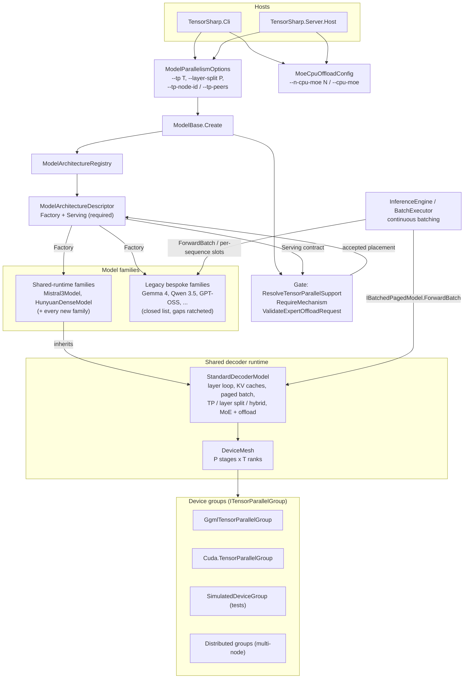
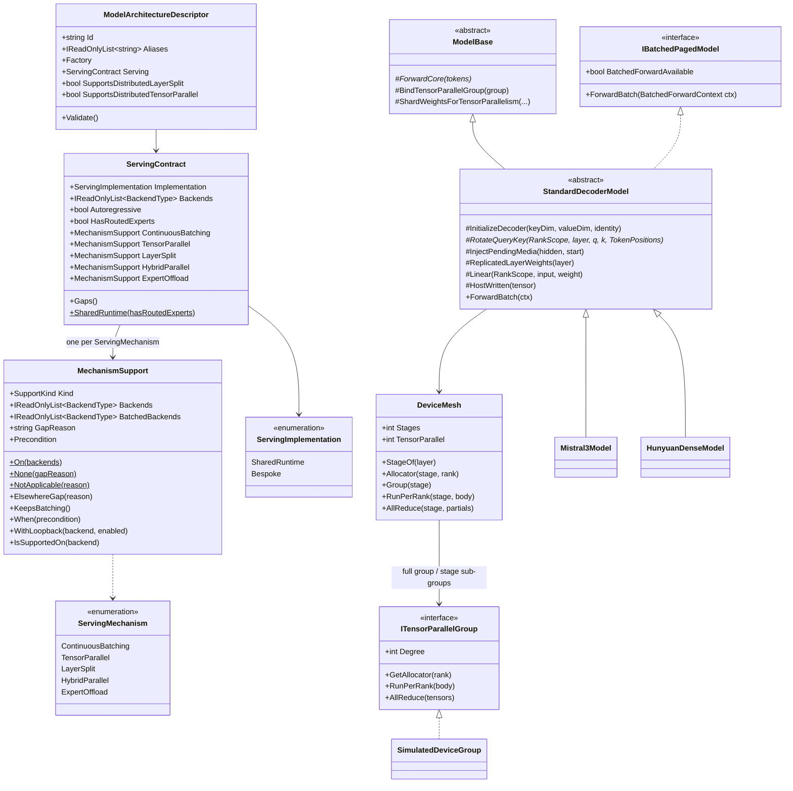
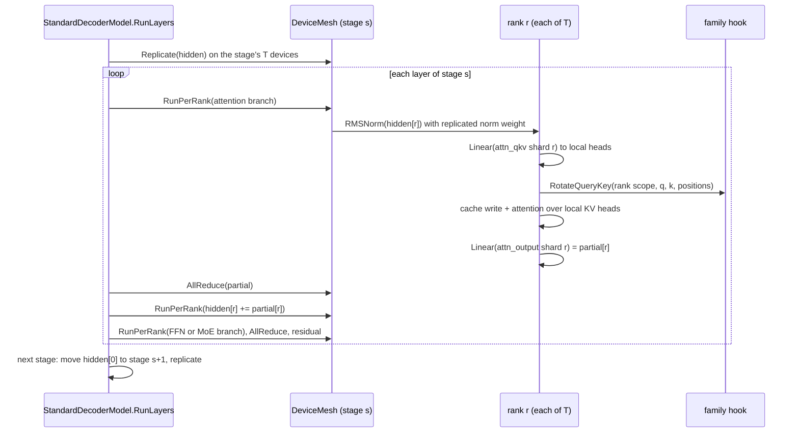

# Unified Execution: one contract for batching, parallelism and expert placement

**Status:** Phase 1 implemented on branch `refactor/unified-execution` (see [§9](#9-phase-1-status-and-validation)). Phases 2–4 are planned.
**Date:** 2026-11-10
**Scope:** how every model family gets continuous batching, tensor parallelism (TP), whole-layer
placement (layer split / pipeline parallelism, PP), hybrid TP×PP and MoE expert offload, on every
backend, without each family re-implementing them.

---

## 1. Problem

TensorSharp runs 18 architecture families on seven backends (`cpu`, `cuda`, `mlx`, `ggml_cpu`,
`ggml_metal`, `ggml_cuda`, `ggml_vulkan`). Five serving mechanisms should be available to all of
them:

| Mechanism | Operator surface |
|---|---|
| Continuous batching of concurrent requests | always on (`--no-continuous-batching` turns it off) |
| Tensor parallelism | `--tp N` |
| Whole-layer placement (pipeline parallelism) | `--layer-split N` |
| Hybrid TP × PP in one process | `--tp T --layer-split P` (T×P devices) |
| MoE expert offload | `--n-cpu-moe N`, `--cpu-moe` |

Today each family implements each mechanism by hand, so support is a patchwork:

* **The forward pass is written several times per family.** Mistral 3 has a single-device forward,
  a TP forward, a layer-split pipeline, a batched forward and a batched TP forward; Gemma 4,
  Qwen 3.5, GPT-OSS and Nemotron have a single-device forward, a TP forward, one or more fused
  decode graphs, a batched forward, and a TP fused decode. Every new mechanism multiplies that.
* **Mechanisms switch each other off.** `BatchedForwardAvailable => !IsTensorParallel`
  (Nemotron, GPT-OSS), `SupportsPerSequenceFusedForward => !IsTensorParallel && ...` (Qwen 3.5),
  `BatchedForwardAvailable => LayerPlacement == null` (Mistral 3). Under `--tp` or
  `--layer-split`, concurrent requests fall back to the serial per-sequence ownership swap.
* **Hybrid TP × PP is refused by construction.** `ModelBase`'s constructor and
  `ResolveTensorParallelSupport` throw *"--layer-split and --tp select different execution modes
  and cannot be combined."*
* **Expert offload is a process-wide static (`MoeCpuOffloadConfig`) that each family's FFN must
  remember to consult.** Some families do on some paths only; others warn
  (`WarnUnsupportedBackend`); native executors each re-implement placement with their own knobs
  (`TS_MUSE_SPARK_CPU_MOE`, `TS_MINIMAX_M3_CPU_MOE`, `TS_Q4E_HOST_EXPERTS`, ...).
* **Nothing forces a new family to support any of this.** `HunyuanDense` (the newest dense family)
  shipped as `MultiGpu = SingleDevice`: no TP, no layer split. The descriptor's multi-GPU fields
  are optional and default to "tensor parallel", so an undeclared family silently claims TP.
* **Backends are a closed `enum` with a `switch` in `ModelBase`'s constructor**; there are about
  750 `BackendType.X` references outside tests. A backend cannot be added or removed without
  editing core code.
* **The option surface grew per family.** About 990 `TS_*`/`TENSORSHARP_*` names are read in
  managed code and 195 in native code. Many are per-family copies of one generic concept
  (micro-batch size, CPU MoE, layer split, pipelined prefill, op offload, slot headroom,
  "batched path on/off", "native path on/off").

### 1.1 Audit: support matrix before this change (text LMs)

Read from the descriptors and the `IBatchedPagedModel` getters at `bd062ece`.
"slots" = per-sequence native slots (concurrent, batched inside a native executor);
"paged" = `ForwardBatch`; "swap" = serial per-sequence KV ownership swap (not batching).

| Family | Concurrency, 1 device | Concurrency under TP / LS | `--tp` | `--layer-split` | Hybrid | Expert offload |
|---|---|---|---|---|---|---|
| Gemma 4 | paged + per-seq fused (GGML) | swap | cuda, ggml_cuda, ggml_vulkan | — | — | per-op + TP paths |
| Qwen 3.5 / 3.6 | paged + per-seq fused | swap | cuda, ggml_cuda, ggml_vulkan | — | — | partial; refused on some backends |
| Qwen 3.8 Flash Next (qwen4exp) | per-seq holders / slots | slots (LS), swap (TP) | ggml_cuda | ggml_cuda, ggml_vulkan, cuda | — | yes (own planner) |
| GPT-OSS | paged + per-seq fused (GGML) | swap | cuda, ggml_cuda, ggml_vulkan | — | — | yes |
| Nemotron-H | paged | swap | cuda, ggml_cuda, ggml_vulkan | — | — | TP-GGML path only |
| Mistral 3 | paged | paged (TP), swap (LS) | cuda, ggml_cuda, ggml_vulkan | ggml_cuda, ggml_vulkan | — | n/a (dense) |
| Hunyuan Dense | paged | n/a | — | — | — | n/a (dense) |
| Muse-Glimmer | swap | swap | ggml_cuda, ggml_vulkan (≤2) | — | — | n/a (dense) |
| Muse Spark | slots (native) | slots | ggml_cuda (native) | ggml_cuda, ggml_vulkan | — | yes (own knobs) |
| MiniMax-M3.1 | slots (native) | slots | ggml_cuda | ggml_cuda | — | yes (own knobs) |
| DeepSeek V4 | slots | slots | — | ggml_cuda, ggml_vulkan, cuda | — | yes |
| DeepSeek V4.1 | slots | slots | ggml_cuda (routed MoE, experimental) | ggml_cuda, cuda | — | yes |
| GLM-5.x / 5.3-Flash | slots (native) | slots | yes | ggml_cuda, ggml_vulkan, cuda | — | yes |

Media families (DiffusionGemma, Qwen-Image, Wan, LTX 2.5, MiniMax-H3) do not decode
autoregressively; continuous batching of chat requests does not apply to them.

### 1.2 Root causes

1. **What a model computes and how it is executed are fused into one class.** Batching, device
   placement, collectives and expert residency are all written inside each family's forward.
2. **Capabilities are optional and scattered.** Load-time multi-GPU fields on the descriptor,
   per-step `IBatchedPagedModel` getters, a static offload config, and environment variables.
3. **Topology is two mutually exclusive integers** (`tpDegree`, `layerSplitDegree`) rather than
   one object describing which device runs which layer with which TP group.

---

## 2. Target architecture

```
                 ┌──────────────────────────────────────────────────────┐
  CLI / server → │ ParallelTopology  (stages × TP group, expert placement)│
                 └───────────────┬──────────────────────────────────────┘
                                 │ validated against
                 ┌───────────────▼──────────┐     ┌───────────────────────┐
                 │ ServingContract          │     │ IBackendProvider      │
                 │ (declared per family,    │     │ (plug-in per backend: │
                 │  enforced by tests)      │     │  devices, allocators, │
                 └───────────────┬──────────┘     │  collectives, host)   │
                                 │                └──────────┬────────────┘
                 ┌───────────────▼────────────────────────────▼───────────┐
                 │ Decoder runtime: owns the layer loop, weight placement, │
                 │ ragged batches + paged KV, TP reduce, stage transfers,  │
                 │ expert residency. Families supply a layer RECIPE.       │
                 └─────────────────────────────────────────────────────────┘
```

Four rules:

1. **One topology object.** Every multi-device decision is a `ParallelTopology`: `P` pipeline
   stages, each a TP group of `T` devices, plus an `ExpertPlacement`. `--tp` and
   `--layer-split` are its two dimensions, not alternative modes. Single-device is `1 × 1`.
2. **One mandatory contract per family.** `ModelArchitectureDescriptor.Serving` declares, for
   every mechanism, *Supported (on which backends, by which implementation)*, *Not applicable
   (why)* or *Gap (why)*. The registry refuses a descriptor that omits it; conformance tests
   prove every *Supported* claim on synthetic fixtures and keep a ratchet of *Gap* entries that
   can only shrink.
3. **Mechanisms belong to the runtime, not to families.** A family built on the shared decoder
   runtime declares `Implementation = SharedRuntime` and gets all five mechanisms on every
   backend with no family code. New families must use it (enforced, §5.3).
4. **Backends are plug-ins.** A backend is an `IBackendProvider` registered by its assembly. The
   runtime only asks providers for devices, allocators and collectives; removing a backend's
   assembly (or its native library) unplugs it and every refusal names why.

---

### 2.1 Structure



### 2.2 Interfaces



### 2.3 One layer on a tensor-parallel stage



## 3. Topology: `--tp T` x `--layer-split P`

`--tp` and `--layer-split` are the two dimensions of one topology, not alternative modes:

| Request | Devices | Shape |
|---|---|---|
| neither | 1 | single device |
| `--tp T` | T | one stage, T tensor-parallel ranks |
| `--layer-split P` | P (local) or P per node | P whole-layer stages of one device each |
| `--tp T --layer-split P` | T x P (one process) | P stages, each its own T-device TP group |

* **Validation** (`ModelBase.ResolveTensorParallelSupport`) reads only the family's serving
  contract: hybrid needs `HybridParallel` on the backend, a pure split `LayerSplit`, pure TP
  `TensorParallel`; a single-device backend is refused for every family alike; a mechanism's
  `Precondition` checks degree limits (Muse-Glimmer's two KV heads, DeepSeek V4.1's eight GPUs
  per process). Refusals keep the existing contract: exit code 2 and one stderr line. The
  option parser (`ModelParallelismOptions`) accepts both degrees together and refuses only a
  multi-node hybrid.
* **Placement** (`DeviceMesh`): device (stage s, rank r) is global device `s*T + r` of one
  group spanning all T x P devices (its allocators, its per-rank pinning, its native
  collective when there is one stage). Layer ranges come from the existing weight-byte
  balancer (`LayerSplitPlan.CreateWeighted`): embedding on stage 0, head on the last stage.
* `--n-cpu-moe` / `--cpu-moe` are validated against the contract's `ExpertOffload` before
  anything loads; a dense checkpoint, or a backend that already keeps experts in host memory,
  takes the option as a no-op with a note.

Multi-node groups (`--tp-node-id/--tp-peers`) keep their existing validation; a multi-node
whole-layer split runs the serialized stage protocol (`ModelBase.ForwardLayerPipeline`).

## 4. Backends: what is abstract today, and the plug-in step

**Phase 1 (this change).** Everything a mechanism needs from a backend goes through three
small seams, so the runtime and the contract never switch on a backend name:

* `ServingContract.MultiDeviceBackends` / `HostBackends` - which backends can expose several
  devices (TP, layer split, hybrid are meaningful there; elsewhere the gate refuses for every
  family alike) and which keep every weight in host memory (expert offload is trivially
  honoured there).
* The device mesh asks for allocators per device (`ModelBase.CreateLayerDeviceAllocator`, the
  full `ITensorParallelGroup` for TP/hybrid) and for collectives through `ITensorParallelGroup`;
  `SimulatedDeviceGroup` is a complete host-memory backend for that seam, which is how the
  conformance suite proves placements without GPUs.
* Backend fast paths (fused SwiGLU FFN, MLX fused add+norm and decode attention, half-operand
  GEMMs, native paged attention, ggml's stacked-expert kernel) are inside runtime primitives,
  not in family code, so adding a backend means teaching the primitives, not every family.

**What is not yet a plug-in.** `BackendType` is a closed `enum` (about 750 references outside
tests, many in per-family kernels), and `TensorSharp.Models` references every backend assembly
directly. A provider registry over that enum would only re-label it. Phase 2 makes the step real:

1. `BackendType` becomes an open, string-keyed identifier (`readonly record struct`) with the
   same well-known instances, so existing `==` comparisons keep compiling; the `switch`/`is`
   pattern sites are rewritten mechanically.
2. Each backend assembly registers an `IBackendProvider` (id, availability with a reason,
   device count, allocator per device, collective group, traits) from a module initializer;
   hosts list `--backend` choices from the registry, and an assembly or native library that is
   absent unplugs its backend with the provider's own refusal.
3. The native lowering (§6.3) moves the remaining backend-specific kernels behind the runtime,
   which is what lets families stop referencing backend assemblies at all.

## 5. The serving contract

### 5.1 Declaration

```csharp
public sealed record ServingContract
{
    public required Implementation Implementation { get; init; }   // SharedRuntime | Bespoke
    public required MechanismSupport ContinuousBatching { get; init; }
    public required MechanismSupport TensorParallel { get; init; }
    public required MechanismSupport LayerSplit { get; init; }
    public required MechanismSupport HybridParallel { get; init; }
    public required MechanismSupport ExpertOffload { get; init; }
}

MechanismSupport.On(params BackendType[] backends)   // supported where listed
MechanismSupport.NotApplicable("dense: no routed experts")
MechanismSupport.Gap("whole-layer placement is not implemented for the native executor")
```

`Implementation = SharedRuntime` derives every mechanism from the runtime (all backends that
can provide the devices) and a family may not override that downwards: a shared-runtime family
that cannot support something is a runtime bug, not a family exception.

The loader reads only this contract: `ResolveTensorParallelSupport` and the hosts' refusals are
driven by it, so a declared gap is also the operator-facing refusal message.

### 5.2 What "consistent across backends" means

* The same flags are accepted on every backend and mean the same thing.
* Single-device backends (`cpu`, `mlx`, `ggml_metal`, `ggml_cpu`) report `DeviceCount = 1`; a
  `--tp 2` request on them is refused by the topology planner with the same message for every
  family, not by family code.
* Every *Supported* claim is exercised by a conformance test that compares the mechanism against
  the single-device reference on a synthetic fixture.

### 5.3 Enforcement

1. **Registration:** `ModelArchitectureDescriptor.Validate()` requires `Serving`; an autoregressive
   family must not declare continuous batching `NotApplicable`.
2. **Gap ratchet:** `ServingContractConformanceTests.KnownGaps` lists today's gaps. The test fails
   when a descriptor declares a gap that is not listed (a regression or a new family taking the
   easy way out) and when a listed gap has been closed but not removed (so the list always
   matches reality).
3. **New families use the shared runtime:** any architecture id not in the legacy (bespoke) list
   must declare `Implementation = SharedRuntime`; the test fails otherwise.
4. **Proof per claim:** `SharedRuntimeConformanceTests` runs every shared-runtime family through
   prefill, decode, truncate-and-refill and reset under TP 2, layer split 2 and 4, and hybrid
   2×2 and 2×3 on simulated devices (`SimulatedDeviceGroup`), comparing logits with one device
   (layer split exact, TP within 1e-4), and serves concurrent requests through the engine in
   every placement (asserting the paged batched forward ran). `SharedRuntimeMoeConformanceTests`
   does the same for routed experts with and without host offload, through a test-only family
   that writes nothing but its rotary step. Single-device parity on the real backends
   (`ggml_cpu`, `ggml_metal`, MLX) is checked against the managed reference.

---

## 6. The shared decoder runtime

### 6.1 What a family writes

A family describes *what* one layer computes, once:

```csharp
internal sealed class HunyuanDenseRecipe : IDecoderRecipe
{
    public DecoderGeometry Geometry { get; }            // layers, hidden, heads, kv heads, head dim
    public WeightRoleMap Roles { get; }                 // which weights are column/row/expert/replicated
    public void BuildLayer(LayerBuilder b, int layer)
    {
        b.Branch(norm: "attn_norm", body: (ctx, x) => ctx.Attention(x, layer, rope, qkNorm: AfterRope));
        b.Branch(norm: "ffn_norm",  body: (ctx, x) => ctx.SwiGluFfn(x, layer));
    }
}
```

A layer is a list of **residual branches**: `h = h + post_norm(Reduce(body(pre_norm(h))))`. The
body is ordinary code over `BranchContext` primitives and is written rank-agnostically:
`ctx.Linear` picks the local shard from the role map, `ctx.LocalHeads` is `H/T`, and the
returned tensor is a partial sum that the runtime reduces. A body that does not end in a
row-parallel projection (or an expert combine) is rejected under TP, so a recipe cannot produce
silently unreduced output.

### 6.2 What the runtime owns

| Mechanism | How the runtime provides it |
|---|---|
| Continuous batching | Every request owns a **slot**: its attention cache rows on each (layer, rank) device, in the configured KV dtype, plus its recurrent states (6.5). The bound slot is the model's active cache, so a lone request runs the single-sequence kernels; binding another request swaps references. A batched step packs every scheduled row of every slot into one activation; only attention (and a recurrent mixer) runs per sequence, on that sequence's slot. `TryExtractKVBlock`/`TryInjectKVBlock`, retention and donation to the prefix cache are implemented once. |
| Tensor parallelism | Weights are sharded by role at load (column: output rows; row: input blocks; KV-group aware; fused QKV/gate-up sharded per segment, then fused per rank). Each branch body runs once per rank (`RunPerRank`, concurrent on GGML); the runtime all-reduces the partials. |
| Layer split | The runtime assigns layers to stages, loads only owned weights on each stage's devices, allocates that layer's KV there, and copies the activation at stage boundaries. |
| Hybrid TP × PP | Stage `s` runs its layers with the TP sub-group of its devices; boundaries move the replicated activation from one sub-group to the next. |
| MoE and expert offload | A layer with `ffn_gate_inp` + stacked `ffn_{gate,up,down}_exps` (and optionally `ffn_*_shexp`) is a routed-expert layer: softmax top-K routing (renormalized by `{arch}.expert_weights_norm`), the shared expert on the device. `--n-cpu-moe N` / `--cpu-moe` layers keep their experts in the GGUF mapping and run them on the host - ggml's CPU backend on GGML backends, the managed quantized kernels elsewhere - while router, shared expert, attention and norms stay on the device. Under TP the experts are distributed whole (expert parallelism: rank r owns a contiguous expert range and computes it for every token), so expert memory is spread without slicing weights. |

### 6.3 Performance and correctness on Metal

Phase 1 executes branch bodies with the same TensorSharp ops the families already use
(quantized matmul, fused SwiGLU FFN, fused norm+add, MLX decode attention, native paged
attention), so a migrated family's single-device path issues the same kernels as before. The
batched paged path uses the existing paged-attention kernels.

On `ggml_metal` the runtime turns off ggml's lazy-sync asynchronous compute for its per-op
paths, as Gemma 4 and DiffusionGemma already do: lazy-sync drains device work before host
reads but has no host-write barrier, and per-op paths interleave host writes (positions,
decode rotary, paged-attention results, host experts) with device kernels. Measured on an M5
Pro before this change, the per-family Mistral 3 forward was non-deterministic on
`ggml_metal` (two identical runs 6.5e-2 apart in relative L2, 8.9e-2 from the managed
reference); with lazy-sync off it is deterministic and within 9e-4, bit-identical to the old
code run with `TS_GGML_ASYNC_COMPUTE=0`.

The runtime is also the seam for **Phase 2 (native lowering)**: the same recipe is recorded into
one ggml graph per micro-batch (the way the Muse Spark and MiniMax-M3 executors already run) and
executed by a TensorSharp-owned scheduler with one ggml meta backend per stage (TP), one stage per
device range (PP) and CPU buffers for host experts. Upstream ggml is used unchanged, as AGENTS.md
requires.

### 6.4 Hybrid stacks: recurrent mixers

A layer's token mixer may be a recurrent block (linear attention, an SSM) instead of
attention. The family declares which layers (`IsRecurrentLayer`), the shape of one rank's
state (`CreateRecurrentState`, an opaque `RecurrentState`), the block itself
(`RecurrentMixer`: normalized input in, the rank's partial output out, state advanced) and how
its weights shard (`ShardRecurrentLayer`, with `ShardOutputRows` / `ShardInputColumnGroups`
for any head layout). The runtime owns where state lives: one per (layer, rank) for
the primary cache and one per (slot, layer, rank) for each request, carried with the slot's
attention rows, fresh for a new request and recycled on `OnSequenceReleased`. So TP, layer split, hybrid and batching need nothing family-specific.
A fused native block may take the raw residual and apply the input norm itself
(`RecurrentMixerTakesRawInput`).

A recurrent state summarizes every token so far, so such a stack truncates only to its length
or to zero, has no K/V snapshots, and declares itself class R to the prefix cache (no
resumable pages): a shared prefix is re-prefilled, never restored wrong.

Qwen 3.5 / 3.6 is the first user (`Qwen35RuntimeModel`): gated attention
(`GatedAttentionOutput`: `attn_q` emits `[q_h | gate_h]`), QK-norm before a partial NeoX
rotary, Gated DeltaNet as the recurrent mixer, and MoE with a sigmoid-gated shared expert.
Under TP a rank owns a contiguous block of key heads and the value heads that read them
(block-cyclic), so the recurrence is rank-local and only `ssm_out` is reduced. On the GGML
backends each rank's block is one native graph with the state on the device; elsewhere it is
a managed loop.

### 6.5 Slots: device-resident continuous batching

The first runtime kept a batched step's K/V in host F32 arrays (paged blocks) and ran attention
on the host; every bespoke family's paged path does the same. On a lone request that path is
slower than the device cache it replaced. Measured through the server on an M5 Pro (4 distinct
greedy chats, 64 tokens each; main vs slots):

| Model | Backend | Lone request, tok/s | 4 concurrent, tok/s | Identical text |
|---|---|---|---|---|
| Hy-MT2-1.8B Q4_K_M | `ggml_metal` | 14.0 → 28.1 | 29.3 → 44.4 | 4/4 |
| Ministral-3-3B Q4_K_M | `ggml_metal` | 17.4 → 27.3 | 35.2 → 45.4 | 4/4 (main 3/4) |
| Hy-MT2-1.8B Q4_K_M | `mlx` | 33.1 → 84.6 | 76.3 → 190.5 | 4/4 |
| Ministral-3-3B Q4_K_M | `mlx` | 31.3 → 62.9 | 69.8 → 132.7 | 4/4 |

Slots use the per-request holder contract the engine already batches (`BindSequenceCache`,
`TryForwardBatchedFusedDecode` / `TryForwardBatchedFusedPrefill`, retention, and
`IHolderPrefixCacheModel` donation), so the engine serves the runtime exactly as it serves the
holder families. `SlotParity` checks the contract: three requests in batched steps (prefill
chunks of different lengths, decode, a lone step on one slot in between) reproduce each request
alone in every placement, bit-identical on the managed backend and within backend rounding on
GGML and MLX. A multi-node pipeline (the serialized stage protocol) has no slots yet.

### 6.6 Whole-forward graphs (the native lowering, first step)

Hand-fused native graphs were written per family and per mode (decode, prefill, batched, tensor
parallel, verify): 7.3k lines of the native library are such graphs, and the same blocks recur
across them (`flash_attn_ext` in 32 files, `rope_ext` in 26, `mul_mat_id` in 19). The runtime
now emits each step as ONE ggml graph instead (`StandardDecoderModel.Graph.cs` over the generic
builder `ggml_ops_graph_builder.cpp` / `GgmlGraph`): leaves are weights (bound to the cached
device copy by host pointer), state (slot caches and recurrent states, updated in place) and
per-run inputs; the runtime writes norms, projections, cache writes, per-sequence attention on
each slot, dense FFN and routed experts once for every family, and a family adds only its own
pieces (`EmitQueryKey`: rotary, QK-norm, position scale; `EmitRecurrentMixer`: Qwen 3.5's Gated
DeltaNet). Single-device GGML placements use it; other placements keep the per-op path until
their lowering lands. Measured on an M5 Pro, `ggml_metal`, 512 / 128 tokens, tok/s:

| Model | per-op runtime | graph | legacy family code |
|---|---|---|---|
| Hy-MT2-1.8B Q4_K_M | 627 / 14.7 | 4,720 / 141.6 | - |
| Ministral-3-3B Q4_K_M | 429 / 24.7 | 2,651 / 98.3 | - |
| Qwen3.5-0.8B Q8_0 | ~1,750 / 45.7 | 6,996 / 166.6 | 9,370 / 220 (`Qwen35Model` fused graphs) |

Greedy text is byte-identical to the per-op path on all three; Qwen3.5-0.8B perplexity is
50.1337 through the graph and through `Qwen35Model` alike.

**Replay.** Emission is a trace with a 128-bit signature over everything that shapes the graph
(ops, parameters, extents, bound host pointers); per-run inputs (activations, positions, masks,
KV write indices) are outside it. A decode step writes K/V by index (`set_rows`) and attends to
a window padded to 64 rows on Metal (256 elsewhere) under a mask, so every token of a bucket has
the same signature: it traces in hash-only mode and replays the cached graph. Copies are emitted
only for strided inputs, and where the backend reads row-contiguous strided views (Metal, CUDA,
as the fused Qwen graphs already rely on) the Gated DeltaNet's Q/K/V feed the norms and the
recurrence directly. Qwen3.5-0.8B, `ggml_metal`, after replay: 9,076 / 196.7 tok/s against
`Qwen35Model`'s 9,450 / 220 (96% / 89%); Hy-MT2 4,755 / 168.1, Ministral 2,725 / 107.3.
Perplexity stays 50.1337.

**In-place recurrent state.** The per-token copy of each Gated DeltaNet state (18 x 1 MB on
Qwen3.5-0.8B) was the rest of the decode gap. The builder's alias primitive places an op's
result inside a persistent state buffer (falling back to the copy when the buffer is not
resident); each request's GDN state has a backing buffer [one row's outputs | state], and on
Metal a decode row's recurrence writes onto it in place, as `Qwen35Model`'s fused decode does.
Two A/B rounds, runtime vs `Qwen35Model`: decode 220.8 / 220.2 vs 220.1 / 220.1 tok/s, prefill
9,279 / 9,103 vs 9,472 / 9,521; perplexity 50.1337 both; 96-token greedy text identical.

**ggml_cuda** (RTX PRO 6000 slice, one GPU, 512 / 128, two rounds, main -> graph):

| Model | main | graph |
|---|---|---|
| Hy-MT2-1.8B Q4_K_M | 819-838 / 54.5-58.0 | 7,246-7,296 / 204-206 |
| Ministral-3-3B Q4_K_M | 466-622 / 62.3-64.0 | 4,545-4,820 / 137-138 |
| Mistral-Small-3.1-24B Q4_K_M | 290-319 / 18.8-18.9 | 1,133-1,139 / 25.2-25.3 |

Mistral-Small's greedy text is identical to main; Ministral's differs by design (the YaRN fix
above; perplexity on 1,020 tokens 47.45 -> 42.29). Hy-MT2's diverges after about 25 words:
its perplexity is 148.72 on main's CUDA path and 149.64 through the graph, against an exact
managed reference of 146.39 and 149.45 / 149.50 on ggml_metal (main / graph). Every GGML arm
sits about 2% above the exact value because ggml quantizes activations in quantized matmuls;
the graph computes on CUDA what Metal computes, and main's CUDA prefill (about 9x slower)
dequantized the weights instead, which lands 0.6% lower. Qwen 3.5 on CUDA through the graph: 0.8B 16.1-16.3k / 258 vs `Qwen35Model` 17.4-18.6k /
269-271; 9B 3.1-3.2k / 40.1 vs 3.5k / 40.6 (9B greedy text identical). Its 0.8B perplexity is
50.33 against the legacy 50.07; the exact managed reference is 50.24, every backend scatters
within about 0.3% of it (Metal 50.13, MLX 50.09-50.14), and the runtime is the closer of the two
CUDA arms, so this is rounding, not a quality loss. Qwen keeps `Qwen35Model` on one device until
CUDA prefill and the features below reach parity.

---

## 7. Migration plan

| Phase | Content | Families |
|---|---|---|
| 1 (this change) | Topology, backend providers, contract + enforcement, managed shared runtime, legacy option clean-up | Hunyuan Dense and Mistral 3 text tower move to the shared runtime; all other families declare their real support and gaps |
| 2 | Native lowering of recipes to one ggml graph per micro-batch; device-resident paged KV; graph reuse | perf parity gate per family before switching |
| 3 | Port per-op families: Muse-Glimmer, GPT-OSS, Nemotron-H, Gemma 4, Qwen 3.5 (recurrent state as a runtime-owned slot pool) | delete each family's `*TensorParallel*`, `*BatchedForward*`, `*PerSeqCache*` once its recipe passes parity and perf gates. **Status:** Qwen 3.5's recipe is on the runtime (6.4) and serves layer split, hybrid and host experts on cuda / mlx; one device and `--tp` stay on `Qwen35Model` until the runtime matches its fused graphs (Phase 2), so none of its files is deleted yet |
| 4 | Native executors (Muse Spark, MiniMax-M3, DeepSeek V4/V4.1, GLM, Qwen 3.8 Flash Next) share one scheduler/placement/slot core extracted from them | per-family split plans become role maps |

A family moves only when its recipe matches the old path's logits on fixtures and real
checkpoints and is not slower on the backends it already served; the old path is deleted in the
same change (no dual paths behind a switch).

---

## 8. Option clean-up policy

* One option per concept, shared by every family: `--tp`, `--layer-split`, `--n-cpu-moe` /
  `--cpu-moe`, `--no-continuous-batching`, `TS_SCHED_MAX_BATCHED_TOKENS`.
* Per-family copies of a generic concept are retired through the existing registry
  (`SpeculationEnvVars.RemovedNames`-style hard errors naming the replacement), never silently
  ignored.
* Switches whose only effect is to select a slower or superseded path are removed with the path.
* Observers, oracles and measurement switches listed in the 2026-09 keep list stay.

---

## 9. Phase 1 status and validation

### 9.1 What changed

| Area | Change |
|---|---|
| Contract | `ModelArchitectureDescriptor.Serving` (`ServingContract`) is required and replaces `MultiGpu`, `SupportsLayerSplit`, `LayerSplitBackends`, `SupportsNativeTensorParallel` and `MultiGpuLimitation`. Every family declares its real support; 128 gaps are recorded. |
| Gate | `ResolveTensorParallelSupport` and `ValidateExpertOffloadRequest` read only the contract. `--tp T --layer-split P` is accepted where the family supports the hybrid; an expert-offload request a family cannot honour is refused instead of warned about or silently ignored (Nemotron-H ignored it outside its GGML TP MoE). |
| Runtime | `StandardDecoderModel` (`TensorSharp.Models/SharedDecoder/`) and `DeviceMesh` (`TensorSharp.Models/Placement/`): batched paged forward, TP, local and multi-node layer split, hybrid, routed experts with host offload and expert parallelism. |
| Families | Mistral 3 and Hunyuan Dense moved onto the runtime. Deleted: `Mistral3Model.TensorParallel.cs`, `.BatchedForward.cs`, `.BatchedForwardTP.cs`, `.LayerSplit.cs`, `HunyuanDenseModel.BatchedForward.cs`. Hunyuan Dense gains TP, layer split and hybrid; Mistral 3 gains batching under layer split and hybrid. |
| Clean-up | `TS_GGML_TP_FUSED_MATMUL` (never the default, measured 2.3x slower) and its managed path are removed and registered as a hard error. The per-family batched switches had already been retired. |
| Hosts | `ModelParallelismOptions` accepts both degrees; both usage pages document hybrid placement. |
| Tests | `ServingContractConformanceTests` (contract, ratchet, closed legacy list), `SharedRuntimeConformanceTests`, `SharedRuntimeMoeConformanceTests`, `SimulatedDeviceGroup`. |

### 9.2 Validation (2026-11-10, Apple M5 Pro, ggml `cd6d2b75`)

**Test suites** (`InferenceWeb.Tests`, managed-only build against prebuilt native libraries):

| Lane | Refactor | Baseline (`bd062ece`) |
|---|---|---|
| CPU (`ggml_cpu` pinned) | 12,600 passed, 0 failed, 867 skipped | - |
| Metal (`TS_TEST_GGML_BACKEND=metal`) | 12,557 passed, 0 failed, 918 skipped | 12,512 passed, 0 failed, 918 skipped |

Skips are tests gated on CUDA, Vulkan, a second GPU or checkpoints that are not on this machine.
New suites: 31 contract/placement tests (`ServingContractConformanceTests`, `SharedRuntimeConformanceTests`),
15 MoE tests (`SharedRuntimeMoeConformanceTests`).

**Numerical parity with the old per-family code** (same synthetic fixtures and script, logits compared):
Mistral 3 bit-identical on `cpu`, `ggml_cpu` and MLX; Hunyuan Dense bit-identical on `cpu` and
`ggml_cpu`, within 2.9e-7 on MLX. On `ggml_metal` the old Mistral 3 was not reproducible run to run
(lazy-sync race, §6.3); the refactor is deterministic and bit-identical to the old code with
`TS_GGML_ASYNC_COMPUTE=0`.

**Real checkpoints** (Hy-MT2-1.8B Q4_K_M `hunyuan-dense`, Ministral-3-3B-Instruct-2512 Q4_K_M
`mistral3`): 96-token greedy generations through the CLI (scheduler, paged batched forward) are
byte-identical to the old code on `cpu`, `ggml_metal` and MLX for both models.

**Throughput** (CLI `--benchmark`, 512-token prefill, 128 decode tokens, alternating A/B processes,
medians of the steady-state runs, tok/s):

| Model | Backend | Old (async on) | Old (async off) | Refactor |
|---|---|---|---|---|
| Hy-MT2-1.8B | `ggml_metal` | 602 / 10.3 | 608 / 11.8 | 611 / 11.7 |
| Hy-MT2-1.8B | MLX | 2,877 / 17.1 | - | 2,840-3,270 / 119 |
| Ministral-3-3B | `ggml_metal` | 411 / 19.9 | 410 / 22.1 | 406 / 21.9 |
| Ministral-3-3B | MLX | 1,875 / 47.2 | - | 1,881 / 47.2 |

(prefill / decode.) No regression; Hunyuan Dense on MLX decodes about 7x faster because the runtime
gives it MLX's device-resident decode attention and fused add+norm instead of copying the KV cache
to the host every token. Disabling Metal lazy-sync did not cost these per-op paths speed.
These are single-device numbers; the per-op `ggml_metal` path remains slow for its size, which is
what Phase 2's native lowering addresses.

### 9.3 Real GPUs (2026-11-10)

2x RTX PRO 6000 Blackwell Server Edition, each exposed as one MIG 1g.24gb slice (two 24 GB
devices, no peer access), CUDA 13.2, ggml `cd6d2b75`, native library built for sm_120.

* **CUDA test lane** (`TS_TEST_GGML_BACKEND=cuda`): this branch 13,891 passed / 4 failed,
  baseline 13,845 / 1. The shared failure (`DirectCudaPrefillModelTests` gemma4moe_global) is
  pre-existing; the other three were test plumbing (a registry scan that saw another test's
  throwaway architecture, a reflection helper that did not know the runtime's cache layout),
  fixed since.
* **Real checkpoints** (Hy-MT2-1.8B, Ministral-3-3B, Mistral-Small-3.1-24B, Q4_K_M) through the
  CLI on `ggml_cuda` and `cuda`, one GPU, `--tp 2` and `--layer-split 2`: every placement loads
  and generates; one GPU and layer split produce byte-identical greedy text per backend; tensor
  parallelism diverges after about ten tokens (summation order). The baseline refuses Hunyuan
  Dense on both multi-GPU placements and Mistral 3 layer split on `cuda`.

| Model | Backend | 1 GPU | `--tp 2` | `--layer-split 2` |
|---|---|---|---|---|
| Hy-MT2-1.8B | `ggml_cuda` | 876 / 64.5 (old 529 / 58.0) | 653 / 41.1 (old: refused) | 623 / 65.2 (old: refused) |
| Hy-MT2-1.8B | `cuda` | 5,061 / 60.5 (old 4,744 / 53.1) | 1,416 / 36.1 (old: refused) | 4,572 / 61.4 (old: refused) |
| Ministral-3-3B | `ggml_cuda` | 584 / 61.1 (old 604 / 65.1) | 515 / 37.8 (old 282 / 42.2) | 592 / 64.0 (old 594 / 62.4) |
| Ministral-3-3B | `cuda` | 2,656 / 43.6 (old 2,637 / 44.5) | 1,090 / 28.2 (old 193 / 24.9) | 2,391 / 29.7 (old: refused) |
| Mistral-Small-3.1-24B | `ggml_cuda` | 275 / 18.4 (old 271 / 18.6) | 184 / 16.5 (old 122 / 17.5) | 266 / 18.7 (old: failed) |

(prefill / decode tok/s, 512 / 128 tokens, medians.) Two slices with no peer access make tensor
parallelism a capacity feature here, not a speed one.

### 9.4 Not validated

* Hybrid placement on GPUs (it needs four devices) and anything on `ggml_vulkan`: proven only on
  simulated devices. Hybrid stages reduce through the host (no native sub-group collective yet).
* Tensor-parallel decode on `ggml_cuda` is 6-10% below the old Mistral 3 TP path, and Ministral
  on `cuda --layer-split 2` decodes 32% below one GPU while Hunyuan Dense does not; both are
  open.
