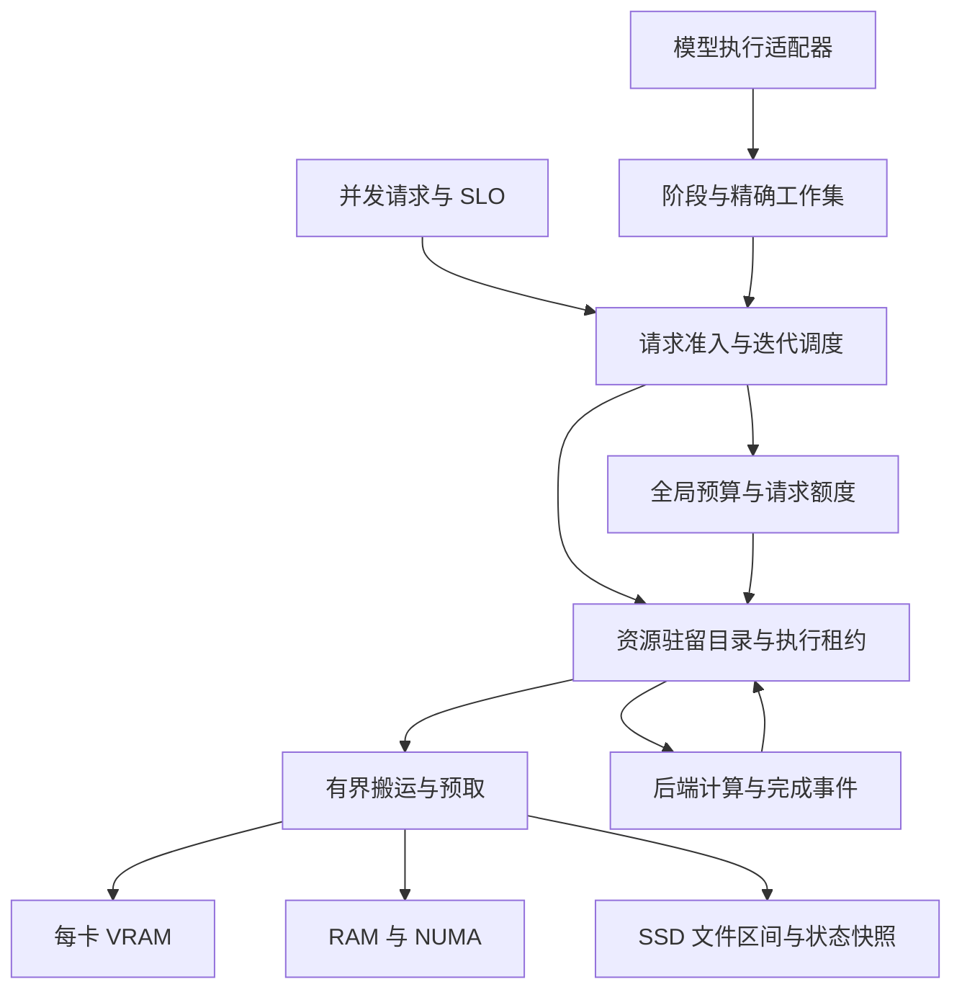

# TensorSharp 统一 VRAM / RAM / SSD 调度系统

源码基线：`f5b1eefb6cf378ed19c9a33178be84c818f7fc4b`；文件权重执行续作基于 `163474ba30814e5abcaba277c3a1f83d9f8ab604`。设计、实现与硬件续验：2026-10-10–11 UTC。

## 1. 交付状态与目标

目标是让模型的**可执行工作集**适配硬件，而不是要求整个模型同时驻留 VRAM 或 RAM。系统统一管理权重、专家、KV、循环状态、前缀缓存、LoRA、多模态中间结果与临时工作区，保留原有模型计算语义，并根据请求并发程度选择驻留、搬运、计算和排队方案。

本次已经构建可运行的调度基础库、RAM/文件搬运与状态回写、请求预算、GGUF 分片目录、CUDA 分配适配器，并将 Qwen4Exp 原有放置算法抽出后接回原路径。文件权重执行现已显式接入 dense Qwen 3.5 的 Q8_0 和 dense Gemma4 的 Q8_0/F16 PLE，两者均限定单 rank GGML CUDA、文本、无 MTP/draft。Qwen 0.8B 的完整 logits 与重复释放验收已通过；Gemma E4B 的短提示诊断、645-token 长提示 Forward/分块 ForwardRefill、后续 decode 和各两次加载均与原常驻路径逐位一致。Gemma 为保持原 CUDA 归约和融合语义，部分投影需要完整逻辑矩阵的临时设备工作区，不能沿用 Qwen 的极小配额结论。具体预算、上下文和硬件范围见第 6、14 节。**尚未完成全部模型的原生执行图、KV 和媒体流水线接入；不能把本次实现描述为“所有模型已自动支持三层调度”。** CLI、Server、TensorAgent 的公共引擎已可通过环境变量启用有预算的主机 KV 快照换页，但没有一个开关可以开启完整的全模型三层调度。

Server 现有一个默认关闭的 `--unified-memory` 专用入口：按架构选择 Qwen3.8 Flash Next / `qwen4exp` 或 GLM5Next 会话，限定单 GGML CUDA 设备和可选匹配图像 projector，接入共享分配预算与多请求准入。Qwen 已完成真实 N3→N2 decode 合批及取消恢复；GLM 完整模型质量与性能尚未通过，不能沿用 Qwen 资格。它不代表全模型三层调度已完成。可运行命令、开启/关闭项及硬限边界见[第 15 节](#15-后续实际接入与硬件验证入口)。

| 范围 | 本次状态 |
| --- | --- |
| 模型无关预算、驻留目录、租约、版本、LRU、固定搬运缓冲 | 已实现并测试 |
| 真正的 RAM 分配、文件按区间读取、可变状态 SSD 回写/恢复 | 已实现并测试；存储介质类型未作 NVMe 假设 |
| 请求完整峰值预留、FIFO 队列、取消、预留向实际分配转账 | 已接入 ContinuousBatchScheduler/InferenceEngine；由执行器显式提供成本，未自动启用全部旧模型 |
| GGUF / split GGUF 权重目录和不改量化格式的切片 | 已实现并测试；旧加载器未整体切换 |
| 文件权重实际执行 | dense Qwen35 Q8_0 和 dense Gemma4 Q8_0/F16 PLE 的单 rank GGML CUDA 文本适配器已接入；Qwen 0.8B 已验收，Gemma E4B 短/长提示 Forward 和分块 ForwardRefill 完整 logits 逐位一致；配额只覆盖登记的权重 payload |
| Qwen CUDA/UMA 静态放置算法通用化 | 已接入原模型路径；保持原调优参数 |
| 主机 KV 快照、前缀页、循环状态快照 | 显式启用时选择可恢复的逐序列路径，不再被融合路径绕过；Gemma 及 dense、无 MTP、单 rank GGML CUDA 的 Qwen 3.5 真实模型 RAM/文件换页已验证；不接管原生 holder/device arena |
| CUDA 原始分配/读写/释放、真实 event fence、可选 P2P | 默认有界主机中转。前一台 `63.141.33.49` 的中转和显式 P2P 探针通过；当前 `69.30.85.216` 的中转通过、显式 P2P 两个方向均损坏，独立 CUDA oracle 复现；不能跨部署推断直连可靠性 |
| GGML lazy device-copy/preload、选中专家 cache | 可通过 GgmlCacheBudgetScope 接入同一份托管 MemoryBudget，分配前预留、物理释放后归还；原有独立 cache 配额仍有效。Linux CUDA 大权重 cache miss 默认按页面驻留与 CPU 配额选择有界读取/上传流水线；不新增主机权重 payload 副本，实际覆盖见第 14 节 |
| Flash 选中专家的 Windows 文件读取/上传 | 已实现精确分片区间登记、有界并行读取、最多 32 MiB 共享搬运 arena、失败恢复和设备驻留释放后的重新登记；超过可用 RAM 且已有正值专家配额时自动选择。arena 可通过 hostPools 接同一 RAM 账本；槽内默认使用衰减频次淘汰，冷热性能和独立质量验收仍需分别看第 14 节 |
| 硬件/请求预算规划与驻留保留 | dense Gemma4/Qwen35 的 AdaptiveModelSession 显式入口；优先保留驻留图，按物理可用 RAM/VRAM、权重格式、融合、KV/状态和工作区选择；不是全模型自动策略 |
| 文件权重的跨 token RAM / GPU 复用 | RAM 保留原始字节区间；GPU 可保留完整权重及其输入/输出/scratch arena。动态入口按硬件余量、执行期峰值和用户上限设置额度，压力时先回收缓存；Qwen FullPrecision 覆盖 prefill/decode，Gemma ResidentCuda 当前只保留 N=1 decode |
| 文件执行临时 CUDA 工作区复用 | AdaptiveModelSession 默认自动启用；扣除其他 owner 与执行预留后，以最多四分之一余量作为工作区准入份额，权重缓存留出相应空间；请求 reset 回收未再使用的项。显式 0 关闭；底层手工 WeightStreamingOptions 仍保留零缓存默认值 |
| Qwen4Exp 单 token 图内复制及广播消除 | CUDA 默认保留已连续的选定只读输入，并以零步幅 view 广播；真实 IQ1_M 的 34 行完整 logits 逐位一致。最新新 VM 应用 decode 56.65 token/s，同期 llama 59.95，尚未对齐，详见第 14 节 |
| Qwen4Exp 图、循环状态与设备快照预算 | 已接入 includeGraphBuffers 共享账本，覆盖单请求和 batch arena；快照回滚、耗尽拒绝、增额重试和清理归零已有 CUDA 测试；仍不是总 VRAM 上限 |
| GGML/Metal/Vulkan/MLX 原生图、分页 KV、全部融合算子 | 全面适配仍待实现；本轮没有 Metal/Vulkan/MLX 硬件验收 |
| 多卡预算向量、带节点/设备标识的资源位置 | 已支持多位置工作集租约和全 rank fence；两张 A40 上实际内核、双向中转和释放验证通过 |
| 多机协调、远程内存、异步 DMA 重叠 | 设计阶段，未实现；文件提前读取已实现，不能等同异步 CUDA DMA |

“高速”必须相对于模型、量化、工作集、带宽和 SLO 定义。容量虚拟化能让更多模型运行，但无法让每个 token 都要读取几十 GB 冷权重的 dense 模型获得全驻留 GPU 的延迟。

## 2. 当前源码的实际集成边界

| 当前代码 | 已有机制 | 需要统一的边界 |
| --- | --- | --- |
| `TensorSharp.Models/Models/Qwen4Exp/Qwen4ExpModel.ExpertPlacement.cs` | CUDA/Metal 专家放置、专家缓存配额和布局下限 | 算法已迁出；GGML CUDA 选中专家缓存已接共享预算并支持压力缩槽/空闲回收；其他分配和后端仍需接入 |
| `TensorSharp.Models/GpuMemoryBudget.cs` | free VRAM、headroom、token 容量估算 | 统一观测、避免已驻留资源再次扣账 |
| `TensorSharp.Models/ModelBase.WeightLoading.cs`、`ModelBase.WeightPolicy.cs` | 公共权重读取和驻留决策 | 从目录注册资源，按执行边界获取租约 |
| `WeightStreamingOptions`、`WeightStreamingExecutor`、`GgmlWeightStreamingSession`、`GgmlResidentWeightSession` | 显式文件权重、固定主机 tile、下一 tile 文件预读、预算内 RAM 范围和 GPU 完整权重复用；按模型保留行分块或完整逻辑 M/N 算术 | Qwen35 Q8_0 和 Gemma4 Q8_0/F16 PLE 已接入；Gemma 的归约、Norm/RoPE/Residual 融合语义单独对齐，GPU 保留限 N=1；其他模型族和异步 CUDA DMA 未接入 |
| `TensorSharp.Runtime/GgufReader.cs` | GGUF、分片、mmap、tensor 类型与字节布局 | 新增文件区间接口；可避免预读整个数据区 |
| `TensorSharp.GGML.Native/ggml_ops_core.cpp` | device-copy、预载、host buffer、offload cache | 所有分配必须预留；缓存命中必须表示上传已完成 |
| `ggml_ops_host_moe_cache.cpp`、`ggml_ops_host_moe_decode.cpp` | 专家缓存与主机计算 | 热专家驻留、联合选中专家工作集、CPU/GPU 成本选择 |
| `TensorSharp.Runtime/Scheduling/ContinuousBatchScheduler.cs` | 连续批处理、prefill 分块、KV 容量准入、抢占 | 接入字节与 I/O 成本；仅 token 数和 KV 元数据不够 |
| `TensorSharp.Runtime/Scheduling/PrefixCache/` | radix、holder/page、跨请求恢复协议 | 可迁移数据位置，不改变“哪些状态足以恢复”的规则 |
| `TensorSharp.Runtime/Paged/`、各模型 KV/holder | 页面与模型专用状态 | 区分已读页、追加尾页、循环状态、可共享完整页 |
| `TensorSharp.Chat/DiffusionBatchScheduler.cs`、QwenImage、Wan | 非自回归任务、分阶段模型和临时张量 | 以 encoder/denoiser/VAE/帧块为阶段估算资源 |
| `TensorSharp.Distributed/`、GGML TP 实现 | collective、多卡执行路径 | 节点内预算与跨节点原子准入协议分别接入 |

原生执行图里缓存了原始地址。只增加一个“LRU + memcpy”会产生 use-after-free 或读到旧版本。必须在算子、图或原生 slot 的生命周期上持有租约。对于捕获图，采用固定地址的 slot arena，或在地址/布局版本改变时失效并重建图。模型名字不应进入驻留管理器。

本次原生改动全部位于 TensorSharp 自有 C++/CUDA 文件。upstream ggml 固定为 `ffa4e8b80930029a35991f94e7c8a93cd67730ab`，本地 checkout 保持原样，此前 VM 验收也使用未修改的同一 revision。VM 的 CUDA 12.8 / sm_86 缓存预算构建和本机 CUDA 12.6 / sm_86 文件权重构建分别记录，不能混为一次验收。对该 VM 使用 ggml 已有的 `GGML_CUDA_NO_PEER_COPY=ON`；TensorSharp 的 CMake 不再强制覆盖用户选项，没有修改 upstream 实现。

lazy device-copy cache 在分配前原子预留、成功发布后转为 committed，使用 ggml 报告的 buffer 字节数；显式 preload 单独记录 reserved/committed。`GgmlBasicOps.TryGetCacheMemoryUsage` 提供每 rank 诊断。可在首次缓存分配前安装 `GgmlCacheBudgetScope`，将这些缓存的完整所有权记入与 KV 快照共用的托管 `MemoryBudget`；物理释放后才归还额度，失败的 scope 卸载可在清理后重试。新增 `includeGraphBuffers: true` 可纳入已接线的普通算子和 Gemma/Qwen35 图 buffer、reuse gallocr，以及 Qwen4Exp 自有图 arena、循环状态和设备状态快照；默认构造保留旧 cache-only 合约。仍未覆盖所有 native executor、backend/driver pool 和总 RSS/VRAM。具体接入与关闭顺序见第 15 节。

首次 DeviceCopy 上传现在在发布前同步完成，随后图构建因 scratch 分配失败而退出，也不会留下未初始化的缓存命中。CPU/UMA host-pointer 路径不变；该正确性修复相对早期延迟上传的独立成本尚未隔离，不能将它本身宣传为提速。后续 Linux 冷页读取/上传优化保留这一发布边界，其同一二进制开关对照见第 14 节。设备回归覆盖 F32、Q8_0、opaque host key、放弃图构建后重试，以及跨 64 MiB 窗口和部分尾块；没有 Metal/Vulkan 运行验证。

## 3. 系统分层



控制面管理所有权、预算、版本、准入、放置和观测。数据面执行原有正确的算子、数据搬运和设备事件。调度器知道“字节数、合法执行位置、下次使用、代价、状态依赖”，不需要知道这是 Gemma、Qwen、图像还是音频。

新模型应主要增加**布局与执行计划适配**：声明只读资源、动态状态、每阶段工作集和安全完成边界。新算子可能需要新的分块内核；抽象接口无法凭空让一个必须连续持有巨大张量的旧内核变成可流式执行。

## 4. 资源和所有权协议

实际类型在 `TensorSharp.Memory/`：

| 类型 | 职责 |
| --- | --- |
| `ResourceKey(Owner, Epoch, Name)` | 区分模型修订、请求/租户、reload 和资源，避免地址复用污染缓存 |
| `MemoryResource` | 字节长度、用途、可变性、布局指纹；核心不解释布局字符串 |
| `IResourceSource` | 精确区间读取；权重可直接引用原文件，无需复制到 SSD 缓存 |
| `IMemoryBackend` | 预先声明实际分配的所有预算约束，再分配设备内存 |
| `ResourceLease` | 固定地址和版本；并发读共享，写独占；GPU 使用直到事件完成 |
| `BudgetReservation` | 保留、提交、转账、返还额度，覆盖短时双副本 |
| `MemoryLocation` | 节点、设备/NUMA、主机或加速器位置 |

权重和已完成的只读前缀允许多副本。KV 尾页、循环状态、扩散 latent 等可变资源有一个当前逻辑版本。取得写租约前等待读者结束，清除旧副本/快照，再增加版本。完成并验证一次搬运后才把目标登记成可命中副本。

执行中的资源、源副本和未完成写入不能被淘汰。每个资源的状态转换单独串行化，不在全局锁内等待 SSD 或 GPU。相同资源并发加载合并为一次；不同资源允许并行搬运。

多资源算子必须一次取得完整合法工作集。当前 `AcquireReadSetAsync` 在压力或冲突时释放部分租约，由上层重试整个集合；不会拿着半个工作集等待另一半容量。多资源写事务、COW 前缀页和 graph arena 的复合租约是原生适配阶段的必要工作。

资源来源保持不可变，源句柄必须活到注销之后。模型 hash、LoRA 组合、KV dtype、RoPE 参数、位置/模态布局、TP 分片规格等都应进入各适配器的缓存身份或布局验证，不能只用 prompt 文本作为键。

## 5. 一个预算系统，多个物理约束

对每个 pool 始终保持：

$$\text{reserved}_p + \text{committed}_p \leq \text{capacity}_p.$$

pool 是容量约束，不只是 VRAM/RAM/SSD 三个计数。例子包括 `node0/gpu0`、`node0/numa0/ram`、`node0/pinned`、`node0/ssd` 和 `node0/metal-working-set`。

Apple UMA 上一块共享内存同时约束物理 RAM 与 GPU working set；这是同一分配的两个上限，不是两份物理数据。独显权重存在 host mirror 与 device copy 时则确实是两份分配，需要分别记账。

预算必须包括权重、专家 cache、KV/前缀、draft/MTP、encoder、LoRA、activation、scratch、graph arena、通信区、对齐和复制过程中的新旧双份。固定 staging buffer 要先预留，保证压力下仍有办法搬出一页，而不是把最后一点 RAM 给缓存后无法回写。

当前 `MemoryBudget` 支持多 pool 原子预留、提交、释放、缩减容量时拒绝破坏已有额度。请求 envelope 的字节在分配时转成 committed；不重复记一遍请求额度和实际 buffer。释放 buffer 时返还活跃请求；请求先结束时，仅释放剩余额度，其仍被缓存保留的 buffer 继续计入全局 committed。

capacity 要扣掉 OS、其他进程、驱动、.NET 元数据、原生 allocator 等 headroom。已有分配不能同时算作 free-memory 观测中的减少和新的完整扣款。接入旧 cache 前应做一次基线归属清查，并持续比较“调度账本”和“设备/进程实际内存”的差值。

当前实现约束的是已登记的 payload 和对齐额度，**不是进程 RSS 的硬上限**。buffered I/O 的 page cache、libc 保留的 heap 页面、旧 GGML/MLX 缓存没有凭空纳入控制。生产阶段还需 Linux cgroup/pressure、Windows memory pressure、macOS working set 等观测；硬约束部署要配合系统级限制并保留缓冲余量。

## 6. VRAM 和 RAM 都不足时的加载

加载顺序应为：解析头部/张量目录 → 校验文件范围与布局 → 计算最小前进工作集 → 预留 staging 和必要状态 → 按阶段获取权重块 → 执行并释放。禁止为了“模型加载完成”先把所有张量读入托管数组、完整解量化或锁定全部 mmap 页面。

`GgufMemoryCatalog` 已实现单文件/分片目录和共享 shard 句柄，按真实文件 offset 读取原始量化字节；它不猜测专家布局。`GetSlice` 可以描述某专家、某些行或一个 tile，但其边界合法性必须由算子适配器保证。非 GGUF 数据可直接实现 `IResourceSource`。

实际权重执行入口是 `ModelBase.Create(..., weightStreaming: options)` 和 Qwen35/Gemma4 对应构造参数。`WeightStreamingOptions` 借用公共 `MemoryBudget`，声明一个 host pool、一个或多个约束同一 CUDA allocation 的 device pool、文件 tile 大小和 token 分块上限。能力检查限定为 dense、单 rank GGML CUDA、文本、无 MTP/外部 draft：Qwen35 接受 Q8_0 二维投影与 embedding；Gemma4 接受 Q8_0 矩阵，以及明确列入文件权重的 F16 `per_layer_model_proj.weight`。Gemma 的 F16 PLE 为兼容原 CUDA 算法，还要求输入宽度按 64、输出行数按 32 对齐；不能从通用 F16 文件区间支持推断任意模型布局可执行。MoE、多卡、layer split、媒体、推测解码和可绕过状态保护的批处理入口均明确拒绝。少量具名 F32 norm/循环参数保持常驻，限制为每 tensor 至多 1 MiB、合计至多 32 MiB，并单独报告字节数；它们不属于权重 staging 配额。

`WeightStreamingExecutor` 持有模型生命周期的 catalog 和一个固定主机读取 tile；共享容量允许时申请第二个 tile 并提前读取下一块。加载不创建全量 host 权重副本、不 prefault/mmap 数据区，也不把临时 tile 指针注册进旧原生 cache。运行时可在预算内逐区间保留已读原始字节；容量足够时可能逐渐缓存全部访问区间，不能将“加载不预读”误写为“始终不保留 RAM 权重”。Q8_0 每输出行是 `K / 32 * 34` 字节，`K` 必须按 32 元素 block 对齐；F16 原始行是 `K * 2` 字节。文件读取必须填满请求区间，不能把短读当成有效权重。embedding 和 Gemma PLE embedding 只读实际 token 对应行。Gemma 的单位 scale Q/K/V、同 scale 的 gate/up 使用 `ConcatenatedWeightSource` 形成虚拟行拼接，保持常驻参考的逻辑输出宽度；不复制源 tensor、不重复统计原文件字节，缺 V 时借用 K，共享 KV 层只投影自身 Q。非单位 QKV scale 明确拒绝，gate/up 的 scale 不同时保留 split。

计算策略按模型区分。Qwen35 继续使用 TensorSharp 自有 Q8×F32 行分块内核，保留 F32 激活和完整归约维度。Gemma 的 `ResidentCuda` 模式保留原 GGML CUDA 运算选择：Q8 在逻辑 token 数 `N <= 8` 时采用兼容 MMVQ 的行分块，F16 在 `N <= 16` 时采用对应的小批量行分块；Q8 `N > 8`、F16 `N > 16` 则通过 `GgmlResidentWeightSession` 分段上传完整逻辑权重矩阵和输入，只按原始 M/N 投影一次，再分块下载。token/row tile 仍限制 host staging，但不能缩小这部分完整设备工作区。F16 完整矩阵当前有 session 权重与 cuBLAS scratch 权重两份临时设备副本，连同 half input/output、对齐和显式 cuBLAS workspace 全部计账；handle、驱动和库内部元数据需要额外 headroom。Gemma E4B 已通过的短/长提示 Forward 分别使用 128/256 MiB device 配额，不声称 32 MiB 可以运行相同参考数学。

CUDA MMQ/cuBLAS 的归约策略会随逻辑矩阵形状变化，微小误差又可能在后续 Q8_1 激活量化时放大。因此 Gemma 除了保留完整投影形状，还用仅持有激活和小参数的 `StreamingNormRoPE`、`StreamingNormResidual` 图保留原路径的 norm/mul/rope 与 norm/mul/add 融合边界，并使用显式 flash attention 与相同 KV dtype。常驻整模型权重图和 batched holder 仍关闭；这里保留的是实际计算语义，不是缓存整个文件权重模型。默认 fusion policy 的模型对比已单独记录；`TS_WEIGHT_FUSION_COPIES=0` 可能使常驻 FFN 采用 split 投影，该非默认参考尚未由当前结果覆盖。

主机输出 tile 与 CUDA 工作区分别在分配前预留、物理释放后归还。若 host pool 也约束 CUDA allocation，规划会同时扣除独立的主机输出 staging 和设备工作区，避免漏记两份分配。允许分块的工作区按剩余额度缩小输出行数，再缩小 token 数；完整矩阵路径的 device payload 是固定下限，不会靠缩小 host tile 假装满足更低配额。规划后被其他 owner 抢占的额度仍由实际预留裁决，失败立即返回 pressure 并回收临时 staging，不持有半个工作集等待。调用同步完成后才复用 tile；CUDA 创建与清理同时失败时保留 session 和额度。`ResetKVCache` 必须先成功重试释放保留的 session，再重置模型状态并解除失败保护；Dispose 也允许重试。文件读取可与当前 tile 的计算重叠；跨 token 的 RAM 原始字节复用现已接入。H2D、计算和 D2H 仍按 session 同步执行。可选 GPU cache 保留完整权重及其已计费 arena，命中时只替换输入和下载输出；没有异步 DMA 或自动跨模型驱逐。

`HostCacheBytes` 控制可选 RAM 缓存，旧显式构造默认关闭。缓存以本次模型加载的 source 引用、offset 和长度为键，仅发布完整读取成功的不可变原始字节；命中先复制到固定 staging，再交给设备。64-byte 对齐 payload 分配前预留，物理释放后退款，缓存不持有捕获图地址。最多 4096 个条目；索引元数据由运行时 headroom 承担，不计作已精确约束的 RSS。满缓存不因每个扫描 miss 淘汰已有范围，避免大于 RAM 的顺序扫描导致完全抖动；压力回收采用 LRU。此策略没有成本反馈，区间形状变化也可能产生重复副本，不能称为最优替换算法。

`AdaptiveModelSession` 仅在选择文件权重路径时自动设置缓存上限：取源权重字节、用户上限和硬件预算减去 prefill/decode 峰值后的最小值。缓存只在加载结束后的读取中填充，因此不长期扣留加载临时峰值。准入仍为执行期预测保留余量，扣除已经计账的必需读取 tile，额外预读 tile 继续竞争剩余容量。请求边界刷新容量时，若现有 owner 与下次工作区余量不再同时容纳，先 `TrimIdleMemory` 回收缓存、重读物理可用量，再更新预算；不撤销活跃 KV 或其他 owner。未接管的状态仍依赖保守预测，不能等同全进程硬上限。

这条路径新增了实际文件权重计算，**尚不是整个 forward 的原子内存事务**。中途 pressure/I/O 错误可能发生在前面若干层已更新状态之后；流式 `Forward`/`ForwardRefill` 失败会阻止直接重试，必须成功 `ResetKVCache` 并重放请求，或释放模型。固定 host tile、输出 staging 和设备工作区的预算不包含现有激活、live KV、图/后端池、运行时和 OS page cache。真实模型的完整 logits 对比、实际 RSS/VRAM 观测及可用硬件范围须由第 14 节分别给出；不能从较小的 payload 配额推断“物理 RAM 不够也已完成整模型验收”。

最小可执行单元仍有下限：

$$M_{\min}=M_{\text{required state}}+M_{\text{activations}}+M_{\text{scratch}}+M_{\text{one legal tile}}+M_{\text{transfer reserve}}.$$

当某个现有内核的这个工作集也放不下时，需要更细粒度且正确的分块内核，或者 CPU 路径。如果全部合法路径都无法前进，应在加载/准入阶段给出需要的最小容量，而不是启动之后反复 OOM。

SSD 存放两类内容：只读模型权重直接引用原文件；变化的运行状态写入独立配额的临时快照。当前可变状态快照采用有界缓冲、完成所有写入并关闭句柄后原子改名和 SHA-256 校验，失败/取消不发布目标。临时换页不逐页强制持久化到物理介质。原文件不被修改。文件名不含 prompt 或请求内容。进程崩溃后的自动清理和持久恢复尚未实现，不能把临时 swap 文件当成可恢复会话数据库。

## 7. 按计算行为选择策略

### Dense 与共享权重

执行顺序通常可预测：按层/矩阵 tile 顺序读取，保持小而高频的常量驻留，提前准备下一单元，重复使用 staging。吞吐模式把多个请求对同一组权重的计算合并，摊薄 SSD/H2D 读取；交互模式限制 microbatch 和 prefill 工作量以保护 decode 延迟。

核心不应强制整层作为唯一迁移粒度。Embedding/LM head 的行访问、矩阵的行列分块、张量并行分片，都可以是独立资源。但分块 matmul 的归约顺序可能改变浮点舍入；需要与原路径比较 logits 和输出，而不能仅凭字节搬运正确就宣布模型等价。

### MoE

路由器仍执行原有 top-k。针对一个 microbatch，合并所有 token 实际选择的专家集合，gate/up/down 和格式元数据作为合法执行组获取。热专家保留在 VRAM，次热专家在 RAM，冷专家引用 SSD。预测只用于预取；预测错了必须加载真正被选择的专家，不能减少专家数或用近似专家替代。

选择 CPU 专家计算或搬到 GPU，比较的是测量得到的总时间：CPU 计算 + activation 传输，对比排队 + SSD/RAM 读取 + H2D + GPU 计算。一次只活跃很少专家的 decode 和覆盖大量专家的 prefill 可能需要不同策略。

并发增加时，活跃专家的并集会扩大。不能拿单请求的 expert-cache 命中率推算并发 16 的 VRAM。首版统一预算已能表达各类资源竞争；具体专家文件 coalescing、带宽成本模型和跨请求专家分组仍需在原生 MoE 执行适配中落地。

### KV、滑动窗口与循环状态

可复用的**冷前缀**与每个 decode 都访问的**活跃历史 KV**应区分。把前缀放到 SSD 可以节省再次 prefill；把活跃 KV 放到 SSD 则可能每个 token 都付出读取代价，收益条件不同。

普通 attention 的原始 K/V 以页保存；滑动窗口只丢弃模型语义已经允许不再访问的区域。GDN/SSM/Mamba 等保存的是循环状态及必要 checkpoint，不能按普通 KV 的 token 公式强行分页。共享 KV、压缩/索引 attention、MLA 和模型自己的 retention 策略保留专用布局与恢复规则。

超大活跃 KV 可用完整覆盖历史块的 online softmax attention。对于两个已计算块，令最大 logit 为 $m_a,m_b$、归一化和为 $l_a,l_b$、未归一化输出为 $z_a,z_b$：

$$m=\max(m_a,m_b),\quad l=e^{m_a-m}l_a+e^{m_b-m}l_b,$$
$$z=e^{m_a-m}z_a+e^{m_b-m}z_b,\qquad o=z/l.$$

这能分块覆盖所有原始 KV，不必用裁剪上下文换容量，但仍需与原内核验证精度、掩码、位置和吞吐。**本次尚未新增该 attention 内核。** Prefix cache 的分页/holder 协议只迁移位置，不擅自改变原有可恢复性判定。

### Diffusion、多模态、LoRA 与 draft

图像/视频的 text encoder、vision encoder、denoiser、VAE 常在不同阶段活跃。阶段切换允许卸载不再使用的组件；denoiser 的重复步骤有利于保留同一工作集。大分辨率 latent/attention 和 VAE 仍需要正确的空间/时间分块，不能假设仅搬运权重就解决所有峰值。

音频按采样长度/特征帧数，图像按 patch 数，视频按帧数和时空 token 数估算资源；按文本 token 预算会漏掉 encoder 峰值。LoRA、DoRA、draft、MTP 作为独立依赖登记，包含正确 identity、临时 merged/dequantized buffer 和验证阶段 KV。不得自动降低图像尺寸、帧数、音频长度、步数、draft 验证强度或改变 mask。

## 8. 并发请求调度

推荐的运行时流程是：

1. 模型适配器估算 prompt、最大输出、模态编码、循环状态和最坏算子 scratch，声明哪些资源可共享。
2. 请求进入有界队列，不能单独满足的请求立即给出容量原因；可满足但暂时不足的请求排队。
3. 每次迭代挑选 decode 和 prefill chunk，形成实际资源并集，并在所有相关 pool 上预留。
4. 获取完整租约集合、等待数据和依赖事件；完成之后执行；事件结束后释放临时租约。
5. KV/状态按请求生命周期持有；prefix cache 接收状态时保留其预算所有权，再关闭请求额度。

已实现的队列是严格 FIFO，具有明确的队头阻塞取舍。它没有自称为 EDF、WFQ 或动态批处理优化器。后续与 `ContinuousBatchScheduler` 集成时，保留现有公平性/防抖动机制，加入有限 bypass、aging、prefill token/byte 双预算，以及 IO stall 信号。请求的公平单位不能只看 token 数，还要考虑它占用的 SSD 时间和 GPU 工作集。

压力优先级建议为：取消低收益预取 → 清理无租约冷副本 → 回收冷前缀 → 缩小 prefill/microbatch → 排队新请求 → 在合法 checkpoint 暂停请求。避免多个长请求反复互相抢占、重新 prefill。用户显式指定的最大输出不应被悄悄改小。

同一权重在不同请求之间共享一个资源和加载过程；请求私有状态按 owner 隔离。逐层跨请求复用通常改善吞吐，但会增加请求等待权衡，需由目标 TTFT/TPOT/SLO 决定批次，而不是只优化总 tokens/s。

## 9. 多卡与多机

单机多卡采用每卡 pool、NUMA host pool 和设备拓扑。静态规划与实测传输成本应区别 PCIe、NVLink、P2P、经主机中转，以及共享 SSD 带宽。TP/PP/EP/DP 的分片与副本位置属于执行计划，不能把“有多个 MemoryLocation”当成已支持任意并行模式。

一个 TP step 需要同时取得所有 rank 的额度和 collective 工作区；不能 rank 0 持有预算后永久等 rank 1。单进程内多 pool 原子预留已能表达这个约束。图捕获地址、通信 buffer 和跨设备事件仍须后端适配。

多机以节点为预算权威：协调器发送带 epoch/有效期的 prepare；所有节点接受后 commit；任一失败则撤销整组。节点失联时禁止向失效地址发 DMA，未提交的预留超时回收，已提交的执行按可验证 checkpoint 恢复。远端 KV/专家缓存必须有模型版本、布局与分片标识；鉴权和配额按租户处理。远端缓存不是本地 SSD 的等价延迟层。

**以上跨节点协议尚未实现。** `MemoryLocation.Node` 只是为后续扩展预留身份空间，不提供分布式一致性。

## 10. 当前所有模型族的接入清单

以下来自基线 `BuiltInArchitectures.cs` 及其模型目录，不依据宣传名称推断已经兼容。所有条目的通用登记/搬运数据结构可复用；Qwen 放置策略、公共主机 KV 快照路径，以及下表限定的 Qwen35/Gemma4 文件权重执行入口已经接入。其余原生执行、holder/arena、媒体资源适配仍须逐项完成，不能用公共路径或微算子测试代替每个模型的验收。

| 注册族/目录 | 必须申报和适配的资源 | 关键验收 |
| --- | --- | --- |
| Qwen35 | dense、单 rank GGML CUDA、Q8_0、无 MTP/draft 的文本文件权重执行通过真实 0.8B 完整 logits parity；该单 rank CUDA 路径已有主机 GDN/KV 快照 | MoE、其他量化/backend、TP 流式权重、推测解码（含 N-gram）、MTP、vision 及 native KV/holder 全预算仍未接入 |
| Qwen4Exp | 专家、QSA/索引 KV、PLE、MTP、host seam | 全部选中专家、compact cache、量化布局、多请求并集 |
| Gemma4 | dense、单 rank GGML CUDA 的 Q8_0/F16 PLE 文本文件权重已接入；E4B Forward/分块 ForwardRefill、decode、重复加载完整 logits 逐位一致；原主机 KV 快照已有验收 | MoE、其他量化/backend、多卡、媒体、推测解码和 native holder/arena 全预算未接入 |
| GptOss | MoE、窗口/全局 attention KV、量化专家 | 分页与跨请求状态、完整路由 |
| Nemotron | 混合循环/attention、已有模态组件 | scan/conv 状态与 checkpoint 一致 |
| Mistral3 | dense 权重、KV、vision projector | 图像 token/位置、prefill/decode 一致 |
| HunyuanDense | dense 权重、KV、scratch | Dense 流式分块与原实现 logits |
| MuseGlimmer | 语言权重、vision、KV、DFlash | draft/target 的资源隔离与验证回滚 |
| DeepSeek4 | MoE、压缩/索引 attention、原生 slots、draft | 原生 slot 所有权和压缩状态一起恢复 |
| DeepSeek41 | 上述加 Engram/辅助 lookup/vision 等实际启用组件 | lookup 精确区间、异步 gather、slot/TP 不漏账 |
| GlmDsa | MoE、DSA 索引与相关状态 | 索引与值版本一致、精确路由 |
| MiniMaxH3 | 混合计算、专家/循环状态、既有 slot 机制 | 保留模型自己的状态语义 |
| DiffusionGemma | block/canvas、迭代状态、缓存、多模态输入 | 接受规则与恢复点，不能当成普通逐 token AR |
| QwenImage（含 2.1） | text/vision encoder、DiT、VAE、LoRA/DoRA、latent | 阶段峰值、空间分块、mask、adapter identity |
| WanVideo | encoder、DiT、VAE、帧/时空块、latent | 时序依赖、帧块拼接、视频质量和峰值 |

与新模型接入相关的契约应放在架构描述器旁：资源目录工厂、逐阶段工作集估算、原生绑定/重绑定、安全事件和状态导入导出。能力必须按**模型 × backend × dtype/layout × 执行模式**描述。只实现接口、只运行一个小 checkpoint、或保留旧常驻 fallback 都不能标记为完整三层支持。

## 11. 性能控制和带宽上限

以有效读取带宽 $B_{ssd}$、主机到设备带宽 $B_{h2d}$、冷数据字节 $D$ 估算，一个 step 至少受到相应链路时间约束：

$$T_{step}\geq\max(T_{compute},D_{ssd}/B_{ssd},D_{h2d}/B_{h2d}).$$

这是充分重叠时的下界，不是实现时延预测。不能重叠时各阶段还要相加，并计入随机读取、页故障、队列和同步。假设每 step 必须读取 8 GB 冷数据、有效 SSD 带宽 4 GB/s，单读取就至少 2 秒；单请求上限最多约 0.5 token/s，尚未计入计算。若 8 个请求在该 step 共享这批权重，聚合吞吐可能改善，但单请求 step 延迟并没有自动变成八分之一。

首版已实现驻留 LRU、有界搬运、同资源加载合并和不驱逐需求数据的预取。淘汰扫描只遍历**当前驻留项**，不扫描整个 SSD 模型目录。成本感知策略、页缓存建议、IO coalescing、后台回写、水位滞回、预取准确率反馈、按链路限流及 DMA/计算重叠尚待实现。

后续策略可使用“未来命中概率 × 省下的加载/计算时间 ÷ 常驻字节”衡量缓存价值；权重、KV、专家竞争同一个资源预算，但不能混淆它们的恢复成本。保留最低 decode 前进工作集，防止预取与前缀挤占所有额度。

## 12. 正确性规则和故障行为

- 默认仅迁移原有字节，不重新量化、不减少专家、不删有效上下文、不降分辨率。
- 活跃 lease/fence 未完成时不可释放地址。失败 fence 保留租约等待恢复；设备释放失败隔离该资源并保留预算。
- 目标 allocation、双副本、搬运 buffer、SSD 新快照都先预留；I/O 失败不会被当成有效缓存命中。
- 异步取消必须等待 DMA/I/O 不再引用 buffer 才释放。不能用“请求已取消”代替设备完成事件。
- 写租约更新版本、丢弃旧副本；临时 SSD 恢复校验失败返回错误，不读取未初始化数据继续生成。
- 所有资源对齐、元素类型、stride、shape、量化 block 信息由适配器验证；当前 `Layout` 是身份元数据，内核本身不解释它。
- 共享前缀只共享不可变完成页；修改尾页需要 COW 或独占副本。COW 集成尚待完成。
- 新旧后台 cache 不可同时声称拥有同一份免费额度。旧 buffer pool 若缓存物理分配，应在池真正释放之前保留额度。

无损搬运不意味着跨 CUDA/CPU/Metal 计算逐位相同；后端内核和累加顺序本来就可能不同。验收需要区分同路径 exact byte round trip、同 dtype 的数值容差、argmax/token 稳定性，以及任务质量。

## 13. 实施顺序与上线门槛

| 阶段 | 具体工作 | 完成条件 |
| --- | --- | --- |
| 本次基础库 | 预算、lease、文件、spill、queue、GGUF seam、Qwen policy 抽取 | 已有可复现 CPU/文件测试与放置回归 |
| 原生预算接管 | GGML device-copy/preload/expert cache、CUDA pool、MLX/Metal 所有分配归属 | 账本与设备实测差额可解释；加载/图重建峰值不越界 |
| 权重执行适配 | 固定 slot 或按阶段重绑，通用 dense/专家分块、真实 CUDA 事件 | 正确完成“权重 > RAM > 可用 VRAM”的真实模型测试 |
| 动态状态适配 | paged KV、holder、循环状态、draft、prefix 所有权转移 | 多轮/取消/并发/恢复不丢状态；冷/热 KV 语义清楚 |
| 媒体与所有族 | 按上表补齐 adapter、encoder/DiT/VAE 分块 | 每族每后端明确支持矩阵，缺失项不能默认为支持 |
| 高性能路径 | pinned DMA、预取/计算重叠、CPU/GPU 策略、带宽反馈 | 真实设备下满足设定 TTFT/TPOT/吞吐指标 |
| 多卡/多机 | rank 预算、通信区、P2P、节点租约和恢复 | 原子准入与故障测试，不以单卡成功替代 |

在完整适配前应保留显式能力检查；不足时报告哪个执行单元还不能迁移。先收集 shadow accounting，再逐族开启，禁止用无效开关宣称全模型支持。

2026-10-09 UTC 对照用户提供的初始设计复核：基础库、共享原生缓存预算、请求接入、文件执行和 RAM 原始字节复用已进入实现阶段，不能再统一列作“接口设计”。但初始目标的以下验收仍然缺失，不能因局部实现通过而删除：

- 默认 Qwen 解码仍落后独立基线；并行归约实验在较大模型出现数值门槛失败。后续必须同时改善正确性与吞吐，不能直接将实验设为默认。
- 文件权重已支持预算内跨 token GPU 保留，但仍无异步 DMA；Gemma 非单 token 投影继续使用原完整形状或行分块算术。当前准入为按访问顺序填充、扫描不替换热项、压力时 LRU 回收，尚未按实测收益全局选择缓存或优化流水线深度。需继续分别测量工作区、PCIe、计算和物理 SSD I/O。
- Gemma 12B UD-IQ2_M 的 FF7 重复/事实错误尚未解决；同源量化控制、独立数学对照和长输出质量检查仍需继续。其他低比特模型也不能套用 Q8 的验收。
- Flash Next 与 Qwen Image 的已有短任务/单图结果不覆盖统一文件调度、多模态多轮、编辑、并发或完整质量指标。新增适配需逐阶段验证 encoder、专家、DiT/VAE 及状态恢复。
- 全部原生 holder/KV、后端池、跨模型竞争和多卡故障恢复尚未统一；已计账 payload 不等于总 RAM/VRAM。远端不可用的本轮测试不计通过，旧 A40 结果保留其原范围。

CLI、HTTP API、Web Chat、TensorAgent 最终应共享一套 engine 配置。产品层只需展示预算、等待原因、实际运行位置、当前模式和预计性能；原生布局/指针等实现细节留在诊断页。该产品配置接入尚未在本次实现。

## 14. 验证与本次证据

本轮 VM 环境为 Ubuntu 24.04 x64、.NET SDK 10.0.401、CUDA 12.8.93、驱动 570.211.01，两张 NVIDIA A40（各 46,068 MiB）。`/workspace` 是网络文件系统，本轮文件换页不代表本地 NVMe 性能。使用未修改的上述 ggml revision 完成 CUDA 原生构建。

独立 Linux harness **46/46 通过**，覆盖原子预算/UMA、并发额度、请求 envelope、队列取消、真实文件大工作集、single-flight、写独占/版本、SSD 无损回写、损坏校验、SSD 配额耗尽、I/O/分配失败和取消回滚、完成事件、部分工作集回滚、预取、主机降级、生命周期、并发状态更新、split GGUF、原策略回归和流式矩阵计算。本轮增加分配与清理同时失败时的隔离、降级清理失败、预算缩减后的队列拒绝、真实 engine 的路径选择、完整页写放大、释放重试，以及多个 owner 共享 RAM/SSD 预算与部分构造回滚。释放中途失败时 worker 停止继续生成，完成所有等待 handle，保留未释放页面和额度；多请求 Dispose 中已经完成的释放不会因下一个请求失败而丢失。Windows 的同一 harness 为 **45/46**：文件共享语义不允许注入的损坏场景不可用，不能计为通过。

真实文件工作集测试：1 MiB 权重文件，在 12 KiB 的受管 payload/staging 预算下循环读取。流式计算测试：512 KiB F32 矩阵，在 20 KiB 的受管 payload/staging 预算下分块，8 个请求共享一次权重读取，4,096 个结果与同运算顺序的参考计算逐位一致。输入/输出、.NET 运行时和 OS page cache 不属于这个 payload 预算；这些不是低 RAM 完整 LLM 的 benchmark。

公共引擎测试用依赖完整历史状态的确定性模型逐 token 比较换页前后并发输出，并验证循环状态 checkpoint、外部预算释放唤醒、前缀回收和取消。原有调度、Qwen 放置与专家计划回归，加上执行计划、有预算快照、prefix 回收与并发对话回归，在 Linux 上 **140/140 通过，0 skipped**，与 harness 分开运行。此前三个 NuGet 包已本地打包；本轮没有发布包。

真实 CUDA residency：GPU 0、GPU 1 各 **5/5**，双 GPU 主机中转 **11/11**，包括两方向全量数据、事件、SSD 恢复和请求物理释放。直接 P2P 的两个方向均失败；独立 CUDA Runtime 控制程序的同步/异步、两个方向共 **4/4 失败**。这是部署上的传输问题证据，不推断具体驱动/平台原因，也不算 P2P 通过。

最终原生缓存 CTest **4/4 通过，0 skipped**：并发预留/回滚、共享预算安装/卸载与生命周期、CUDA 单卡和双卡实际缓存预算与 F32/Q8_0 计算、显式 preload 独立计账、释放归零。放弃图构建用例先将新 allocation 填入测试值，再要求其后缓存命中与强制流式参考逐元素一致。Q8_0 用可精确量化的激活输入，避免把 CUDA Q8_1 的输入舍入误判为缓存损坏；没有放宽比较容差。

真实托管/原生共享预算探针在 **1/2 张 A40** 上均通过，分别完成 **10/14 次**逐元素精确 F32 matvec，以及各 **6 个**分配失败回滚场景。验证外部 owner 占用额度、公共与每 rank 配额、lazy cache 拒绝后的计算回退、preload 拒绝、GC 后回调存活、带未释放缓存时 Dispose 拒绝与清理后重试、原生计数与托管账本一致。每次矩阵 allocation 为 **65,536 字节**。公共 pool 是两卡共享的配额，不是另一份物理 RAM 副本；这不是 UMA 硬件或模型全内存上限的验证。见 [GgmlBudgetProbe](../../eng/validation/UnifiedMemory.GgmlBudgetProbe/README.md)。

真实 Gemma 4 E2B IT Q4_K_M：此前完整聊天模板下并发 **1/2/4/8/16**、每请求 8 个生成 token，原有快照和受限 RAM/文件换页路径输出、结束原因一致；并发大于 1 必须实际发生 spill/load。另比较两个真实历史恢复后 **4,194,304** 个 logits，最大误差 **0**、argmax 无差异。仅验证文本和模型可恢复窗口内的状态。checkpoint hash、复现方式见 [ModelProbe](../../eng/validation/UnifiedMemory.ModelProbe/README.md)。最初未使用完整聊天模板的高并发用例发生早停，已保留为失败证据，不能与纠正后的固定输出用例混算。

Gemma 较长用例实际为两个 **271 token** 完整 prompt，每请求生成 **16 token**；输出一致，换页恢复后 **8,388,608** 个 logits 最大误差仍为 **0**。engine 的 snapshot RAM 配额为 **655,360 字节**，含一个 294,912 字节驻留页及 capture/transfer scratch；权重、设备上的活跃 KV 和 OS page cache 在该配额之外。该上下文仍在模型的 512-token 可恢复窗口内。

Qwen 3.5 0.8B Q8_0 的 dense、无 MTP、单 rank GGML CUDA 路径现已启用安全快照，包含完整 GDN conv/ring/delta state 与 attention KV。新增负数/溢出范围和逐层布局的事务性检查；中途恢复失败时只从真实 recurrent checkpoint 继续。最终计算库下并发 **1/2/4/8/16** 输出与 **16 个独立请求参考**完全一致，tiered 路径分别发生 **0/24/48/96/192 次 spill**；两个历史交替恢复三轮，**6 份快照字节完全一致**，共 **11,919,360** 个 logits 误差为 **0**。较长用例是两个 **258 token** prompt、每请求 **16 token**，发生 **64 次 spill**，**23,838,720** 个恢复后 logits 误差为 **0**。快照页为 **20,398,156 字节**，RAM 配额 **40,861,952 字节**，仍不包含权重/live device KV/OS page cache。MoE、MTP、多卡快照及其他 backend 未开放；这些不属于本次通过范围。

同一计算库在物理 GPU 1 上补跑 Gemma 并发 **2**，与独立请求参考相等，发生 **25 次 spill**；**6 次**快照恢复字节完全一致，**12,582,912** 个 logits 误差为 **0**。Qwen 和 Gemma 的短暂异卡重叠只用于正确性验收，时延没有作为受控 benchmark。GDN 每页重复完整状态导致大额 I/O，严格一页 RAM 配额下的换页显著慢于原有路径。

真实 Qwen 3.5 0.8B Q8_0 的 TP1/TP2 比较执行了 5 个用例 × 24 行、共 **29,798,400** 个 logits。日志、每 rank 缓存计数与设备观测确认两个 rank 实际参与。最终两进程均以 0 退出，全部有限且 **120/120 argmax 相同**；最大 relative L2 为 **0.0005205466**（限 0.001），最小 cosine 为 **0.9999998736**（限 0.999999），最大绝对误差 **0.006324291**。严格门槛未改变。初始版本的 relative L2 **0.04140844**、cosine **0.99914715** 和 max-abs **0.6113646** 属于失败记录，不能混入通过结果。

定位时同一 TP1 路径在物理 GPU 0/1 上的全部 logits 逐位相等；关闭 TP 并行/CUDA graph 等控制未消除旧差异。实际首 token 张量比较将首次显著偏差定位到第 7 层 QKV 投影：约 1e-7 的 norm 差异使 Q8_1 激活量化跨过舍入边界。修复为 dense Qwen GGML CUDA 的 Q8_0 权重注册 TensorSharp 自有 Q8×F32 投影，保留 F32 激活；TP1 和 TP2 使用一致策略，不生成常驻 F32 权重副本，也不修改 ggml。注册跟随 host/device key 生命周期并在释放前注销，缓存键创建失败可回滚重试。该模型的整个模型 TP decode 路径未使用；覆盖的是实际 per-operation TP 路径。命令与限制见 [ForcedLogitProbe](../../eng/ForcedLogitProbe/README.md)。测试使用 host reduction 和关闭 P2P 的 ggml 构建，不代表 NCCL/P2P 或吞吐验收。

以上数值、缓存和完整快照矩阵使用的原生库 SHA-256 为 `0146374922609a3f88038c61540467db26dc05dbf8098b128a87e6d2eacc5cfc`，上游 ggml revision 仍为 `ffa4e8b80930029a35991f94e7c8a93cd67730ab`，工作区无修改。Q8 精度路径改变了运算选择；模型数值误差已按上述范围验证，不能从这些单次运行推导性能提升。

随后只修正可选张量诊断的文件 I/O 错误处理，防止写文件失败使已经推进状态的 forward 重试。该库 SHA-256 为 `5bd4436676564091850c8862ed50e971ad8924147399742e4299fcf895d1c941`；对应 TP 和有效/无效诊断目录控制记录见 [ForcedLogitProbe](../../eng/ForcedLogitProbe/README.md)。它不取代上述原库的完整快照矩阵来源。

新增文件权重执行的本机微算子验证使用 Windows/MSVC 14.44、CUDA 12.6.77、sm_86 和 NVIDIA GeForce RTX 3080 Laptop GPU（16 GiB，驱动 566.36）：Q8_0 流式投影覆盖 **60 种配置 × 2 轮输入/权重内容**，逐元素检查独立 double oracle，并要求 full/tiled 两条 CUDA 计算逐位相等；原 Q8×F32 路径的 **86 种配置 × 2 轮**回归也通过。singleton/显式 rank 的设备身份修复后，contract/显式 rank/singleton 原生回归 **3/3 通过**，该阶段库 SHA-256 为 `d2fb392209eac7b6033a9adffc9b85ffb6be5f0c1aa7bf85514a95add8af4205`。

完整模型验收发现 GDN shape cache 延迟到 CUDA driver 退出后释放，导致虽然 logits 通过、进程仍以非零退出。已在 cache/model/backend teardown 时提前释放 TensorSharp 自有 GDN 和 recurrent-prefill 图缓存。修复后的库 SHA-256 为 `e0c73d62a7b074e82abce47994a1e94c0715d2376b0af3eb702573c1f6c3769b`，上游 ggml 仍为上述未修改 revision。实际 native GDN 生命周期测试覆盖三次分配、两次 Clear 后重建及一次 Shutdown，进程以 0 退出；最终托管契约、失败保护和实际 CUDA 双失败 ownership 回归 **32/32 通过，0 skipped**。流式模式明确拒绝 N-gram 在内的推测解码及直接 fused/pipelined 入口，避免绕过 failed-forward/reset 边界。独立 recurrent-prefill cache 在这些流式模型用例中始终为 0，其清理经过代码审查，但不计作已有分配的硬件释放覆盖。

真实 Qwen3.5 0.8B Q8_0 使用原 checkpoint（SHA-256 `0ad885ffd4bb022fc4f0d33a3308fa108ef8613159d3b3a67e23abca056b7a6c`，文件 811,843,840 字节）。187 个量化 tensor 共 798,887,936 字节保留为文件区间；133 个白名单 F32 tensor 共 1,993,984 字节常驻并单独报告。普通常驻模型生成独立参考，文件流式模型使用相同 prompt/token history；每轮重新构造并释放，外部 owner 耗尽 host/GPU 额度后分别验证构造拒绝、forward 拒绝、必须 reset 及恢复后的完整 logits。

| Qwen35 文件权重模型用例 | 实际通过结果 |
| --- | --- |
| 2 MiB host / 128 KiB CUDA 工作区；2 个 32-token prompt × 4 行 × 2 次加载 | 16 行、3,973,120 logits；max relative L2 **0.000842258**，min cosine **0.999999689**，top-1 **16/16**；host peak **1,052,160** B，CUDA peak **130,816** B |
| 2 MiB host / 2 MiB CUDA 工作区；2 个 256-token prompt × 16 行 × 2 次加载 | 64 行、15,892,480 logits；max relative L2 **0.000717923**，min cosine **0.999999745**，top-1 **64/64**；host peak **1,171,840** B，CUDA peak **1,541,376** B |

两用例均进程退出 0、无量化权重 preload、每轮预算回到 0。长用例每次实际 GDN graph buffer 从 **113,509,376** B 归零；这部分是预算之外的缓存，不能合并成“2 MiB 就能运行整个模型”。最终 Models assembly SHA-256 为 `738b66bf2c73bf92337bb85c39140f6f38f3f28ba0b624e2af15ddfc8560004c`，probe 为 `75125f6de46dbb4cf5007c939c4340ce41aee97c18ea7b2f65e7fc976183b2fc`。复现见 [WeightModelProbe](../../eng/validation/UnifiedMemory.WeightModelProbe/README.md)。Windows `/proc/self/maps` 检查不可用，没有计为通过；VM SSH 当前拒绝连接，新增文件权重路径尚无 Linux/双 GPU 完整模型验收。

性能对照固定 2 个 32-token prompt、每个 4 行、2 个加载周期，顺序为 token tile **8/32/32/8/8/32**。每组各三次运行全部通过原数值门槛。32-row 配置每进程逻辑文件读取从 **19,127,018,240** B 减至 **12,782,428,928** B（**33.2%**）；纯 Forward 中位耗时从 **12.787** s 降至 **9.019** s（**29.5%**），prefill 合计中位耗时从 **6.526** s 降至 **2.821** s。decode 合计仍约 6.2 s，没有声称单 token 解码加速。默认 token tile 因此设为 32，仍按剩余共享预算缩小。对照使用同一 native、Models `318bc7a0765bf57455dcf2374fb4aa4c21517158789acd0ed696369e83d0b652`、probe `f804a51163130e774a554bf336289e6e7dff50aeb593016f8a56dbf97afe9e64`；随后只改默认值和极端 token cursor 溢出边界，最终版本验证如上。这是同机缓存已热的短用例配置对照，逻辑读取包含 OS cache 命中，未测物理磁盘字节、冷启动带宽、p95/p99 或全驻留模型吞吐优势。128 KiB 用例的纯 Forward 合计约 **80.5 s**，更小工作区带来的分块开销不可忽略。

Gemma 文件权重续验使用本机同一 RTX 3080 Laptop / CUDA 12.6 / sm_86 环境，模型为用户目录中的 `gemma-4-E4B-it-uncensored-Q8_0.gguf`，文件 **8,031,235,616** 字节，SHA-256 `96c455818ff64884f0e2ae3bc5517675896c4eae60676cc9135b9bb865eaf15c`。380 个 Q8_0 tensor 和一个 F16 PLE tensor 共 **8,013,152,256** 字节保留为文件来源；339 个小 F32 参数共 **2,263,208** 字节常驻。F16 PLE 的逻辑形状为 `[2560,10752]`，原始 payload **55,050,240** 字节；它没有被当成小常量加载。以上是模型/文件身份，不表示将整个文件同时读入主机内存。

本轮新增原生 contract、显式 rank、singleton、resident 行分块和完整 M/N session 的 CTest **5/5 通过**；托管生命周期、预算和 flash attention 在 CUDA 配置下 **41/41 通过**（40 个 CUDA 用例 + 1 个 CPU 参数检查）；CPU 文件区间、虚拟拼接、布局/能力和 shared-pool 契约 **57/57 通过**，均为 **0 skipped**。随后 NormRoPE **5/5**（4 CUDA double-oracle + 1 CPU 参数检查）、NormResidual **3/3**（2 CUDA double-oracle + 1 CPU 参数检查）分别通过，未把参数检查算作硬件覆盖。完整 session 测试包括分段上传的缺口/越界拒绝、完整投影与原 AddmmQuant 逐位比较、子区域下载 canary、新输入使旧输出失效、真实上传失败后 poison、创建与清理双失败保留所有权，以及 shared host/device pool 的一字节配额边界。结果保存在忽略的 `artifacts/unified-memory-gemma/` 中，对应 `native-complete-matrix-tests-v1.log`、`cuda-complete-matrix-tests-v1.log`、`contracts-complete-matrix-v1.log`、`norm-rope-tests-v1.log` 和 `norm-residual-tests-v1.log`。

最新合并硬件 suite 的 `cuda-final-tests-v1.log` 为 **65/65 通过、0 skipped**，其中 **62 个实际 CUDA 用例、3 个 CPU 参数检查**；与上述阶段性结果存在重叠，不累加为新的独立覆盖总数。它包含 **14 个 direct CUDA circular-cache 用例**，覆盖 F16/F32、长 chunk 最后窗口、非零及 `int.MaxValue` 起点、graph 执行和非 circular 越界拒绝；另有 **2 个旧 `GgmlQ8StreamingSession` API 兼容用例**，比较旧 API 与 generic FullPrecision API 的结果、独立数值 oracle 和共享预算释放。旧 public API 已原样恢复，未借新接口改动旧行为。主机 ring、refill 清理等 CPU 用例不计入该硬件 suite。

CPU 全量套件 `cpu-suite-final-v1.log` 记录 **7,937 passed / 1 failed / 73 skipped**，不是全绿。唯一失败为未修改的 `MultiAgentWorkspaceTests.SymbolicLinksAreRejectedEvenWhenTheirTargetsRemainInsideParent`：创建符号链接时抛出 `System.IO.IOException`，报告缺少所需权限；仍按失败记录，未修改或跳过该测试。该轮编译早于最后一批 SWA 异常清理修改，尚不包含随后新增的 9 个失败清理所有权用例。

最后改动后的 CPU 定向复验 `cpu-focused-final-v1.log` 为 **92/92 通过、0 skipped**：原 57 个文件权重/预算契约、14 个主机 ring 用例、12 个 refill 用例，以及 9 个 SWA 部分分配失败的所有权用例。此轮覆盖 `BuildSwaPrevWindow` / `ConcatHeadFirstKV` 错误路径释放临时 owner，以及 K/V 字典接管时的事务式清理；修改限于异常路径，不改变正常算术。92 个定向通过与此前全量套件有重叠，不相加，也不将此前的符号链接权限失败改计为通过；最后改动后未再次运行整个 CPU 套件。

direct CUDA 的 tracked sm_120 PTX 使用官方 **CUDA 12.8.93** 编译器重新构建；同一编译器的修改前后 control 均含 **150 个 entry**，仅 `ts_copy_head_first_to_cache_f16` 与 `ts_copy_head_first_to_cache_f32` 两个目标 kernel 改变，其余 entry 和前缀相同，见 `artifacts/toolchains/cuda-12.8.1/ptx-control-diff-summary.json`。这是 **sm_120 编译验证**，没有该架构硬件运行结果。本机上述 direct CUDA 用例实际加载的是 **CUDA 12.6.77 / sm_86 / PTX 8.5** 构建，PTX SHA-256 为 `0BE65FA0530B12724E608B732530FE88191E3826D06E2A21C2CBB5592D259F7A`；不能用它宣称 sm_120 已通过硬件验收。

短提示诊断实际执行 **2 个 36-token prompt × 2 行 × 1 个加载周期**，比较全部 **1,048,576** 个 logits，relative L2 和最大绝对误差均为 **0**、cosine 为 **1**、top-1 **4/4**。同时比较选定融合边界的 **396 对中间张量**，全部逐位相等，缺失 **0**；这不是所有执行阶段或长上下文的覆盖。配置为 **32 MiB host / 128 MiB device**、16 MiB 文件 tile、32 token staging、F16 KV、最大上下文 1024、默认 CUDA/fusion 环境。host payload peak **17,566,720** B、device workspace peak **117,170,176** B；流式 quantized preload 始终为 0，构造/forward 压力拒绝与 reset 恢复通过，释放后两个预算 pool 均归零，进程正常退出。报告为 `gemma-e4b-norm-residual-diagnostic-v1.json` 和 `tensors-norm-residual-v1-comparison.json`；此阶段 native SHA-256 `3aed4594acbca0ac637d51d1b30e3ad8cb390f1d23a611b0328bd5bc4a439f47`，ggml 仍为上述未修改 revision。

长提示最新完整通过报告为 `gemma-e4b-long-forward-v3.json`：**2 个 645-token prompt × 16 行 × 2 个加载周期**，共 **64 行、16,777,216 个 logits** 全部逐位一致，relative L2/最大绝对误差为 **0**，cosine **1**，top-1 **64/64**。使用 **32 MiB host / 256 MiB device**、16 MiB 文件 tile、32 token staging、F16 KV、最大上下文 1024 和默认 CUDA/fusion 设置；没有启用 tensor dump。host/device weight payload 峰值分别为 **17,566,720 / 165,812,224 B**，每轮 forward 压力拒绝与 reset 恢复通过，两轮释放后预算均归零，进程正常退出。此报告仍使用上述 native `3aed4594…`；Models SHA-256 为 `707f2c3c8c4ca41a4f13fecebb2360292e7383502d0cb1d0a622be26bf2c3849`，probe 为 `648851c4e97962d878e3bd403aa6e7315700cb8ae6538046e6828b5fb5867d11`。

`long-forward-v1/v2` 的首 decode 不匹配保留为历史定位证据，不再代表最新 Forward 状态：v1 relative L2 为 **0.0083440551**，虽 top-1 相同仍按原门槛失败。修复包含两处实际问题：单 token decode 保持与常驻 CUDA 图一致的物理 ring 遍历顺序；主机 F16/F32 circular cache 写入只调度长 chunk 最后 `min(seqLen,cacheSize)` 行，保持原始 source/head stride，避免旧行与新行并行写同一槽位。direct CUDA 的两个对应 copy kernel 也采用最后窗口 guard，位置相加使用 64 位以免溢出。这些 direct CUDA 修改是独立修复；上述 GGML CUDA 模型验收经过的是主机 copy 路径，不能代替 direct CUDA 后端整模型验收。

同一 v3 报告的纯 Forward 时间对照如下。prefill 速率按输入 prompt token 数除以 prefill 时间；decode 速率只计算独立单 token decode 调用，首个输出由 prefill 产生，因此每例 16 行对应 15 次 decode。常驻参考跑两个用例一次，流式跑两个用例两轮；下表分别使用各自实际计数，不将两轮耗时直接与一轮相比。

| 路径 | Prefill token / 累计秒 / token·s⁻¹ | Decode 次数 / 累计秒 / token·s⁻¹ |
| --- | --- | --- |
| 常驻参考，2 个用例 | 1,290 / **0.538503** / **2,395.53** | 30 / **0.570599** / **52.576** |
| 强制文件流式，2 个用例 × 2 轮 | 2,580 / **29.335252** / **87.949** | 60 / **124.208739** / **0.4831** |

该强制流式配置明显慢于常驻参考。计时只覆盖返回的 Forward 调用，排除模型加载、压力/reset、logits 比较和释放；未控制 cold/warm cache，未交错随机化两条路径，也没有 p95/p99 或跨硬件吞吐测量。两轮逻辑文件读取 **317,490,998,400 B** 可能包含 OS cache 命中，不等于物理磁盘流量。它证明给定工作区下的正确执行和本机代价，不是全性能验收或流式提速结论。

分块 `ForwardRefill` 已完成独立验收，最新 `gemma-e4b-long-refill-v2.json` **通过**：`TS_PREFILL_CHUNK=256`，**2 个 645-token prompt × 16 行 × 2 轮**，**64 行、16,777,216 logits** 全部逐位一致，top-1 **64/64**。配置仍为 32 MiB host / 256 MiB device、16 MiB 文件 tile、32 token staging、F16 KV 和最大上下文 1024；host/device weight payload 峰值为 **17,566,720 / 134,742,016 B**，最终预算归零。与 Forward v3 合计 **128 行、33,554,432 logits** 逐位一致；这只是两类已列明用例的正确性总量，不合并性能指标。此阶段 Models SHA-256 为 `d772645dc281d5bb906f11ad744ae69b3fa879a17d11e8fb868e7f345c651a19`，native/probe 与 Forward v3 相同。

旧 `long-refill-v1` 的首行 relative L2 **0.0142817554** 属于已修复的历史失败。streaming 先前只保留 `W-1` 行旧 SWA 历史；resident CUDA verify 保留完整 `W=512` 行，再由首 query 的 mask 排除最老一行。两者有效逻辑 key 集相同，但删去这一行会移动 flash attention 的归约布局并改变数值。现在只对 streaming 保留完整的 512 行及其 leading masked slot，普通 per-op 路径保持原状；v2 的完整模型结果验证了修复，未放宽数值门槛。

Refill v2 未启用 tensor dump，其纯 ForwardRefill/prefill 与后续 decode 对照单独列出，token 和 decode 计数口径与上表一致。两条 arm 均使用 ForwardRefill，但它与整段 Forward 的工作划分不同，不能混算为一次吞吐结果。

| 分块 refill 路径 | Prefill token / 累计秒 / token·s⁻¹ | Decode 次数 / 累计秒 / token·s⁻¹ |
| --- | --- | --- |
| 常驻参考，2 个用例 | 1,290 / **0.802487** / **1,607.50** | 30 / **0.544150** / **55.132** |
| 强制文件流式，2 个用例 × 2 轮 | 2,580 / **53.639249** / **48.099** | 60 / **126.147967** / **0.4756** |

Refill 两轮逻辑读取为 **368,442,754,048 B**，不是物理磁盘流量。此配置的流式 prefill/decode 仍明显慢于常驻参考；cold/warm cache 未控制、无 p95/p99 和跨硬件测量，计时排除加载、压力/reset、比较与释放，不把正确性验收宣传为完整性能验收。

共享执行器改造后也重跑 Qwen 0.8B，`qwen-regression-v1.json` **通过**：2 个 **256-token** prompt × 4 行 × 2 轮，**16 行、3,973,120 logits**，max relative L2 **0.0007179224**、min cosine **0.9999997448**、top-1 **16/16**。使用 **2 MiB host / 2 MiB device** 配额，实际 payload 峰值 **1,171,840 / 1,541,376 B**，最终额度归零。此回归的 Models 为 `54970d39334bcee780937462381e6e1be151ca23198839b988a3e326e0e5b4e9`，native 为同一 `3aed4594…`；它验证该阶段通用 Q8 路径未被 Gemma 的 resident-arithmetic 分支替换，不混称所有后续模型专属修改均已复验。

最终程序集还完成 Gemma 文件 tile 对照：固定 **128 MiB host / 256 MiB device**，两个 **36-token prompt × 4 行 × 1 轮**，四个独立进程按 **16/64/64/16 MiB** 顺序执行。四次均通过，合计 **32 行、8,388,608 logits** 全部逐位一致，压力/reset/释放检查通过。16 MiB 的纯 Forward 时间为 **17.763 / 16.682 s**，64 MiB 为 **16.767 / 16.457 s**；两次均值分别 **17.223 / 16.612 s**，差 **3.54%**，但样本范围重叠，不能据此断言稳定提速或调整全局默认值。prefill 均值 **4.867 / 4.541 s**，decode 均值 **12.355 / 12.072 s**。每进程逻辑文件读取同为 **39,681,038,976 B**，linear tile 次数由 **3,736** 降至 **2,112**，host payload 峰值由 **17,566,720** 增至 **69,730,304 B**，device 峰值均为 **117,170,176 B**。常驻参考先执行使文件缓存变热；未测冷磁盘或延迟分位数。原始报告为 `gemma-tile-abba-{0-16m,1-64m,2-64m,3-16m}.json`，汇总为 `gemma-tile-abba-summary.json`。Models SHA-256 `1742a43dd7e4f8395fc316a306724bf565ab8ae9cbfe9926419ac8d3086de95a`，probe `f935581331a7e3e98415a50242b507eb13f80325205ec6925828be334a88441c`，native 仍为 `3aed4594…`；这组使用最后的 SWA 异常清理和旧 API 兼容代码。

最后的同一 Models/probe 程序集另以 `gemma-final-refill-smoke.json` 复验两个 645-token prompt、chunk 256、每例 2 行和 1 个周期，**4 行、1,048,576 logits** 逐位一致，压力/reset/释放通过且退出 0。此复验覆盖最后异常清理改动后的正常长窗口 refill；不替代前述 16 行 × 2 轮的长解码报告。

该阶段的性能审查确认当时路径逐算子创建和释放 CUDA 工作区，并串行执行文件读取、H2D、计算与 D2H；随后实现的文件预读与 RAM 复用见下文续验。较大的文件 tile 不减少每个 decode 约 4.96 GB 的逻辑权重读取，现有计数不能区分 OS cache、物理磁盘、PCIe 和同步开销。后续流水线和预算内常驻策略需要独立实现、阶段计时与正确性验证；不能将未实现的异步重叠计为当前性能收益。

这些 payload 配额均**不是进程 RSS 或总 VRAM 上限**。短提示报告观察到流式阶段 working set 约 0.98–1.03 GB；同一进程此前运行了常驻参考，生命周期峰值包含该阶段，且采样可能遗漏瞬时峰值，不能代替 GPU 内存观测。激活、live KV、Norm/RoPE/Residual/attention 图 arena、后端池、CUDA runtime/库内部开销和 OS 文件缓存均在 weight budget 之外。F16 两份临时 device weight 及显式 scratch 已计入设备 payload，但不能由此声称所有原生分配已接管。诊断会增加 I/O 和内存开销；诊断短用例耗时不是性能基准，早期不匹配结果也保留为失败证据。

Linux 主机限额只完成了只读检查：给定 VM 的 cgroup v1 容器已有约 100 GB memory limit，但可见 memory cgroup 目录不通过写权限检查，未创建子 cgroup 或改变任何 limit。可复用工具与实验边界见 [Linux memory-limit evidence](../../eng/validation/linux-memory-limits.md)。文件模型字节数、受管 weight payload、进程 RSS、cgroup 含文件缓存的 usage 和 GPU VRAM 是不同指标，不能互相替代。

本轮最终 SSH 重试仍返回 `Connection refused`（退出码 255），见忽略的 `artifacts/unified-memory-gemma/vm-availability-final.log`。因此 Gemma 新增文件权重路径尚无该 VM 的 Linux/多 GPU 验收；此前 A40 缓存、快照及 Qwen TP 结果不能替代本轮新增路径。

真实媒体输入/生成、全部其他模型族、Metal/Vulkan/MLX、多机以及“权重同时大于 RAM/VRAM”的完整模型测试：**未运行**。模拟 accelerator 只验证状态机。文件换页增加时延，本轮单次观测不是性能提升、p95/p99 或异步重叠证明。

复现命令：

```sh
dotnet run --project eng/tests/unified-memory/UnifiedMemory.Tests.csproj -c Release \
  -- --json artifacts/unified-memory/results.json

dotnet test InferenceWeb.Tests/InferenceWeb.Tests.csproj -c Release -m:1 \
  -p:BuildInParallel=false -p:TensorSharpSkipGgmlNative=true -p:TensorSharpSkipMlxNative=true \
  --filter 'FullyQualifiedName~ContinuousBatchSchedulerTests|FullyQualifiedName~Qwen4ExpCudaPlacementTests|FullyQualifiedName~SchedulerCapacityAdmissionTests|FullyQualifiedName~Qwen4ExpExpertOffloadTests.Plan_|FullyQualifiedName~ExecutionPlannerTests|FullyQualifiedName~BoundedSnapshotEngineTests|FullyQualifiedName~ReclaimQueueFailureTests|FullyQualifiedName~PrefixTreeEvictionTests|FullyQualifiedName~ParallelConversationReuseTests|FullyQualifiedName~RadixPagedEngineTests' \
  --logger 'trx;LogFileName=unified-memory-followup.trx' \
  --results-directory artifacts/unified-memory
```

后续真实基准至少覆盖：全驻留、只缺 VRAM、VRAM/RAM 同时不足；cold/warm cache；并发 1/2/4/8/16；短/长上下文；prefill/decode/混合；各量化格式；MTP on/off；模型 reload、取消、SSD 满/慢/短读、GPU 分配失败；多模态输入和生成阶段；单卡/多卡/多机。

记录 p50/p95/p99 TTFT、TPOT、每请求与聚合吞吐、模型质量/完整 logits、实际 VRAM/RSS/pinned 峰值、每层有效字节、SSD IOPS/带宽/写放大、cache 命中、重复 prefill 和队列等待。比较必须保持 checkpoint、量化、上下文、路由、输出长度和服务质量设定一致，不能把所有请求聚合 throughput 当成单请求速度。

### 2026-10-08：动态驻留、提前读取与扩展模型续验

以下是前述阶段之后的新证据，不覆盖或改写早期失败记录。upstream ggml 仍为未修改的 `ffa4e8b80930029a35991f94e7c8a93cd67730ab`。

新增纯 `InferenceMemoryPlanner` 和单 CUDA dense `AdaptiveModelSession`。规划优先保留原驻留图，再缩小 prefill chunk，最后才选择已验证格式的文件执行器。RAM 区分原文件映射、常驻 F32/显式保留副本与融合构造峰值；Qwen recurrent 输入融合保留原矩阵时计入额外副本。Linux 观察同时约束于 `/proc/meminfo` 和当前进程可见的 cgroup v1/v2 各级 `limit-current`；隐藏的 namespace 父层仍不可观测，读取失败不当作无限内存。请求边界刷新容量时保留 live owner，压力下停止新准入，不撤销正在使用的 KV。

原生 graph owner 适配保持 ggml 原 buffer 的类型、context 与 free 函数不变，避免破坏 CUDA/Metal 的类型判定。reuse gallocr 在已核对的 upstream 单 buft 世代切换边界退款。真实模型测试发现并修复了 Gemma 单路解码图在 `Model.Dispose` 后仍存活的问题；E4B 两次加载、Forward/decode、卸载后全部 owner 归零，无须 backend Shutdown。

E4B Q8_0（checkpoint SHA `96c455818ff64884f0e2ae3bc5517675896c4eae60676cc9135b9bb865eaf15c`）在 RTX 3080 Laptop 16 GiB 上按 resident/adaptive/adaptive/resident 四个独立进程交替，context 2048，每进程排除一次 warmup、测三次 645-token prefill 和 63 次 decode。native SHA `4bd1fbae1ba3a7e8422f9169527a64277b56c6f008ef159e067f347287320233`。六次/组中位数为：resident **2037.09 / 53.24** tokens/s，adaptive **2053.09 / 52.53** tokens/s（prefill/decode）。decode 中位数低 1.35%，观测范围重叠；全部完整 raw-logit 哈希一致且退出零。这支持该 fixture 接近原驻留性能，不能推及所有模型、设备或受限卸载场景。方法与范围见 [AdaptiveMemoryProbe](../../eng/validation/AdaptiveMemoryProbe/README.md)，原始报告在忽略的 `artifacts/unified-memory-adaptive/e4b-abba-v1-*`。

文件执行器可从同一 RAM 预算申请第二块 tile，消费当前块时启动下一次文件读取；中止后等待未完成读取，再释放 buffer 和额度。紧预算、禁用选项及 RAM/device 共用同一 pool 时保留单 buffer。CUDA Q8 输入量化 scratch 在同一输入的输出 tile 间复用，完整形状路径只清零尾部 padding。E4B 短提示新增验证的 8 个完整词表行逐位一致，触发 1,704 次提前读取，host/device payload 峰值 **34,343,936 / 117,170,176 B**。这次验证有并行编译，不用其耗时宣称提速；逻辑读取 **39,681,038,976 B** 也不是物理 SSD 流量。该阶段尚无跨 token GPU 权重保留；后续已补充预算内保留，见下文续验。异步 H2D/D2H 仍未实现。

扩展真实模型检查使用 `C:\Works\models` 的官方分片/组件，并记录固定源版本及 SHA。Flash Next IQ1_M 的完整三分片、projector 和 Qwen Image 2.1 的 Q4 DiT、Qwen3VL encoder、projector、VAE 均完成文件验证。Flash 全模型约 75.45 GB，大于本机 RAM 与 VRAM 总量；host experts + 2 GiB 选中专家 cache 完成实际 `17+25` 任务并输出 `42`。仅该短任务的 prefill/decode 为 **1.676 / 1.291** tokens/s，cache 命中率 **18.89%**，不能当作已达到性能目标。Qwen Image 完成 512×512、40 step、seed 42 生图，红茶壶/蓝杯/木桌的单提示视觉检查通过；杯子部分裁边。不是全图像质量基准、编辑验收或独立实现数值对照。并行编译期间的计时不作为安静硬件性能。原始报告在忽略的 `artifacts/multimodal-local-runs/`。

Gemma 12B UD-IQ2_M 从 Unsloth 固定 revision `fc034cfff751157913579611efad8462ac1be606` 下载，SHA `4bd2461d35398dbcf5f3d5f0c9ad91cac78ae35b556e3a81f315a0cc0815ae8c`。发现并修复了未执行 `tokenizer.ggml.suppress_tokens` 的采样合约缺陷，适用于普通、grammar、greedy 与 speculative 路径，并禁用不适用的 device argmax 捷径。但原中文 FF7 提示在修复后及推荐采样三 seed 下仍有重复/严重事实错误，**质量未通过**。独立重新编译的未修改 llama.cpp `4ebdf2c74acce30883d8e34b7c70b3eb8146f2fe` 同文件、同 prompt IDs 的 greedy 1024-token 输出也未结束，末尾有 period-84 的 310-token 重复；这不能单独证明量化或运行时是根因。TensorSharp 对该连续基线前 20 个固定 teacher prefix 的 allowed argmax 一致，但有限个 top-1 一致不是完整数学或质量证明。逐请求重放的独立基线自身也在 step 18 与连续运行不同，涉及缓存和 prefill/decode geometry，不能把该重放无条件当作 oracle。CUDA FA 的 KV=19/256 两种形状均通过独立 double oracle；默认关闭的 padding 诊断未显示整体 gap 改善，未改默认调度。QAT Q4 是不同 checkpoint，不能替代同源控制。可复用入口见 [GemmaRepetitionProbe](../../eng/validation/GemmaRepetitionProbe/README.md)。

Flash Next 的实际工具智能体套件首次仅 **2/6 通过**，不是只检查输出能否解析为工具调用。两例工具执行正确但最终答复违反精确输出约束；代码生成/修改还暴露前缀 checkpoint 发布重试期间的节点生命周期错误，以及压缩历史后文件正文不可见、`read_file` 却继续去重的错误。代码产物独立执行能区分“文件本身正确”与“完整工作流失败”，不把前者覆盖后者。修复须复测原 8k context 条件，并将更大 context 的结果另列。记录位于忽略的 `artifacts/multimodal-local-runs/flash-agent-v1/`。

真实 CUDA 的 N=38 MoE 共享预算回归还覆盖了 graph allocator 失败后 context-buffer fallback 的同账本拒绝：零预算下两次分配均被拒绝、输出 canary 不变；64 MiB 恢复计算；live owner 阻止 detach，清理后全部归零。该修复位于 TensorSharp 自有代码，native SHA `cf1e969d8f5618734ea43484f96f5485b6fc005ea59a2d0572dc59af4d9078d0`。这只证明该拒绝/恢复路径，不能作为 Flash 全模型吞吐或所有 graph hook 的完整覆盖。

以上新增范围不包括完整多 GPU、Metal/Vulkan/MLX、全量模型族或生产并发 SLO 验收；缺失场景不计通过。

同日最新 `v2` 驻留/动态 ABBA 使用 native `cf1e969d…`、Models `4f264ce3…`，每模型每组 6 个排除 warmup 的样本。E4B 中位 prefill/decode 为 resident **2158.09 / 55.96**、adaptive **2264.80 / 56.24** tokens/s；Qwen3.5-0.8B-Q8_0 为 **2171.81 / 18.38** 和 **2168.53 / 18.36**。各模型完整 raw logits 的 SHA 在两路径及全部请求间一致，释放后账本归零。测量无并行构建、下载或推理；模型哈希在计时前读取，属于文件缓存已预热的范围。它证明本次动态策略无明显额外开销，不证明原执行器已经最优，Qwen 的绝对解码吞吐仍待优化。原 `v1` 数据和文件不覆盖。

同一 native 的长 refill 提前读取回归：E4B 162、Qwen 165 prompt tokens，chunk 64，每模型两个提示各 4 个完整词表行。E4B 逐位一致；Qwen 最大 relative L2 **0.0008688644**、max absolute **0.009527684**，通过预先规定的 relative L2≤0.001、cosine≥0.999999、每步相同 top-1 门槛。host/device payload 峰值分别为 E4B **34,343,936 / 119,406,592 B**、Qwen **34,340,864 / 16,842,752 B**；两者构造/执行压力拒绝、显式 reset 后恢复、卸载零 owner 均通过。此段有并行构建/下载，只用于正确性与预算验证，不作为吞吐比较。日志和 JSON 在忽略的 `artifacts/unified-memory-adaptive/*-refill-read-ahead-v11.*`。

智能体故障的确定性回归使用同一测试程序集比较：旧 HEAD coordinator 的 5 个用例均复现原 root-node 异常，当前版本 5/5 通过；未临时改写工作树源码，负控只替换隔离构建的单个 Compile 输入。文件可见性/真实压缩新增 13/13 CPU 用例通过。扩展 CPU 套件 810 通过、14 跳过；另有 4 个 Qwen KV geometry 用例，覆盖不等 key/value 长度及缺省字段，按实际两个 `Config.HeadDim` 缓存计算预算。实际 CUDA graph/FA 用例 4/4、原生缓存/streaming/预算用例 22/22 通过；原智能体 8k 条件的实际 GPU 重跑仍需另行记录。

续测原 8k 智能体发现第二个问题：不可删除的系统/工具说明、当前任务与最新修复轮已约 6.3k tokens，高于固定预留 2048 后的 6144 目标。每轮压缩都删除全部旧工具记录，也无法满足这个目标。现在先测量受保护的最小提示；目标不可达但仍在硬窗口内时，将剩余容量分给历史和回复，再从完整原历史选择足够的整轮。用户生成上限仍保留，最终回复可使用实际剩余空间。媒体路径使用展开后的实际容量；不截断系统策略、当前任务或最新修复证据，也不允许受保护输入越过硬窗口。

该预算修复的文本/媒体真实准备流程负对照使用同一测试程序集，只替换旧版 Chat 程序集：旧版 2/2 复现错误删除，修复版 2/2 通过；相关 CPU 用例合计 31/31。扩展 CPU 回归最新为 **844 通过、14 跳过、0 失败**；跳过的真实模型场景不计通过。证据在忽略的 `artifacts/context-budget-negative-v1/`、`artifacts/unified-memory-adaptive/context-budget-cpu-v2.log` 和 `cpu-integration-v12.log`。

真实智能体 `flash-agent-recovery-8k-v2` 在相同 8192 窗口、模型、启动参数与 CF native 下，代码生成及代码修改 **2/2 完整通过**：实际 shell 执行、精确 `result.json` 下载验值、最终链接均符合原门槛；追加函数输入独立检查也为 2/2。用时分别为 274.91/261.42 秒，不作为性能合格结论。十轮模型生成的提示为 6300–7039 tokens，无反复清空旧工具历史或原 radix 异常。各托管程序集 SHA 均已记录；期间提交产生版本元数据变更，因此不声称除 Chat 外二进制逐位相同。客户端退出零；server 正常 Ctrl-C 后确认物理退出，其退出码不可观测，记录为 null。前一版重跑保留 case1 失败、case2 主动中断的原始证据；新两例通过不冒充整个六例套件或并发验证通过。证据在忽略的 `artifacts/multimodal-local-runs/flash-agent-recovery-8k-v2/`。

Q8 单 token 投影另有保持原逐 K FMA 顺序的优化，跳过矩阵路径中无用的七列。Qwen3.5-0.8B 四个独立进程按旧/新/新/旧交替，每组 6 个测量请求，完整 raw logits 全部逐位一致。decode 中位数 **18.374→20.122 tokens/s（+9.51%）**，prefill **2174.71→2203.59** 且区间重叠。native 新 SHA `aad101dc524c20388a351e6b0b7bd05e4ee4901d41ab00b2655d55e4e6a8981d`；其独立 FP64、N=1 新旧逐位/越界检查、两条 FullPrecision streaming 入口通过。这是有限的实际模型提升，绝非整体性能目标完成；投影微基准的更大提速不冒充模型提速。完整方法见 [AdaptiveMemoryProbe](../../eng/validation/AdaptiveMemoryProbe/README.md)。

后续 Linux x64/ARM64 CI 在 `8b808869` 揭露了此前本地选测未覆盖的三个批处理失败恢复用例：首次绑定空 suppression 列表错误清掉了待提交的设备 token。现将 null/empty 视为相同合约，同值列表也保留 sampler 状态；真实增加或移除限制仍使旧 draw 失效。原三个用例在本地修复前全部复现，修复后批处理、suppression、speculation、采样及上下文相关 **90/90** 通过。完整本地 CPU lane 为 **8084 通过、76 跳过、1 失败**；唯一失败仍是 Windows 无创建符号链接权限，发生在未改动的测试夹具建立阶段，不计通过。日志在忽略的 `artifacts/unified-memory-adaptive/device-token-bind-*.log` 和 `cpu-full-after-device-bind.log`。修复提交 `63819f22` 的 [Linux x64/ARM64 CI](https://github.com/zhongkaifu/TensorSharp/actions/runs/37843386486) 均完成并通过；这不覆盖其后尚未推送的原生实验修改。自托管 GPU benchmark 仍排队，不算已运行。

新增真实 Flash 专家数学诊断读取原始 IQ1_M gate/up、IQ4_NL down 字节，独立解码先与 native dequant 逐值核对，再以 FP64 计算。保留 H=2560、FF=640、E=512、used=10 原几何；输入与路由明确为合成 fixture，down 只检查 64 个均匀维度，不冒充完整模型激活。它发现 N=1/8 的流式权重会被图分配器回收并覆盖，CUDA 融合 gate/up/GLU 仍在读取这些 leaf。TensorSharp 自有代码现对流式及 deferred fallback 权重同时设置 input/output 生命周期，未改 upstream。相同原生回归程序在旧库失败、修复库通过原有 FP64 容差与 64 次重复检查；真实权重 N=1/8/9/38 流式输出与驻留 CUDA 完整逐位一致，FP64 采样 relative L2 约 0.0069–0.0074。这不解释此前所有整模型 CPU/CUDA logits 差异。Windows 子进程须从父进程继承 native 环境参数；早期只在 .NET 内设置变量的“GPU”试验实际走 CPU，已明确排除。工具及限制见 [MoE numerical diagnosis](../../eng/validation/MoeNumericalOracleProbe/README.md)，证据在忽略的 `artifacts/unified-memory-adaptive/moe-numerical/`。

独立 llama.cpp `4ebdf2c74acce30883d8e34b7c70b3eb8146f2fe` 的 Qwen0.8B 基线完成 1 次 warmup、3 次测量。使用相同 GGUF、643 个精确提示 token、2048 context/batch/ubatch、F16 KV、全部 25 层 CUDA、无推测解码；64 个输出对应 63 次 decode，全部 prompt cache 命中数为零。测量中位 prefill **8792.20**（8669.27–8972.93）、decode **183.98**（181.82–184.69）tokens/s。四条 token 历史与 TensorSharp 对应请求相同；这不是完整 logits 或语言质量等价证明。先前约 20 tokens/s 的 TensorSharp 解码仍远低于此基线，不能把与自身常驻路径一致当作性能目标完成。

Nsight 的 18 个完整 decode 区间显示旧 Q8 kernel 每 token 约占 47.59 ms，而全部 GPU kernel 约 48.40 ms、完整区间 51.89 ms；同步等待不能再次累加为额外 CPU 时间。实验 `TS_GGML_Q8_PARALLEL_VECTOR=1` 将 N=1 投影改为每 warp 一行的 F32 并行归约，保留原量化权重和 F32 激活，不额外分配权重工作区。仍默认关闭；并行顺序改变，不再保证与 N>1 逐位相同。native `12912f533fa340da6e2ab409a833ba590aa324a0c9054d51e4fa1deb13391bca` 通过默认 96×2、实验 106×2 形状与独立 FP64/下溢/越界检查，并以显式启用环境通过两条 FullPrecision streaming 原生入口。固定 64 步 Qwen 整词表对照通过原定 relative L2≤0.001、cosine≥0.999999、每步相同 argmax 门槛：最大 relative L2 **0.0004957374**、最低 cosine **0.9999998876**，最大绝对误差 **0.0071466**；两个进程均退出零。它是数值回归，不是语义质量通过。另一次 E4B 分块 refill 8 行逐位一致、预算归零，但 E4B 使用 ResidentCuda 策略，没有调用该实验 kernel，因此仅算未受影响路径回归。证据在忽略的 `q8-parallel-model-v1/` 和 `q8-parallel-e4b-v1/`。

同源 Gemma12B Q4_K_M SHA `0a270ec9fe6b34f4a0d33992b6135117b484ebc4766ab76b51d4ae8c457e4c42` 已完成 TensorSharp 与独立 llama.cpp 的 1024-token FF7 对照。两者均比 IQ2 输出连贯，正确展开 Cloud、Shinra、Mako、AVALANCHE 等主体，未出现明显循环；但都在段落中间触及上限、未到 EOS，且包含译名及 ATB 表述错误，均不计完整质量通过。这支持继续检查量化影响，却不足以排除两引擎共享底层算子的错误或证明 IQ2 文件为唯一根因。原 IQ2 重复问题仍未解决。

`QuantizedProjectionOracleProbe` 随后以 IQ2 文件中的三张原始稠密权重继续诊断：IQ2_S/IQ3_XXS，K=3840、M=15360/4096、N=1/8/9/19/38，每张抽取 128 行，但原生调用保持完整 K/M 与原 dtype。独立托管解码与 native 抽样权重逐位相同，所有原生输出有限，CPU/CUDA 进程均正常退出并完成 shutdown。对标量 FP64 的激活量化模型，CPU 与 Q8_K 相差约 1e-7；CUDA N≥9 与 MMQ D4 相差约 2e-7，N≤8 与 MMVQ Q8_1 相差约 1e-5。原始 F32 激活 oracle 的差异较大，不能忽略普通量化运算自身对激活的量化。这里使用合成激活、抽样输出及独立标量量化假设，未捕获实际设备量化缓冲，也不证明模型全图或 FF7 输出正确。完整诊断在 `gemma-iq2-projections-v1/`，退出零只代表诊断完成。

该并行 Q8 实验随后完成安静硬件 ABBA：两个隔离目录使用相同全部托管程序集和上述 native，仅父进程开关为 0/1；串行/并行/并行/串行四个进程各排除一次 warmup、测三次请求。精确提示、全部 argmax/消费历史一致，capture 关闭，四次退出及 native shutdown 均成功。decode 中位数 **20.054→186.014 tokens/s（9.2756×）**，范围分别 **20.020–20.124 / 178.198–189.357**，本 fixture 已接近独立 llama 的 183.98。但 prefill 中位数 **2210.58→2106.53（-4.71%）**，范围 **2178.27–2230.58 / 2041.18–2157.50**，仍远低于独立基线；没有用 kernel 未变来否认实际端到端下降。尚未控制动态频率或建立统计置信区间，实验仍不默认启用，其他提示/长上下文/批次策略与语义质量必须另验。严格比较器同时核对进程 PID/生命周期、完整运行数、全部身份与实际 native 选择日志，报告为 `q8-parallel-model-v1/perf-summary.json`。

后续实际 Qwen FullPrecision 分块 refill 在同一 `12912f…` native、实验开关为 1 下通过原定完整 logits 门槛：两段各 165 prompt、各 4 行、refill=64；最大 relative L2 **0.0008688620**、最低 cosine **0.9999996592**、相同 argmax。host/device 配额各 2 MiB、tile=1 MiB，峰值分别 1,171,840/1,541,376 bytes，最终所有者归零。请求 read-ahead 但小配额实际选择 0 次，不能计作并发读取通过。实际 native 选择日志、压力/reset/退出证据在 `q8-parallel-qwen-stream-v1*`。

Qwen 三项语义用例中，串行、并行与独立 llama.cpp 的模板 token、输出 token/文本全部相同，但都只有 **1/3 通过**：17+25 正确，库存筛选答错，1..20 平方列表漏项且违反格式。两个 TensorSharp 探针按质量失败退出 1；独立引擎相同输出没有把这些失败变成通过。证据在 `qwen-q8-semantic-v1/`。另以 8192 context、F16 KV、初始容量 128、提示长度 1024/2048/4096/6000、批量 2/4、32 decode 步完成 matched-checkpoint 数值回归、独立 greedy 延续与最后 solo continuation：无 fallback、argmax 分歧或该工具数值门槛失败，进程退出零。其 cosine/KL 经验门槛与前述整词表门槛不同；构建并发中的耗时不作性能结论，批量路径仍明显慢。记录为 `qwen-parallel-batch-long-v1*`，不覆盖独立 prefill 的状态差异或语言任务质量。

提交 `062f8aff` 的 Linux x64 与 ARM64 CPU CI 均完成通过；自托管 GPU job 仍排队。Windows 完整 CPU lane 中缺少符号链接权限的一项失败仍单独记录，没有以 Linux 结果将其改记为本地通过。

小批量 Q8 实验另以 `TS_GGML_Q8_PARALLEL_SMALL_BATCH=1` 覆盖 N=2..8，每列使用与实验 N=1 相同的 warp 归约，不分配或保留解量化权重副本；默认仍关闭。native `4bc7204e748dadb57fcc1da313d1c931da9f61fd9ab70623b9ad07ab6969f45c` 完成默认 96×2、vector 106×2、small-batch 184×2 原生检查，后者额外覆盖各批次 subnormal 舍入、输入 stride、输出 canary、跨 N 逐位一致和独立 FP64 门槛。首版夹具在 interleaved 输入上调用不受支持的 ggml scale 而失败；修正为分别测试 stride 与合法 scale pipeline 后再测，未改 ggml 或放宽数值门槛。

Qwen0.8B 的 context=8192、prompt=1024/2048/4096/6000、batch=2/3/4、32 步 matched-state 回归在此 native 下全部 logits 零差异、greedy 延续一致。安静硬件 ABBA 的独立四进程则固定 context=2048、prompt=128/256/512/1024、64 步、每进程三个测量 pair；vector 在两组均开启，仅切换 small-batch。每宽度每组 6 样本：batch2 中位 **3686.17→658.82 ms（5.60×）**，batch4 **3853.44→1228.56 ms（3.14×）**，总吞吐分别 **34.72→194.29 / 66.43→208.37 tokens/s**。没有 argmax 分歧、数值失败或 fallback，四进程均退出零。它包含 reseed/capture/logits copy，排除 prefill，不是独立引擎或端到端并发性能达标。详见 `q8-small-batch-model-v1/` 与对应可复用探针说明。

预填充的另一独立研究工具 `GgmlOpsQ8PrefillBench` 使用实际预算约束的 F32 权重行 tile 和 pedantic SGEMM。stride/tail/canary/精确准入及少一字节拒绝检查通过，但 K=1024/M=7168/N=643 的部分较快 tile 仍超出原绝对误差门槛，未进入生产。v5 对旧串行控制也应用同一门槛，发现 527 抽样中有 2 项失败（relative L2 约 8.56e-7），因此现有实现不能当作精确 oracle。失败保持退出 1、原日志保留，没有放宽门槛或将较小的相对误差当作全部通过。scratch owner 清理后归零；范围和排除项见 `eng/validation/README-q8-prefill.md`。

另一条保持原逐 K FMA 次序的预填充实验仅扩大 CTA 内复用的列 tile，以 `TS_GGML_Q8_PREFILL_TILE=64/128` 显式开启；默认仍为 32，不新增全局权重副本或 payload。native `4ae03489d078b7f971dfdd3113477f9cfdfce5c75ee4a7ad1a237e60283b3f8c` 的默认/vector/small-batch/两种 prefill tile 五组 CUDA 检查、CPU 96×2 均通过。Qwen0.8B 六进程按 32/64/128/128/64/32 运行，每组排除 warmup 后六次测量，完整 logits 与 token 历史全部相同，进程及 shutdown 均成功。prefill 中位 **1988.08/2346.67/2549.06 tokens/s**（64 列 +18.0%、128 列 +28.2%），decode **178.61/175.78/171.85** 且区间重叠；后者下降照实保留。测试期间无并发构建或推理，但未锁频，且此前图像测试已使设备升温。它不改变原算子的数值误差，也不能将前述独立 FP64 诊断失败改记为通过；绝对 prefill 性能仍不及独立基线。完整严格比较在 `q8-prefill-tiles-v1/comparison.json`。

此 native 的两条 FullPrecision streaming 原生入口在启用 vector/small-batch 时通过；这些短列用例未覆盖大列 tile。另一次实际 Qwen file-refill 覆盖 prefill 选择和预算读取：两段各 165 tokens、refill64、各 4 个完整 logits 行，host/device 各 64 MiB、tile8 MiB、token rows128；relative L2 最大 **0.0008688620**、cosine 最低 **0.9999996592**，所有 top1 一致，原门槛通过。host/device staging 峰值 **18,350,080/8,519,680 bytes**，实际提前读取 **256 次**，压力/reset 后正常恢复且最终预算归零。该探针使用先前合格的 Models `4f264ce3…` 和新 native，身份已记录，不冒充所有托管程序集均为当前构建。证据在 `q8-prefill-stream-v1/`。

Gemma Q4 的追加 FF7 请求提高 context/max-new 至 4096/3072，TensorSharp **1152 tokens**、独立 llama **1177 tokens** 均自然 EOS、无明显后缀循环。它们仍有译名、ATB/作品分类等内容错误，因此不计严格质量通过，也没有修复原 IQ2 文件的重复。记录在 `gemma-q4-k-m/*long-v1*`。

图像独立对照从 clean stable-diffusion.cpp `3f8527a46c54ecf4cb4ed6003da8e8982283c73c` 构建，并显式使用 unchanged ggml `ffa4e8b…`，未采用该项目的修改版 ggml；CUDA graphs 关闭。相同组件、prompt、40 steps、seed42、CFG1、匹配 sigma 的 512² 编辑同样损坏副标题。追加 **1152×768**、接近原图比例的两引擎编辑可辨识人物、服饰、晴空和标题，但英文副标题仍有字符错误，均不计保留全部文字通过。TensorSharp 观察 wall 117.09 s、峰值 RSS 13.85 GB、采样全设备 VRAM 8603 MiB；独立参考 147.30 s、RSS 1.54 GB、VRAM 14562 MiB，并实际发生 VAE OOM 后 spatial tiling 恢复。二者参考图插值不同、参考有 fallback，且 TensorSharp 初始化期间有短 CPU 构建，不能将此单次时间当作性能胜出证明。RSS、private commit 与采样 VRAM 也不混算为同一预算。原图和未修改输出的严格人工检查在 `artifacts/multimodal-local-runs/image-edit-banner-{sd-upstream,1152}-v1/visual-assessment.json`。

Qwen Image 2.1 还执行了真实 banner 编辑，源图 1253×836，conditioning 640×416，输出 512²、40 steps，native `4bd1fbae…`，进程退出零。人物/服装/姿态保留及明亮蓝天修改通过局部视觉检查，TensorSharp 标题正确，但英文副标题明显乱码，故整项严格语义检查 **失败**。37.063 秒 wall、33.722 秒模型阶段只是一例观测，不作为性能验收。原始图、提示、组件身份与失败判断保留在忽略的 `artifacts/multimodal-local-runs/image-edit-banner-v1/`；此前完整 512² 生图的 native 也是 4BD，F612 只对应较早 256² smoke，不混淆其验证范围。

本轮选中专家缓存修复了一个实际预算边界问题：固定每层槽数被共享预算或当前空闲 VRAM 拒绝时，原来直接回退 CPU；现在先尝试更小的测量图，最低仍容纳全部选中专家。只对分配之前的准入拒绝缩小；分配/commit 失败保留原有回滚行为，不当作普通压力反复重试。热缓存不重复预留。新增 `GgmlBasicOps.TrimHostMoeExpertCache(targetBytes)`，供所有 rank 停止模型工作后的请求边界按 LRU 回收整个专家图，先等待未完成拷贝、物理释放，再归还共享额度；模型/KV 与累计统计保留。

native `a76d9b93914279a9274356e961397ce719201f9e6a332fd84232c767d90d4c53` 在 unchanged ggml `ffa4e8b…` 上完成 **12/12** 相关原生测试，无跳过，覆盖 Q8_0、IQ1_M、IQ2_XXS/IQ4_NL、三阶段失败回滚、最小额度及少一字节拒绝、模拟物理空闲量不足、三项 LRU 顺序和待完成输出拷贝。物理空闲量用注入的更严格观察值测试，不冒充真实 CUDA OOM。两种八层量化夹具和本地真实 Qwen3.8 Flash Next 完成 **10 个最终版本进程**；14 组比较的 **366 个完整词表行全部逐字节相同**，每个进程均正常 shutdown、最终覆盖到的预算 owner 归零。

两个旧 native `4ae03489…` 负对照保留相同托管程序、模型、请求和预算：混合夹具在 26,000,000 bytes 共享额度下仅 756/864 个专家行使用缓存，新版最后一层缩至 6 槽后 864/864，已观察共享峰值 **25,961,854 bytes**。真实 Flash 在 5,630,000,000 bytes 下旧版 1692/1728，新版最后一层 **24→18 槽**后 1728/1728，峰值 **5,629,208,012 bytes**。旧版回退与新版全 CUDA 专家路径的完整 logits 诊断最大 relative L2 分别约 0.003564/0.010207；这不是把任一引擎当作语言质量 oracle。新版压力路径与自身充足预算路径逐字节一致。真实 Flash 另验证每次回收 **2,101,714,944 bytes** 缓存额度后重填成功。完整身份、原始失败和比较在 `artifacts/unified-memory-adaptive/expert-cache-admission-v1/summary.json`。

该轮为短提示、固定历史和带输出捕获的数值/生命周期验证，不使用其计时声明吞吐提升；真实 Flash 的 prompt=4、decode=8、context=256，不能替代 N=38 原失败、长上下文、语义或智能体任务。几何缩小不是全局最优/公平分配，旧小槽表不会自动增大；配置上限、每层分区与原生 512 MiB 物理余量底线仍保留。回收 API 尚未自动接入全部服务的压力调度，预算也不覆盖总 RSS/VRAM。此前 `f33fce97` 的 Linux x64/ARM64 CPU CI 均完成通过，自托管 GPU 仍排队；本轮再试指定 SSH 仍拒绝连接，没有新增多 GPU 通过记录。

随后 CI 在 `e0bfdff5` ARM64 CPU lane 发现新 trim 导出缺少 iOS Release 符号保留项（7426 通过、82 跳过、1 失败）；已在 `5d38902e` 补齐清单，本地既有 MAUI 项目/导出回归 **21/21** 通过。该检查读取实际源文件清单，不是 iOS 设备构建或执行验证；原失败保留，后续提交等待各自 CI。

预填充分段研究继续保持独立、未接入生产：`GgmlOpsQ8PrefillBench` 可把 K 拆成短 pedantic F32 GEMM，再在有界 FP64 tile 中累加、最后转换一次 F32。原始权重和激活精度不变，额外 F32 partial/FP64 sum 都包含在同一预留 arena。K=96 的完整 FP64 小矩阵覆盖 chunk=0/32/64、stride、尾行/列、K 尾块、精确/少一字节准入，共 30 组形状/预算场景、201 个实际执行 tile 全部通过；CUDA Compute Sanitizer 报告 **0 errors、0 bytes leaked**。补充 CLI 严格解析后，最终独立执行文件再次通过这些小用例，并拒绝带符号/后缀/溢出的整数和被实验 tile 改写的控制组。

K=1024/M=7168/N=643、scratch=32 MiB 的相同 527 个 FP64 抽样中，chunk=256 仍有 2/11 个可准入 tile 不满足原绝对门槛；chunk=128/64 的 11/11 满足门槛，但观测耗时更高，未作为性能实现采用。最终 chunk128 最快观测约 **4.54 ms**，同进程串行控制前后约 **3.11/3.47 ms**；没有锁频或均衡整模型 A/B，不能外推到模型吞吐。旧控制仍有 2 个抽样超出门槛，因此相关 benchmark 均保留退出 1。该轮未放宽门槛、未把整个测试标成通过。sanitizer 对应 CLI 收紧前执行文件 `caea0e22…`，最终重测及各版本身份保存在 `artifacts/unified-memory-adaptive/q8-prefill-chunks-v6/summary.json`。

当前默认 Q8/F32 预填充已从固定 32 列改为硬件/形状自适应的 32/64/128 列：查询实际设备 SM 数和两个内核的可驻留 CTA 数，只有 grid 足够利用设备且列尾部浪费不超过 25% 时扩大复用；小行条带保留并行度。它不改变逐 K FMA 次序、不增加全局 VRAM payload，也不把 CTA shared memory 与可交换的权重预算混为一项。`TS_GGML_Q8_PREFILL_TILE=32/64/128` 保留为显式覆盖，unset/auto 使用默认策略；并行 K 的 decode/small-batch 实验仍默认关闭。

native `9be5eabf71cb2554a2bf4a71866c4b2d12ce8a898854ba79fdba91b94f82ca89` 对 unchanged ggml `ffa4e8b…` 完成 **7/7** CPU/CUDA Q8 精度检查和 **4/4** 文件/驻留 streaming 检查，无跳过。新增完整矩阵旧/新逐位检查、独立 FP64 检查以及足够大 grid 的自动选择场景，保留特殊值、stride 和 canary 检查。Qwen0.8B 在 context=2048、prompt=643、64 prediction rows、每进程三次测量下，固定 32/unset/unset/固定 32 两轮 ABBA 共八进程：默认解码的 prefill **2106.63→2791.37 tokens/s（+32.50%）**，decode **19.519→19.442**；开启既有 parallel-K 解码时 prefill **1994.47→2747.54（+37.76%）**，decode **177.943→181.950**。每轮固定/自动之间完整 logits 哈希相同、正常退出和 shutdown；不声称两种解码算术之间逐位一致。没有并发构建/下载/推理，未锁频，decode 范围重叠。这仍不是独立基线性能达标或语言质量通过。证据见忽略的 `q8-prefill-auto-v1/`。

追加 Tensor Core 分量展开研究在同一 K=1024/M=7168/N=643 的 527 个 FP64 抽样中，部分配置满足原门槛，但仍慢于现有内核；K=256 分块出现绝对误差超限。未接入生产，失败和实验源快照留在 `q8-tensor-prefill-v1/`、`q8-tensor-prefill-v2/`。`bc084594` 的 Linux x64/ARM64 CPU CI 已完成通过，不能代替新改动的 CI 或排队中的 GPU job。

追加本地 Qwen3.8 27B UD-IQ4_XS 时发现，加载器为合并 Gate/Up 对 28 层混合格式做二次量化。单 rank GGML CPU/CUDA、已有 split FFN 的模型现在保留原始对象/格式/字节；37 个同格式 pair 仍合并，Gemma/Qwen 的单卡预算不再计入混合 pair 的二次量化副本与 scratch。TP 和其他后端不在这次修改范围内。新回归在旧 Models 二进制上实际失败（加载器 1 项、预算 2 项）；修复后的 CPU 相关测试 **38/38**、CUDA fixture **1/1** 通过，均未跳过。

同一 27B 文件 SHA `40fac405…`、native `9be5eabf…`，旧/新 Models `77380c6c…` / `e85e3b25…`：两次独立进程观测加载 **85.14→7.36 秒**、加载后工作集 **16.398→14.484 GB**。文件哈希会预热页缓存，且只有各一次，不能作为冷加载或重复性能结论；带全词表捕获的 prefill/decode 计时也不是安静吞吐测试。相同 258-token prompt、context512、F16 KV 和 16 步固定历史，干净 llama `4ebdf2c7…` 全部 66 层在 CUDA。HTTP 全词表移除共同 token offset 后，旧/新相对 L2 中位数 **0.007010/0.004672**，最大 **0.026925/0.017443**，两版 argmax 均 16/16 一致，但**都未达到 0.001 门槛**，部分逐行结果变差。修复加载时权重改写不等于整模型数值或语言质量达标。

27B 上另测并行 Q8 向量与串行版本：完整固定历史数值比较最大 relative L2 **0.011107**，未通过。并行解码继续仅供显式实验，不因小模型速度结果而设为默认。独立比较工具 `AdaptiveMemoryProbe/llama-teacher.py` 检查原始捕获哈希和完整词表，保存失败响应；新增 4 项 CPU 工具测试通过。证据在 `qwen27-q8-precision-v1/`。

Gemma 12B IQ2 的 embedding-only 诊断也未找到修复：仅把 tied `token_embd.weight` 从 Q3_K 替换为同源 Q4_K，另外 666 个 tensor 字节不变；原模型和明确标记的诊断变体在同一 FF7 提示、context4096、无惩罚/无重复截断/MTP关闭下均生成到 3072-token 上限，没有 EOS，并出现重复和事实错误。原版 19-token 周期后缀 1374 tokens，变体 41-token 周期后缀 914 tokens。未用变体冒充原文件修复。生成器增加单文件与 alignment 检查后的版本只重测了合成 fixture，完整变体使用 manifest 记录的先前版本。原始输出与全部身份在 `gemma-iq2-embedding-v1/`。

另测本地 Gemma E4B Q8（SHA `96c45581…`、262 prompt tokens、context1024、16 步）：固定32/unset配置的完整 logits 逐字节一致，进程正常退出。但此模型的 resident 路径使用原有量化算术，没有触发新 Q8/F32 自动分块，只算未受影响路径的回归，不计为新内核覆盖或性能提升。证据 `gemma-q8-auto-v1/`。

### 2026-10-09 UTC：文件权重 RAM 复用与执行期余量

新增缓存只保留完整读取成功的原始字节，能力检查与计算内核不变。最终 Models SHA-256 为 `eb3781a969a37595de32db0e301420fb9dc3f461148526f5f7896f71af606397`，WeightModelProbe 为 `09ad61805c7b154b18e9a6eba0c623011eaec254a4b8e1f267a189b1f3eac0c3`；native 仍为 `9be5eabf…`，upstream ggml `ffa4e8b80930029a35991f94e7c8a93cd67730ab` 工作树无改动。相关 CPU 两组 **70 + 64**、CUDA **25**、比较工具 **2** 项通过，无跳过。覆盖扫描抗抖动、不同 source 的引用身份、短读失败不发布、预读中止排空后复用、共享 owner 保留、实际 CUDA 输出不变、trim 后重读、旧 API、能力拒绝及失败/reset 边界。新增预算用例覆盖加载期结束后的额度回收，以及 owner 尚能放下但下个请求工作区已不足时的提前回收。没有新增原生导出。

最终真实文件路径检查：Qwen0.8B Q8 SHA `0ad885ff…`，两个 67-token prompt × 8 行 × 2 次加载，共 **32 个完整词表行**通过原数值门槛，最大 relative L2 **0.0008168431**，不宣称与常驻参考逐位一致。128 MiB host、64 MiB device、64 MiB cache ceiling 下，实际缓存 **67,108,160 B**，每次加载期间复用 **1,274,598,528 B**。本地 `C:\Works\models\gemma-4-E4B-it-uncensored-Q8_0.gguf`（SHA `96c45581…`）的两个 36-token prompt × 4 行，共 **8 行完整词表逐位一致**；256 MiB host/device、128 MiB cache ceiling 下，缓存 **134,189,056 B**，复用 **937,300,608 B**，实际完成 506 次完整矩阵投影，覆盖 Q8/F16 PLE 路径。两模型均通过压力拒绝、显式 reset 和释放后零 owner 检查；这些运行不是安静吞吐基准，也不验证中文长输出语义。

另用最终二进制在同一 RTX 3080 Laptop 16 GiB 上执行 Qwen 文件模式 **off/on/on/off** 四个独立进程；相同 context512、67 prompt tokens、16 prediction rows、16 MiB tile、512 MiB host/device ceiling，固定串行 Q8 算术和 prefill tile32。每进程一个 warmup、三个测量请求，每组 **6 个测量样本**。缓存 ceiling 为 256 MiB，动态余量限制使实际保留 **249,109,568 B**；不能把 ceiling 当成实际分配。修正前保守方案保留 180,452,416 B 的结果在 `host-weight-cache-v1/` 单独留存，不与最终结果混用。

| 指标 | 缓存关闭 | 缓存开启 | 变化 |
| --- | ---: | ---: | ---: |
| prefill 中位 tokens/s | 67.224 | 77.612 | +15.45% |
| decode 中位 tokens/s | 2.416 | 2.772 | +14.74% |
| 每测量请求逻辑源读取 B | 13,839,729,920 | 9,356,312,576 | −32.40% |
| 每测量请求缓存复用 B | 0 | 4,483,417,344 | 同一批原始字节 |

全部 warmup/测量请求的完整 logits 哈希和 token 历史一致，四进程正常退出/shutdown，缓存与其他预算 owner 释放归零。测量无并发构建、下载或其他推理；未锁频，模型哈希会预热文件缓存，未测冷盘、物理 SSD I/O、p95/p99 或独立引擎同预算性能。**该配置的绝对速度仍远低于全驻留参考，不能据此宣布性能目标完成。** 完整身份、范围、原始计数和失败拒绝在忽略的 `artifacts/unified-memory-adaptive/host-weight-cache-v2/`；比较入口为 [compare-host-cache.py](../../eng/validation/AdaptiveMemoryProbe/compare-host-cache.py)。本轮 SSH 两次连接均拒绝（exit255），没有新的 Linux/多 GPU 验收。上一提交 `2d66c0b9` 的 Linux x64/ARM64 CI 已通过，不代替这次新增托管实现的 CI。

### 2026-10-09 UTC：保持运算顺序的默认 Q8 解码优化

默认 N=1 投影改为每 lane 一行、每 CTA 一个 warp，用符合 Q8_0 两字节对齐约束的打包读取，消除原来的共享内存转置和每 32 项屏障。仍按递增 K 对原始 Q8 权重与 F32 激活执行相同 FMA；没有扩大权重、增加全局 scratch 或改变并行归约默认开关。sm86 编译资源为 40 registers、0 local stack、0 shared memory。所有改动在 TensorSharp 内；ggml `ffa4e8b80930029a35991f94e7c8a93cd67730ab` 工作树保持无改动。

最终 native SHA `3c6f0fb7204b678a607fe38f74ba39fdcf436dd8503246adab16634d8beda7bc`，Models 仍为 `eb3781a9…`，AdaptiveMemoryProbe 为 `402871974977554eaffffc303147d38e4820ad7dc446035cb3a21ad133ff9386`。生产精度与 streaming 原生检查 **12/12** 通过，无跳过；默认精度程序另经 CUDA memcheck 检查，0 errors。原有独立 FP64 门槛未放宽。独立研究程序的 60 组形状/步幅 × 10 路径均逐位一致、canary/输入未改写，memcheck 0 errors；该研究自己的 FP64 检查使用逐项 FMA 的前向误差界，不能冒充生产严格绝对误差门槛通过。研究控制程序在修改生产代码前冻结，重新构建时的 control 则是当时链接的生产版本。

本机 RTX 3080 Laptop 16 GiB，Qwen0.8B Q8、643-token prompt、context2048、64 prediction rows，旧/新/新/旧四个独立进程，每组 6 次测量并排除 warmup：decode 中位数 **19.513→84.985 tokens/s（4.355×）**，范围 **19.461–19.528 / 83.741–85.759**；prefill **2783.714→2804.476**，范围重叠。全部 warmup/测量的完整 logits 哈希和 token 历史相同，进程退出及 native shutdown 均正常。无并发推理、构建或下载，未锁频且文件哈希预热页缓存。与先前独立 llama **183.98 decode / 8792.20 prefill** 参考仍有明显差距，不作为性能目标完成的结论。

同一托管程序集搭配旧/新 native，对本地 `C:\Works\models\Qwen\Qwen3.8-27B-UD-IQ4_XS.gguf`、258-token prompt、context512、固定历史 16 行全词表捕获全部逐位一致。这避免引入此前 parallel-K 在 27B 上的新偏差，但不解决既有独立基线差异或语义质量问题。Qwen 文件模式再测 32 行完整词表，原数值门槛通过；128 MiB host/64 MiB device/64 MiB cache ceiling 下实际保留 67,108,160 B，压力拒绝、reset 恢复与最终零 owner 均通过。该文件验证只计正确性和预算覆盖，不算吞吐基准。

27B 另以关闭完整 logits 捕获的独立四进程完成相同固定历史 ABBA，每组 6 次测量：decode **7.503→14.749 tokens/s（1.966×）**，范围 **7.422–7.541 / 14.411–14.879**；prefill **397.602→391.744**，范围 **374.978–400.633 / 383.002–400.776**，保留中位下降的观测。包含 warmup 的所有完整 logits 哈希/历史一致，进程退出和 shutdown 正常。仍是单卡短固定历史，不能推断长中文输出质量、其他设备或并发 SLO。

严格测速入口现为 `compare-native-runs.py --executions`，同时校验四进程时间/PID、退出、隔离部署身份、设置、计时分母以及包含 warmup 的完整历史，比较工具回归共 **6/6**。原始证据位于忽略的 `artifacts/unified-memory-adaptive/q8-ordered-vector-v1/`，方法见 [AdaptiveMemoryProbe](../../eng/validation/AdaptiveMemoryProbe/README.md)。上一提交 `f1bbbe53` 的 Linux x64/ARM64 CPU CI 已通过；本次 native 修改仍需独立 CI，多 GPU 与其他未运行场景不计通过。

### 2026-10-09 UTC：文件权重的预算内 GPU 保留

文件执行器现在可将完整、不可变的 Q8_0/F16 权重及其输入/输出/scratch arena 保留在共享设备预算内。主机仍通过原有小 tile 上传和下载，不增加整矩阵主机副本。FullPrecision 使用实际 token 数，允许同一 arena 在预填充与解码间复用；Gemma ResidentCuda 当前只保留 N=1，其他 N 继续使用原有算术与工作区。完整矩阵超出索引范围或缓存额度时回退行分块。默认显式 streaming 的 `DeviceCacheBytes=0`；动态入口依据硬件容量、请求执行期峰值和 `MaximumStreamingDeviceCacheBytes` 自动设置上限并预留后续工作区。

准入不因扫描未命中替换热项；临时工作区需要额度时先按 LRU 物理释放缓存，再缩小 tile。FullPrecision 晋升后移除同源 RAM 范围，避免重复保留。正常 KV reset 保留有效权重，idle trim/Dispose 释放；上传、计算或释放失败时禁止继续使用失败 owner，物理释放成功才归还预算，显式 reset 可重试。最多 256 个缓存 arena；驱动/stream/托管索引仍由额外余量覆盖，不能将 payload 上限称为总 VRAM/RSS 上限。当前策略不包含异步 CUDA DMA、全局公平分配或按收益优化的缓存选择。

最终 native SHA `74c1b4f8c2981c8571d456b105074044b27b5b164446a116e8ffba0c69167ba1`，Models `c2404c9e326a8cd87dd2e02241d6f621bb81ad3e9c5cb5ed00e79cc9452d5791`，unchanged ggml 仍为 `ffa4e8b…`。**13/13** 原生、**129/129** 相关托管检查通过，无跳过；新增原生保留路径覆盖 14 个形状/算术组合、每项四次输入替换，独立 FP64 或原驻留算术门槛未放宽，CUDA memcheck **0 errors**。缓存比较器 4/4 测试通过，包含缺失命中、伪造节省、输出变化、预算越界和退出失败的拒绝检查。扩大执行 Python 全套检查为 582 项，报告 5 failures、49 errors、2 skipped，涉及历史文件缺失/哈希、Windows Bash/路径及文本编码；该全套检查未通过，完整失败日志保留。HTTP 相关测试以显式 UTF-8 复测 15/15 通过，不改写原全套失败。

本地 Qwen0.8B 文件模式 32 行完整词表通过原数值门槛：最大 relative L2 **0.0008168431**、最低 cosine **0.9999996796**、全部 top1 一致，两次加载释放后预算归零。实际设备保留 **134,195,200 B**，保留与临时工作区合计峰值 **135,736,576 B**。Gemma E4B 两个短提示的 8 行完整词表与原驻留路径逐位相同，设备保留 **134,183,936 B**，合计峰值 **251,354,112 B**，小于 256 MiB 设备配额；两者均执行压力拒绝和 reset 恢复。这些是数值/所有权验证，不是语言质量通过。

最终构建另以 Qwen0.8B、context512、67-token prompt、16 predictions、512 MiB host/device 配额、RAM cache ceiling 256 MiB，设备 cache 关/开/开/关进行四个独立进程对照。每进程排除 warmup、测三次请求；实际设备保留 **184,048,640 B**，受工作区预留约束而低于 256 MiB 上限。预填充中位 **75.096→86.556 tokens/s（+15.26%）**，范围 **73.299–78.000 / 83.700–90.398**；解码 **3.035→3.851（+26.90%）**，范围 **2.981–3.076 / 3.815–3.929**。每请求权重上传 **13,839,638,528→10,997,921,792 B（−20.53%）**，逻辑文件读取 **9,356,312,576→6,518,669,312 B（−30.33%）**。完整 logits/历史逐位一致，退出、native shutdown 和最后预算清零通过。相同全部二进制、串行 K、tile32，无并发构建/下载/推理；文件缓存已预热，未锁频。这仍远低于全驻留基线，不代表性能目标完成，也不是冷盘、物理 SSD 或 p95/p99 测量。证据在忽略的 `artifacts/unified-memory-adaptive/device-weight-cache-v2/`；相同 native 的原生日志在 `device-weight-cache-v1/`。

本轮没有新增 Flash Next、Qwen Image、IQ2 FF7、多 GPU 或智能体语义质量通过记录。SSH 指定 VM 仍拒绝连接（exit255）。更广的模型接入、独立引擎性能差距、IQ2 重复输出、媒体文字质量和异步搬运继续保留为未完成项。

### 2026-10-09 UTC：完成通知边界与预算内 CUDA 工作区复用

上一提交 `65ec9e04` 的 Linux ARM64 CI 通过，x64 有一项前缀保留测试失败（8094 passed、82 skipped、1 failed）。定位为请求的完成通知早于结束状态的保留/释放交接：容量压力先移除旧 checkpoint，再发布结束状态，调用方可能在两者之间读到空集合。现在正常结果处理在交接完成后才关闭 token channel 并通知 completion；释放异常仍保留原失败 owner 和额度，不承诺失败释放已经成功。新的确定性阻塞测试在旧 Runtime 上失败，修复后的前缀/引擎/预算相关测试 **422 passed、33 skipped**；跳过的模型场景不计通过。

文件执行器新增可选的空闲行分块 CUDA arena 复用，`DeviceWorkspaceCacheBytes` / adaptive `MaximumStreamingWorkspaceCacheBytes` 默认均为零。每次借用重新上传输入和权重；匹配 rank、格式、K 和行/token 容量，ResidentCuda 还要求原始逻辑 N/M 相同，完整矩阵的多 token Gemma 路径不进入此池。最多保留 16 个成功完成的 session，所有 payload 继续占用共享设备预算。动态入口保留执行期峰值，压力下先物理释放空闲工作区，再回收权重缓存；正常 reset 保留健康项，失败 owner 禁止重用并在显式 reset 重试释放。不同 K、输入/权重替换、共享 owner、失败创建/上传/释放与恢复相关测试 **74/74** 通过，无跳过。

Models SHA `e1162225ee23c3aae812d576a465d118909e55827a29a94cd31dc0be7df0a4d6`，AdaptiveMemoryProbe `713f29e1e2dbd63722e3f6efa2e9e1d4d9908feb6c79324fb5d142bfdcb34250`。本次没有改动 native，实际加载的仍为已验证的 `74c1b4f8…`；ggml `ffa4e8b80930029a35991f94e7c8a93cd67730ab` 工作树保持干净，未重复把上次 13 项原生测试计作本次新增覆盖。

Qwen0.8B Q8 的两轮加载、32 行完整词表通过原门槛（最大 relative L2 **0.0008168431**，最低 cosine **0.9999996796**）。实际空闲工作区 **4,214,272 B**，复用 **2,221** 次；保留权重加全部工作区峰值 **138,409,472 B**。本地 Gemma E4B 的 8 行完整词表与常驻路径逐位一致，空闲工作区 **13,778,688 B**，复用 **1,455** 次，合计峰值 **265,132,800 B**，仍在 256 MiB 设备配额内。两模型的压力拒绝、reset 恢复与加载周期结束后零 owner 均通过；这些短数值检查不证明中文长输出语义正确。

独立安静测速使用 Qwen0.8B、context512、67 prompt tokens、16 predictions、host/device ceiling 各 512 MiB、RAM cache ceiling 256 MiB、device weight cache ceiling 固定 128 MiB。工作区 ceiling 以 **0/64/64/0 MiB** 运行四个新进程，每进程排除 warmup，测三次；实际工作区保留 **31,555,584 B**，设备权重保留 **134,195,200 B**，两者峰值合计 **165,750,784 B**。

| 指标 | 工作区复用关闭 | 工作区复用开启 |
| --- | ---: | ---: |
| prefill 中位 tokens/s（范围） | 82.297（80.362–84.209） | 89.414（87.368–90.207），+8.65% |
| decode 中位 tokens/s（范围） | 3.574（3.492–3.610） | 4.577（4.542–4.602），+28.08% |
| 每测量请求新建 session | 2,224 | 0（复用 2,224 次） |
| 每测量请求逻辑源读取 B | 7,300,775,936 | 7,300,775,936 |
| 每测量请求权重上传 B | 11,779,715,072 | 11,779,715,072 |

所有 warmup/测量的完整 logits 和 token 历史一致，退出、shutdown 和最终 owner 清零通过。比较器还要求每个测量请求实际复用、创建与复用次数合计一致、RAM/device 权重命中及传输量不变；若工作区挤走权重，则拒绝这类隔离对照。三个缓存比较器 **6/6** 测试通过，包含伪造复用、计数下降、权重竞争、额度越界、输出变化和超时的拒绝用例。证据在忽略的 `artifacts/unified-memory-adaptive/workspace-reuse-v1/`，可复用入口为 [compare-workspace-cache.py](../../eng/validation/AdaptiveMemoryProbe/compare-workspace-cache.py)。

本机仍为 RTX 3080 Laptop 16 GiB；无并发构建/推理/下载，哈希预热文件缓存，未锁频。配置与上一次 device-cache ABBA 不同，不能把两轮百分比相乘。工作区选项保持显式启用：尚未证明更广形状/设备或动态权重与工作区竞争下的最优分配。同步 CUDA 搬运、全驻留基线差距、IQ2 FF7 重复、媒体文字质量、多 GPU 和其他未执行场景继续未完成。

### 2026-10-09 UTC：自适应入口默认工作区复用与竞争验证

`AdaptiveModelMemoryOptions.MaximumStreamingWorkspaceCacheBytes` 现在默认 `long.MaxValue`，代表由硬件、请求执行峰值和共享账本限定上限；显式 `0` 关闭。实际准入再以扣除其他 owner 与执行预留后的可选设备余量的 **1/4** 为上限，不预先分配这部分显存。完整权重准入为尚未占用的工作区份额留出空间，已计费的空闲 arena 不重复扣除；上限、物理可用量和预算缩减仍有效。请求 reset 时物理释放上一请求没有用到的 workspace，并按当前余量缩小保留量；失败释放继续持有额度、阻止新计算并允许 reset 重试。该份额是经过代表性竞争测试的启发式，尚未实现按耗时反馈的全局最优分配。底层显式 `WeightStreamingOptions` 与其他手工缓存选项一样仍默认零；自动默认适用于已支持的 adaptive 文件路径，不表示所有 Server/CLI 模型已接入自动三层调度。

最终 Models SHA `5552950117db0074da4b0180bc12ac322d5c7156e69bf6a46765ac9668645c14`，AdaptiveMemoryProbe `21009081c001b13229899cee81e70a021c0a247bc1b215a1501c8cbf8e76c97d`。native 仍为 `74c1b4f8…`，没有修改或重新宣称覆盖原生内核；ggml `ffa4e8b80930029a35991f94e7c8a93cd67730ab` 保持干净。相关托管/CUDA 检查 **78/78** 通过，无跳过，新增共享预算下权重与工作区共存、其他 owner 挤压、跨请求失效以及 aging 释放失败恢复。缓存/parallel/native/prefill 比较工具回归分别 **9/8/6/4** 项通过，无跳过。独立真实文件数值检查：Qwen **32** 行通过原门槛（最大 relative L2 **0.0008168431**），Gemma E4B **8** 行与常驻路径逐位一致；压力拒绝、reset 和最后零 owner 通过。这两次正确性运行与构建/CPU 校验有重叠，不计吞吐证据。

四组性能对照共 **16 个独立进程**，每组均 off/auto/auto/off；auto 进程省略工作区选项，控制组显式设为零，RAM/device 权重缓存均使用自动上限。每个进程一个 warmup、三个测量请求；相同二进制、模型、上下文、完整 token 条件、Q8 串行算术和 tile32。固定请求每组每侧 6 个测量；混合请求 warmup 为短提示，测量顺序为长/短/长，按提示长度分别统计（短 2、长 4 个样本/侧）。首次长提示包含该形状的首次设置成本。

| 文件模式与 host/device 配额 | prefill 中位 tokens/s：off → auto | decode 中位 tokens/s：off → auto | 每请求权重上传变化 |
| --- | ---: | ---: | ---: |
| Qwen0.8B，69-token prompt，512 MiB，16 predictions | 84.753 → 89.950（+6.13%） | 3.554 → 4.550（+28.02%） | +6.48% |
| Qwen0.8B，69-token prompt，384 MiB，16 predictions | 66.774 → 74.779（+11.99%） | 2.702 → 3.436（+27.17%） | +1.46% |
| Gemma E4B，38-token prompt，1 GiB，4 predictions | 10.977 → 11.457（+4.37%） | 0.574 → 0.650（+13.13%） | +2.96% |
| Qwen 混合，512 MiB，69-token 短提示 | 65.899 → 68.123 | 2.897 → 3.276 | +0.49% |
| Qwen 混合，512 MiB，258-token 长提示 | 123.844 → 122.702 | 3.295 → 3.284 | +3.13% |

混合长提示的中位数下降原样保留；prefill 范围 **116.403–135.620 / 115.944–128.630**，decode **2.973–3.600 / 3.209–3.435**，均重叠。第一条长请求使更多图内存驻留；auto 曾在请求中实际复用后释放全部空闲工作区，后续稳定在较小份额，不能要求每条请求结束时缓存仍非零才算真实复用。新 `--competition` 比较模式验证每条测量请求的新增复用、完整输出、退出、最终零 owner，以及源读取/RAM/device 复用与投影字节的守恒，允许并报告权重上传变化。原隔离比较仍要求上传/读取不变；不会将自动竞争的收益错误归因于单独减少分配。首次混合报告因“结束时缓存为零”的旧校验拒绝，原失败证据保留；修正比较器并新增释放后验证用例后通过，未改原始模型记录。

所有 warmup/测量的完整 logits 哈希及历史在对应控制与 auto 请求之间一致。Qwen 512/384 MiB 实际空闲工作区分别 **38,666,240 / 11,599,872 B**；Gemma 为 **112,639,744 B**。Qwen 固定 512 MiB 测量期新建 session **2,064→0/请求**；384 MiB 为 **2,688→368**；Gemma **1,105→253**。所有受测共享 pool 均未超出配额，释放后归零。保留 payload 与总 VRAM/RSS 仍有区别。

本地 RTX 3080 Laptop 16 GiB、CUDA 12.6，四组对照期间无并发推理、构建或模型下载；文件缓存预热、未锁频，不作为跨机器或 p95/p99 保证。原始范围、身份、预算与完整失败记录在忽略的 `artifacts/unified-memory-adaptive/workspace-auto-v1/`。上一提交 `f0baf26a` 的 PR Unit Tests 已通过（[CI](https://github.com/zhongkaifu/TensorSharp/actions/runs/37886188421)），包括此前完成通知竞态修复；新的提交仍需独立 CI。没有新增多 GPU、异步搬运、IQ2 FF7、媒体或智能体语义通过；全驻留独立基线差距仍未关闭。

### 2026-10-09 UTC：Flash 文件读取、冷热性能与独立质量续验

本节基于 `5bce5840` 之后的工作区修改。TensorSharp-owned native SHA256 为 `3fb137a04a10511cec5a1f5a43f8e7d35712471dfb65d2c56f39176a8eab940a`，最终 Models 为 `6dcadb46…`；upstream ggml `ffa4e8b80930029a35991f94e7c8a93cd67730ab` checkout 保持未修改。复用此前 mmap 读取/上传流水线；新增 Windows 文件读取，避免所有 decode miss 都将映射源页纳入进程工作集。加载器登记精确分片、偏移和长度，读取工人填充一个按需增长的主机 arena，只有提交线程执行上传。投影全部提交后才发布槽位，失败时等待在途读取/上传；不改原权重字节或算术。

arena payload 上限 **32 MiB**，此模型观测约 **16.85 MiB**；优先小型 CUDA pinned host allocation，失败时回退 pageable RAM，不锁住整套模型映射。空缓存 trim 释放 arena；模型仍存活但调用 `ReleaseGgmlDeviceResidency()` 时，失效旧登记后按原 GGUF 区间重新登记，保证下次执行继续使用文件路径。自动策略仅覆盖 Windows、GGML CUDA、可映射量化专家、已有正值专家配额且专家总量大于当前可用 RAM 的情况，在加载和设备驻留释放后评估。`TS_HOST_MOE_FILE_READ=0/1` 保留诊断覆盖。**这不是全局动态 RAM 策略**：主机 arena 尚未接共同 RAM 账本，专家 VRAM 配额仍需配置，CPU 长预填充与其他权重/KV 不在此文件路径中。

正式验证在 RTX 3080 Laptop 16 GiB、31.71 GiB RAM、i7-11800H、CUDA 12.6 上串行运行，无并发模型/构建/下载，未锁频、未清空 OS 缓存。中文 FF7 提示 62 tokens、126 decode forward、自然 EOS、context512、8 CPU threads、无推测解码；同一最终二进制只切换文件读取。两轮 ABBA/BAAB 共 8 进程，每进程首请求单列、之后 3 次重复；两侧专家配额均为 9472 MiB，实际专家图保留均为 **9,894,764,544 bytes**。

| 中文完整生成 | mmap | 有界文件读取 |
| --- | ---: | ---: |
| 首请求 prefill 中位 tokens/s，各 4 次 | 12.35 | 7.40 |
| 首请求 decode 中位 tokens/s，各 4 次 | 6.06 | 15.35 |
| 热请求 prefill 中位 tokens/s，各 12 次 | 22.31 | 24.30 |
| 热请求 decode 中位 tokens/s，各 12 次 | 24.86 | 22.00 |
| 全部进程的峰值工作集 GiB | 21.98 | 16.60 |
| 采样全设备 VRAM 峰值 GiB，含桌面 | 14.33 | 14.37 |

首次 decode 改善，热 decode **-11.52%**；首次 prefill 的观测亦下降、范围较宽，不能只展示有利数字。首请求不是受控冷 SSD；热请求是同进程相同提示和历史。完整词表链与输出在全部 32 请求逐位相同并完成清理，但这仅验证搬运等价性。另一个 88-token 工具 JSON 提示 ABBA 共 16 请求也完整词表逐位一致、自然 EOS；首请求 decode 中位 **3.62→9.12**，热 decode **22.16→17.84（-19.47%）**，峰值工作集 **22.58→19.03 GiB**。中文和工具提示都没有用输出来证明一般语言质量。

带 I/O 采样的独立诊断发现 mmap 过程可用 RAM 最低仅 **0.257 GiB**，全磁盘读取约 **18.18 GiB**；早期文件版本对应 **3.148 GiB / 8.51 GiB**。两次顺序及 OS cache 状态不同、二进制也非最终版本，不计受控性能结论；全磁盘统计覆盖其他进程，PageFaultCount 包含软错误，进程 I/O 又遗漏部分 mmap 读取。Windows 内核追踪因权限不可用，未将其算作通过。热请求仍需复制读入文件字节；新策略如何同时保留首次性能与热数据复用，是后续工作，不宣称瓶颈已经全部定位或解决。

已撤回 PrefetchVirtualMemory（热请求回退和更大磁盘读取）、VirtualUnlock（内核开销/停顿）、完整与三个地址抽样的 QueryWorkingSetEx（均有严重内核开销），以及按热度串行 ReadFile（热 decode 回退约 14.78%）。被中止的实验只有原始日志，不计完整吞吐或通过。最终保留有界并行读/上传；没有改 ggml。默认自动选择的真实模型另完成一次首次、两次设备驻留释放后 refill，三次完整词表一致、EOS 和清理通过；重新登记日志真实出现，重复 refill decode 约 **14.71/14.71 tokens/s**，不能作为热吞吐；首次 prefill 仍约 **29.53 s**。

独立 Strata `99f3dbd0b21d1401b3769e0c0d963913607f380b` 与固定 llama.cpp `3cf03257f219afbe7334045ff7c6a06ac68c627d` 从未修改源码构建，TensorSharp 的依赖仍为前述 `ffa4e8b…`。两轮新进程测试给两引擎相同提示 token IDs、FP16 KV、greedy/EOS、无实际 MTP。平方数 1..20 列表全部通过且输出 IDs 相同；严格工具 JSON **TensorSharp 缓存开启/关闭均失败，Strata 通过**：TensorSharp 多出 Markdown 代码围栏。没有剥除围栏、放宽检查或把正确字段当作格式通过，也没有执行真实工具或完整智能体循环。文件搬运开关保持同一 CUDA 路径的全部 logits；缓存关闭是另一 CPU 量化算术，不能把这两类比较混为一谈。

该 Strata 首请求 decode 约 **3–4 tokens/s**，TensorSharp 文件路径平方数约 **12.96/18.30**、工具 JSON **8.90/8.20**；不是用户 10–11 基线的复现。Strata 实际专家缓存约 9.60 GiB、进程工作集约 10.31 GiB；TensorSharp 专家配额 9.25 GiB、工作集约 13.93–19.03 GiB，总 RAM 不匹配。兼容 pack 的 dense BF16 转换、两个引擎的 prefill/decode/TTFT 分母差异明确保留，因此不能宣称相同资源性能或整图逐位 parity。此独立比较使用 native `70658696…`，后续最终版新增回收/重新登记修复；二进制与各自范围分别记录。

最终本机原生 CUDA 检查 **16/16、无跳过**，涵盖真实 Q8/IQ1_M 文件偏移/边界、异序完成、部分上传/读取失败恢复、源失效、pageable fallback、trim 与释放后重用；Compute Sanitizer memcheck **0 errors**。性能比较器 **21/21**、语义检查工具 **11/11**；这些工具测试不改变实际 JSON 失败。新增原生入口的 iOS 保留清单已同步，既有项目/源符号检查 **21/21** 通过，未运行 iOS 构建/设备。Probe/Server.Host 构建成功。原始证据在忽略的 `artifacts/flash-decode-optimization-v2/`，汇总为 [本地报表](../validation/flash-decode-optimization-v2/report.html)；复用工具在 [Probe 说明](../../eng/validation/Qwen4ExpExpertCacheProbe/README.md)。

**剩余工作**：解决热 decode 回退与首次 prefill；Flash 全请求 RAM/VRAM/workspace 共同规划；匹配总资源及请求的独立性能验收；严格结构化输出、Gemma IQ2 无限重复、Qwen Image 字幕质量与真实多轮智能体；长上下文及新版本多 GPU 回归。给定 VM 的 SSH 本轮仍拒绝连接，未新增远程/多 GPU 通过记录。历史 `1.29 tokens/s` 是旧 2 GiB 缓存、仅 3 decode 次、无 warmup 的短请求，不能直接与本轮 9.25 GiB/长生成相除当作补丁提速。

### 2026-10-09 UTC：专家频次复用、共同主机预算和实际工具往返

本轮仍使用未修改的 upstream ggml `ffa4e8b80930029a35991f94e7c8a93cd67730ab`。已开启的紧凑专家缓存，槽内淘汰默认改为**衰减访问频次，同频时 LRU**；保护当前全部路由，优先空槽，16-bit 计数饱和，衰减周期随容量选择 32–1024 行。只增加计数元数据，不增加权重副本或改变计算。`TS_HOST_MOE_EXPERT_CACHE_LFU=0` 保留原 LRU 对照；专家缓存本身仍要求正值配额，尚未变成全请求自动规划。

真实中文、工具 JSON、平方数的路由捕获，均先逐项复现原生 LRU 的 calls/hits/misses，再用于离线策略诊断；trace 计时不算吞吐。中文热请求的专家未命中中位数 **5440→3332**，工具 **2814→1723**，平方数 **1663→934**，主要减少重复文件读取和上传。正式比较保持两侧配额、文件读取、CPU 线程、上下文、采样完全相同，短 prefill 固定走 CPU。硬件仍为 RTX 3080 Laptop 16 GiB、31.71 GiB RAM、i7-11800H，未锁频、未清空 OS 页缓存。

| 请求 / 配额 / 二进制 | 热 prefill，LRU→频次，tokens/s | 热 decode，LRU→频次，tokens/s | decode 变化 | 进程峰值 WS，LRU→频次，GiB |
| --- | ---: | ---: | ---: | ---: |
| 中文 / 9472 MiB / A，两轮 ABBA+BAAB | 21.42→22.37 | 21.52→24.39 | +13.33% | 16.56→16.59 |
| 工具 JSON / 9472 MiB / A，ABBA | 21.51→20.68 | 17.70→21.77 | +23.03% | 19.03→19.03 |
| 平方数 / 9472 MiB / B，ABBA | 24.35→23.10 | 25.66→26.72 | +4.14% | 14.02→14.03 |
| 工具 JSON / 2048 MiB / B，ABBA | 20.93→21.58 | 7.96→9.23 | +15.95% | 19.03→19.03 |

A 为 native `bc756aabe81e69637cd7b30b675d23c64e91f5e71beecd386084b4dc75ff68c7`，B 为最终 `9c3e68d79200a2f77779fa3ae7a65b9e3975edbb42e7e909c74b5e21ee281f40`；两者之间只拆分主机预算原生接口并增加版本不匹配时的明确拒绝，未改专家计算/淘汰代码。各二进制分别统计。另有 A 的平方数 BAAB，热 decode **25.83→26.99**，完整结果保留在报表。9472 MiB 组的实际专家图保留均为 **9,894,764,544 bytes**；2048 MiB 组为 **2,101,714,944 bytes**。全设备峰值大缓存约 14.4–14.5 GiB，小缓存约 7.2 GiB，含桌面，不是模型硬上限。

六轮共 **96 次完整生成**的受控组内词表链、EOS、配额及清理均通过。平方数 32 次独立内容检查通过；无约束工具 JSON 32 次仍带围栏，严格检查失败。中文只有回归一致性与实际输出记录，不据此宣布广泛语言质量通过。首请求仍有退步和顺序影响：A 的工具 decode **9.31→8.65**、平方数 **18.44→14.77**；B 的平方数反向顺序为 **15.40→16.72**。首次 prefill 未普遍改善，不把热请求收益当作首请求收益，也不将 v1 的 1.29 与本轮不同历史/配额相除。

**主机 arena 已接共同预算**：`GgmlCacheBudgetScope(..., includeGraphBuffers, hostPools)` 将其与其他 RAM owner 原子计费，GPU rank pool 独立；先预留再分配，增长前先释放旧缓冲，物理释放后归还。已有 arena 拒绝接管，存活时拒绝卸载。独立的 `TSGgml_AttachSharedCacheBudgetWithHost` 防止旧原生库把扩展参数当作 graph 布尔值而漏计 RAM；混用旧库时在模型加载前明确拒绝。省略 hostPools 保持旧覆盖范围。

最终版在真实模型上用已接线 GPU 配额 15 GiB、host 配额 32 MiB，完成首请求及两次设备驻留释放、trim、refill，三次完整词表相同且清理归零；1-byte host 配额在读取/arena 分配前拒绝，保留原生拒绝原因并清理归零。host arena 本模型约 16.85 MiB，上限 32 MiB；**不覆盖** mmap 驻留、OS 文件缓存、CPU 长 prefill scratch 或所有驱动分配，仍不是整个进程 RAM 上限。

另对现有 GPU streamed prefill 做了诊断，阈值设为 32：工具 prefill 首次/两次重复为 **8.48/38.45/42.93**，平方数为 **15.18/35.22/36.04 tokens/s**。同任务文本与 CPU 路径相同，但 logits 不逐位相同；工具格式问题仍存在。全设备峰值约 **15.2–15.3 GiB**，更接近物理上限。此路径启用了计时日志，只作为诊断，未据此降低默认 128-token 阈值或宣称数值验收完成。

**真实 HTTP 质量覆盖**：最终 Server.Host，context 4096、专家配额 8192 MiB、现有 GPU prefill 阈值 128、无 MTP/前缀复用。天气工具与字符串 JSON 参数两种任务，在流式/非流式下完成四个两轮往返；严格验证工具名、参数类型和内容、模型生成的 call ID、回传 receipt。另一个严格 JSON Schema 响应通过。它们是客户端工具夹具，不执行外部天气查询或模型生成代码，且不能替无约束格式失败免责。首次 context 1024 因真实受保护工具提示超过容量而拒绝，保留该失败后扩大上下文并降低缓存重测。1564-token 天气请求首次 TTFT **183.67 s**、decode **7.67 tokens/s**，重复同类请求 **32.62 s / 11.99 tokens/s**；实际长 prefill 延迟仍是明显未完成项。

最终原生 **21/21**、托管/符号 **24/24**、Python 验证工具 **43/43** 通过，无跳过；托管中 3 项为实际 CUDA 预算测试、21 项为项目/符号检查。专家文件/LFU/拒绝恢复夹具的 Compute Sanitizer 为 **0 errors**；未做 iOS 设备或构建验收。初始夹具槽位假设、测试钩子构建缺失、原生拒绝原因丢失及旧库兼容检查器的未安装 scope 判断均有原始失败和后续修复/核验记录。Probe、Server.Host 构建成功；NuGet 在线漏洞数据查询不可达警告保留。

证据在忽略的 `artifacts/flash-decode-optimization-v3/`，完整阶段数据、质量失败、二进制身份及限制见 [v3 报表](../validation/flash-decode-optimization-v3/report.html)。剩余重点是长/首请求 prefill、Flash 全请求共同资源规划、同总资源的独立基线、Gemma IQ2 重复、图像语义和真实工具执行型智能体；VM 本轮仍拒绝 SSH，没有新增多 GPU 通过结果。

### 2026-10-09 UTC：扩展多架构质量、性能与图像验证

新增 [串行多模型验证入口](../../eng/validation/multimodel-quality-bench.md) 与独立重算评分/计时分母的报告工具，直接测试生产 HTTP 服务。冻结部署仍使用 native `9c3e68d79200a2f77779fa3ae7a65b9e3975edbb42e7e909c74b5e21ee281f40`；本轮没有修改或重建原生内核。上游 ggml `ffa4e8b80930029a35991f94e7c8a93cd67730ab` 干净。所有 GPU 请求串行，贪心、无惩罚、关闭推测解码/前缀复用/技能发现/模型委派；不把现有实现输出当作正确答案。

主矩阵五个 checkpoint、**66 次请求，严格任务检查 51 通过、15 失败**。每项先运行一次，再重复两次；下表速度为后两次的中位数，单位 tokens/s。短 prefill/decode 使用平方数任务；较长 prefill 使用 60 条记录的信息提取，实际只有 419–614 prompt tokens，不是长上下文验收。单卡仍为 RTX 3080 Laptop 16 GiB、RAM 31.71 GiB。内存为整个进程生命周期的采样峰值，各列峰值不保证同时发生。

| 模型/放置 | 严格任务通过 | 短 prefill | 平方数 decode | 较长 prefill | RAM working set GiB | 整卡 VRAM GiB |
| --- | ---: | ---: | ---: | ---: | ---: | ---: |
| GPT-OSS 20B Q8_0，GPU | 9/12 | 689.24 | 89.23 | 1987.07 | 18.66 | 12.64 |
| Muse-Glimmer 30B IQ2_XXS，GPU | 9/15 | 347.95 | 18.56，截断 | 502.60 | 12.19 | 10.74 |
| Qwen3.6 35B-A3B IQ2_XXS，GPU，MTP 文件但推测关闭 | 12/15 | 354.10 | 71.27 | 1355.66 | 13.64 | 13.87 |
| Gemma 12B QAT UD-Q4_K_XL，GPU | 12/15 | 300.34 | 37.58 | 1177.58 | 8.37 | 8.42 |
| Gemma 26B-A4B QAT UD-Q4_K_XL，8 线程主机专家 | 9/9 | 57.27 | 22.93 | 447.18 | 13.42 | 3.93 |

**具体失败与独立检查**：GPT-OSS 的无约束 JSON 三次把 `arguments` 写成字符串；Gemma 12B 三次带 Markdown 围栏。Muse 的平方数/JSON 六次在 256-token 上限截断；`think:false` 并未使该 checkpoint 停止内部推理。另一个新进程以 1024 上限各测一次，分别在 399/292 tokens 完成两项任务；这是预算区分实验，不称为修复，也不合并到主表。

Muse 与 Gemma 12B 的同一数字图片 OCR 各 **3/3** 通过；Qwen3.6 三次将 `4821` 读为 `4081`。独立、未修改的 llama.cpp `4ebdf2c74acce30883d8e34b7c70b3eb8146f2fe` 用同一 checkpoint、projector、图片和可见提示也三次失败，输出 `6611`。双方 prompt count 均为 332，但没有完整 token/logit 对齐，不能认作数值一致或认定量化是唯一原因。本地主模型和 projector 的完整 SHA 与 [Unsloth MTP 仓库固定版本](https://huggingface.co/unsloth/Qwen3.6-35B-A3B-MTP-GGUF/tree/5bc3e238d916f48a861bac2f8a1990a0e9b7e98d) 一致；非 MTP 仓库同名文件的字节不同，不能混用身份。

四个模型各完成流式/非流式工具调用，共 **8 个两轮往返**；检查模型生成的 call ID、参数及回传 receipt。这些是客户端天气夹具，不是外部天气服务或完整宿主智能体执行。四个模型各一次 JSON Schema 请求通过，不能替无约束格式失败免责。Qwen3-VL 8B 的独立 chat 加载失败：当前只接入 Qwen-Image 的 encoder，未注册完整聊天架构，未计通过。

评分代码同时修正了自动剥离代码围栏、宽松接受数学/列表格式、以及允许重复工具参数键的问题。相关 Python 检查 **33/33** 通过，无跳过；已有 8 个真实工具往返另经新规则离线复核通过，不重复计作 GPU 测试。报告工具重新从原始响应验证每项评分、请求、采样设置、图像 SHA、计时分母和实际加载的 native 身份；质量失败原样保留。

**资源策略的边界**：Gemma 26B 主表显式关闭 compact expert cache；较早设置 4096 MiB 的六次运行另存，代码检查该缓存只接入 Qwen4Exp，不能把一个未生效选项当作跨模型预算/缓存覆盖。全驻留 GPU 与主机专家放置不同，不作简单速度排名。RAM working set、private commit、整卡 VRAM 均不是全请求 `MemoryBudget` 硬上限。图像编码/渲染不在模型 prefill 计算计时内，HTTP 总时间单独保留；decode 包括内部推理及协议 token，不等于可见答案速率。哈希与启动 warmup 会预热，未控制冷 SSD 或锁频；两个热样本不支持 p95/p99 或性能最优结论。

证据在忽略的 `artifacts/multimodel-quality-v1/`，完整首请求/热请求范围、内存、输出与失败分析见 [多模型报表](../validation/multimodel-quality-v1/report.html)。本轮继续未完成的项目包括 Flash 首/长 prefill、全模型共同资源动态规划、Qwen3.6 OCR 定位、Gemma IQ2 FF7 重复、Qwen-Image 字幕质量、完整宿主智能体和多 GPU；VM SSH 再次拒绝连接。没有新增这些场景的通过记录。

### 2026-10-09 UTC：新双 A40 VM、多模型实测与默认容量规划

新 VM 实测为两张 A40，各 46,068 MiB；CUDA 12.8、驱动 580.159.03、Ubuntu 24.04、.NET 10.0.401。宿主机显示 503 GiB RAM 和 96 逻辑 CPU，容器实际 `memory.max=99999997952`（93.13 GiB）、`cpu.max=1615000 100000`（16.15 核）。规划必须采用容器限制。`/workspace` 是约 932 GiB 的网络文件系统，不能将首次读取/换页数字标为本地 NVMe 性能。

工作树（包括前序未提交的自有实现）已部署；ggml 固定 `ffa4e8b80930029a35991f94e7c8a93cd67730ab`，实际验证的 upstream checkout 保持干净。独立 CUDA Runtime 双向同步/异步复制四项全量数据检查通过。统一内存 CUDA 探针在主机中转、显式 P2P 两种模式下均完成真实内核、event、全缓冲复制、文件回写/恢复、多 rank fence 和释放检查；这不等于三个生产模型都接入统一预算。

Qwen3.8 Flash Next 使用 Unsloth `766911a6b7369840a91dbcd95f9f997acaab6cd6` 的 UD-IQ1_M 三分片和 BF16 projector；GLM 5.3 Flash 使用 Unsloth `a38483c8cd5df544f53d70fb281afe97369d5ab6` 的 UD-Q2_K_XL 四分片和 BF16 projector。Unsloth 的 V4.1 Flash GGUF 地址返回 401，改用模型文档已记录的 smalinin 修复版 `d1de55c19f95172c882906cc83c0e55932d26a63` Q2_K-Q5（312.349 GiB）。三组下载均完成完整 SHA-256 校验。DeepSeek 视觉组件从官方 `dba1be0a40aa45a94ad051997016db3960a90277` 的隔离视觉分片和精确区间生成，970,619,072 字节、306 tensors，SHA-256 `e7b0debed15706dd2f065879fa62a54f49e5c0472a54fa33d5ff40957f167e0c`；生成组件的哈希与发布方权重校验分开记录。

验证工具扩展到 Linux：核对实际加载的 `.so`、全部 GGUF 分片、每卡及合计 VRAM、进程 RSS 和容器用量/限流。可显式复用先前完整下载校验的摘要并复查尺寸，报告明确不宣称每次重复全量哈希。新增独立 llama.cpp HTTP 任务重放与原始响应离线复核；按用户要求，两引擎共同失败的质量用例先记录、暂缓修复。生成证据在忽略的 `artifacts/new-vm-20261009/`，[完整报告](../../artifacts/new-vm-20261009/report.html) 分开验证同部署分组，保留初始失败和复测日志。

本轮修复：

- 发布 GGUF 使用 `glm5-next`，原有入口只识别 `glm5next`；统一架构识别、native 元数据前缀、视觉和协议入口，未改写模型或 ggml。混合 KDA/MLA + Q8 专家合成 fixture 的旧/新别名在托管和原生 CPU 上 logits 逐位一致，decode/reset/rewind 契约一致；随后用真实双卡 GLM 完成下面的文本、图像、工具测试。
- GLM 5.3 Flash / DeepSeek V4.1 的 GGML CUDA 加载器默认调用已有 native 容量规划，根据实际空闲 VRAM、context、scratch 和 ubatch 选择最少 CPU 专家层；可全驻留时选择零层。其他后端/模型保留原策略，显式 CLI 或环境变量设置仍优先。修复环境变量 `TS_N_CPU_MOE=0` / `TS_CPU_MOE=0` 未标记为显式禁止的问题；回归从 3 项失败变为本机 51/51 通过。VM 最终定向托管套件 **146 通过、2 跳过**，跳过项不计通过。
- Linux Hadamard 隔离测试补齐无关投影分支的 fail-fast 链接 stub。CPU-only 量化 strip 改用未修改 ggml 的 `mul_mat_id` 批处理语义，修复 VNNI Q2_K 在 N=17 时与参考计算的偏差；14 种量化格式和显式 F32 的定向复测通过。CUDA strip 分支未因此改变，不宣称获得 CUDA 加速。

顺序单请求、context 4096、16 线程、无 MTP、无前缀复用、贪心采样，计时期间无并发下载/编译。任务是算术、严格 JSON、短代码、60 条记录的文中检索和图片数字 OCR；同一检索提示在三个模型上分别为 612、466、378 token。每类 3 次，表中 warm 为后两次中位数；首次不等于主动清空 OS 缓存。DeepSeek 行合并同一 auto-final 部署的基础套件与检索/工具补测，完整报告分别核对两份原始运行。速度单位 tokens/s。

| 模型 / 部署 | 严格质量 | 首次短 prefill / decode | warm 短 prefill / decode | warm 检索 prefill | 采样 RSS / 两卡 VRAM GiB |
| --- | --- | --- | --- | --- | --- |
| Qwen3.8 Flash Next UD-IQ1_M / v2 | 12/15 | 140.59 / 47.36 | 254.28 / 53.24 | 735.51 | 43.11 / 46.07 |
| GLM 5.3 Flash UD-Q2_K_XL / auto-final | 15/15 | 41.37 / 20.69 | 51.70 / 22.81 | 171.66 | 25.44 / 82.40 |
| DeepSeek V4.1 Flash Q2_K-Q5 / auto-final | 15/15 | 0.84 / 2.58 | 45.31 / 18.42 | 92.39 | 83.83 / 81.16 |

三模型 OCR 均通过，非流式、流式两轮工具调用及 JSON Schema 也各通过；工具结果是客户端生成的确定性回执，不是已覆盖完整宿主智能体。Qwen 的 3 个失败是未加 schema 的严格 JSON 返回 Markdown 围栏，独立 llama.cpp 同样失败，暂缓处理。RAM 是进程采样 RSS，VRAM 是同一时刻各卡占用总和，不是相同强制内存配额；容器 `memory.current` 含页缓存并接近上限，未发生 OOM。Qwen 退出时有一次采样进程消失记录，原始证据保留。

v2 的实际 native SHA-256 为 `91b62abca1e0e12f0a7aeada356213c670e023a7278ab594024145a7d8c440f1`，Models 为 `8bc8a1f7ae464f3fa88a07af8568720dd8008f62e641c34fd3c31ab5c95e2f0e`。auto-final 使用相同 native，Models 为 `39c37166b0c588b1e4eb3675bbf2e8252d2c9e586f23c47755c43ba3f7c41c4f`。v2 已在显式 12/24 层上完成 GLM/DeepSeek 复测；auto-final 未提供层数仍实际选择 12/24 层并通过，不能把默认行为变化宣传成热 decode 内核加速。

原生全套首次运行 **91 项：83 通过、6 跳过、2 失败**。6 项需要 3–8 GPU；CPU strip 失败已如上修复并定向复测。另一项为未修改 upstream F16 dense flash attention 在 N=256、KV=4096/8192 下相对 FP64 的 L2 误差约 0.00167/0.00187，超过 0.0015；dense 与 sparse-hint 回落路径逐位一致，真正 sparse 路径的较长 KV 场景通过。保留失败、不放宽阈值；这不是 DeepSeek 真实模型与 llama.cpp 的共同质量失败。没有把定向复测称为整套重跑全绿。

仍需继续的工作：

- DeepSeek 的主机专家约 110.0 GiB，加 Engram 共 235.8 GiB 主机映射，超过容器 93.13 GiB。新提示需要不同权重页，网络存储换页令首次请求明显变慢；18.42 tokens/s 是重复工作集命中页缓存后的结果，冷请求瓶颈尚未解决。自动卸载是加载时容量规划，尚不是全局 RAM/VRAM/SSD 成本最优调度。
- Qwen IQ1_M tensor parallel 因缺少精确 CUDA MMQ output-strip kernel 明确拒绝；本轮双 GPU layer split 通过，不能算 TP 通过。完整生产 KV/media/holder 接入共同账本、跨请求成本反馈及异步读取/传输流水线仍有缺口。
- 独立 llama.cpp 固定未修改 `6184e92c57dcd34de8a3e381d7641a5e75250d5f`。Qwen warm 算术 decode 为 58.81、检索 prefill 为 630.65；GLM 需将层划分从 1:1 调为 28:19 才能在相同 12 层 CPU offload 下装入两卡。GLM 仅设置 `enable_thinking=false` 仍产生思考，单独加 `reasoning_budget_tokens=0` 的复测为 15/15，warm 算术 decode 21.61；保留两种配置的独立结果。两引擎模板、输出 token、scratch/ubatch 和计时分母有差异，报告保留原始次数，不宣称固定 token 或相同硬预算下性能已经一致。DeepSeek 实际加载退出码 1、返回 `unknown model architecture: deepseek41`，没有可用独立真实模型 logits 对照。
- 长上下文、服务并发、完整宿主智能体、音频与图像生成不在本轮三模型验收内；不能从有限任务全部通过推断全面质量最优。

### DeepSeek CPU 专家的按路由读取：2026-10-09 后续验证

新增 Linux `TS_DSV4_HOST_EXPERT_READ=1` 实验路径：在实际路由产生后，以持久描述符、
I/O 线程池和有界暂存读取当前层选中的 gate/up/down 原始字节。模型仍使用原 mmap 和
未修改的 ggml 算子；不改量化或归约顺序，不预测未来专家，不声称跨层计算/传输已经重叠。
线程数综合进程 CPU affinity/cgroup 和请求配置，最多 16；暂存依据主机实际 allowance
缩放，最多 64 MiB。配置 `hostPools` 时先取得共享 RAM 信用、物理释放后归还，
OS 文件页、Engram 映射和其余运行时内存仍不属于这个暂存额度。

初版的自定义节点在整张 CPU 图的 16 个线程上重复执行驻留查询，已在 TensorSharp 回调
中增加单线程入口保护。真实 ggml 图覆盖 1/4/16 线程、1/3 列、9 次连续执行，共 54 次，
检查路由字节、后续 matmul 结果以及每层读取次数。解码的已检查专家可使用至多八次层调用
的驻留提示；新专家和 prefill 总是检查。这是可过期的性能提示，不是锁页；OS 提前回收
仍由 mmap 正常缺页读取。配额竞争、失败 commit 回滚、驻留跳过、短文件错误和释放回收
也通过。四个相关 native CTest 通过，Linux 页缓存工具单测通过。

最终对照使用同一个 native `8aa6cf26874fd34097dd110dccae9fd9d7aff4f1567671b4d0c845ce78d95d05`，
ggml 仍是干净的 `ffa4e8b80930029a35991f94e7c8a93cd67730ab`。设备、量化和容器限制同上，
context 4096、16 线程、自动 CPU 专家 24 层，关闭 MTP、前缀复用和后台 Engram 预热。
两臂启动前仅对十个分片执行客户端文件缓存回收，`mincore` 验证全部 81,880,380 页非驻留。
不控制 FUSE 文件服务器或物理设备缓存；模型加载仍可预热部分页。性能套件不加载 projector。

每类五次请求，warm 为后四次中位数，单位 tokens/s。只有平方数首次是进程首请求，
其余新提示可利用前序请求的缓存。各配对组回答、prompt/generated token 数一致。

| 任务 | 首次 prefill，关→开 | 首次 decode，关→开 | warm prefill，关→开 | warm decode，关→开 |
| --- | --- | --- | --- | --- |
| 平方数，31→58 token | 0.91→4.41 | 2.74→4.21 | 44.86→43.53 | 17.36→16.76 |
| 严格工具 JSON，72→27 token | 1.76→9.34 | 3.48→4.98 | 52.30→49.73 | 17.36→15.62 |
| 文中检索，378→1 token | 14.83→42.69 | 不作吞吐结论 | 105.33→94.22 | 不作吞吐结论 |

平方数首请求总耗时从 55.29 s 降至 20.95 s，但热 decode 仍下降约 3.5%，工具 JSON 热
decode 下降约 10.0%，检索热 prefill 下降约 10.5%。因此仍默认关闭，不把冷热折中写成
普遍提速。驻留提示已减少重复查询，整个热图仍有开销；消除这部分开销以及加入根据
实测缺页成本切换的策略，是下一步，尚未完成。采样 RSS 约 61.09→61.06 GiB、两卡同时
VRAM 80.57→80.64 GiB，含文件缓存的 cgroup 峰值约 73.28→75.45 GiB，均不是全局硬预算。

真实模型以相同有效 token 历史，比较 17-token prefill、8 步 teacher-forced decode 和
reset 后 31-token refill：10 组完整 129,280 维 logits 全部有限且逐位一致，共 1,292,800
个值。额外安装实际 native host 预算回调后，关闭时暂存峰值为 0，开启时为 64 MiB；
模型销毁后额度全部归还、解绑成功。这是同模型两配置的数值不变性，不能代替独立模型 oracle。

补充确认生产默认的 TensorSharp 自有 F32 attention，在 N=256、head=512、64 heads、
KV=4096/8192 的两组测试通过；相对分解 F32 参考的 L2 分别约 2.55e-7 / 7.47e-7。
4096 的自有 dense 路径耗时 9.21 ms、参考 8.37 ms；8192 的自有 sparse 路径 17.24 ms、
参考 17.67 ms，只是该形状的微算子测量。此前 upstream F16 相对 FP64 的失败仍保留，
它不是这个生产默认 F32 路径；未修改 ggml、未放宽阈值，也没有把补测记成全套 CTest 全绿。

本次完整生成的配对性能套件为 30/30；最终同库开启路径的代码和 OCR 补测为 6/6，
非流式、流式两轮工具往返及 JSON Schema 均通过。它们是确定性客户端工具回执，
没有执行完整宿主智能体。通过情况和最终图片/工具补测见
`artifacts/deepseek-cold-20261009/report.html` 与原始报告。该忽略目录保留三轮不同二进制的
冷热结果和失败实验，不将它们混成同一实现的重复测量。

### 取消读取节点后的热态对照：2026-10-09

在 TensorSharp 自有 CPU 后端中登记专家文件映射，在原 `MUL_MAT_ID` 前准备读取，
不再添加路由复制或读取节点。CPU 产生的路由先执行其依赖前缀；同一路由的三个投影
共享准备，不同路由分别处理。CPU 算术与其他自定义算子仍由原 upstream 后端执行。

这一阶段的库为 `ec402a6f34b1ae43347172460db41244ff8653681c46d7e53a1c6685ab8d47cd`。
先开后关、再先关后开，两组普通亲和性对照各五次请求；下表合并每组后四次，
每种模式、每个任务共八个 warm 样本，单位 tokens/s。二进制、请求、token 数、
显存/主机限制与页缓存回收条件匹配。相同 token 位置的图节点和 split 数一致。

| 任务 | warm prefill，关→开 | warm decode，关→开 |
| --- | --- | --- |
| 平方数 | 47.39→42.82 | 18.66→17.07 |
| 严格工具 JSON | 54.51→48.77 | 18.18→14.64 |
| 378-token 文中检索 | 102.18→97.57 | 仅输出 1 token，不作吞吐结论 |

**取消额外节点仍未消除热退化。** 仅将旧节点移出计算线程组的较早版本也未解决问题，
其负面结果单列保留。驻留检查累计耗时较小，不能据此推断全部差距来自检查本身；
运行时调度、内存放置等影响仍需隔离。

该构建实际为 `GGML_OPENMP=ON` 并链接 `libgomp`。`ggml_threadpool` 对象存在并不
意味着 ggml 的 pthread 工作线程及 `poll` 参数在生效。显式限制到 CPU 0–15 后，
平方数 warm decode 降至约 10–11 tokens/s；普通亲和性下显式设置
`OMP_WAIT_POLICY=PASSIVE`、`GOMP_SPINCOUNT=0` 后约为 5.81（关）/7.57（开）。
这些负面实验不作为默认策略，也不能据此断言所有 NUMA 或等待策略均无效。

这一阶段最终库的四组配对共 120/120，代码与 OCR 补测 6/6、流式/非流式工具回执、
JSON Schema 均通过。10 组完整 129,280 维 logits 逐位一致，64 MiB 暂存额度销毁后
归零。原生测试补强了 CPU 路由生产依赖、不同路由不可误复用及其他自定义算子的执行，
共 109 次包装后端成功执行和 13 次原 CPU 参考；四项相关 CTest 通过。
基准工具对 OpenMP 设置显式记录并排除继承环境中的隐含调优，8 项工具测试通过。

完整证据在 `artifacts/deepseek-hot-20261009/report.html`。模型、存储、并发和独立
oracle 的覆盖边界同上；此处没有把普通亲和性、限制 CPU 或被动等待的结果混成一个
性能中位数。按实际缺页反馈避开热态准备的实现及压力恢复验证在后续阶段继续进行。

### 缺页反馈与热态直通：2026-10-09

在上述自有 CPU 后端中增加反馈策略：连续 32 个单 token CPU 图没有实际读取和
major fault 后，直接提交整个原 CPU 图，省去逐专家准备。多 token 图恢复准备；
进程 major-fault 计数变化时同时清除热态状态和旧专家驻留提示。提示始终是可失效的
优化，原 mmap 和 upstream 算术继续承担数据读取与计算。已开启读取时可用
`TS_DSV4_HOST_EXPERT_HOT_BYPASS=0` 关闭该策略。

最终库为 `38551bf1bc92bd0e2a420db43734e1acf0aa6b75288c8178189a930b466a91bf`，
ggml 仍为干净的 `ffa4e8b80930029a35991f94e7c8a93cd67730ab`。
双 A40、93.13 GiB cgroup RAM、16.15 核 CPU 配额，context 4096、16 计算线程、
按层分两卡、自动 24 层 CPU 专家；关闭 MTP、前缀复用及 Engram 后台预热。
普通配置先关后开、再先开后关，每任务每臂五次，后四次合并为八个 warm 样本：

| 任务 | warm prefill，关→开 | warm decode，关→开 |
| --- | --- | --- |
| 平方数 | 48.37→42.81 | 18.75→16.89 |
| 严格工具 JSON | 55.85→50.87 | 18.29→16.46 |
| 378-token 文中检索 | 104.24→99.87 | 仅输出 1 token，不作吞吐结论 |

两次进程首请求的平方数端到端耗时分别由 **54.46→26.58 秒**、
**54.40→21.17 秒**。每臂启动前十个分片共 81,880,380 个客户端缓存页全部非驻留；
不包含对 FUSE 服务端或物理设备缓存的控制，模型加载仍会预热部分页面。
冷启动收益仍在，但**尚未证明热态稳定达到原路径性能**：开启时两组平方数 warm
decode 分别为 14.32 和 18.63，工具 JSON 为 13.38 和 18.34 tokens/s，不能只选后一组。
慢的一组各 warm 请求专家新增读取均为零；准备累计约 19–44 ms/请求，采样中
CPU 限额节流也较少。调度/内存放置仍待隔离，不能把全部差距归因于驻留查询。
普通配置、固定线程分布和较早版本均单列，不混成一个中位数。

补充的 `OMP_PROC_BIND=spread`、`OMP_PLACES=cores` 组合配置中，平方数 warm
decode 为 20.05→17.81，工具 JSON 为 15.07→16.89 tokens/s，没有一致收益。
它还将提交线程的亲和性收窄，触发现有预算规则把读取池从 16 线程/64 MiB 降为
2 线程/8 MiB，故不能把结果全部归因于计算线程分布，也未据此调整默认配置。
这暴露出后续成本策略需要分别评估计算并行度与存储读取并发度。
普通配置的采样峰值 RSS 为 61.04–61.09 GiB，两卡同时采样的 VRAM 总和为
80.57–80.63 GiB；包含文件缓存的 cgroup 采样峰值为 67.76–71.42 GiB。
这些是采样值，不是所有瞬时峰值或整个运行时的硬预算证明。

质量与恢复验证：

- 普通配置配对请求 60/60，补充组合配置 30/30；代码/OCR 补测 6/6，流式与非流式模型工具回执、
  JSON Schema 通过。这里只覆盖有限任务，不代表完整宿主智能体或并发任务已完成。
- 两种模式各捕获 21 个完整 129,280 维 FP32 logits，逐位一致。独占测试进程在
  同步 Forward 之间回收自己的只读模型映射，再确认十个分片缓存均非驻留；
  相同历史下继续解码与回收前参考逐位一致。没有把这次压力测试用作吞吐基准。
- 开启策略时，回收后新增 50 次 major fault，实际重新准备 1,844,674,560 字节
  专家数据，热态直通计数不再增长，证明恢复准备确实发生。
- 64 MiB 共享主机暂存预算峰值符合额度，模型销毁后额度归零且 detach 成功。
  这不是整个模型的 RAM 硬上限；OS 文件页、其他运行时分配另计。
- 四项相关 CTest 通过；原生夹具包含 142 次包装后端成功执行和 13 次原 CPU
  参考，覆盖 CPU 路由依赖、热态直通、回到多 token 准备、错误传播及预算回滚。
  映射范围校验工具的三项测试通过。未重新宣称全部原生测试或其他模型通过。

完整日志、逐请求响应、内存采样、源码/二进制身份及失败尝试保存在
`artifacts/deepseek-adaptive-20261009/report.html`。实验读取仍默认关闭。
32 次阈值尚未经过成本标定；跨模型统一 KV/媒体/workspace 账本、带宽/延迟反馈、
跨阶段异步传输流水线、更多并发/模态覆盖仍未完成，不能用本阶段验证替代。

### 持久提交线程实验与两引擎复测：2026-10-09

为隔离 DeepSeek 热态回退中的线程迁移因素，测试了 TensorSharp 自有的同步持久
CPU 提交线程原型。两臂均开启专家读取，使用同一个实验库，只改变提交线程开关；
默认 CPU 亲和性、16 个读取线程和 64 MiB 暂存额度保持一致。每臂启动前均确认
十个分片的客户端缓存页全部非驻留，每任务五次，后四次取 warm 中位数。

| 任务 | warm prefill，原提交→持久线程 | warm decode，原提交→持久线程 |
| --- | --- | --- |
| 平方数 | 46.50→44.32 | 18.21→14.04 |
| 严格工具 JSON | 52.18→51.66 | 17.14→13.41 |
| 文中检索 | 104.21→100.15 | 仅输出 1 token，不作吞吐结论 |

仅完成先关后开的一个顺序，不能排除 NUMA/系统波动或认定迁移是唯一原因，
但该原型没有提供保留所需的性能证据，**已经撤回**。30/30 模型 HTTP 请求通过，
两臂响应与 token 数一致，图几何一致；四项相关 CTest 通过，覆盖 142 次包装后端
执行、13 次原 CPU 参考，以及并发提交/错误恢复夹具。原型的完整 logits、压力恢复
及补充 OCR 验证没有执行，不算通过。实验库 SHA-256 为
`8572ca9f796022c24d4d03dc547f41260a7c620ca690750381aeecdc29a8a783`；
源码按前一阶段清单精确恢复，原生库重新构建后逐字节恢复为 `38551bf…`，四项
相关 CTest 再次通过。ggml 仍为未修改的 `ffa4e8b…`。实验源码、撤回补丁、
原始响应、测试与恢复清单在忽略的 `artifacts/deepseek-dispatch-20261009/`，
其 `dispatch-report.html` 明确区分实际通过和未执行的覆盖。

随后复测 Qwen3.8 Flash Next UD-IQ1_M，复用此前已验证的冻结 Server 构建及
`91b62abc…` 原生库，与未修改的 llama.cpp `6184e92c…` 串行比较。模型三分片、
BF16 projector、二进制身份与实际加载路径均复核。双 A40、context 4096、
16 计算线程、两卡按层划分，关闭 MTP、提示 KV 复用与诊断日志。两个文本任务
各执行三次，warm 为后两次中位数，两引擎均 **6/6** 通过。本轮结果与此前完整
套件分别保留，没有合并样本，也不冒充最新全部工作区源码的跨模型验收。

| 本轮 Qwen 任务 | TensorSharp prefill | llama.cpp prefill | TensorSharp decode | llama.cpp decode |
| --- | --- | --- | --- | --- |
| 平方数 | 246.50 | 179.06 | 52.25 | 60.19 |
| 文中检索 | 711.25 | 659.52 | 输出过短，不作比较 | 输出过短，不作比较 |

单位 tokens/s。本轮平方数 decode 观测低 **13.2%**，此前完整套件为
53.24 对 58.81、低 9.5%；两组均表明缺口存在，但样本量与系统波动不足以证明
代码退化或最优性能。平方数 prompt 为 37 对 38 token，两边输出计数均为 87；
检索 prompt 为 612 对 613 token、输出均为 4。llama decode 分母对应 86 个后续
生成步骤，TensorSharp 的 API 区间还包含末端执行；模板、ubatch、scratch 也
未完全统一。因此这是相同用户任务的应用层观测，尚非固定 token 序列和相同
强制 RAM+VRAM 配额下的性能验收。

本轮 Qwen 两文本任务的采样峰值 RSS 为 **43.05 对 42.72 GiB**，两卡同时
采样的 VRAM 总和为 **44.54 对 44.98 GiB**。含页缓存的 cgroup 峰值分别为
约 **92.98、90.49 GiB**，不能把 RSS 当作实际 RAM 总成本。此处没有图片任务，
不能与旧完整套件的峰值相减当作内存优化收益。启动至就绪约 **149.62 对
12.10 秒**；TensorSharp 包含较长内核/图预热，未统一启动策略或控制整个文件
缓存，该数值不作为严格冷启动基准，但启动延迟仍是待优化项。

独立开启 `TS_Q4E_PROFILE`/`TS_Q4E_LOG` 的诊断运行也完成 6/6 请求。三个
平方数请求各观察到 88 次单 token Forward，原生调用累计区间占 API decode
约 **99.5%**，并观察到 graph replay。该粗粒度毫秒计时包括原生图执行、准备、
同步和传输，不是纯 CUDA kernel 时间。诊断日志影响性能，其吞吐没有纳入上表。
目前证据支持优先细分原生执行阶段，而不是把托管采样视为主要成本；尚需统一
执行步数、CUDA event/传输计时及更长输出验证，不能据此宣布找到唯一瓶颈。

同 VM 的既有 GLM 5.3 Flash UD-Q2_K_XL 完整套件，两边均 15/15 通过；
平方数 warm prefill 为 **51.70 对 37.55**、decode 为 **22.81 对 21.61**。
这是既有结果，本轮没有重新运行 GLM。双方均卸载 12 层 CPU 专家，llama
分卡 28:19 并设置 `reasoning_budget_tokens=0`；输出长度仍不同。RSS
**25.44 对 90.88 GiB** 的差别包含映射/页缓存统计归属，不能等同于节省同等
物理 RAM。DeepSeek V4.1 在该 llama.cpp revision 报 `unknown model architecture:
deepseek41`，仍没有有效两引擎吞吐对照；不得将 TensorSharp 的 18.75 tokens/s
与加载失败值相比。

汇总、原始计时、质量失败、资源峰值和身份清单见本阶段
`engine-comparison.html` / `engine-comparison.json`。Qwen 旧完整套件的严格
JSON 围栏失败两边均有，仍为 12/15，没有被本轮两个文本任务的 6/6 覆盖。
固定工作量与共同硬预算对照、Qwen 原生 decode/启动优化、DeepSeek 读取热态
回退、跨模型 KV/媒体/workspace 账本、成本反馈与异步传输、长上下文/并发及
完整宿主智能体仍未完成。

### Qwen 默认门控融合与冷权重上传：2026-10-09

本阶段最终原生库为 `3d27837388a03998ab75db51835d2f999f28bb8210f6992f2e60e4df3159b673`。
upstream ggml 仍为干净的 `ffa4e8b80930029a35991f94e7c8a93cd67730ab`，没有补丁。
Server 复用已有冻结托管程序集，原生库与本轮七个变更源文件的身份已复核；
这不代表其余未提交托管改动都经过本轮跨模型验收。测试仍使用双 A40、
93.13 GiB cgroup RAM、16.15 核 CPU 配额，context 4096、16 计算线程、按层分两卡，
关闭 MTP 和前缀复用。计时期间没有并行编译、下载或其他模型测试。

先对原生跨度增加可关闭的阶段计时。诊断中两个 rank 的首次节点构建/权重绑定
分别耗时约 57.67、55.57 秒，同次图计算仅约 53、44 毫秒；热态 replay 的
图计算中位数约 8.76、9.26 毫秒。这是包含同步的主机区间，不是纯 CUDA
kernel 时间，也没有把诊断吞吐混入普通测试。启动与 decode 因而分别处理：

- **普通 CUDA 单 token FFN 默认使用 canonical SwiGLU 节点**，允许未修改的
  ggml 配对投影融合。CPU 专家、TP 和多 token 图保留原路径；
  `TS_Q4E_FUSED_GLU=0` 可关闭。多 token 验证和其他设备没有被本次单 token
  性能结果自动覆盖。
- **Linux CUDA 的大权重 cache miss 默认自动选择页面准备/分块上传**。先完成
  设备预算准入及分配；对至少 16 MiB 的权重，仅在 CPU 并行额度大于一且
  `mincore` 检测到非驻留页面时启动流水线。全驻留源或查询失败保持整块上传。
  `TS_GGML_UPLOAD_PREFETCH=0` 关闭，`=1` 强制符合大小/设备条件的权重准备；
  未设置为自动。
- 工作池初始化时按亲和性/CFS 配额限制总并发度，最多 16（包含提交线程）；
  每块 4 MiB、一个活跃读取窗口最多 64 MiB。工作线程读页，提交线程上传，
  每个窗口等待读取全部结束后再前进，异常也先汇合工作线程。没有新增或锁定
  主机权重 payload 副本；全部上传完成后才发布 cache 命中及提交额度。
  这是读取与同步上传的重叠，**尚不是异步 CUDA DMA 与计算的重叠**。
  页缓存仍由 OS 回收，窗口不是总 RAM 硬上限；并发度也没有在线成本标定。

Qwen UD-IQ1_M 的 GLU 对照使用同一个实验库，先开后关、再先关后开；每臂、
每任务合计六个 warm 样本。32/32 文本请求通过。平方数 warm decode 为
**53.01→55.30 tokens/s（观测 +4.3%）**，prefill 为 263.41→265.17。
长检索 prefill 为 758.92→740.76；该多 token 路径没有改变，仍保留这组波动，
不将少量样本解释为全场景稳定提速。两个顺序分别保留在报告中。

上传策略的各轮使用对应的同一二进制，只改变上传开关，不合并不同缓存条件：

| Qwen 对照 | 就绪秒数，关→开 | 平方数 warm prefill，关→开 | 平方数 warm decode，关→开 |
| --- | --- | --- | --- |
| 首组，客户端缓存未控制 | 143.61→70.63 | 257.89→242.63 | 53.23→53.10 |
| 反向顺序，两臂启动前客户端缓存均非驻留 | 131.45→58.60 | 263.14→263.50 | 54.10→53.85 |
| 最终库，关闭→默认自动；均先回收客户端缓存 | 122.47→60.46 | 258.19→266.98 | 55.01→55.18 |

速度单位 tokens/s，warm 为每任务第 2、3 次中位数。最终自动策略使此条件下的
就绪时间下降 **50.6%**。缓存回收只针对停止使用的模型分片，逐分片确认非驻留；
未控制 FUSE 服务端或设备缓存，不称为物理冷盘测试。首组短 prefill 的下降
没有在后两组复现，但这些结果也不证明所有硬件、存储或并发下均无退化。

正确性与资源生命周期验证：

- GLU 合成模型 34 行、真实 Qwen 34 行完整 logits 逐位一致；最终自动上传
  与原路径另有 34 行真实 Qwen logits 逐位一致，词表为 248,320。
  均检查完成状态及模型、cache、reuse buffer 和 native shutdown；
  原始 FP32 payload 下载后再次校验。它们证明路径一致性，不替代独立语义检查。
- 自动上传诊断确认 144 次准备、合计 41,838,182,400 字节，跨两个 rank，
  窗口最大 64 MiB；不是仅设置开关而没有执行。该带日志运行不用于吞吐比较。
- 最终构建的 12 次相关 CTest（8 个不同场景）均通过，没有 skipped。
  覆盖单/双卡 cache 预算与释放、自动/强制/关闭策略、非对齐驻留查询和冷尾页，
  64 MiB + 8 KiB 权重的每行精确校验、冷源端点及内部页面、缓存复用，
  读取池异常汇合，以及 Qwen QSA/CPU/CUDA prefill 合并。
- 首次真实模型捕获因输入验证清单 schema 不匹配，在加载模型前失败；
  保留失败记录，转换既有完整 hash 核验清单、核对当前大小/mtime/分片元数据后
  重试通过。没有将这次工具失败计为模型失败，也没有冒充重新进行整文件 hash。

最终库与同 VM 上干净的 llama.cpp `6184e92c57dcd34de8a3e381d7641a5e75250d5f`
重新执行了五种任务各三次，均含代码、严格 JSON、长检索和图片 OCR：

| 模型 | 平方数 PF：TS / llama | 平方数 D：TS / llama | 长检索 PF：TS / llama | 任务检查：TS / llama |
| --- | --- | --- | --- | --- |
| Qwen3.8 Flash Next UD-IQ1_M | 266.98 / 177.27 | 55.18 / 59.04 | 750.67 / 660.01 | 12/15 / 12/15 |
| GLM 5.3 Flash UD-Q2_K_XL | 51.22 / 35.05 | 21.43 / 20.40 | 166.26 / 135.74 | 15/15 / 15/15 |

Qwen decode 仍观测落后 **6.5%**，没有宣布完成性能对齐。其严格 JSON 的三个
围栏失败两边均有，按用户要求记录而不在本轮修复。TensorSharp 两个模型额外的
流式/非流式工具往返及 JSON Schema 均通过；工具回执为确定性客户端模拟，
尚非完整宿主智能体。GLM 双方均卸载 12 层 CPU 专家，llama 分卡 28:19，
并显式设置 `reasoning_budget_tokens=0`。Qwen 平方数 prompt 为 37/38 token，
输出计数均为 87，但 llama 的 decode 区间对应 86 个后续步骤；模板、ubatch、
scratch 和执行步数未完全统一，仍为应用层对照，不是固定 token、共同指定的
较小 RAM+VRAM 配额验收。

| 模型/引擎 | 峰值 RSS GiB | 双卡显存峰值 GiB | 含页缓存的 cgroup 峰值 GiB | 启动至就绪秒数 |
| --- | --- | --- | --- | --- |
| Qwen / TensorSharp | 43.31 | 46.14 | 93.12 | 60.46 |
| Qwen / llama.cpp | 42.73 | 45.02 | 90.37 | 80.57 |
| GLM / TensorSharp | 25.40 | 82.40 | 93.13 | 35.49 |
| GLM / llama.cpp | 91.70 | 82.25 | 93.13 | 198.37 |

这些是整个运行的采样峰值；TensorSharp 还包含工具/schema 补测，llama 为共同
十五项任务，不能相减当作严格相同工作量的内存收益。显存为两卡同时采样总和，
含设备/驱动占用；RSS 与文件缓存统计归属不同，GLM 的 RSS 差距不代表同等
物理 RAM 节省。双方仍接近 cgroup 上限。本轮两引擎均先回收模型客户端缓存，
但初始化、读取与预热策略不同；不能把此前缓存未统一时 llama 的 12 秒就绪
结果与本轮 80.57 秒相减，解释为代码退化。

完整结果、每次响应、峰值、源码/二进制身份与原始 payload 在忽略的
`artifacts/qwen-pipeline-20261009/report.html` / `report.json`，归档 152 个证据文件
均已校验。DeepSeek 本轮未重新验收，固定 llama.cpp 对 `deepseek41` 的不支持
记录仍有效。Qwen 剩余原生 decode 开销、固定工作量/较小硬预算对照、DeepSeek
读取热态回退、全模型 KV/媒体/workspace 账本、在线成本反馈、异步 DMA、长上下文、
并发、多平台及完整宿主智能体仍未完成。

### 新 VM 与 Windows 跨硬件续验：2026-10-09

当前 VM 已切换为 `69.30.85.216:22101`；前文 `63.141.33.49` 上的成绩保留为
历史记录。新机为双 A40，每卡 46,068 MiB，驱动 595.91.07、CUDA 12.8。
宿主物理 RAM 约 503 GiB，但当前容器使用 **cgroup v1**，memory limit 为
99,999,997,952 字节（93.13 GiB），CPU quota 为 16.15 核。`/workspace` 是
FUSE 网络卷，不能把测试称为本地 NVMe/SSD 性能。控制器只读，本轮未建立更小的
共同进程 RAM 硬配额。Windows 对照机仍为 RTX 3080 Laptop 16 GiB、约 31.71 GiB
物理 RAM、驱动 566.36、CUDA 12.6。

发现并修复验证采样器只读取 v2 固定路径的问题。新增
`eng/validation/linux-cgroup-telemetry.py`，通过被测服务进程的 cgroup membership
和 mountinfo 识别 v1/v2/hybrid、组合 CPU mount、命名空间内挂载及可见祖先；
保留原始文件名、controller version、读取错误和单位。v1 的 usage/limit/peak
映射到报告字段，但不把 failcnt 冒充 v2 OOM 次数，也不把读取失败写成零。
现有模型侧 `HostMemoryAvailability` 已支持两种版本，本次修复的是验证观测。
采样器的目标服务由同一工具启动，共享其 mount namespace；不声称已验收任意
跨 namespace/PID 的观测。解析单测 5 项及包含 PID/退出竞态的 bench 单测 9 项通过。

双卡传输验收发现明确的部署限制：`UnifiedMemory.CudaProbe --peer false`
在两卡的真实 kernel、事件、RAM/VRAM 压力恢复、并发读取、部分工作集回滚和
全 rank fence 检查中通过；显式 `--peer true` 两个方向均发生字节损坏。
新增独立 CUDA Runtime 程序 `eng/validation/cuda-peer-oracle.cu`，不依赖
TensorSharp/ggml，复现 4 KiB、1 MiB + 17 B、16 MiB 三种大小、两个方向的
**6/6 直接 P2P 失败、6/6 主机中转通过**。因此保持默认有界主机中转；
尚不能区分具体驱动、虚拟化或硬件根因，不能只凭 API 报支持启用直接 P2P。
补充 `--without-peer-access` 独立新进程控制后，同一 `cudaMemcpyPeerAsync` API
的 6 项复制与 6 项主机中转均正确；这种运行时回退的通过不代表直接 P2P 可用。
当前两引擎构建没有启用 `GGML_CUDA_NO_PEER_COPY`，运行环境也没有设置
`GGML_CUDA_P2P`；这些实际条件与前文旧 VM 的构建条件分别记录。
原生双卡 cache 测试另经 compute-sanitizer memcheck，报告 0 errors。

本机以重新构建的原生库
`5f222d080283b87bcbd404480e50f1728165235d501bdf8497c38a2b8803231d`
完成三模型对照。ggml 为未修改的 `ffa4e8b80930029a35991f94e7c8a93cd67730ab`；
Windows llama.cpp 为干净的 `4ebdf2c74acce30883d8e34b7c70b3eb8146f2fe`。
本机 24 项相关 CTest 通过、无 skipped；4 项真实 CUDA graph budget/释放检查
在最终 DLL 上单独重跑通过。较早使用旧 DLL 的那次运行保留，但不作为最终库覆盖。

下表为每任务三次中的后两次中位数，单位 tokens/s，context 4096、8 线程、
无 MTP/前缀复用、贪心并关闭惩罚。质量包含平方数、原始严格 JSON、代码、
长检索，以及具备 mmproj 的两个模型的图片 OCR。

| 本机模型 | 短 PF：TS / llama | D：TS / llama | 长 PF：TS / llama | 严格任务：TS / llama |
| --- | --- | --- | --- | --- |
| Gemma 4 12B QAT UD-Q4_K_XL | 279.19 / 355.77 | 38.20 / 39.30 | 1161.19 / 1178.84 | 12/15 / 12/15 |
| Qwen3.6 35B-A3B UD-IQ2_XXS | 357.88 / 385.05 | 72.49 / 73.90 | 1385.16 / 1141.65 | 12/15 / 12/15 |
| GPT-OSS 20B Q8_0 | 616.22 / 549.48 | 85.68 / 83.44 | 1991.88 / 1445.71 | 9/12 / 9/12 |

Gemma 短 prefill 仍落后，长 prefill 差距较小。Gemma 的三个原始 JSON 回答均带
围栏，Qwen 的三次 OCR 均读错数字，GPT-OSS 的三个 JSON 回答均把 arguments
写成字符串；对应 llama 对照也失败，依用户要求记录而暂不修复。Qwen 两引擎读错的
数字不同，不能由同一通过数声称输出等价。三个 TensorSharp 模型额外的流式/非流式
工具往返与 JSON Schema 均通过；这不覆盖原始严格 JSON 的失败。

| 本机模型/引擎 | 峰值 RSS GiB | 整卡显存峰值 GiB |
| --- | --- | --- |
| Gemma / TensorSharp | 8.31 | 8.64 |
| Gemma / llama.cpp | 7.00 | 8.37 |
| Qwen3.6 / TensorSharp | 13.57 | 14.21 |
| Qwen3.6 / llama.cpp | 11.31 | 12.94 |
| GPT-OSS / TensorSharp | 18.63 | 12.82 |
| GPT-OSS / llama.cpp | 11.31 | 12.00 |

这是应用层对照：模板/token 分母未完全统一，llama decode 使用其计时对应的
n−1 步，TensorSharp 使用 API 计数。显存含桌面与驱动占用；生命周期不同，TS
还包含工具/schema 补测，不能将峰值差直接解释成等工作量物理 RAM 收益。模型先
hash、TS 先执行、llama 后执行，未统一冷缓存条件，不比较冷启动。
该冻结版本还有一个已定位的加载语义差异：Qwen3.6 虽然关闭了推测生成，TensorSharp 日志
仍记录初始化 NextN/MTP draft head；llama 日志明确忽略 20 个相关 tensor，原始
payload 合计 322,557,952 字节。这不是实测 GPU 差额，也解释不了全部内存差距；
后续同工作集和辅助权重的按需准入需要把这部分单独核算。下述 2026-10-10 UTC
续验已修复显式关闭 MTP 和启用 n-gram 时的此项加载问题；上表仍保留原冻结版本数据。

此外，在同一冻结服务上补了真实宿主智能体：skill 选择/读取、skill script、shell、
文件生成、读取、patch 和执行。Qwen3.6 为 **5/6**，skill 选择的最终答复多了说明
文字；生成和修改后的两个 Python 函数均经独立新增输入检查通过。Gemma QAT 也为
**5/6**，文件修改成功，但反复生成相同的无效 PowerShell，未完成要求的 shell
验证；执行器没有重放历史错误命令。独立诊断发现保留的两个 Python 函数都正确，
仍不把原工作流失败改为通过。这些是 Windows **显式 unconfined 功能验证**，
不构成 OS 隔离、稳定长程代理能力或双引擎智能体性能验收。

新 VM 的 21 项相关原生 CTest 已通过、无 skipped。`Qwen4ExpExpertCacheProbe`
现在支持 layer split 的每 rank 独立 device pool，数值配额分别应用于每张卡，
可选 host pool 仍共用一个 RAM 账本。真实 Qwen UD-IQ1_M 在双卡每 rank 32 GiB
scope 下，两轮合计 **34 行、8,442,880 个 logits** 与无 scope 路径逐位一致；
两个下载后的原始 payload 也再次逐行校验 SHA。阶段观察中两卡最大 committed
分别为 22,311,445,696 / 23,159,210,380 字节，清理后两卡账本及 1,090 个活跃
allocation owner 全部归零。它们是阶段采样值，不是每个瞬时分配的峰值。
每 rank 16 MiB 用例在 quantized weight preload 明确拒绝，随后 cache/reuse
释放、scope 卸载、native shutdown 均完成，没有残留 owner 或 cleanup error。
以上配额覆盖已接入 cache/preload/graph buffer，**不是总 VRAM/RSS/KV 配额**。
这组正确性验证与下载重叠，不用于吞吐比较。

进一步降低到每 rank **21 GiB**，运行仍成功：部分权重未驻留于 cache，转入已
计账的 graph storage；两轮各 17 行完整 logits 的链哈希与无 scope 结果一致。
阶段观察的 committed 最大值为 22,311,445,696 / 22,471,082,164 字节，均在每卡
22,548,578,304 字节容量内，最终全部归零。此用例原先预期触发拒绝，故编排脚本的
该断言失败；原记录保留并单独更正解释，不称作运行时失败，也不假称已经覆盖
“第一卡运行后第二卡中途拒绝”。21 GiB 仅保留全量 logits 的链摘要，未另外导出
原始词表 payload；32 GiB 的完整下载复核范围保持独立。

为定位 Gemma 短 prefill，`GemmaRepetitionProbe` 新增仅用于诊断的
`--prefill-method forward|refill`。相同 40-token prompt、8 个固定 teacher token，
按 Forward/Refill/Refill/Forward 顺序运行；同方法两次完整 logits 逐位一致，
跨方法 relative L2 为 **0.0561–0.1206**。两方法及独立 llama 连续生成的 allowed
argmax 在这 8 行均一致，但 top-list logit gap 仍有差异；有限 top-1 一致不能证明
完整数学等价。首次 Forward 约 196/165 ms，Refill 约 199/220 ms，包含 graph/JIT
初始化，不作为 warm 吞吐收益。当前最后一个 prompt token 独立 decode 的路径
未改默认，不能为减少一次调用而忽视 batch geometry 引起的数值变化。

新 VM 主矩阵已完成，冻结原生库为
`7bd75ec6aeea0c0880df44f451a00c5432d00b8cf63738629cf56a9bd91035da`，
独立 llama.cpp 为未修改的 `6184e92c57dcd34de8a3e381d7641a5e75250d5f`。
运行环境清除了先前实验变量，16 线程、context 4096、按层分两卡；GLM 两边均
放置 12 层 CPU 专家。编译、模型下载及正确性探针结束后才串行运行性能矩阵。

| 新 VM 模型 | 短 PF：TS / llama | D：TS / llama | 长 PF：TS / llama | 严格任务：TS / llama |
| --- | --- | --- | --- | --- |
| Qwen3.8 Flash Next UD-IQ1_M | 256.16 / 179.19 | 55.33 / 60.00 | 762.09 / 625.07 | 12/15 / 12/15 |
| GLM 5.3 Flash UD-Q2_K_XL | 48.53 / 37.89 | 22.13 / 22.27 | 160.00 / 136.89 | 15/15 / 15/15 |
| DeepSeek V4.1 Flash EngramQ5-Q2_K | 47.03 / 不支持 | 19.12 / 不支持 | 98.81 / 不支持 | 12/12 / 未执行 |

Qwen decode 仍落后约 **7.8%**，性能对齐未完成；其三次原始 JSON 围栏失败两边
都有。GLM decode 观测差约 0.6%，不把小样本微差解读为稳定优劣。三个 TS 模型
额外的两个工具往返及一次 schema 均通过。DeepSeek 本轮仅测文本，未在新 VM
复验视觉组件；固定 llama revision 的 `deepseek41` 不支持记录来自先前独立加载
失败，本轮没有把该缺项算作通过，也没有编造两引擎吞吐比。

| 新 VM 模型/引擎 | 峰值 RSS GiB | 双卡显存峰值 GiB | cgroup 采样峰值 GiB | 就绪秒数 |
| --- | --- | --- | --- | --- |
| Qwen / TensorSharp | 43.44 | 46.18 | 93.13 | 68.68 |
| Qwen / llama.cpp | 42.73 | 45.02 | 90.26 | 10.78 |
| GLM / TensorSharp | 25.45 | 82.40 | 93.13 | 51.56 |
| GLM / llama.cpp | 91.89 | 82.26 | 93.13 | 243.13 |
| DeepSeek / TensorSharp | 85.86 | 83.02 | 93.13 | 29.70 |

这组未清空、也未统一各次启动的文件缓存，故**不比较冷启动**；尤其不能把
Qwen 的 68.68/10.78 秒称为同冷态加载速度比。RSS 和共享文件缓存口径不同，
不能从 GLM 的 RSS 差推导同等物理 RAM 节省。v1 控制器实际采样成功，保留了
limit/usage/failcnt；观测到的 failcnt 为零不代表任意请求均不会触达容量上限。
DeepSeek 的首个平方数 prefill/decode 为 **37.81/22.23 秒**，首次工具提示为
**44.06/8.91 秒**，首次长检索 prefill 为 **26.53 秒**；相同工具提示随后两次
prefill 为 1.54/1.29 秒。网络卷、页缓存与新 token 的访问工作集影响显著，
不能把 warm 19.12 tokens/s 当作首请求或任意新任务的 SLO。

为继续缩小 Qwen 的 decode 差距，另试验仅由 TensorSharp 提前展开 router 权重
子图，使 ggml 能识别连续的 softmax/top-k/get-rows 融合；没有修改 ggml。
小型合成模型的 34 行 logits 逐位一致，但真实 UD-IQ1_M 的每轮 17 行中，
prefill 一致，16 行 decode 的 relative L2 为 **0.0474–0.1691**，远超既定
`1e-6` 门槛。所有 top-1 相同不能替代完整数值检查，故停止该候选的性能验收，
撤回实验开关和代码。独立进程设置 `GGML_CUDA_DISABLE_FUSION=1` 后，两种图
顺序恢复逐位一致；证据把差异定位到融合相关路径，但未证明具体哪个算子有误，
也不把当前实现自动当作模型语义的独立真值。失败捕获、源码快照和控制实验
保留在 `router-experiment/`；上述主矩阵使用此前冻结的库，不受此实验影响。
撤回后强制重新编译，Linux 库的 SHA-256 恢复为主矩阵的 `7bd75ec6…035da`；
两轮合计 34 行真实模型 logits 与实验关闭时逐位一致。恢复后的 Linux 相关
CTest 20 项通过。Windows 恢复构建为 `bf584fe5…c701a`，相关检查 23 项通过、
单 GPU 笔记本上的双卡项 1 项 skipped；不能把这项计作通过。首次恢复曾因
复制文件保留旧时间戳而没有重编译，证据留存于 `restored/`，最终强制重建及
回归位于 `restored-final/`，两者不混算。

按更新后的设计核对，本轮新增完成与剩余工作分别为：

| 范围 | 当前状态与后续验收 |
| --- | --- |
| 新 VM / Windows、多模型共同任务、图像及真实工具 | 本轮已完成 6 个模型的 TS 测试和其中 5 个 llama 对照；每模型 3 次共同任务，失败原样保留。不是长程智能体或所有模态验收 |
| 双卡预算与释放 | 真实 Qwen 的每卡 32/21 GiB scope 数值一致、16 MiB 预加载拒绝及清理完成；不是整个进程 RAM/总 VRAM 硬上限，也未覆盖第二卡运行中拒绝 |
| 跨硬件观测与传输 | v1/v2 采样器及新部署的独立复制 oracle 完成；当前 VM 的显式 P2P 不合格，保留默认有界中转 |
| 解码和短 prefill 对齐 | 正在进行。Qwen decode 仍差 7.8%，Gemma 短 PF 仍差约 21.5%；router 提前展开、Gemma Forward/Refill 候选均没有足够数值证据可改变默认 |
| 冷权重/新任务访问 | 部分页驻留反馈及读取/上传流水线已实现；DeepSeek 网络卷上的首次新任务延迟仍显著，尚需不同提示工作集、受控页缓存及成本反馈验收 |
| 模型全资源统一计账 | 部分接入；KV、媒体、辅助 MTP 权重、全部 workspace 的统一准入，以及相同较小 RAM+VRAM 硬预算对照仍待完成 |
| 长上下文、并发、其他后端、异步 DMA、多机 | 本轮未覆盖；相关全面适配仍属剩余工作，不能从双卡单请求测试外推 |

本阶段原始证据及独立重算报告位于忽略目录
`artifacts/vm216-20261009/`，入口为 `report.html` 和 `report.json`。全模型 KV/媒体/workspace 统一账本、较小共同
RAM+VRAM 硬预算对照、在线成本反馈、异步 DMA、长上下文/并发及完整跨平台
智能体仍未完成；新增硬件结果不代表整个设计已验收。

### 2026-10-10 UTC 续验：Qwen 辅助权重准入与 decode 定位

本轮已实现 Qwen3.5/3.6 的 NextN 权重按需加载：启动时显式 `--no-spec` /
`TS_SPEC=0`，或启用 `TS_SPEC_TYPE=ngram`，均在 prefault、权重物化、融合、上传
之前排除声明的尾部 NextN 层，相应层的 KV 和缓存数组也不再创建。专家文件读取
策略的工作集估算只计入准入权重。没有指定策略的直接 API 保留历史兼容能力，允许
调用者在构造后附加学习型草稿解码器；显式启用 MTP 仍加载并执行该头。策略在模型
构造时确定，不随之后的环境变量变更动态重载。本项不扩大文件流式权重模式的支持范围。

真实本地 `Qwen3.6-35B-A3B-UD-IQ2_XXS` 少加载 **20 个 tensor / 322,557,952
字节（307.6 MiB）源 payload**，总缓存层数从 41 降至 40。源字节数不是物理 RAM/
VRAM 节省值。公共观测字段 `OmittedCheckpointWeightBytes/Count` 明确采用该口径。
实现及 probe 全在 TensorSharp 自有代码中；上游 ggml 仍为干净的
`ffa4e8b80930029a35991f94e7c8a93cd67730ab`，本轮没有 native 源码或二进制行为改动。

可复用入口为 [Qwen35WeightAdmissionProbe](../../eng/validation/Qwen35WeightAdmissionProbe/README.md)。
冻结改动前后程序集，共用同一 checkpoint、native、上下文、输入及 teacher token：

| 数值/执行范围 | 实际结果 |
| --- | --- |
| 显式关闭 MTP：改动前 / 后 | 两轮共 34 行完整词表 logits 逐位一致 |
| 显式启用 MTP：改动前 / 后 | 两轮共 34 行完整 logits 逐位一致；16 个生成 token 相同，16 drafted / 8 accepted / 8 verify / 4 rollback |
| 修改后关闭 MTP / n-gram | 两轮共 34 行完整 logits 逐位一致 |
| 实际 n-gram 生成：改动前 / 后 | 另 17 行完整 logits 逐位一致；64 个输出 token 相同，42 drafted / 42 accepted / 21 verify / 0 rollback |
| 最终相关单元测试 | Windows **99/99**、Linux **99/99**，均无 skipped；包含加载策略、streaming 契约、CLI、prefault 与 n-gram |

每行复核原始 f32 payload、SHA-256、长度和输入历史；没有以 top-1 相同代替全量
检查。该证据证明此修改的行为不变，不是模型语义的独立真值。真实数值覆盖一个
Windows GGML CUDA checkpoint，不能算作其他量化、MLX 或 Linux 真实 NextN 模型
验证。Linux 首次 `--no-restore` 因缺少项目还原资产未实际运行测试，不计为通过；
恢复依赖后的正式 TRX 才是上述 99/99 的依据。初始探针 teacher 长度检查失败以及
复制失败日志均保留，不计为通过。

本地 RTX 3080 Laptop 16 GiB，context 4096、8 线程、greedy、输出上限 512，关闭
MTP 和前缀复用。每组相同五类任务各 3 次，速度仍采用指定任务后两次的中位数。
按“前 / 后 / 后 / 前”执行，前后使用相同 native `bf584fe5…c701a`：

| 顺序 | 短 prefill token/s | decode token/s | 长 prefill token/s | 峰值 RSS GiB | 整板显存峰值 GiB |
| --- | --- | --- | --- | --- | --- |
| 0 / 修改前 | 323.31 | 71.89 | 1359.96 | 13.94 | 14.11 |
| 1 / 修改后 | 385.10 | 75.08 | 1417.93 | 13.75 | 14.04 |
| 2 / 修改后 | 381.71 | 73.12 | 1426.58 | 13.86 | 14.13 |
| 3 / 修改前 | 380.74 | 74.47 | 1418.66 | 13.80 | 14.14 |

decode 两组中位数为 **73.18 → 74.10 token/s**，约 +1.26%，区间重叠，不能宣称
稳定提速。短 prefill 波动也不能直接归因于本修改。RSS/显存读数受采样、桌面及
驱动影响，不能把源 payload 当作显存收益。四组共同任务完整答复、结束原因和
token 数均相同，严格任务 **12/15**，原有 3 次 OCR 失败保留；工具往返与 schema
均通过。C 盘在冗余二进制复制时耗尽后，两组冻结程序均改存 D 盘，原始证据保留在
忽略目录；未比较冷启动，也未将失败的复制当作完成。

新 VM 双 A40 的 Qwen3.8 使用原稳定冻结库 `7bd75ec6…035da`，单独完成线程数
16 / 8 / 8 / 16 的同任务对照；这些性能运行期间，本任务没有在 VM 并行构建、
下载或执行其他测试：

| 线程 / 顺序 | 短 prefill token/s | decode token/s | 长 prefill token/s | 峰值 RSS GiB | 双卡显存峰值 GiB |
| --- | --- | --- | --- | --- | --- |
| 16 / 0 | 265.15 | 54.48 | 739.73 | 43.34 | 46.14 |
| 8 / 1 | 252.14 | 55.23 | 742.76 | 43.47 | 46.21 |
| 8 / 2 | 260.02 | 54.08 | 731.80 | 43.41 | 46.12 |
| 16 / 3 | 257.07 | 54.66 | 748.50 | 43.30 | 46.05 |

16 线程 decode 中位数 **54.57**，8 线程 **54.65 token/s**，差约 0.15%；没有
充分依据修改全局线程默认。全部严格任务 12/15，原始 JSON 围栏失败保留，工具和
schema 补测通过。本轮没有重新跑 llama.cpp；上一主矩阵 55.33 / 60.00 的约 7.8%
差距仍属未解决，不把不同轮次观测拼成新的引擎速度比。

进一步使用原库开启已有阶段计时，40-token prefill、64 个固定 teacher token，
两轮。第二轮前两个 decode 为 **34.19 / 44.95 ms**，之后 62 步中位数 **17.80 ms**。
后 62 步的两个 layer span 中位数分别为总计 **8.555 / 9.080 ms**，其中
`graph_compute` 为 **8.470 / 8.875 ms**；累计该调用占 span 墙钟 **98.25%**。
准备、输入上传与输出下载较小。`graph_compute` 包括图内调度、同步和可能的搬运，
不等同于纯 GPU 算术；这些带诊断日志的时间不混入主吞吐矩阵。
代码审计显示每个 span 的 prefill/decode 共用一个 shape cache 槽，形状切换会
替换已有图；保留多形状的候选仍需有界预算、释放及全 logits 验证，**尚未实现**。
稳定 decode 的下一步是算子级定位，而不是根据线程实验猜测提速。

本轮证据入口：忽略目录 `artifacts/weight-admission-20261010/report.html` 与
`report.json`。辅助 MTP 无用驻留这一具体缺项已修复；全模型 KV/媒体/workspace
统一计账、较小共同 RAM+VRAM 硬预算对照、Qwen decode/Gemma 短 prefill 对齐、
DeepSeek 新任务冷访问、长上下文/并发和跨后端全面验收仍未完成。

### 2026-10-10 UTC 续验：Qwen3.8 单 token 图内复制消除

已完成上一阶段的 CUDA 算子级定位，并在 TensorSharp 自有
`ggml_ops_qwen4exp.cpp` 中消除部分冗余物化：单 token 且输入已连续时，
hyperconnection 首路混合、GDN 的 q/k/v 及归一化输入直接保留 view。
该路径仅在 CUDA 默认开启；`TS_Q4E_DECODE_VIEWS=0` 可恢复原复制路径。
多 token 图、状态写入以及专家融合所需的显式分配屏障保持原有行为；没有修改
上游 ggml，也没有采用前一轮未通过数值验收的 router 顺序候选。

新增可复用的 [CUPTI activity 工具](../../eng/validation/cuda-activity-trace.md)
在图内记录 GPU 内核、复制及 runtime API，用完整 forward 的时间戳界定范围。
两组均取第二轮跳过前两步后的 14 步，未发现丢失记录或 CUPTI 错误。
每步 D2D 复制从 **519 降至 207 次**，累计复制时间 **1.0996 → 0.7387 ms**；
各名称 GPU 内核的执行次数相同，累计内核时间 **15.8761 / 15.8821 ms**。
API 与 GPU 时间重叠，不能相加；CUPTI 会增加 graph launch 开销，以上不是
无插桩的吞吐结果。已有逐节点 profiler 会打破融合并改变数值，其结果不作为
正确性 oracle 或正式性能对照。实际追踪也确认专家加权归约已经融合，不能仅
凭图中的 add 数量判断该归约尚未融合。

数值校验使用同一真实 `Qwen3.8-Flash-Next-UD-IQ1_M` checkpoint、40 个提示
token、16 个固定 teacher token、两轮，每行 248,320 个 f32。旧稳定库、候选
关闭、候选开启的 **34 行完整 logits 逐位一致**；最终限定 CUDA 的构建另在
每卡 32 GiB 已接线资源 scope 下复验，34 行仍逐位一致。独立复核原始 f32
文件的偏移、长度、输入历史及 SHA-256；各 scope 均在物理清理后归零。
这证明修改保持已有结果，不把旧实现视为独立模型语义真值；scope 也不覆盖
总 VRAM、全部 KV、driver/backend pool 或主机 RAM。

同期间按 off / on / llama / on / off / llama 顺序完成六组应用对照。四组 TS
使用同一最终 native 和程序集，仅切换上述开关；不插入 CUPTI。硬件为双 A40，
context 4096、16 线程、按层分两卡、greedy、输出上限 512、关闭 MTP 和前缀
复用。同一五类共同任务各执行三次，表中取每组对应任务后两次的中位数：

| 顺序 / 路径 | 短 prefill token/s | decode token/s | 长 prefill token/s | 峰值 RSS GiB | 双卡显存峰值 GiB |
| --- | --- | --- | --- | --- | --- |
| 0 / TS 原复制 | 234.07 | 54.34 | 743.42 | 43.31 | 46.13 |
| 1 / TS view | 255.36 | 56.04 | 748.98 | 43.30 | 45.98 |
| 2 / llama.cpp | 171.18 | 59.68 | 654.79 | 42.73 | 45.02 |
| 3 / TS view | 262.50 | 55.68 | 763.07 | 43.20 | 46.07 |
| 4 / TS 原复制 | 255.01 | 55.29 | 761.04 | 43.54 | 46.23 |
| 5 / llama.cpp | 181.08 | 60.28 | 636.85 | 42.73 | 45.02 |

TS decode 两组中位数 **54.82 → 55.86 token/s（+1.91%）**；同期 llama 为
**59.98**，TS 仍落后 **6.87%**。两次 on 的运行中位数都高于 off，但单次
请求区间有重叠、样本有限，不能外推普遍稳定收益。多 token prefill 图未变，
短 prefill 的波动不直接归因于该修改。两引擎的模板和 token 数仍可能不同；
llama decode 使用实际 n−1 步，此表不是固定 teacher token 的跨引擎内核基准。

全部六组严格任务均为 **12/15**，三次原始 JSON 围栏失败两引擎共有，依用户
要求记录保留。数学、代码、长检索及图像 OCR 通过。四组 TS 的完整答复、
停止原因和 token 数相同，额外的两个真实工具往返及一次 schema 均通过。
RSS/整板显存仅为采样峰值，TS 多执行的工具任务也不同，不能推导等工作量
物理 RAM 节省。最后一次 llama 采样出现一次 PID 消失错误；其脚本先停止
进程后停止采样器，存在退出竞争，该组只报告已有样本峰值，不声称连续完整
采样。没有统一清空页缓存，不比较冷启动；容器 RAM 上限仍为 93.13 GiB，
没有增加较小的共同 RAM 硬预算。

最终构建的实际相关验证：Windows CUDA 托管测试 **15/15**、Linux 双卡
**15/15**；Windows 原生 CTest **8 通过 / 1 双卡项 skipped**，Linux **9/9**；
诊断报告解析器 **4/4**。Windows 初次忘记选择 CUDA 测试后端造成 8 项 skipped，
该记录不计入通过。真实数值仅覆盖此 IQ1_M；其他量化、其他后端、长上下文与
并发未在本轮增加验收。GGML 仍为干净的 `ffa4e8b80930029a35991f94e7c8a93cd67730ab`，
llama 为干净的 `6184e92c57dcd34de8a3e381d7641a5e75250d5f`。最终 Linux native
为 `ed488422…ad7f6`，Windows 为 `5b6f5a02…0ae3`。

原始证据、源码差分、构建身份、独立重算报表位于忽略目录
`artifacts/qwen-kernel-20261010/`（入口 `report.html` / `report.json`）。较大
证据通过该目录内 junction 保存到 D 盘，未 force-add。GLM/DeepSeek 等模型
本轮未重跑，仍参考先前分阶段报表。Qwen 剩余 decode 差距、Gemma 短 prefill、
DeepSeek 新任务冷访问、KV/媒体/workspace 全资源统一账本、共同较小 RAM+VRAM
预算、长上下文/并发与跨后端验收仍未完成。

### 2026-10-10 UTC 续验：Qwen 广播消除及图/状态共享预算

进一步将单 token CUDA hyperconnection scatter 和 PLE 的只读广播改为零步幅
view，保留后续乘法的归约与融合语义。`TS_Q4E_BROADCAST_VIEWS=0` 恢复物化
repeat，与上一阶段 `TS_Q4E_DECODE_VIEWS` 独立；默认开启，多 token 和非 CUDA
路径不变。初版错误使用 `ggml_view_tensor`，丢失计算生产者并触发 native
assert，已改为保留源依赖的 `ggml_view_3d`。失败日志保留，仅修正后的构建合格。

Qwen4Exp 自有的 gallocr 图 arena、循环/GDN/PLE/QSA 状态和设备状态快照已接入
`includeGraphBuffers: true` 的共享账本，按活动 rank 计费，物理释放后归还。
batch arena 同样接入。新增三项 CUDA 测试分别验证 cache-only/graph scope
覆盖差异及快照回滚、额度耗尽时拒绝并清理、batch 拒绝不推进 holder 且增额后
原批重试与参考输出一致。默认 cache-only 合约保持；host、全部 KV/媒体、
backend/driver pool 尚未统一覆盖，不能称为整个模型的硬显存上限。

真实 IQ1_M checkpoint 的 40-token 提示、16 个固定 teacher token、两轮，
开关两侧以及两个 CUPTI 诊断运行的 **34 行完整词表 logits**，均与上一稳定
构建逐位一致；每行 248,320 个 f32。独立复核原始文件偏移、长度、SHA-256 和
输入历史。每卡 32 GiB 已接线 scope 的物理清理后额度归零；这证明保留既有
数值，不将旧实现当作独立语义真值。

同一最终 native、相同 TS 程序集、相同环境，仅切换广播开关，完成六组
off / on / llama / on / off / llama 对照。双 A40，context 4096、16 线程、
按层分两卡、greedy、输出上限 512，无 MTP/前缀复用；五种共同任务各三次，
下表速度取指定任务后两次中位数，应用测试没有 CUPTI 插桩或并行 GPU 测试：

| 顺序 / 路径 | 短 prefill token/s | decode token/s | 长 prefill token/s | 峰值 RSS GiB | 双卡显存峰值 GiB |
| --- | --- | --- | --- | --- | --- |
| matrix-0-off | 214.43 | 56.48 | 755.16 | 43.24 | 46.09 |
| matrix-1-on | 251.69 | 56.58 | 727.78 | 43.25 | 46.02 |
| matrix-2-llama | 176.88 | 59.63 | 656.41 | 42.73 | 45.02 |
| matrix-3-on | 258.53 | 56.72 | 721.48 | 43.31 | 46.10 |
| matrix-4-off | 208.09 | 54.46 | 690.19 | 43.37 | 46.16 |
| matrix-5-llama | 181.56 | 60.27 | 649.25 | 42.73 | 45.02 |


两组运行中位数：TS decode **55.47 → 56.65 token/s**
（+2.14%），同期 llama **59.95**，
仍落后 **5.50%**。多 token 图没有改变，prefill
波动不能直接归因于该优化；样本有限，不能外推全部工作集或硬件。模板与 token
数可不同，llama decode 用实际 n−1 步；不是跨引擎固定 token 内核基准。

六组均 **12/15**：三次原始 JSON 围栏失败两引擎共有，保留失败；数学、代码、
长检索、图片 OCR 通过。四组 TS 的完整答复、停止原因和 token 数相同，额外
两种工具往返与 schema 通过。采样器先停止再退出服务，六组无采样错误；RSS
和整板显存仍只是采样峰值，TS 额外任务不同，不能据此推导等工作量 RAM 节省。
容器 RAM 上限仍为 93.13 GiB，未增加较小共同硬预算，也未控制冷文件缓存。

CUPTI 独立诊断中，第二轮跳过前两步后的 14 步，repeat 内核每步
**169 → 72**，无活动丢失或追踪错误，全部 logits
仍逐位一致。API/GPU 时间有重叠，插桩会改变运行开销，不计入主吞吐结论。

实际相关托管验证：Windows CUDA **18 个唯一测试通过**（17 项与后续 3 项有
2 项重叠），Linux CUDA **21/21**；策略/CPU 两平台各 **150/150**。原生全量
Windows **85 通过、1 双卡项 skipped**；Linux **84 通过、2 失败、6 skipped**（需要 3–8 张卡）。
Linux 失败 `deepseek41-sparse-flash-attention-cuda` 直接链接未改的上游 ggml，
不链接 TensorSharp 内核：256-token、4096/8192 KV 的结果与 dense 路径相同，
对独立 double oracle 的 relative L2 为 0.001668 / 0.001868，超过原有
0.0015 门槛；没有放宽阈值或将失败计入通过。Windows 不配置该测试。另一项
失败为默认传输的 NCCL F32 gather 超时，使用 `NCCL_P2P_DISABLE=1` 单独复跑
通过；结合此前独立 CUDA 直连损坏证据，仍不能宣称默认 P2P 在此 VM 可靠。

变更 Python 工具测试 **85 通过、1 Linux-only skipped**。另一次历史全量
discovery 共 651 项，5 failures、44 errors、3 skips，**未通过**；涉及缺失的
历史忽略证据 fixture、Windows CRLF 导致的固定源码 hash 差异和平台假设。保留日志，不把相关小集的
通过描述为全仓库通过。Qwen Image 2.1 的原生 CPU/CUDA 合成图测试通过，但
不计作新增真实图像 checkpoint 的生成质量验收。

ggml 仍为干净 `ffa4e8b80930029a35991f94e7c8a93cd67730ab`，llama 为干净
`6184e92c57dcd34de8a3e381d7641a5e75250d5f`。Linux native
`affe5f81…746aa`，Windows `8a52a011…e1a60`；构建后仅修正一处 allocator
名称注释，未改变执行代码。证据入口为忽略目录
`artifacts/qwen-broadcast-20261010/report.html` / `report.json`；大文件通过
junction 存在 D 盘。未提交生成日志、报表或 upstream 改动。

本阶段收尾不等于全设计完成。Qwen 剩余 decode 差距、Gemma 短 prefill、
DeepSeek 新任务冷访问及上述上游数值缺口、全模型 KV/媒体/workspace 账本、
较小共同 RAM+VRAM 硬预算、长上下文/并发和跨后端适配仍待继续。

### 2026-10-10 UTC 续验：多模态计账、低预算和长上下文并发

**默认状态没有变成全模型统一调度。** 已验证的局部缓存/图复用仍沿用默认策略；
`GgmlCacheBudgetScope`、`AdaptiveModelSession`、主机 KV 分层和请求内存准入仍是显式入口。
本轮扩展的是已接入分配的计账覆盖，不是全进程 RAM/VRAM 硬上限。

新接入 Qwen-Image 2.1 的持久图、前缀 K/V、VAE context buffer，以及 MiniMax-H3
十处执行/持久 context buffer 分配；释放也通过同一生命周期计账。Qwen-Image
在共享额度不足时回收可重建的另一图槽，再进行一次有界重试。测试发现失败的
ggml allocator 仍保留无 backing storage 的计划，直接重试会崩溃；TensorSharp
现先销毁失败 allocator，再新建重试。未修改上游 ggml。

真实权重来自固定 revision、逐文件 SHA-256 验证的 Qwen-Image 2.1 Q4_K_M、
Qwen3-VL-8B Q4_K_M/F16 projector/BF16 VAE，以及 Unsloth MiniMax-H3 FL2VA Q4_K、
32B Q4_K_M encoder、视频/音频 VAE 和固定 tokenizer。另修正 Qwen-Image 配置中
把 Q4/F16 文件命名为 Q8/BF16 的错误，并使用可覆盖的跨平台模型目录。

双 A40 VM 的多模态测试只使用一张卡；RAM cgroup 仍为 93.13 GiB、CPU 配额
16.15 核。创建较小子 cgroup 被拒绝，因此**尚无较小 RAM 硬上限通过结论**。
表中额度只约束已接入的 native 分配；RSS 与 GPU 实测不能与额度混称。

| 场景 | 计账额度 GiB | 生成耗时 s | 计账峰值 GiB | 进程 RSS 峰值 GiB | GPU 峰值 GiB |
|---|---:|---:|---:|---:|---:|
| Qwen-Image 512²/20 步，连续两次，原预读入口 | 32 | 23.334 / 9.573 | 4.106 | 11.881 | 4.604 |
| 相同请求，较小额度 | 8 | 18.507 / 9.423 | 4.106 | 11.773 | 4.612 |
| 红壶改蓝壶，512²/20 步 | 8 | 25.976 | 6.078 | 12.703 | 6.808 |
| H3 文生视频，256²/22 帧/8 步 | 32 | 40.328 | 15.673 | 16.280 | 16.341 |
| 相同 H3 请求，较小额度 | 20 | 38.949 | 15.673 | 16.309 | 16.341 |
| H3 256²/107 帧/4 步，数值覆盖 | 32 | 46.150 | 16.023 | 16.660 | 16.690 |
| H3 图生视频，256²/22 帧/8 步 | 20 | 47.970 | 15.898 | 18.246 | 未采样 |

首组矩阵与 sd.cpp 的 CPU 编译有重叠，耗时只作诊断，不能用于声称额度改变带来
加速。峰值为采样下界。Qwen 两档额度的两次原始 F32 像素均逐字节相同；H3
两档额度及修改前 native 控制的 22 帧和双声道 PCM 均逐字节相同。所有成功运行
模型 Dispose 后计账归零。Qwen 4 GiB 额度在所需图不适配时明确失败，清理后
active allocations 为零；这属于拒绝/回收验证，**不计为生成成功**。

独立性能对照发现 Qwen-Image 自定义 DiT loader 绕过了通用并行预读。现接入
相同的有界、容量检查及驻留页检查，`TS_QWEN21_DIT_PREFAULT=0` 可关闭；仍尊重
`TS_GGUF_PREFAULT=0`。编译和其他服务退出后的 off/on/on/off 四个新进程测试：
首请求平均 **22.20 → 15.18 s（-31.6%）**，去噪阶段均值 **14.027 → 7.058 s**，
四次原始像素 SHA 完全相同，计账峰值不变。本地 RTX 3080 Laptop/32 GiB RAM
的前后各两次测试也保持原始像素相同；最终两次为 20.152/16.501 s，RSS 峰值
11.770 GiB、计账峰值 4.106 GiB；样本不足以声称本地稳定加速。

最终 CLI 与未修改的 stable-diffusion.cpp 同权重、512²、20 步、seed 42、CFG 1、
显式相同 sigma、每引擎两个新进程、交替串行测试：

| 引擎 | 进程 wall 均值 s | 内部生成均值 s | 去噪均值 s | VAE 解码均值 s | GPU 峰值 GiB |
|---|---:|---:|---:|---:|---:|
| TensorSharp 最终预读 | 17.687 | 15.180 | 6.961 | 5.383 | 4.599 |
| stable-diffusion.cpp | 9.465 | 7.870 | 6.370 | 0.685 | 8.923 |

因此首次请求性能**仍未达基线**，剩余差距集中于加载/文本编码和首次 VAE 阶段。
两边实际 GPU 占用不同，没有同一硬内存额度结论；sd.cpp RSS 采样不可用，保留为空。
成图 RGBA PSNR 为 32.92 dB，像素不相同，不能据此判定谁是质量 ground truth。
人工检查文生图符合红壶/木桌描述；改色完成但背景纹理与高光也变了，严格背景
保留尚未通过。视频首末帧可辨识雪地行走狐狸；没有将有限值检查当作完整视听质量验收。

Qwen3.8 IQ1_M 在双卡、context 16384 下，两个主题各约 **11266 prompt tokens**，
串行/并发/错峰、串流交叠、精确标记任务、取消槽复用和后续健康检查通过。
主题组端到端合计输出率分别为 **16.26/15.14/14.27 tokens/s**；日志明确
`arena decode currently requires one device`，双卡仍逐序列 fused 执行，不能宣称
双卡批量 decode 已完成。相同 HTTP 长提示的 llama.cpp 双槽控制为串行/并发
**25.43/31.22 tokens/s**，未施加相同硬 RAM/VRAM 配额，也不是纯 decode 速度。
本地 Gemma 4 12B QAT UD-Q4_K_XL 的相同短主题矩阵通过，日志观察到 batch width 2；
主题串行/并发为 **38.31/62.71 tokens/s**，标记任务没有同等吞吐提升。

这些自动测试只覆盖相关性、明显串话、标记与恢复。两模型的长篇答案在串行/
并发之间并不逐字相同，不能宣称严格输出一致。人工复核发现 Qwen 并发 FF7
回答称“神罗科学家爱丽丝”，与 [Square Enix 官方人物介绍](https://na.finalfantasy.com/titles/finalfantasy7)
不符；该项事实质量未通过，不能被自动主题 PASS 覆盖。llama 的本轮截断回答
未复现同一人物错误，不据此断言问题已解决或归因于量化。

本轮验证：Windows 五项 Qwen native CPU/CUDA/VAE 测试通过；Linux 四项相应测试
通过，其中 TP 使用 `NCCL_P2P_DISABLE=1`，不覆盖 VM 已知失效的默认 P2P。
Windows 定向托管测试 193 通过、1 个无 fixture 的真实 companion 测试跳过。
Linux H3 实际权重两项测试通过，含 640×384 下 22–124 帧有限值扫描及长片段
去噪循环。GGML 仍为干净的 `ffa4e8b80930029a35991f94e7c8a93cd67730ab`；sd.cpp 为
`f89d9b13d730eabeede7314ce49dacd18d3c90c2`，其 ggml 为
`d25b121ce1d6ae0c7e62ad080460d9fc1e46dd93`。复用探针见
`eng/validation/UnifiedMemory.MultimodalProbe/README.md`；生成证据在忽略的
`artifacts/multimodal-budget-20261010/` 和 `artifacts/multimodal-budget-gemma-20261010/`。

仍需完成：其余 executor/live KV/managed arrays/vendor workspace 的全模型计账；
硬 RAM 限额和跨请求统一准入；更长上下文与多卡批量 decode；上述事实质量问题的
独立数值定位；首次 VAE/加载延迟、更多 LoRA/遮罩/多参考及完整音频质量验收。

### 共享请求额度、自动快照驻留与容器准入：2026-10-10

**默认状态：全模型统一内存仍未默认启用。** 本轮使显式共享配置下的模型、
KV 快照和请求预留实际连接起来，并修复了会阻碍默认启用的确定性问题。

- `AdaptiveModelSession.Create(path, options, sharedBudget)` 借用既有 RAM/device
  pool，加载与刷新不改写外部容量；计算可选缓存时扣除其他 owner。
  私有 session 使用原子多 pool 容量刷新，失败不会只改一半。
- 同一账本上的请求峰值与 KV 页面不再重复计费。捕获、恢复、预取、spill
  使用原请求的 envelope；请求结束后仍被缓存保留的子分配继续计费。
  SSD 预留不足时拒绝，不能绕过预留去占用其他全局空闲额度。
- 预取遇到在途转换或活跃写租约立即返回未命中，不等待正在执行的请求。
  无容量变化的刷新、子分配归还给仍存活的请求，不再唤醒全局准入等待者。
- 完整替换快照不读回将被覆盖的 SSD 旧页；分配失败保留旧恢复来源。
  临时 swap 不逐页执行持久介质同步，仍保留写完、关闭、原子发布和恢复校验。
- `RequestMemoryAdmission.ForKvSnapshots` 按实际页大小、请求长度、并发数、
  既有 owner 和执行余量分配 RAM 窗口；能完全驻留的请求不预留无用 spill。
  它只推导快照部分，其他请求增量仍须由 adapter 提供，不是全模型估算器。

VM 上复现了另一个真实问题：cgroup v1 的约 93.13 GiB 限额中，约 90 GiB
是文件页缓存，原算法直接用 limit−usage，导致 0.8B 模型也无法准入。
现在仅保守计入当前叶 cgroup 的干净、未映射、非活跃文件缓存，并扣除
dirty/writeback/shmem/unevictable；v2 还要求确认无后代并扣除保护额度。
每个可见祖先和宿主 MemAvailable 仍约束结果，不借用兄弟 cgroup 的缓存。
缺少完整统计不给回收额度，错误统计仍拒绝。修复后相同 VM 成功加载和运行，
前后 `memory.failcnt` 都为 0。这里是硬件可用量预测，不是原子的 OS 内存预留。
计数语义参考 Linux 官方 [v1 memory controller](https://docs.kernel.org/admin-guide/cgroup-v1/memory.html)
和 [v2 memory controller](https://docs.kernel.org/admin-guide/cgroup-v2.html)；上述保守公式是 TensorSharp 的策略。

实际执行与质量：

- Linux 核心运行时测试 **54/54**；Windows **53/54**，其中既有损坏文件注入
  在 Windows 报平台不可用，**未计通过**。托管规划、硬件观察、调度与快照
  集成测试 **115/115、0 skip**。旧二进制分别复现共享额度拒绝和预取等待；
  新实现通过。取消活跃请求后，剩余请求及新请求输出正确、额度归零。
- Qwen3.5 0.8B Q8_0：本地 RTX 3080 Laptop 与 VM A40，单请求及 2/4 并发，
  与隔离执行 token 完全一致。每个数值回放案例比较 **11,919,360** 个 logits，
  最大差为 **0**，六次完整快照导出/恢复字节一致。
- 本地 Gemma4 12B QAT UD-Q4_K_XL：1/2 并发及 **12,582,912** 个回放 logits
  全部一致，最大差 **0**。这不是此前有重复输出问题的 IQ2_M checkpoint。
- 模型释放后保留独立 owner 的 64 MiB，全部物理释放后账本归零。
  这些是状态恢复/隔离测试，不是事实问答、长输出或智能体语义质量验收。

以下是整组请求墙钟时间，含 prefill、decode 和换页，**不是分别测得的
prefill/decode tokens/s**。对照是相同 TensorSharp 逐序列路径的 managed
快照，不是 llama.cpp；两侧都关闭 batched decode/prefix reuse。

| 模型 / 环境 / 场景 | managed 对照 | 共享预算快照 | 解释 |
| --- | ---: | ---: | --- |
| Qwen0.8B / 本地 / 2 并发、短提示 | 1.696 s | 1.738 s | 最终实现两个独立进程平均；auto 驻留、0 spill |
| Qwen0.8B / 本地 / 4 并发、短提示 | 3.396 s | 3.412 s | 同上；0 spill |
| Gemma12B QAT Q4 / 本地 / 2 并发 | 3.787 s | 3.672 s | 单次；0 spill，不宣称稳定加速 |
| Qwen0.8B / A40 / 2 并发、短提示 | 2.079 s | 2.453 s | 单次；此项仍有 18% 墙钟差距 |
| Qwen0.8B / A40 / 4 并发、短提示 | 4.581 s | 4.593 s | 单次；0 spill |
| Qwen0.8B / A40 / 1 GiB RAM + 4 GiB device、长一些的提示、量子 1 | 6.068 s | 65.674 s | 48 次 spill，约 5291 MiB 恢复传输；压力性能未达标 |
| 同一小账本与提示、使用现有默认量子 256 | 3.055 s | 3.052 s | 0 spill；请求 TTFT 约 2.75/2.97 s，不能等同严格逐 token 公平性 |

常规案例账本上限为 8 GiB RAM + 12 GiB device；小账本案例为 1 + 4 GiB。
它们**不是 RSS/物理 VRAM 硬限**，本探针未采样物理峰值。小账本提示最小
256 tokens、context 1024，不算长上下文验收。`--decode-quantum 1` 是强制
频繁换页的压力配置，现有生产默认是 256。本地强制每请求一页时耗时
44.33 s，I/O 调整后 46.12 s，未测得收益；auto 驻留才消除了此处不必要换页。
本地 spill 目录实际位于 Seagate USB HDD，VM `/workspace` 是网络 FUSE；
没有把它们称为实测 NVMe SSD。单次/两次测量、未锁定时钟，不能当通用性能保证。

GGML 始终未修改，revision 为 `ffa4e8b80930029a35991f94e7c8a93cd67730ab`。
生成报表/JSON/日志位于忽略的 `artifacts/shared-admission-20261010/`；远端
归档 32 个文件经 SHA-256 清单验证。复用入口见
`eng/validation/UnifiedMemory.ModelProbe/README.md`。

剩余默认启用门槛：全模型 live KV/holder/managed/vendor workspace 计账；
所有 adapter 的完整请求峰值；跨 owner/引擎缓存回收与多模型 GGML scope；
较小预算下吞吐和交互公平性的兼顾；真正长上下文、物理内存硬限、更多多模态
与工具调用质量验收。不能因为本轮明确场景通过就全局切换默认值。

### 空闲缓存回收、准入唤醒与 4K 压力验证：2026-10-10

**全模型统一内存仍未默认启用。** 已修复同一引擎的一个确定性停滞：
请求的峰值预留被空闲缓冲或保留前缀占住时，旧 worker 只等预算变化，
却不主动归还自己能释放的额度。对上一版运行库的两项回归分别在 5 s、
10 s 超时；修复后请求可完成并保持输出一致。

- 仅在准入被阻塞、没有运行请求时，于模型计算锁内释放停放缓冲，随后按
  radix 优先级/LRU 逐项回收，检查真实共享 pool 的可用额度，够用即停。
  此准入路径允许驱逐 newest/public 缓存；一般 `TrimIdleMemory` 的保留策略
  不变。pin、状态租约、未完成 donation 继续受保护。
- `CanReserve` 只是检查，真正准入仍由原子的 `TryReserve` 决定。额度仍不足
  时，重新捕获变化信号后在锁外等待，避免自身部分释放触发反复 trim；取消、
  外部释放及容量刷新可唤醒。释放异常终止 worker，不在不确定生命周期下继续推理。
- Windows 与 Linux 各通过 **517 项**相关托管回归（516 项组合测试 + 1 项
  最小回收测试），各有 14 项模型/设备条件跳过，未计入通过。
  Linux 独立内存 harness **54/54**；未据此宣称 GPU 模型全部覆盖。

真实压力探针先确认 native holder 前缀复用，然后将设备账本降到当前占用，
提交一个合成的大请求预留，要求引擎主动释放原生额度。部分释放后请求必须
继续等待；探针显式恢复容量后重新计算，并和独立请求逐 token 对比。
这验证回收、等待和重建图后的正确性，**不等于已经实现完整的模型请求峰值
估算，也不是在缩小的 VRAM 硬限中完成 forward**。初始探针误关 holder 路由、
将图重建峰值设为 64 KiB，以及为 Gemma 设置恢复后仍无法容纳的合成峰值等
失败均保留在证据中，不当作通过或产品性能数据。

| 真实场景 | 自动释放的原生设备额度 | 回收至等待边界 | 数值验证 |
| --- | ---: | ---: | --- |
| RTX 3080 Laptop，Qwen3.5 0.8B Q8_0，66 token 提示 | 82.17 MiB | 40.94 ms | 6 次快照逐字节恢复；11,919,360 logits，最大差 0 |
| RTX 3080 Laptop，Gemma 4 12B QAT UD-Q4_K_XL，67 token 提示 | 776.57 MiB | 113.81 ms | 6 次恢复；12,582,912 logits，最大差 0 |
| 单 A40，Qwen3.5，4K 配置、2,050 token 提示 | 139.18 MiB | 31.87 ms | 6 次恢复；11,919,360 logits，最大差 0 |
| 同一 A40，2 GiB RAM / 4 GiB device / 4 GiB spill 账本 | 139.18 MiB | 53.53 ms | 输出及全部回放 logits 一致 |

以下是本轮快照探针的**整组墙钟时间**，包含 prefill、每请求 8 个输出 token
及状态交换，使用相同的 16-token prefill chunk、decode quantum 256。
参考为 TensorSharp 的托管快照路径，候选为共享预算快照；**不是 llama.cpp
对照，也不是单独的 prefill/decode tokens/s**。每行单次测量，未锁定时钟。

| 双请求场景 | 托管快照参考 | 共享预算快照 | 说明 |
| --- | ---: | ---: | --- |
| 本地 Qwen3.5，8/12 GiB RAM/device 账本 | 0.947 s | 0.947 s | 候选无 spill |
| 本地 Gemma 12B，8/12 GiB 账本 | 0.934 s | 0.947 s | 候选约慢 1.3%，无通用加速结论 |
| A40 Qwen3.5，4K 配置、8/12 GiB 账本 | 24.380 s | 24.669 s | 候选约慢 1.2%，无 spill |
| A40 Qwen3.5，4K 配置、2/4 GiB 账本 | 23.343 s | 17.276 s | spill 预留使请求按预算排队，减少交错交换；不代表同时运行两路 |

最后一行候选两请求 TTFT 为 8.660/17.204 s；完整快照回放另用独立预算强制
真实 spill，因此候选组没有 spill 不等于未经换页正确性验证。4K 是配置值，
实际只输入 2,050 token；没有算作 128K 长上下文或语义、工具任务验收。

Gemma 整个探针进程最高工作集 9.11 GiB、整卡采样峰值 9,150 MiB；A40 小账本
探针采样 RSS 11.24 GiB、卡 0 峰值 1,877 MiB。这些采样**包含无 KV 准入的
参考路径、独立数值回放、模型映射和保留分配**，不能当作候选单臂峰值或
2/8 GiB RSS 硬限的证据；整卡计数亦包含非本进程占用。RAM/VRAM 硬限验收
和全模型资源归属仍未完成。

本轮未修改 native/ggml；本地与 VM 上游 revision 均为
`ffa4e8b80930029a35991f94e7c8a93cd67730ab`，工作树干净。生成日志、各轮失败、
报表和哈希存于忽略的 `artifacts/admission-reclaim-20261010/`，远端 17 个证据
文件经 SHA-256 清单校验。尚待：跨引擎回收、全部 host/live KV/holder 与
vendor workspace 计账、图重建和 KV 增长的完整峰值、自动硬件容量刷新、
公平性/延迟验收、真正长上下文及更多多模态应用；因此保持显式接入。

### 主机资源归属、请求执行峰值与 8K/32K/64K 验收：2026-10-10

**本轮补齐了重要的分配入口，但“完整资源计账”和物理硬限验收仍未全部完成，
全模型统一内存继续显式接入。** 主要变化：

- 新增 `HostAllocationBudgetScope`，在模型创建前接管已接线的 GGML 主机池和
  `HostBuffers`。按实际页/对齐尺寸先预留再分配，复用更大块时保留其完整额度。
  归还池不等于释放；失败的 unmap 保留归属供重试。CPU 初始池部分分配失败会
  回滚，模型销毁会真正 trim 已归还的块。已有未接管分配不能追溯计账。
- `AdaptiveModelSession.EstimateRequestPeak` 使用实际模型几何，包含 KV 块取整、
  循环状态、旧/新状态共存的增长峰值、图工作区和文件权重投影余量。
  `CreateRequestMemoryAdmission` 再加主机快照驻留/可能的 spill 额度。
  每个序列执行时，host/native 分配消费该请求的 envelope；预留不再与同一
  分配重复计账，也不能借用其他请求的空闲额度。存活缓冲在请求关闭后仍收费。
- 新适配器只接受显式单 rank、逐序列、无 prefix cache、无 speculation 的
  dense 文本执行。media、MTP、batched holder 和 TP 尚未适配；拒绝不支持的路径。
  这是一条同步模型执行通道，不是多引擎并行分配上下文。
- `MemoryBudget.HighWatermarks()` 给出每个 pool 自创建以来精确的 Owned
  （预留加提交）和 Committed 峰值，补足定时采样遗漏。它们不是 RSS。
- 扩大回归发现 Windows 原生分页注意力缓存在线程析构中调用 CUDA 释放而
  崩溃。改为 TensorSharp 自有的进程级缓存归属，在计算停止后统一释放；
  cache key 加 backend 身份，graph buffer 的分配/释放均接入预算。
  退出线程的缓存保持计账，trim 后可在恢复额度时正确重建。没有修改上游 ggml。

**回归证据。** Windows/Linux 各 398 项通过、各 5 项条件跳过；之后新增的
CPU 初始化回滚与主机分配检查在 Windows 的 10 通过/1 跳过组合、Linux 的
5 项主机检查中通过。专门的 Windows 线程退出回收测试通过；VM 第二张 A40
原生检查 7 通过、1 跳过。Linux 核心 harness 为 54/54，其中模拟 accelerator
场景仍标为模拟。早期发生 native 崩溃和计账释放不匹配的失败记录全部保留，
没有算作通过；Metal/Vulkan 未获得本轮硬件验收。

新的 [LongContextProbe](../../eng/validation/UnifiedMemory.LongContextProbe/README.md)
让参考和候选使用独立进程，避免把同进程参考路径的高水位当作候选内存。
以下均为 Qwen3.5 0.8B Q8_0、每请求 16 个输出 token、F16 KV、相同逐序列路径。
参考是 TensorSharp resident 模型/托管快照，**不是 llama.cpp**。
8K 使用 chunk128，其余 chunk256。速率使用 forward 时间，墙钟包含排队和状态交换。

| 硬件 / 配置 / RAM、device 账本 | 实际输入 / 最大同时准入 | 参考 / 候选整组秒 | 候选 prefill token/s | 候选 decode token/s | 参考 / 候选 RSS 峰值 GiB |
| --- | --- | ---: | ---: | ---: | ---: |
| RTX 3080 Laptop / 8K / 2、4 GiB | 每路 6,018 / 2 | 11.959 / 12.042 | 1,266–1,305 | 71.51–75.60 | 2.613 / 2.672 |
| A40 / 32K / 4、4 GiB | 每路 28,002 / **1** | 78.364 / 20.951 | 2,706–2,768 | 72.28–79.19 | 6.243 / 1.362 |
| A40 / 32K / 8、8 GiB，首轮 | 每路 28,002 / 2 | 78.364 / 92.526 | 1,747–1,796 | 75.98–78.06 | 6.243 / 6.376 |
| A40 / 32K / 8、8 GiB，反向复测 | 每路 28,002 / 2 | 75.022 / 77.275 | 1,841–1,917 | 66.56–84.89 | 6.226 / 6.400 |
| A40 / 64K / 8、8 GiB | 60,018 / 1 | 24.079 / 24.448 | 2,482 | 74.07 | 1.731 / 1.729 |

所有候选逐 token 一致，且引擎/模型释放后全部账本为零。32K 小预算只让一路
运行，减少交错恢复，因此较短耗时**不能算并发加速**。两路 32K 的差距在首轮
18.1%、反向复测 3.0% 之间，未锁定时钟/宿主负载，不能宣布稳定持平；forward
以外的状态交换仍是主要墙钟成本。64K 是实际约 60K 输入的单请求验收，没有
换入换出。计数提示建立执行一致性，不证明长文理解或智能体语义质量。

| 候选场景 | RAM Owned / Committed 峰值 GiB | device Owned / Committed 峰值 GiB | 整卡已用采样峰值 GiB |
| --- | ---: | ---: | ---: |
| 本地 8K | 1.970 / 1.136 | 1.729 / 1.081 | 2.428 |
| A40 32K，4 GiB | 2.197 / 0.417 | 3.008 / 1.381 | 1.947 |
| A40 32K，8 GiB，两轮相同账本峰值 | 7.976 / 5.158 | 4.148 / 1.381 | 1.887 |
| A40 64K，8 GiB | 7.998 / 0.792 | 4.230 / 1.772 | 2.258 |

Owned 和 Committed 各自取峰，不要求同一时刻；整卡 total-minus-free 包含非本
进程占用，采样可能错过短峰。64K 单请求仍保守预留潜在快照和增长工作区，
Owned 远高于 Committed，后续应根据完整执行生命周期减少不必要的预留，
不能简单减掉其他 owner 的 committed 字节。本地 RAM 配额 2 GiB 而 RSS 达
2.672 GiB，直接说明 GC、映射驻留等尚不在完整物理上限内。

长上下文组均无真实 spill。另用当前原生/主机计账实现对本地 Gemma 4 12B
QAT UD-Q4_K_XL 做短上下文完整快照回放：**12,582,912 logits，最大绝对差 0，
6 次逐字节恢复，2 次 spill，传输 138,313,728 bytes**。该探针仍使用快照部分的
请求估算入口，不是新增完整执行 envelope 的 Gemma 长上下文验收，也不是
原先 IQ2_M 重复问题的本轮复验。

**物理硬限：尚未通过。** 新增 `eng/validation/run-memory-cgroup.py`，只在
新建且已委派的 Linux cgroup 内启动待测子进程，读回 RAM/禁用 swap 上限，
记录内核 peak/events 和进程 RSS；不可用时 exit77、`passed=false`，不启动
无限制替代。当前 VM 是 user namespace，cgroup 叶目录不允许创建子组，
8 GiB 验收在启动模型前得到 PermissionError；没有修改共享父组的约 93 GiB
现有限额。本轮只验证了拒绝路径，尚无成功施加小 cgroup 硬限的模型记录。
该工具也不限制 VRAM，cgroup 内存与共享文件页的 RSS 归属并非一一对应。

上游 revision 仍是 `ffa4e8b80930029a35991f94e7c8a93cd67730ab`，本地/VM
上游树干净。Windows 原生 SHA-256 为 `4f91b4f241a0bc0deeee60cd3cfa84ef3086d9fdeae0006bfe70fb559463260c`，
Linux 为 `7b3203083520500d1e80e2f850cd36d7c2c4aac7ecbf39fc24eda8092f9bcd01`。
47 个远端证据文件经 SHA-256 清单校验，报表、失败记录和实际加载二进制哈希
保存在忽略的 `artifacts/resource-accounting-20261010/`。首轮 32K 使用的 managed
GGML DLL 早于最后的 CPU 初始池回滚修复；反向复测与 64K 已用最终 DLL，
相关 CUDA 路径没有变化。本地 D: 为 USB HDD，VM /workspace 为 FUSE 网络存储，
不声明 NVMe 吞吐结果。

仍待完成：GC/tokenizer、映射页驻留、全部 native host scratch 和 vendor/driver
内存归属；跨引擎缓存回收；硬件变化下自动重新规划；更小物理 RAM/VRAM 硬限；
减少保守重复峰值和长上下文交错恢复成本；128K、长期运行/取消公平性以及
多模态、MTP、TP、批量 holder 的完整请求峰值和应用质量验收。

### 请求执行形状绑定、Gemma 峰值修复与 128K：2026-10-10

**共享预算、AdaptiveModelSession 与请求准入仍是显式接入，尚不满足全局默认开启条件。**
本轮补齐实际执行形状约束，修复两个资源释放问题，并把真实输入推进到 120,018 token。
“完整资源计账”和“小物理硬限”仍未完成，不以这些模型的通过替代全模型验收。

- `RequestMemoryExecutionShape` 绑定快照配置对象、账本、块尺寸、最大运行请求数和
  prefill 上限。引擎、调度器和提交的序列均检查对应约束；禁止将小请求估算复用于
  更大的块或并发配置。`PrefillChunkTokenLimit` 同时约束独占、混合 decode 和
  prefill 公平分配路径。以前只有 chunk 配置提示，不能保证所有调度分支都遵守。
- 最大运行请求数为 1 且关闭前缀/推测时，只预留执行峰值，不为永不发生的切换
  预留请求快照 RAM/SSD；引擎捕获 scratch 和传输 staging 继续计账。多个请求可
  排队依次完成。旧 `05dec838` 在同样 5 GiB RAM / 8 GiB GPU / 0 SSD 的 Qwen
  64K 请求上因快照峰值拒绝，新实现完成且输出一致。
- Gemma 的估算原先缺少滑动窗口溢出后跨层保留的 F32 旧窗口与 donor 输入，
  使约 1.73 GB 的图 arena 反复被请求额度拒绝。新增按物理 KV owner 汇总的窗口
  暂存与最大单层 concat/转换工作区估算。本例每请求执行峰值由 1,721,393,152
  调整为 2,602,196,992 bytes；保持 6 GiB RAM / 12 GiB GPU 总预算，消除了
  反复回退。试验性的跨层暂存过度叠加版本会阻塞后续请求，已撤回，不算通过。
- 预填充注意力 TLS 缓存与之前 paged attention 存在同类问题：Windows 工作线程
  退出时在 loader lock 下 cudaFree 触发 abort。改由进程 registry 保持所有权，
  在线程外的静止清理点释放，并以 backend identity 匹配缓存；实际释放前额度不归还。
  CUDA 回归覆盖 worker 退出、跨线程清理、零额度拒绝与恢复后重建。
- Gemma 回退路径的 `_cachedRoPEPosQ/K` 未在 Dispose 释放。真实 12B 模型回归
  在旧 DLL 留下 **2 个分配 / 8 KiB**，修复后归零。首轮测试曾误选 MTP assistant
  文件，属于测试选择失败；缩窄文件匹配后才进行上述新旧验证。

最终配对测试均使用独立进程、相同模型 SHA、F16 KV、固定 chunk、greedy 和
per-sequence 路径，每请求输出 16 token；候选逐 token 一致，结束后全部账本归零。
Qwen 使用 VM 的单张 A40；Gemma 使用本地 RTX 3080 Laptop。基线是 TensorSharp
内部 resident 对照，**不是 llama.cpp，也不是独立语义质量 oracle**。

| 模型 / 实际输入 / 运行数 | RAM/GPU/SSD 配额 GiB | prefill 基线→候选 token/s | decode 基线→候选 token/s | 请求组耗时 基线→候选 s |
|---|---|---|---|---|
| Qwen3.5 0.8B Q8_0，60,018，1 | 5/8/0 | 2,432.3→2,472.1 | 70.1→70.7 | 25.022→24.557 |
| Qwen3.5 0.8B Q8_0，120,018，1 | 10/10/0 | 2,221.0→2,204.7 | 61.0→68.3 | 54.359→54.727 |
| Qwen3.5 0.8B Q8_0，28,002×2，2 | 8/8/16 | 1,812.3/1,880.5→1,652.1/1,831.7 | 75.9/84.3→78.8/84.7 | 80.691→88.336 |
| Gemma 4 12B QAT UD-Q4_K_XL，3,523×2，排队/运行1 | 6/12/0 | 849.0/992.4→855.3/1,024.3 | 33.8/34.7→34.4/34.9 | 8.625→8.476 |

同一行多请求的速率按请求分别列出。Gemma 修复峰值前的回退只有 132.0/172.5
prefill token/s，组耗时约 48 s，并因未释放主机分配判失败；不能当作可用基线。
4 GiB RAM 候选在加载规划阶段拒绝，也未计入通过。最终 Gemma 已回到对照附近；
64K/128K 的小幅差异不应解释为稳定加速，decode 仅 15 步尤其容易受波动影响。
32K 两请求观测到同时运行数 2，正确性通过，但本次候选组耗时仍高约 9.5%，
不能宣布并发性能完全达标。该组有 218 次加载、零 spill，故不增加 SSD 换页覆盖。
反向顺序复测为候选 92.804 s、对照 87.176 s，差距 **6.46%**，输出仍完全一致；
两请求 prefill 为候选 1,714.7/1,739.5、对照 1,738.2/1,726.6 token/s，decode
为候选 78.5/78.0、对照 75.8/75.8 token/s。由总耗时减去已记录的 forward 时间，
forward 之外候选 59.992 s、对照 54.453 s，相差 5.539 s，几乎解释全部组耗时
差距；这将下一步定位缩小到状态切换、捕获/恢复和调度区间，尚未证明具体热点。

| 场景 | 峰值进程 RSS 基线/候选 GiB | 采样设备占用 基线/候选 GiB | 候选 RAM Owned/Committed GiB | 候选 GPU Owned/Committed GiB |
|---|---|---|---|---|
| Qwen 64K | 1.737/1.727 | 2.258/2.258 | 4.128/0.792 | 4.230/1.772 |
| Qwen 128K | 2.575/2.605 | 3.037/3.037 | 8.078/1.542 | 7.430/2.550 |
| Qwen 32K×2 | 6.229/6.390 | 1.867/1.887 | 7.976/5.158 | 4.148/1.381 |
| Gemma 4K 排队×2 | 8.636/8.674 | 9.663/9.663 | 3.777/3.777 | 10.757/8.333 |

RSS 含加载阶段；采样设备占用包括其它 owner，可能错过短峰值。Owned 包含未用
请求预留，Committed 为已插桩分配，两者各自的最大值不保证同时发生。Gemma 的
6 GiB RAM 账本下进程 RSS 仍为 8.674 GiB，再次说明逻辑配额不是物理进程硬限。
32K 候选预留了 4.784 GiB SSD、实际 committed 为 0，仍有减少保守预留的空间。

Windows 扩大回归 **406 通过 / 5 跳过**，Linux **405 通过 / 6 跳过**，Linux
核心 harness **54/54**。最终预填充 worker 测试的主机池清理调整另在两端运行；
Linux 原生预算组 **6 通过 / 2 缺模型跳过**。跳过模型、TP、多模态、MTP、真实
SSD spill 和长期公平性没有算作本轮通过。

再次尝试新建 8 GiB RAM cgroup，仍在启动子进程前 PermissionError，返回
`enforcement=unavailable, passed=false`；未修改共享父组，也没有施加 VRAM 硬限。
物理硬限验收需要具备委派权限的环境。完整计账还缺 GC/tokenizer、映射驻留、
部分 native host scratch 和 vendor/driver 内存；跨引擎回收、自动容量重新规划、
多模态/TP/MTP/批量 holder 的峰值与应用质量仍是后续工作。

上游保持 `ffa4e8b80930029a35991f94e7c8a93cd67730ab`，两端 ggml 工作树干净。
最终 Windows 原生 SHA-256 `45f8cd7546fa7639c1dc50f0fc668e5f303856d47fb2aa7fb387cffb38631c21`；
Linux `ecf611d48dee1f025bb602e3a85878cb885c4c6f7f0cc9183139f1c507d462b7`。
生成报表、规划快照、新旧失败记录、实际加载 DLL/SO 哈希及远端文件校验清单均在
忽略的 `artifacts/request-shape-20261010/`，未加入 Git。D: 是 USB HDD，VM
`/workspace` 是 FUSE 网络存储，不声明 NVMe 性能。

### 32K 恢复开销、物理观测及 CUDA 分配硬限：2026-10-10

**本轮改善了已测 dense Qwen 路径，仍不全局默认开启共享预算。** 两轮 32K
双请求在相同优化下的预算额外组耗时为 **+1.88% / −1.08%**，低于上一轮
6–10%；这只是两个配对样本，不能推广成所有模型、设备或请求的稳定上限。

先加入可选 `TS_PROFILE_KV_SWAP=1` 分阶段计时。未固定 CPU 时，对照/候选
分别为 86.895/84.777 s，已能看到运行波动；候选约 11,990 次快照获取和预取
合计只占 0.065 s，不能解释数秒差距。真正大的成本是 Qwen 的递归状态恢复：
每块都复制 GDN 状态，而下一个块会立即覆盖它。固定 VM CPU 0–15 后，
旧对照路径的注入占 31.503 s；新候选路径只占 5.806 s。

- 新增可选 `IKvSnapshotBulkRestorer` 合约。Qwen 连续恢复保留每块 attention
  行，校验所有块，但只复制最后有效端点的递归状态。后续块拒绝时，先重读并
  还原前一有效端点，再返回短前缀；异常要求调用方重置，不能继续使用中间态。
  一次只持有一个需求页，预取仍在释放租约前完成，不增加未计账的整份状态副本。
  `TS_DISABLE_BULK_KV_RESTORE=1` 可做旧路径对照。其它模型保持原合约，
  引擎仍受既有跨请求快照能力门控，未扩展未验证架构的复用资格。
- 恢复失败后的重算以前只用 `MaxNumBatchedTokens`，可能超过预估工作区。
  现在同时受 `PrefillChunkTokenLimit` 和准入执行形状上限约束。两个回归分别
  通过显式上限与准入上限触发拒绝/重算，检查所有 forward 的尺寸和最终输出。
- 小配额的默认安全余量改由 `min(硬件总量, 配额上限)` 推导，显式安全余量
  优先，物理可用量仍单独约束。之前 4 GiB MPS 客户端在 46 GiB 显卡上继承
  约 2.8 GiB 余量，加载规划直接拒绝；修复后可正常执行。未扩大调用方的账本
  容量，也未把负载预测当作物理分配的替代。
- 原生计账可按 rank/kind 查看 lazy copy、预载权重、graph/context 与 native
  host staging 的 pending/committed 数量和字节，多约束池只计一次 payload。
  probe 增加进程 RSS/PSS、匿名/文件页、GC 和精确模型路径的映射驻留观测。
  这些量有重叠，不能相加；物理观测补充了归属分析，**没有补齐全部归属计账**。

本轮模型为 `/workspace/models/Qwen3.5-0.8B-Q8_0.gguf`，SHA-256
`0ad885ffd4bb022fc4f0d33a3308fa108ef8613159d3b3a67e23abca056b7a6c`。
单张 A40，F16 KV、chunk256、greedy、每请求输出16 token；除初步 profile 外
固定 CPU0–15，独立进程交替运行。对照是 TensorSharp resident，**不是
llama.cpp 或独立语义质量 oracle**。同一行的速率按请求列出，PP/TG 是 forward
速率，组耗时包含换入换出。短 decode 受波动影响，不作稳定加速结论。

| 场景 | prefill 对照→候选 token/s | decode 对照→候选 token/s | 组耗时 对照→候选 s | 预算额外耗时 |
|---|---|---|---|---|
| 32K，28,002×2，旧恢复 | 1,802.4/1,921.4→1,803.1/1,836.8 | 54.5/74.9→76.4/85.0 | 76.501→80.507 | +5.24% |
| 32K，28,002×2，新恢复 | 1,851.2/1,881.6→1,800.5/1,882.9 | 79.5/73.4→69.9/71.3 | 50.392→51.338 | +1.88% |
| 32K，新恢复，反向顺序 | 1,817.3/1,878.7→1,812.4/1,886.9 | 73.2/85.6→62.8/85.0 | 50.877→50.330 | −1.08% |
| 32K，新恢复，MPS4GiB | 1,857.6/1,948.1→1,848.1/1,924.8 | 73.7/76.1→79.3/84.8 | 49.314→49.726 | +0.84% |
| 16K，12,018×4，新恢复 | 2,179.9/2,269.0/2,318.7/2,292.8→2,200.7/2,245.8/2,336.7/2,283.3 | 70.4/71.3/74.5/70.8→70.0/74.8/75.1/66.4 | 33.724→33.753 | +0.09% |

两请求/四请求分别观察到运行数2/4，执行仍是 per-sequence，不是融合 CUDA
batch。所有候选逐 token 与相同输入对照一致，释放后账本归零。旧候选→新候选
组耗时由80.507降至51.338 s，约减少36.2%，不是提高 GPU forward 吞吐的宣称。

| 场景 | 峰值进程 RSS 对照/候选 GiB | 采样 GPU 对照/候选 GiB | 候选 RAM Owned/Committed GiB | GPU Owned/Committed GiB |
|---|---|---|---|---|
| 32K 新恢复反向顺序 | 6.312/6.378 | 1.867/1.887 | 7.976/5.158 | 4.148/1.381 |
| 32K MPS4GiB | 6.289/6.387 | 1.897/1.841 | 7.976/5.158 | 4.148/1.381 |
| 16K 四请求 | 5.464/3.610 | 1.766/1.783 | 7.518/2.274 | 4.009/1.186 |

逻辑 RAM/GPU/SSD 上限为8/8/16 GiB。32K SSD预留4.784 GiB、实际 committed0；
四请求 SSD预留也为0。两种真实模型场景均 **Spills=0**，因此没有新增真实模型
SSD 换页验收；单页驻留/实际 spill 的 CPU 合约回归通过。RSS 峰值包含加载，
设备采样可能错过短峰值，Owned/Committed 各自峰值不保证同时发生。
MPS候选的某个峰值采样同时记录 RSS6.387 GiB，其中匿名页5.941、文件页0.423、
共享页0.023 GiB；账本 RAM committed5.158、GC live0.544 GiB。该拆分有助于
定位账本之外的内存，但 GC 已包含在匿名页内，不能再相加或把差值全部认作泄漏。

**CUDA 客户端分配硬限已有成功验收，RAM/整机综合硬限仍未完成。**
新增 `eng/validation/run-cuda-mps-limit.py` 创建独立 MPS pipe/log/daemon，不改
设备 compute mode、已有 daemon 或父 cgroup。探针申请1 MiB成功，申请
限额+16 MiB返回 CUDA OOM；验证探针和模型 PID 确实连接本次服务，再要求
模型比对/清理成功。4 GiB 下两个32K模型对照/候选均成功；最新工具另检查
显卡有足够空闲以排除单纯物理耗尽，并验证 `/usr/bin/true` 虽 exit0但未连接
CUDA，必须判失败。该负例的 canary成功、模型连接false、整体exit1。
限额约束 [MPS 客户端 CUDA 分配](https://docs.nvidia.com/deploy/mps/appendix-environment-variables.html)，
不是整个显卡含 driver/server 的占用，更不是 RAM。8 GiB逻辑GPU账本也不能
因此被称为适用于所有4 GiB放置的峰值保证。

MPS 的 CUDA查询可能同时返回整卡 total 和客户端受限 free；直接相减会错误
显示约44 GiB占用。probe已在MPS下将该占用字段置空，保留原始可用量，使用
独立 `nvidia-smi` 采样记录整卡占用。旧 `final-mps-*` 的该字段不可使用，
以 `measured-mps-*` 为准。当前 VM 新建8 GiB RAM cgroup仍返回PermissionError
（本次为EACCES）/exit77，
`enforcement=unavailable, passed=false`，未启动无限制替代。

Windows最终回归 **424通过/7跳过**，Linux **425通过/6跳过**。新增真实 A40
测试比较普通恢复与连续恢复后的全部快照字节，以及连续4次decode的完整logits，
要求逐元素一致且有限；该测试在Linux实际通过，本地缺对应0.8B模型，记为跳过。
首轮准入重算回归遗漏禁用batched的测试环境变量，失败后修正，最终两种约束路径
均通过。未将缺模型、长期运行、公平性、媒体、MTP、TP或新架构计入本轮通过。

本轮未改任何原生/ggml源文件，依赖仍为
`ffa4e8b80930029a35991f94e7c8a93cd67730ab`，两端上游树干净。实际Linux SO
SHA-256为`ecf611d48dee1f025bb602e3a85878cb885c4c6f7f0cc9183139f1c507d462b7`，
Windows DLL为`45f8cd7546fa7639c1dc50f0fc668e5f303856d47fb2aa7fb387cffb38631c21`。
108个远端证据文件经SHA-256校验，生成报表/失败记录/二进制清单保存在忽略的
`artifacts/shared-budget-20261010/`，未纳入Git；VM存储仍为FUSE网络盘。

默认开启仍需：可委派环境中的小RAM硬限及组合验收；GC/tokenizer、全部native
scratch、driver/vendor内存的可执行归属策略；物理限额下的准入峰值保证；真实模型
spill、长期取消/公平性，以及其它模型、多模态、TP/MTP/holder路径的回归资格。

### 本机多模型、Qwen 峰值修复与跨平台边界：2026-10-10

VM 已关闭，本轮仅在 Windows 11、i7-11800H（8核16线程）、32 GiB RAM、
RTX 3080 Laptop 16 GiB 上验证。模型来自 `C:\Works\models`。C: 空间不足，
证据/换页通过忽略目录的 junction 放在 D: USB HDD；不是 SSD/NVMe 吞吐成绩。

**跨平台实现**：主机观测移入独立的 `TensorSharp.Memory.HostMemoryInfo`，
不再由 CUDA 模型类持有 Windows/Linux 实现。Windows 保留物理内存观测，Linux
保留可见 cgroup 约束。macOS 新增 `hw.memsize`、Mach VM 页计数；iOS/Mac
Catalyst 再取应用剩余额度的较小值。free 已含 speculative，不重复相加；不把
inactive/dirty/compressed 全当作空闲，应用额度为零不当作无限。模型文件预热
共用该入口。MLX 默认 wired ceiling 修复 `Max` 与预留空间策略相反的问题，
并停止使用 GC 堆额度冒充物理 RAM。依据见 [Apple 应用内存说明](https://developer.apple.com/documentation/os/os_proc_available_memory)
和 [XNU VM ABI](https://github.com/apple-oss-distributions/xnu/blob/main/osfmk/mach/vm_statistics.h)。

预算、准入、归属和主机 KV 换页只依赖 pool、字节量与执行能力；cgroup/MPS
仅是外部验收工具，不是运行依赖。UMA 必须由后端/硬件报告，不能按 OS 名称
猜测；同一设备分配可同时受 RAM/GPU working-set 约束，不算成两份物理存储。
iOS spill 必须使用应用可写目录，不假设桌面路径或无限后台运行时间。
未知容量/执行能力必须拒绝。

Apple 计数解释、4K/16K页、零额度、错误输入与 ABI 布局已在 Windows 测试；
**Apple 原生 API、AOT、Metal/MLX 模型执行尚未验收**。`AdaptiveModelSession`
仍是 dense single-CUDA 适配器。主机提供者覆盖不等于执行适配；其他后端需要
自己的分配回调、工作区测量和 UMA 准入，不能直接套用 CUDA 布局/峰值。

**真实 Qwen3.8 27B 发现的三个问题已经修复**：

- GGUF 含尾部 NextN 层，原先即使主干不加载这些层也会被拒绝。Adaptive 现在
  固定仅主干的 `ModelMemoryPolicy`，规划与加载用同一排除规则；按实际主干
  层数/权重计账，环境改变不能追加未计账草稿。活跃推测解码仍拒绝。普通直接
  API 保留原有行为。省略 MTP 的 dense CUDA trunk 可恢复主机快照；活跃 MTP、
  MoE、TP 和 NextN 文件 streaming 仍未在此适配器验收。
- hidden=5120、heads=24、显式 head dimension=256 是合法布局。移除错误的
  整除限制，工作区按真实投影宽度估算。没有显式维度且无法整除仍拒绝。
- 漏算与 prefill 同时保留的整模型 decode 图。实际拒绝：申请 **204,816,640 B**，
  请求剩余 **150,915,584 B**，全局却有 **1,307,242,496 B** 可用，触发慢速
  per-op 回退。现按层数、投影宽度、循环状态、上下文预留 decode 图；未提高
  调用者预算、借其他请求额度或绕过计账。新增有界 `NativeAllocationRefusals`
  记录总次数/首末拒绝及当时额度；普通压力与 callback 错误分开。

Qwen 的同一786-token×2、32-token输出，逻辑 RAM/GPU/spill 为8/15/4 GiB：
修复前 wall **27.23 s**、decode **2.93–3.06 tok/s**；修复后首次 **10.93 s、
13.91–14.59 tok/s**，对照11.15 s。实际最大running=2、拒绝=0。反序复测如下。

表格为普通 **TensorSharp resident → shared candidate**，不是 llama.cpp。
每arm新进程，含冷图构建，F16 KV、输出32 tokens；速率范围来自两请求各自
forward 时间，wall包含调度/恢复。Gemma4K chunk256，其余chunk128。
Gemma长请求受SWA恢复窗口限制，max-running=1排队；仅Qwen此行实际running=2。

| 本机模型/实际输入 | wall s | prefill tok/s | decode tok/s | 峰值 RSS GiB | 采样整卡 VRAM GiB |
| --- | --- | --- | --- | --- | --- |
| Gemma E4B Q8_0，3519×2 | 4.036→4.211（+4.34%） | 2423–2757→2197–2748 | 48.96–49.21→48.19–48.46 | 8.867→8.905 | 9.133→9.133 |
| Gemma12B UD-Q4_K_XL，3523×2 | 8.420→8.038（−4.54%） | 1000–1121→1040–1212 | 35.96–37.02→36.24–37.30 | 8.636→8.675 | 9.713→9.713 |
| Qwen3.8 27B UD-IQ4_XS，786×2 | 10.816→11.407（+5.47%） | 288–297→270–285 | 14.26–14.49→13.93–14.09 | 14.581→14.573 | 15.214→15.205 |
| Gemma E4B Q8_0，28023×2、32K配置 | 32.485→32.368（−0.36%） | 1764–1852→1770–1864 | 43.93–44.72→42.21–43.66 | 8.867→8.906 | 9.530→9.530 |

四行token完全一致、计数前缀正确、原生拒绝0、释放后账本归零。Gemma E4B
4K正序/反序仍有 **+6.12%/+4.34%** 冷启动wall开销，主要集中第一请求prefill；
Qwen修复后两次约 **−2.0%/+5.5%**，不能宣布稳定零开销。模型加载、页面缓存、
频率和其他进程未受统一控制；构建重叠的初期探索测量不作吞吐结论。
Gemma逻辑RAM/GPU为8/12 GiB，Qwen为8/15 GiB；Qwen ledger RAM最大owned/
committed约3.03/1.35 GiB，GPU约14.28/13.15 GiB，SSD为0。RSS达14.57 GiB，
高于8 GiB RAM额度，说明映射、GC/运行库、driver等仍未受同一物理硬限约束。
RSS、映射、GC和native payload重叠，不能相加；VRAM采样可能漏瞬时峰值。

另行完成强制文件换页 replay（自动驻留引擎arm的spill仍为0）：

| 模型/后端 | spill/load | 字节一致恢复 | 完整 logits 比较数 | 最大绝对误差 |
| --- | --- | --- | --- | --- |
| Gemma12B UD-Q4_K_XL / CUDA | 2/8 | 6 | 12,582,912 | 0 |
| Gemma E4B Q8_0 / CPU | 2/8 | 6 | 6,291,456 | 0 |

两份历史各恢复三次，logits有限、argmax差异0、最后总账归零。CPU验证共享主机
KV/文件层，不表示CUDA Adaptive模型分配器已经移植到CPU。Qwen27B另通过真实
CUDA普通/连续恢复全快照字节和四步完整logits一致性测试，缺0.8B模型的一项跳过。
相关回归最终 **464通过/6跳过**；首轮能力测试把已省略MTP仍当活跃MTP，补充
显式状态覆盖后通过。缺模型/设备、Apple真机均未计作通过。

本轮未改原生或ggml源文件。上游树干净，revision仍为
`ffa4e8b80930029a35991f94e7c8a93cd67730ab`；Windows DLL SHA-256仍为
`45f8cd7546fa7639c1dc50f0fc668e5f303856d47fb2aa7fb387cffb38631c21`。
证据、失败记录、模型/程序集指纹和报表在忽略的
`artifacts/portable-memory-20261010/`，不提交Git。

**共享预算仍显式开启**。剩余验收包括完整物理归属/跨平台硬限、Apple执行适配
与真机、长上下文真正并发、短冷启动开销、长期取消/公平性、跨引擎回收，以及
更多MoE/多模态/MTP/TP场景。旧VM的Linux结果属于历史，不能算当前提交的新
验收；短计数/恢复一致性也不能代替全面语义质量基准。

### 跨引擎压力、物理拒绝恢复与更多模型：2026-10-10

本轮仍只在 Windows 11、i7-11800H、32 GiB RAM、RTX 3080 Laptop 16 GiB 上实测。
VM 已关闭。新增 Qwen3.5 0.8B Q8_0 与 F16 mmproj 来自
`unsloth/Qwen3.5-0.8B-GGUF`，下载 revision 为
`6ab461498e2023f6e3c1baea90a8f0fe38ab64d0`，两文件均按仓库 LFS SHA-256 校验。
模型和本轮证据实际位于 D: USB HDD，通过目录联接从 `C:\Works\models` 和
`artifacts/runtime-pressure-20261010/` 访问；不能把其交换性能写成 SSD/NVMe 性能。
ggml 仍为未修改的 `ffa4e8b80930029a35991f94e7c8a93cd67730ab`；本轮没有原生 ggml 改动。

**新完成的执行/恢复路径：**

- 同一 `MemoryBudget` 的引擎现在能够发布准入压力，唤醒其他空闲引擎。对方只在自己的
  worker、自己的模型锁下回收，不跨模型持锁，也不驱逐运行中的序列。通知按预算变化合并，
  两个无可回收资源的引擎不会相互忙唤醒。清除已取消需求，不把过期通知当作回收依据。
  这不是全局 LRU 或跨引擎严格 FIFO；也没有解除 GGML 进程全局缓存只支持一个
  `AdaptiveModelSession` 的限制。
- 修复已取消 token 的回调早于 Submit 到达时留下孤立请求的问题；回调绑定序列身份，
  旧请求的延迟取消不会误伤复用同一 ID 的新请求。计算门关闭时仍可取消尚未准入的请求，
  但释放活跃状态、trim 和修改推测执行的命令必须等门重新打开。
  这些是跨平台调度契约测试，不能替代 Apple 前后台切换、AOT 或真实 Metal/MLX 验收。
- RAM 分配可能在账本尚有额度时被 OS 拒绝。需求读取现在先归还失败分配的预留，
  再有界地回收相应 pool 的空闲副本；允许回收另一请求的空闲页面，但额度仍归还原请求，
  不挪用对方预留。host demotion 物理拒绝可直接转磁盘；磁盘满、lease 存活或清理失败时
  保留恢复源/隔离计账。预取被物理拒绝只记一次 miss，不为预取驱逐需求数据。
  `PhysicalAllocationRefusals` 单独记录此类拒绝。CUDA adapter 将驱动 OOM 映射为同一契约。
- 实际硬限触发了 Qwen 的每算子后备路径，暴露出失败投影和已消费 hidden 的 host owner
  泄漏。已修复并增加真实 CUDA 强制分配拒绝回归；池化块只有实际 trim 后才归还额度，
  测试不会把池化保留当作泄漏，也不会提前归还物理所有权。

**硬限验收口径：** 新工具 `eng/validation/run-memory-job.py` 将挂起的子进程先加入
Windows Job，再恢复执行；读回限制，并用超额 `VirtualAlloc` 必须失败的 canary 证明
限制生效。超时终止自己启动的进程树，不可用时无无界运行的后备。该限制是私有提交内存，
不是 RSS、文件映射/页缓存或 VRAM 硬限，也没有让 portable scheduler 依赖 Windows API。

Qwen 0.8B、32K 容量、28,002 × 2 实际输入、每请求 32 输出、chunk 256、F16 KV：
最初把逻辑 RAM/GPU 各设成 8 GiB，放进 8 GiB Job 时失败；回收修复后仍可能因
WDDM/CUDA 的提交内存需要额外余量而失败，不能用“池额度相同”冒充完整物理约束。
改为 RAM/GPU 各 6 GiB、spill 8 GiB 后，两路同时准入，逐 token 与无预算对照一致，
一次物理拒绝通过一次实际换出恢复；累计传输 23,347,276 bytes，结束后所有账本和
host/native owner 归零。wall 61.267 s，prefill 1,326–1,355、decode 70.78–72.78 tokens/s。
Job peak commit 8,588,500,992 bytes，距离 8 GiB 限制仅约 1.37 MiB，余量很紧；
这是一条成功压力恢复记录，不是跨负载安全默认配置或全物理计账完成的证明。

**真正运行并发与性能：** 下表 reference 是 TensorSharp 无共享预算的同一路径，
不是 llama.cpp。每 arm 新进程、同一模型/提示/KV/chunk/生成长度，哈希读取会暖文件缓存，
未锁定 GPU 时钟。prefill/decode 是 forward 计时，wall 包含调度和快照开销；不能相互替代。

| Qwen 0.8B 场景 | wall s，reference→共享预算 | prefill tokens/s | decode tokens/s | peak RSS GiB |
|---|---:|---:|---:|---:|
| 32K，28,002×2，正序 | 61.524→58.238 | 1,337–1,356→1,340–1,360 | 70.53–73.88→69.91–72.99 | 6.842→6.768 |
| 同配置反序 | 58.933→68.197 | 1,328–1,349→1,275–1,297 | 70.89–73.92→40.10–73.87 | 6.837→6.751 |
| 64K，56,010×2 | 166.904→166.948 | 1,011–1,016→1,011–1,021 | 61.24–66.90→63.41–65.56 | 11.971→11.540 |

这些运行的观测最大 running 都是 2，采用按序列执行、交替恢复状态，不是双序列 CUDA
批处理内核。32K 共享 RAM/GPU/spill 各 8 GiB；64K 为 12/12/16 GiB。
两组模型输出都完全一致，native quota 拒绝为 0、实际 spill 为 0，清理后账本归零。
另有 RAM/GPU/spill 各 4 GiB 的 32K 测试虽正确完成，但 running 只有 1，不计作并发通过。
32K 两种顺序的 wall 差分别为 -5.34%/+15.72%，波动尚未归因，不能宣称已消除额外开销。
64K 单组 wall 差 +0.03%，也是单组证据，不是跨负载无开销保证。
64K 状态所有权切换 reference/共享预算为 55.166/55.195 s；其中 extraction 为
34.607/34.811 s、bulk inject 为 12.244/12.324 s。phase 存在嵌套，不能加总；
完整快照捕获仍是后续减少共同基线开销的主要方向。

4K 容量、最少 3,500 输入、提交两个请求但只运行一个的短请求复测，保持每请求 32
输出、chunk 256、禁用 prefix/speculation。正序/反序各一个新进程对照：

| 模型 | 正序 wall s，reference→共享预算 | 反序 wall s，reference→共享预算 | decode 范围，reference→共享预算 |
|---|---:|---:|---:|
| Qwen3.5 0.8B Q8_0 | 4.413→4.440（+0.61%） | 4.388→4.437（+1.11%） | 77.27–80.33→76.69–80.16 |
| Gemma4 E4B uncensored Q8_0 | 4.065→4.064（-0.04%） | 4.097→4.205（+2.64%） | 48.48–49.87→47.63–49.84 |

均输出一致、未发生 native quota 拒绝、清理后额度归零。Qwen RAM/GPU 各 4 GiB，
Gemma RAM/GPU 为 8/12 GiB，两者 spill 额度为 0；此串行 lane 无请求快照换出。
包括冷图构建，不包括进程启动/模型加载，文件缓存也未清空；因此只能说这轮首请求的
额外耗时较小，不能说已经修复了受控磁盘冷启动，更不能把与上轮的差异全部归因于代码。

**模型质量与测试口径：**

- Qwen 0.8B 图像后多轮复用、并发文本/图像、快照导入/克隆已实测。图像控制最大 logit
  差 0.00997，文本控制 0.00502，恢复的 6 步完整 logits 差为 0；这些证明的是执行一致性。
  模型仍可能把屋顶/墙壁颜色说反、误判主体颜色，并把尼罗河列为欧洲河流。
  本地 llama.cpp `b10636-4d19b2876` 用同一 Q8_0、相同系统/用户提示也输出了
  “Rhine, Danube, and the Nile”。按用户要求记录该双方共有的地理错误，暂不修改模型；
  图像语义还没有独立 oracle 结论，不计作质量通过。
- 本地 Qwen3.6 35B-A3B UD-IQ2_XXS 的 CUDA MTP 测试过去只要求前半段 token 一致，
  并且继续生成到 EOS 之后。现在要求首个 EOS 前及 EOS 本身完全一致，缺少模型/开关/设备
  明确记作 skipped。本轮首都问答 13/13 tokens 一致；draft 12、accept 8、verify 4、
  rollback 2。短回答普通 decode 19.06、MTP 10.29 tokens/s，MTP 明显更慢，不能据此
  默认启用。普通 prefill 含冷图构建、MTP 在同进程后跑，因此二者 prefill 数字不构成
  公平性能对照。本测试也不是共享预算 MoE/MTP 全模型验收。

**回归范围：** 最终相关 .NET 回归 474 通过、10 skipped；其中真实 CUDA 不可能容量分配
验证 OOM 分类、额度归还以及随后小分配的可用性。受控主机/文件系统 harness 为
58 通过、1 skipped（Windows 不允许该文件共享模式下的损坏注入），模拟 accelerator
明确标记，不当作设备实测。Windows Job API 的正常退出、非零退出及超时清理三项通过。
另外 Qwen 强制拒绝及 100,000 轮请求压力分别通过；后者共 800,000 请求、400,000 取消，
逐轮检查存活请求的 FIFO 进度、输出和完整额度归还，测试耗时 9.41 s。
这是高次数状态机测试，不是多小时真实 GPU 服务 soak。多模态三项通过、一项缺 27B 模型
skipped；MTP 实际执行一项通过。各子集有重叠，不相加成独立通过总数。

**仍未完成：** 共享预算继续显式开启。完整 GC/tokenizer/mmap/页缓存/vendor/driver
物理归属、各平台等价硬限和自动余量规划尚未闭环；Apple 执行适配/真机、多小时取消/公平性、
全局跨引擎回收策略、MoE/多模态/MTP/TP 的完整共享预算适配仍待完成。单卡本机不能把
Apple 和 TP 场景算作通过；局部 CUDA/受控主机状态机测试也不能替代这些验收。

### 默认就绪续验：2026-10-10–11 UTC

本轮模型/GPU 验证使用上述 Windows 单卡笔记本及同机 WSL2，模型来自 C:/D:/E:。
WSL 的 Qwen 0.8B CUDA 数值、性能和 3 GiB cgroup 运行已单独验收，但自然生成三题
仅通过一题，具体失败与范围见下文；不能写成全模型 Linux 质量通过。
GLM 当前检查点位于用户指定的 `E:\models\GLM-5.3-Flash-GGUF`，生成证据主要
位于 D:/E:。D: USB HDD 与 E: USB SSD 的测试分别记录。
**完整共享预算、AdaptiveModelSession 和请求准入仍须显式启用。** 下表中的
“已实现”只说明对应代码路径存在；没有列出的真机/模型场景不算验收通过。

| 设计项 | 本轮实现与边界 | 状态 |
|---|---|---|
| 物理观测、余量规划 | 显式区分 host available、allocator free、private commit 与 application footprint 指标；只有 allocator 证明已包含在该指标内的 committed bytes 才能加回。未知、过期或不一致样本拒绝规划；增长与历史峰值回弹形成额外余量 | 已实现，CPU 契约验收；指标类型不等于已有每个平台的观测/执行 adapter |
| 动态容量下降 | 保存配置 ceiling、期望 target 和保护存活 owner 的 effective floor；实际释放后 floor 跟随下降，不能重新开放已经撤回的额度 | 已实现并测试 |
| 请求边界物理准入 | 新请求在计算门开放且持有本模型锁时刷新；共享账本使用每次准入的物理约束原子检查，不修改借用账本的配置 ceiling；提交/已有请求的 token 执行不查询硬件 | CPU 集成通过，含部分回收后物理目标仍不足的拒绝与唤醒回归 |
| tokenizer/GC 启动开销 | 规划读取跳过 tokenizer 元数据，避免先加载完整词表/merges 再由真实模型重复读取；预读缓冲改为有 owner 的有界原生分配，实际 free 后归还 | 10 个本地模型元数据几何 hash 一致；不等于 tokenizer/GC 全物理纳管 |
| GLM 主机映射与加载 | 跨平台只读映射、Unicode 路径、边界检查；映射失败拒绝无界私有复制；上传线程异常先 join 再返回，文件 seek/read/size 失败明确拒绝；上传 payload 接入 host budget | Windows/Linux CPU 通过；ASCII/Unicode 单 CUDA 数值回归 2/2；E 盘 IQ1_S 的数学、抽取、代码、工具 JSON 四题自然 EOS 严格通过，新上传暂存数值一致/8 MiB 计账归零；自然请求仍仅约 0.19–0.30 tokens/s，广泛质量、缓存性能与完整物理预算未达标 |
| 可选预热暂存 | 聚合 ticket 同时覆盖 pread payload/mincore scratch，先预留后分配；配额过小明确跳过可选暖页，取消/异常先 join/free 再还账 | Windows 72、Linux 156 项夹具检查；Linux 强制真实 pread 65,534 B，三类生产消费者在两平台对象编译通过。尚未验收新完整 CUDA native、全页缓存归属或高优先级抢占 |
| MLX | 主机 mirror 先预留再实际分配、实际释放后还账；统计读取失败明确 unknown，不把失败当作零占用，不强制 lazy eval | 主机/模拟 getter 契约通过；用户确认没有可用 Apple 设备，真实 Metal/MLX/iOS GPU 尚未验收 |
| GPT-OSS 专家副本 | 单 CUDA、非 TP、完整 stacked 权重的自动兼容策略省略持久专家副本；per-expert fallback 用一个临时 gate/up 拼接保留原投影形状，释放前同步并撤销精确 cache key；融合前预检全部专家与偏置 | 23 项 CPU、独立 gated CUDA 1 项通过；1025-token fallback 完整 logits 与 10 种专家行数一致；最终普通 ABBA 在 5% 门槛内，Server 严格任务仍 6/8，保留模型既有 JSON 失败 |
| 跨引擎回收 | 按首次阻塞需求对冲突 pool 排队；无冲突 pool 可继续；每个存活需求分别记录各 donor 在本次账本 generation 的尝试，避免无法满足的旧 RAM 需求阻塞独立 GPU 回收；单个协同回收租约、每次最多 8 个 prefix victim | CPU 综合 330 项通过，含独立 pool、冲突 FIFO、1000 轮取消与 ID 复用；不是全局成本驱动 LRU |
| 长期取消/公平性 | 四个真实 CPU worker、128 KiB 共同 RAM、原生内存实际分配/释放、每波 32 请求且半数取消，检查状态输出及额度归零 | 最新冻结 Memory B8E / Runtime 8D2C 独立 7200.429 秒通过，119,776 完成及同数取消、149,720 次实际分配全部释放；历史 A359 v5 7200.137 秒另列。早期中断不拼接时长；不是 GPU/真实模型长期验收，也没有逐请求 FIFO 轨迹 |
| 全物理硬限 | 硬限证据声明实际覆盖维度；Windows Job private commit、Linux cgroup、Apple available-memory 不能互相冒充 | 全平台等价硬限未完成；无可验证能力时明确拒绝此保证 |
| 完整模型适配 | dense Gemma/Qwen35 text 单 CUDA 的受限执行 lane；MoE/多模态/MTP/TP 仍有未纳管 owner、执行峰值和回收路径 | 继续显式启用，不以组件测试代替整模型验收 |

**GLM 加载修复与验收边界：** `unsloth/GLM-5.3-Flash-GGUF` 固定 revision
`a38483c8cd5df544f53d70fb281afe97369d5ab6` 的 UD-IQ1_S 三分片及 F16 mmproj
已下载至 `D:\TensorSharp-models\GLM-5.3-Flash-GGUF`，合计 **94,215,292,384 bytes**。
用户随后将模型移动至 `E:\models\GLM-5.3-Flash-GGUF`（SSK USB SSD），后续测试改用
此路径。移动后重新完整读取四文件 SHA-256，全部与下载清单相同，耗时 209.257 s；
这次顺序扫描会改变文件缓存，不作为受控冷启动。证据为 `glm-e-identity-v1.json`。
四个最终文件均逐字节读取并通过官方 SHA-256；中断下载留下的 `.part` 不算通过。
`glm-download-report.json` 保存各文件大小、预期与实际摘要，可作为后续探针的
`--checkpoint-manifest`。下载完成只证明完整性；下述实模首轮仅完成数值与性能探针，
语义和多模态质量仍待独立测量；mmproj 下载完成不代表已运行图像任务。

完整 UD-IQ1_S 三分片为 **93,087,245,088 bytes（86.695 GiB）**。本机 16 GiB GPU /
32 GiB RAM / D: USB HDD 的首轮实模探针成功加载并退出，使用原生 `DAD34C3B…`、
Runtime `8D2C80A4…`、Models `EE3F66E3…`；context 1024、ubatch 32、8 个 CPU
专家线程、单 uploader/8 MiB 暂存。自动容量规划将约 73.7 GiB 专家权重映射到主机，
GPU 常驻权重约 10.4 GiB；由于物理余量不足，跳过完整映射预热。加载 **164.587 s**，
首次固定 8-token prefill **424.991 s（0.01882 token/s）**、1-token teacher-forced
decode **22.763 s（0.04393 token/s）**。采样峰值 RSS **12,379,930,624 bytes**、
private **14,847,045,632 bytes**、整卡 **12,031 MiB**；这是单次页缓存状态未控制的
HDD 探针，不是模型稳态吞吐，也不代表全部映射常驻 RAM。

独立读取保存的两行完整词表 logits，**309,760 个 float32 全部有限**，文件摘要与
报告一致；末行与计时轮逐 bit 相同。计时 prefill 行没有独立保存/hash，不能将它写成
全部行跨轮一致。整个进程 619.297 s，扣除加载及首次 PP/TG 后只剩 **6.956402 s**，
包含相同输入的完整非计时重放及启动、tokenizer、hash、报告等开销，因此只给出重放
时长上界，不能据此编造单独测得的重放 token/s。此结果与相同路由的专家页留在 RAM
后显著加速相符，后续必须分别测量首轮/重复轮与新的语义路由。晚启动的存储观察覆盖
495.884 s，D: 全盘读取 13,943,755,264 bytes，均值约 28.12 MB/s；全盘计数含其他
进程，进程 page fault 同时含软/硬缺页，不能直接当成本模型的 HDD 归因或冷缓存证据。
本轮 `quality_checked=false`，尚无语义通过结论。证据见
`glm-full-pilot-v1.json`、`glm-full-pilot-v1-owned/`、
`glm-full-pilot-independent-review.json`；最终 `4A1E9832…` 原生仍需独立实模复验。

后续 **`4A1E9832…` 完整实模复验已经完成**：相同 Runtime/Models、D: HDD、context
1024、ubatch 32、8 个 CPU 专家线程和单 uploader/8 MiB。两次固定 8+1 测量分别为
PP **0.019519 / 4.794052 token/s**、TG **0.043486 / 4.511966 token/s**，末行摘要
相同，保存的两行完整词表 logits 与 `DAD34C3B…` 首轮逐字节相同。后一个数字仅代表
重复同一组路由后的短缓存样本，不能作为持续自然生成吞吐。

同进程实际执行 low reasoning effort 算术题 `17 + 25`，32 个提示 token，生成
`[101961,154842,101961,154827]`，正常 EOS，production parser 得到 content `42`、
reasoning `42`，**1/1 通过**，无截断。该新路由请求 TTFT **796.695 s**、总耗时
**871.740 s**，说明短重复测量不能掩盖 HDD 上的实际首请求延迟。整进程 1601.563 s、
exit 0；采样峰值 RSS **20,990,291,968 B**、private **15,464,976,384 B**、整卡
**12,837 MiB**。RSS/private/整卡显存存在不同归属与重叠，不能相加。一个算术题不是
广泛语言、工具、图像或共享预算资格。证据为 `glm-full-quality-low-v1.json`、
`glm-full-quality-low-v1-owned/`、`glm-storage-reference-v1-summary.json`。

模型迁往 **E: SSK USB SSD** 后，完整读取校验原始三片及 mmproj，共
94,215,292,384 B，用时 209.257 s，四项 SHA 与下载记录一致。仍使用相同
`4A1E9832…` 原生和同一组参数，加载从 D: 的 **285.881 s** 降到 **27.258 s**；
E: 两轮 8+1 的 PP 为 **0.179573 / 5.106031 token/s**，TG 为
**0.443978 / 3.686484 token/s**。完整两行 logits 的 SHA 为
`7d5bdf0198cc730fc46e20b57e45e7cabc2fcc289e995583652fef374d5a506b`，与 D: 完全一致。
同一算术请求输出四个 token 完全一致、正常 EOS、**1/1 通过**；TTFT
**96.931 s**，总耗时 **105.982 s**。采样峰值 RSS/private/整卡显存分别为
**20,215,971,840 B / 15,475,879,936 B / 12,438 MiB**；进程 190.296 s、exit 0。
迁移明显改善首次权重访问，但远不足以消除首请求延迟。文件 SHA 扫描及前置探针
会改变 OS 页缓存，未执行受控清缓存；上述“第一轮”不是严格磁盘冷启动。
证据为 `glm-e-identity-v1.json`、`glm-e-quality-low-v1.json` 和相应 `-owned/`。

Windows/MSVC 与 WSL/Linux/GCC 的独立映射 fixture 验证 Unicode、只读权限/内容、
源句柄关闭后的视图存活、重命名、反复释放、超过 4 GiB 的稀疏文件与暖页边界。
加载器另有两处普通 `fopen`，导致 Windows 中文/emoji 路径虽然能读取元数据，却在
上传权重时失败。旧原生 `D394ACA4…` 的新增独立 CUDA fixture 实际失败；改用上游
公开的 `ggml_fopen` 后，ASCII 与 Unicode 两项均通过，均为 37-token prefill +
6 步固定 token decode，GPU 专家与映射 CPU 专家的最大绝对 logit 差均为
**2.44751573e-5**。Unicode 修复阶段原生 SHA-256 为
`DAD34C3B999805161AE13BBA17EA2B7BDB1C97294252873B4D4E3E06EFBCD019`。
这是合成模型数值回归，不是完整 GLM-5.3-Flash 的语义质量或吞吐证明。

旧 uploader 的独立注入反例还复现了 worker `bad_alloc`、部分线程启动失败导致
`std::terminate`；修复将首个异常带回调用线程，停止并 join 全部已启动 worker，
用 RAII 关闭文件，并在 C ABI 拒绝未知异常。Windows/Linux fixture 覆盖异常后
清理、首异常、成功重试，以及短读、偏移溢出、seek/tell 失败；没有实际耗尽系统
内存/线程。构建保持 `TENSORSHARP_GGML_NATIVE_BUILD_TESTS=OFF`，ggml 上游仍为未改动的
`ffa4e8b80930029a35991f94e7c8a93cd67730ab`。证据见本轮忽略目录中的
`glm-upload-fix-summary.json`、`glm-unicode-fix-summary.json` 与对应 log/TRX。

后续补齐内存不足时的 owner 清理：读取 Linux 内存/cgroup 文本的 FILE 在
`std::string::append` 抛错时自动关闭；根与各分片的 GGUF/tensor 元数据在复制 source map
前即由作用域 owner 接管，保持原来的先 GGUF、后 tensor 释放顺序；POSIX 映射源 fd
以 `O_CLOEXEC` 原子打开。Windows/Linux 各四组便携 fixture 通过，实际注入下一次
字符串分配失败并检查 HANDLE/fd 已关闭，source-map 分配失败后检查真实 malloc
payload 的释放顺序、次数、部分初始化与 64 轮重试。元数据 fixture 使用可观测释放
回调，不将它描述为 gguf parser 内部 OOM 的实测。正常计算图、默认参数和预算不变。
最终 cleanup 原生 SHA-256 为
`4A1E9832E24C324C4993FA49FC22FE555E2EEDB5CDA40AA9E65C10C4054E35EF`；
ASCII/Unicode CUDA 两项再次通过，最大 logit 差仍均为 **2.44751573e-5**。
证据为 `glm-oom-cleanup-summary.json`；完整检查点首轮探针使用此前的 `DAD34C3B…`，
不能将该实模结果改标为本次最终原生版本的完整验收。

GLM uploader 的后续原生版本 `C2F4AEF3…` 已把每个 worker 的 upload payload 和
TP strip source slab 接入共同 host pool。`glm_upload_buffer.h` 在实际分配前预留，
分配成功后提交；容量复用不重复收费，增长时在上一轮同步上传完成后先释放旧 scratch，
再预留新容量，实际释放早于归还额度。低配额和分配/提交失败会明确拒绝，不能改走
不受预算约束的缓冲。Windows MSVC 与 Linux G++ 的独立 fixture 各 **93 项通过**；
Windows CPU/CUDA 的真实原生合成 GLM 加载各 **27 项通过**，覆盖 1-byte 拒绝、
增额重试、512 个完整 logits 逐位一致以及最终所有权归零；旧 `4A1E9832…` 的负对照
不能在 1-byte 配额下拒绝，确认新检查覆盖了旧缺口。这些是合成执行与 payload 计账，
尚不等于多卡 TP 验收；证据为 `glm-upload-budget-v1/`。

随后 `C2F4AEF3…`、Memory `AD0C47B2…`、Models `EE3F66E3…`、Runtime
`8D2C80A4…` 的完整 E: GLM 5.3 Flash 实测也已完成：加载 27.852 s，两个
teacher-forced 完整词表行与旧 `4A1E9832…` 逐字节一致；host-staging 配额与实际
owned/committed 高水位均为 **8,388,608 B**，无 refusal/callback/lifecycle 错误，
模型释放后所有覆盖到的 owner 为零、scope 正常解除。算术与信息抽取 **2/2 正常
EOS 通过**，分别输出最终答案 `42`、`cedar, maple`。两题的 prompt/output 为
32/4、52/21 tokens；TTFT 分别 **98.642/165.253 s**，总耗时
**108.104/222.271 s**。这既验证了新暂存区接线不改变数值，也说明更广提示的
真实生成仍受严重 I/O 延迟影响。短 8+1 的第一/重复轮 PP 为
**0.178774/4.329206 token/s**，TG 为 **0.376849/3.927216 token/s**，不能用重复
单 token 的速度代替上述自然生成请求。整个进程 425.672 s、exit 0；采样峰值
RSS/private/整卡显存为 **23,705,706,496 B / 16,042,807,296 B / 12,327 MiB**。
该 8 MiB 仅约束已接线 host staging，绝不是整模型 RAM 上限；证据为
`glm-e-budget-c2f-v1.json`、对应 `.host-staging-budget.json` 及 `-owned/`。

后续 `b5b76f30` 为已安装 host scope 的加载增加自动暂存规划：开线程和上传前，
按实际最大 job 与 TP strip source slab 一次预留全部 worker arena；不足时先减少
worker，再缩小 chunk，最低保留一个合法且有用的 I/O 单元。成功预留后才分配和提交，
worker 只借用固定切片，全部 join 后先释放 payload 再还账。拒绝发生在预协商，
不重试已经上传一半的模型。无 host scope 时仍保留原来 16×64 MiB 的 lazy 分配和
读取形状；日志分别标明 accounted 与 lazy 上界。该策略解决配额下的可执行性，
没有证明 worker/chunk 已达到各存储设备上的最优吞吐；stdio/thread/allocator 余量
仍不能算成零。

Windows production native `129E2F8A…` 已使用未修改的上述 ggml 构建，198 个自有
源文件前后摘要一致、测试 hooks 关闭。独立 CPU planner **239 项**及旧 buffer
**93 项**通过；第二次独立复跑不累计为新的覆盖项。实际 CPU 合成 GLM 在清除
load-threads/chunk 环境变量后，先拒绝 1-byte 配额，再在同进程将额度提升至
**32 KiB**：自动选择一个 worker、32 KiB chunk/arena，512 个完整 logits 与无
预算参考逐位一致，峰值 committed 32768 B，释放后所有 owner 归零。
同一 native 随后在真实 CUDA 上完成 **29 项**合成 GLM 检查，512 个完整 logits
逐位一致，1-byte 拒绝后同进程 32 KiB 重试成功，最终 host/device owner 归零。
独立 Linux/GCC 编译的同版本 planner **239/239** CPU 检查也通过；该项没有运行
新 planner 的 Linux CUDA。上述 C2F/8 MiB 完整模型数据属于人工指定 worker/chunk
的旧版本，不能重新标记为自动规划实测。

完整 E 盘 GLM 另做同额度的旧/新加载验收，**不设置 load-threads/chunk**。
旧 native `10150D28…` 尝试较大 worker scratch 后抛 `ModelLoadRefusedException`，
进程退出 **3762504530**，未构造模型。原 sidecar 的 `cleanup_passed=false` 和
`lifecycle_error` 保留；另外核实 callback 无错误、scope 已卸载、最终 owner 为零，
不将负例改写为 exit0 或全部清理检查通过。新 native `129E2F8A…` 在
**7 次预协商拒绝后第 8 次成功**，自动选择 **1 worker × 8 MiB**，加载后数学和
抽取两题均独立严格评分通过、自然 EOS。两题 prompt/全部输出 token 与旧 C2F
相同，2×154880=309760 个完整 F32 logits 全有限且逐字节相同，捕获 SHA 为
`7D5BDF01…`；最终 host/device 账本及活动 owner 归零，cleanup 通过。

该新进程的外层 wall 为 **623.859 秒**，监督器内部为 623.656 秒。数学的
first-forward/total 为 **118.557/128.565 秒**，抽取为 **286.001/389.206 秒**；
旧 C2F 对应为 98.642/108.104 和 165.253/222.271 秒。新抽取总耗时增加约
**75.1%**，不能宣称性能已改善。两题首个预测之后的 decode 分别约
**0.300/0.194 tokens/s**；重复短 8+1 的热态 3.325 tokens/s 不能替代该结果。
OS 文件缓存未控制，前半段与低 CPU 的 B8E soak 重叠，尚无同条件 quiet ABBA
可以把变慢归因于上传 planner；本轮只通过受限加载、数值、语义与所有权资格，
**不通过性能收益或默认开启资格**。采样峰值 RSS/private/整卡 VRAM 为
**23,752,839,168 B / 16,041,156,608 B / 12,325 MiB**，不得相加推算总物理占用。
完整证据为 `glm-upload-autoplan-full-v1/summary.json`，旧失败和全部原始数据保留。

同一 `129E2F8A…` native、Memory `AD0C47B2…`、Models `EE3F66E3…`，配合
扩展 Direct probe `AE932D7C…`，另完成代码与工具 JSON 两个自然生成请求。
代码题返回不带 Markdown 的 `def square(x): return x * x`；工具题严格返回
`get_weather`、`Hangzhou`、`celsius` 对象，无多余键或围栏。两题均闭合 reasoning、
自然 EOS，生产判定与独立 `fixed-answer-only-v2` 均通过；这使当前原始四类固定
任务的覆盖达到 **4/4**，不代表实际工具调用往返、多轮智能体或广泛能力验收。
代码为 **39 prompt / 13 generated tokens**，first-forward/total 为
**223.014/279.966 秒**；工具 JSON 为 **85/26 tokens**，对应
**600.409/718.140 秒**。完整 prompt 速率约 **0.1749/0.1416 tokens/s**，首个
预测之后的生成速率约 **0.2107/0.2123 tokens/s**。重复的固定 8+1 热态结果为
4.169/4.043 tokens/s，不可替代这些真实自然请求的速度。整个监督进程为
**1104.282 秒**，退出零，数值重放与共享 host payload 清理资格通过，自动上传
仍为 1 worker × 8 MiB。报告为 `glm-extended-quality-autoplan-v1.json`，独立审计
为 `glm-extended-quality-preparation-v1/launch-audit.json`，原始报告 SHA
`E8B82FE6…`。该进程没有后台 CPU soak 或 WSL，但 OS 页缓存未控制，仍非同条件
跨引擎 ABBA，也不赋予性能达标或默认开启资格。

新增两题进程的 998 次采样峰值为 RSS **23,402,733,568 B**、private commit
**17,564,008,448 B**、整卡显存 **12,343 MiB**。这些是同一进程的观测维度，
并非每题独立峰值；整卡显存含其他进程，不能把它与 RSS/private 相加为物理总额。

映射的虚拟长度不等于 resident RAM，映射和页缓存硬限仍需平台能力或有界执行适配。
上述实际 GPU 构建 `129E2F8A…` / Linux `A79B5FD3…` 尚未计账 Linux
`dsv4_file_warm.h` 的每 worker 预读 buffer。GLM 在整个映射可装入主机余量时才
进入该路径，但该条件不等于共同账本准入。随后 TensorSharp 自有
`file_warm_budget.h` 已补充聚合 host kind3 ticket，将固定预读 payload 与最坏
未对齐 `mincore` scratch 一起预留，之后才分配、commit、打开文件和启动线程。
配额不足按线程数/块大小缩减；最低有效块仍放不下时，明确跳过可选预热，正常
需求读取继续，不退回未计账 buffer，也不误打印“预热成功”。五处 GLM/DeepSeek/
Engram/TP 调用同步处理该状态。未配置 scope 的路径保留原 lazy payload 和并行
几何，但每次完整 warm 新增一次 ticket 生命周期；没有宣称这一开销为零。

例如 8 MiB 配额和 4 KiB 页面下，含 residency scratch 的计划选择一线程、4 MiB
payload 加 1025 B scratch，不能只按 8 MiB payload 忽略辅助内存。所有线程结束后
先释放物理 payload，再归还额度。范围端点/总长度溢出提前拒绝；预先取消不会先
申请大型 payload；分配、commit、读取、回调异常和部分线程启动失败均可清理后重试。
默认分配器的异常仍由已有 GLM/DeepSeek 加载及后台线程边界捕获，没有穿越 P/Invoke。

新代码实际完成 Windows/MSVC 与 Linux/GCC 的预算夹具、旧 Warm/ExactRead 回归，
并分别编译 GLM、DeepSeek4、DeepSeek4.1 TP 三个生产消费者的独立对象；Linux
另通过 host-demand-read 并实际编译旧 warm benchmark。最终增强夹具在 Windows
执行 **72 项检查**、Linux 执行 **156 项检查**，不相加为互不重复的测试。
Linux 使用真实只读 mmap/未对齐 mincore，并关闭 resident-skip 强制执行真实
`pread`，覆盖 **65,534 B**；这是热页缓存正确性测试，不是 SSD 吞吐或冷盘验收。
v3 的 Windows 10 个、Linux 13 个执行阶段通过；v4 只增强上述夹具，生产源码/头
与 v3 逐字节一致，引用 v3 的消费者对象与旧回归，未重复计作新的生产编译。
早期 v2 误在 Windows 编译 Linux-only benchmark 的失败保留；该场景在 Windows
明确不适用，不计通过，Linux 已实际编译。现有 frozen native 和模型数据未被覆盖。

这次验收是 CPU/POSIX/helper 与生产对象编译，**没有重新构建并验收完整 CUDA
native，也没有 Apple 真机资格**。ticket 可以占用整个预热过程，目前没有面向
更高优先级请求的抢占租约；它仍不证明全局公平性。元数据、线程栈、OS resident/
页缓存及 driver 未因此完整纳管。Windows 映射页触发分支未变，它直接改变 OS
resident/cache，不能按零字节物理开销处理。源码依赖保持原始 ggml `ffa4e8b…`。
原始阶段、source/object 身份、失败及清理证据见
`file-warm-budget-v5/summary.json`。v5 只补充 v4 展示行缺失的 resources 字段，
底层仍是相同的 v3/v4 执行，原 v4 摘要及 SHA 保留。汇总器现在对格式不完整的
展示行明确拒绝；原格式错误只能作为索引显式声明的历史记录展示，不能选作当前
通过记录或静默丢弃。本轮 Windows 自有 Job 进程、Linux 进程组已回收，
独立检查无本次编译/测试残留，Ubuntu 已停止。
`glm-staging-budget-audit.json` 记录了具体接线位置、峰值归属和分阶段验收条件，
因此本项仍不赋予完整共享预算默认开启资格。

**本机 Project-Maya 对照与尚未完成的 GLM 路由缓存：** 本轮使用用户提供的
`C:\Works\project-maya`，版本 `6af7f8d8d3c4524c05f609232f93369c60a5755e`，
其 llama.cpp 为 `3cf03257f219afbe7334045ff7c6a06ac68c627d`。Windows CUDA 12.6 /
sm86 原生构建完成，3608 个上游源文件与固定发布 archive 的逐文件 SHA 全部一致。
TensorSharp 的 ggml 保持 `ffa4e8b80930029a35991f94e7c8a93cd67730ab`，不修改任一
上游。Maya 原生 pack 在 E 盘引用同一组原始 GLM 专家分片，另生成约 900 MiB dense
arena；其中 849 个小投影转换为 BF16。因此是同源检查点的独立实现对照，不是全部
权重逐字节相同，也没有达到双方相同物理硬预算的条件。

Maya v2 使用与 TensorSharp 相同的 32 个 prompt IDs，生产 tokenizer 逐个核对；
关闭 MTP、speculation 和 prefix reuse，8 CPU 线程、F16 KV。两次都正常 EOS，
最终答案 `42`，生产 parser 语义 **2/2 通过**；第一条完整 4-token 输出与 TensorSharp
一致，第二条包含不同但正确的算术推理，输出 8 tokens。保留区别，不把不同 reasoning
判成最终答案失败，也不称完整 token parity 全通过。

| 同一算术提示 | TTFT s | prompt tokens/s | decode forward tokens/s | 请求 wall s |
|---|---:|---:|---:|---:|
| TensorSharp C2F，单次 | 98.642 | 0.3244 | 0.3170 | 108.104 |
| Maya v2，第一次 | 131.453 | 0.2434 | 0.3225 | 140.765 |
| Maya v2，第二次 | 104.593 | 0.3060 | 0.2736 | 130.187 |
| Maya v3，batch32 / min1，第一次 | 98.922 | 0.3235 | 0.1415 | 120.125 |
| Maya v3，batch32 / min1，第二次 | 90.265 | 0.3545 | 0.3003 | 113.578 |

decode 分母是输出数减 1，首个输出来自 prefill logits。TensorSharp 的
`first_token_ms` 止于首次 `ForwardRefill` 返回、尚未执行 greedy 采样；其后续生成
区间包括有限值检查与采样。Maya 的 TTFT、prefill 和 decode 使用自己的计时边界，
请求 wall 还包括采样/输出开销，不能当作完全相同的端到端口径。该表不是 ABBA，
缓存状态与输出工作量也未完全一致，不能据此
宣称稳定胜负。Maya 进程采样峰值 RSS/private/整卡显存为 **5.883/17.801/15.442 GiB**；
TensorSharp 完整两题进程的对应峰值为 **22.078/14.941/12.038 GiB**，不是第一题独立
峰值。RSS/private/显存存在重叠，不能相加为总物理资源。

Maya 日志给出 7.61 GiB 专家 GPU cache、1176 slots；自动 RAM cache 仅约 0.34 GiB、
48 slots，受当时 Windows commit 余量与 6 GiB headroom 限制。两次 decode GPU
命中率为 58.13%/51.06%，每输出 token 的磁盘读取时间约 2179/2997 ms，I/O 仍主导。
另一个重要配置差异是 Maya 默认 batch prefill 下限为 32，而本题最后一个 prompt
token 分开处理，实际 batch 为 31，因此 v2 走逐 token fallback。另起 v3 进程明确设置
32-token workspace、minimum=1，日志确认实际 tensor-core batch attention；两题再次
正常 EOS、最终 `42`，第一条完整 4-token 与 TensorSharp 一致，第二条为 8 tokens、
推理文本不同。第一题内部 31-token prefill 为 89.6404 s，wire 的完整 32-token prompt
计时为 98.9232 s，两者不可混用。预填充较 v2 变快，但第一条 decode cache 命中率降至
37.70%，每 generated token 的 disk 时间约 5047 ms，3 次 decode forward 共 21.2023 s。
这说明批量预填充与后续专家驻留状态会相互影响，不能只看 PP 决定最优策略。两个
Maya 进程都不是受控冷盘或跨引擎 ABBA；当前成绩不足以证明稳定超越。
证据为 `maya-e-math-v2/report.json`、`maya-e-math-batch32-v3/report.json`、完整日志
及 `maya-upstream-source-verification-v1.json`。

补充抽取题使用同一组 **52 个 prompt IDs**，Maya 保持 batch32/min1、无 MTP、
无 prefix reuse；TensorSharp 与 Maya 都自然 EOS，最终答案均为 `cedar, maple`。
TensorSharp 为 21 个输出 token，Maya 为 22 个，reasoning 不同；完整 token 不一致，
最终答案正确性与 token 一致性分别判断。TensorSharp/Maya 的 TTFT 为
**165.253/171.063 秒**，完整 prompt 的速度约 **0.3147/0.3040 tokens/s**，
decode 为 **0.3508/0.2337 tokens/s**，请求 wall 为 **222.271/260.907 秒**。
Maya 本进程 279 次采样的峰值 RSS/private/整卡显存为 **5.622/17.757/15.496 GiB**。
TensorSharp 的峰值仍取前述包含两题的整进程观测；不能把不同范围的峰值或短输出
当作同预算吞吐验收。该补测有低负载 CPU 合成 soak 在后台，未清空 OS 页缓存。
证据为 `maya-e-extraction-batch32-v4/report.json`，原始文本、EOS、指标和身份均保留。

**新增代码与工具 JSON 的 Maya 对照已完成。** 两题分别绑定实际 Direct 报告的
39/85 个原始 prompt IDs，同一 E 盘 pack、batch32/min1、8 CPU threads、无 MTP/
prefix reuse；独立新进程运行，两者均自然 EOS、严格答案通过。代码的 13 个 token
和工具 JSON 的 26 个 token（均包含 EOS）与 TensorSharp **完整逐 ID 相同**。

| 新增自然请求 | TensorSharp first-forward / total s | Maya TTFT / total s | TensorSharp / Maya prompt tokens/s | TensorSharp / Maya 首预测后 tokens/s |
|---|---:|---:|---:|---:|
| 代码，39→13 tokens | 223.014 / 279.966 | 176.297 / 247.469 | 0.1749 / 0.2212 | 0.2107 / 0.1686 |
| 工具 JSON，85→26 tokens | 600.409 / 718.140 | 324.531 / 484.250 | 0.1416 / 0.2619 | 0.2123 / 0.1565 |

Maya 完整 prompt 的 wire 计时分别为 176.3052/324.5369 秒，其内部 batch 计数
少最后一个 scalar prompt token，不能拿内部 84-token 时间代表完整 85-token
预填充。TensorSharp 的 first-forward 边界与 Maya TTFT 的差别仍如上文所述。
首预测后的分子分别是 12/25 次 forward；原生 Maya STAT 计算 ms/token 时用 generated 数作分母，
表中按 generated−1 修正。TensorSharp 在这两条轨迹中后续生成较快，但请求总耗时
分别比 Maya **高约 13.1%/48.3%**，因此没有完成“质量与性能全面持平或超越”的目标。
这些是不同进程/缓存历史和资源布局的观测，不能据此推定稳定比例或优化收益。

Maya 代码/工具 JSON 两个进程的采样峰值 RSS 为 **6,025,957,376 / 6,315,171,840 B**，
private commit 为 **19,078,066,176 / 19,086,413,824 B**，整卡显存为
**15,850 / 15,876 MiB**；TensorSharp 新增两题同进程的范围见前文。双方仍未施加
相等的全物理硬预算，不将 RSS、private 和整卡显存相加。代码/工具 JSON 的进程
I/O 计数约 65.98/123.14 GB，也不是独占物理 SSD 读取量。两次 Maya 退出零、所有
自有进程已回收、工具/pack/原生身份前后不变。原 v5 准备脚本的路径检查失败发生在
启动模型之前，失败记录保留，v6 未借此删改任何模型输出。

当前四任务主汇总中 TensorSharp **4/4**；Maya 四类任务合计五次请求 **5/5**，
完整 token parity 为 **3/5**，另外两次数学推理/抽取文本不同而最终答案正确。
该汇总采用新的 `129E2F8A…` TensorSharp 数学/抽取及新增两题，没有用更快的旧 C2F
替换较慢的新数据。见 `glm-maya-four-task-v6-summary.json`；旧 scalar 数学、不同
工具评分与历史性能均保留。工具 JSON 只是精确格式输出，尚未执行工具或验收多轮
智能体；GLM 多模态、MTP/TP 及更长自然生成仍不能计为通过。

验收规则随后进行了独立复核：固定数学/抽取/平方题的答案直接由题目定义，不能拿
TensorSharp 的输出作为 ground truth。Maya 的旧规则是与参考最终文本相等；现在额外
按 `fixed-answer-only-v1` 绑定精确题目复核，要求自然 EOS、闭合 reasoning、无 tool call
且完整答案符合格式。历史三份报告共五个请求 **5/5 通过**，与参考完整 token exact
为 **2/5**；原文件、原评分和原工具 SHA 均保留，不伪装成 GPU 重跑。Direct 工具原来
仅提取英文单词的抽取判定过宽，已改成锚定的 `cedar, maple` 逗号列表，不接受 JSON、
围栏或额外解释。工具层 37 项 Python、82 项独立 C# CPU 检查通过；旧冻结 GPU app
仍按原身份记录。证据在 `maya-fixed-task-policy-v1/`。

随后扩展 `fixed-answer-only-v2` 的代码/工具 JSON 规则：代码以独立 Python AST
与 C# 有限语法检查，避免执行生成代码；JSON 拒绝重复键、额外键、错误参数和围栏。
同时修复闭合 reasoning 后尾随换行、重新打开 thinking 以及不成对 UTF-16 surrogate
的判定边界。**345 项 C# 检查与 43 项 Python 测试通过**，详见
`E:/TensorSharp-validation-cache/glm-quality-extended-v1/summary.json`；这是检查器
覆盖，不能作为额外模型样本。历史五个 Maya 请求用 v2 离线重评仍为 5/5，保留
原始评分和报告，详见 `maya-fixed-task-policy-v2/summary.json`。

代码审查确认不能只把 Qwen 路由缓存开关直接用于 GLM：GLM 使用自己的 backend/
多 backend scheduler，当前缓存依赖全局 backend；GLM 激活还要求 gate 上限 10、
up 截断到 [-10,10]，plain SiLU 不等价。后续 cache key 必须包含模型 owner/generation、
backend/rank、量化精度及激活参数，并在模型解除映射/释放 backend 前排空所有使用者。
此模型 42 个 trunk MoE 层，每层 8/288 个专家，当前路由所需三种投影 payload 每层
49.5–67 MiB，跨层最低约 **2219.5 MiB**；现有 32 MiB 文件暂存条件无法处理一整层
全部 miss。需将选中权重分块读取/传输，并用真实 completion fence 保护暂存复用，
同时规划 dense placement、graph/workspace 与专家保留容量。这些是下界，不含 driver、
alignment、KV 或未来请求峰值，也不是已经完成的新 GLM 适配。

自然生成瓶颈复核进一步区分了计数含义：Maya 日志的 `disk reads/token` 实际是
从磁盘层获取的 **expert 数量**，不是 OS read 系统调用次数；默认每个 miss 还拆成
三组投影 × 8 个 chunk。历史数学运行的 native decode 计数中 disk wait 约占
94–95%，CPU lane 仅约 0.55–1.52 ms/token；这支持优先研究 I/O 与驻留布局，但
不是 TensorSharp 的独占时间剖析，不能直接把该比例移植给另一引擎。Maya 的
代码题加载时还有约 19.3 GiB 可用物理 RAM，却只有约 5.5 GiB commit 余量；
其 6 GiB headroom 策略使 RAM tier 降至约 0.34 GiB。自动规划必须同时考虑
private commit、pinned host、VRAM、KV、暂存与请求峰值，不能只看“空闲 RAM”。

下一阶段先用同一组自然 EOS 任务分别比较读取 chunk 数和实际 cache 容量，再做
TensorSharp 自有的 GLM compact-expert 数值 oracle：验证 clamp/路由顺序、命中/
未命中/逐出、分块传输、owner 释放与地址复用，之后才接入完整模型。不能借调试
trace 改变 router materialization/fusion 后将其计时冒充生产基线，也不能用热态
固定 8+1 重放代替自然路由工作集。具体源码身份与验证顺序在
`glm-natural-decode-bottleneck-review-v1.json`；这些后续缓存适配尚未实现。

上游 scheduler 的 eval callback 返回 false 只退出当前 split 内循环，不能保证整次
执行失败，因此不能用它来传播预算拒绝并继续返回 logits。第一阶段应实现 TensorSharp
自有的单 GPU scalar graph-view 执行与显式 owner cache，执行前验证所有边界，出错后
失效或恢复 KV/KDA 状态，禁止半次 forward 后重跑整个旧 scheduler。先通过独立完整专家表
数值对照、所有权/失败注入，再做实模 ABBA；TP、MTP、视觉和大 batch 必须另验收。
具体审查证据在 `glm-host-moe-cache-integration-review-v1.json`。

**本机 Strata 对照与 Qwen 预填充瓶颈：** 使用干净的 Strata
`61b3fb5dd3f1e8ec09cf7e4e05208bc6d3c46406` 和未改动依赖 `3cf03257…`，
同一 C: NVMe 上的 Qwen3.8 Flash Next UD-IQ1_M 三分片；独立 pack 放在 E:。
pack 中 196 个 dense tensor 因 BF16/F16 兼容转换发生舍入，最大绝对差 0.0144；
专家原始字节不变，不能把整个模型称为权重逐位相同。强制
`STRATA_ROUTE_TAIL_SKIP=0` 保留全部路由，单 GPU、8 CPU 线程、无 MTP。

固定自然文本的 63-token prefill 加 129 次 scalar forward，四个新进程按
TensorSharp/Strata/Strata/TensorSharp 顺序完成。TensorSharp 为冻结的 Models
`EE3F66E3…` / Memory `AD0C47B2…` / Runtime `8D2C80A4…` / native `C2F4AEF3…`。
两引擎实际消费的完整 token 历史一致；最后一次预测未再输入模型。

| 相同消费历史的单轮 ABBA | TensorSharp | Strata |
|---|---:|---:|
| Prefill，tokens/s，中位数 | 2.156 | 12.983 |
| Decode，tokens/s，中位数 | 15.513 | 9.321 |
| 整进程 wall，中位数，秒 | 45.304 | 40.602 |
| 采样峰值工作集，GB（十进制） | 15.743 | 7.774 |
| 采样整卡 VRAM，MiB | 13,447–13,450 | 14,128–14,132 |

TensorSharp decode 较快，但整体耗时仍较长，不能据 decode 单项宣称全面领先。
两边不是相同物理硬限：TensorSharp 专家 cache 实际保留 8,547,999,744 bytes，
Strata GPU cache 约 8.14 GiB、受 Windows commit 余量约束的 RAM cache 约 4.42 GiB。
RSS、整卡显存与缓存 payload 分别报告，不相加。TensorSharp 在 63-token PP 中
cache Calls 为 0，原因是该路径只接受最多 8 行；decode 则有 6192 次 cache 调用、
83.267% 专家命中率。Strata 每轮约 83.35 MB 文件读取，读取耗时主导 CPU 路径；
这些是进程/实现计数，不等于独立归因的物理 SSD 或 PCIe 传输。

另有同 prompt IDs 的五题自然 EOS 验收，TensorSharp cache0/cache8GiB 各 **4/5**，
Strata **5/5**。算术、提取、代码、平方数通过且各题三臂完整输出相同；原始工具 JSON
在 TensorSharp 两臂多出 Markdown 围栏，严格失败，Strata 输出纯 JSON 通过。既有
HTTP 工具/schema 验收不能代替这个原始生成失败。该失败不能通过比较不同生成历史
的末行 logits 归因。

进一步使用干净的 llama.cpp `4ebdf2c7…`、同一组原始 **88 个 prompt IDs**，不加入
schema/grammar，也不渲染新模板或修补输出。实际请求输出 26 tokens、自然 EOS、纯 JSON
通过；首两 token 为 `271/4754`，与 Strata 的首次分歧方向一致，而 TensorSharp 是
`271/71093`（围栏）。该问题不能归为“独立基线也失败”而搁置。llama 这次实际工作集
峰值 19.022 GiB、private 5.512 GiB、整卡 4878 MiB，与 TensorSharp 资源设置不同；
PP 2.499、decode 3.295 tokens/s 只记录为其 API 口径，不作为共同预算性能胜负。
9 个实际加载模块及运行前后身份核对通过，HTTP 完成后监督器有意终止常驻 server，
不将该退出动作当作模型崩溃。完整记录在 `qwen-tool-json-llama-raw-v1/` 和
`qwen-tool-json-llama-summary.json`；下一步须在相同 88-token prefill 后仅续接
`271`，比较第二行完整分布，不能用 89-token 重预填充改变几何后替代这个边界。

工具显式分块 1/8 的诊断使 PP 从 30.139 秒降至 4.537/3.550 秒，但也改变了模型调用
几何：两种分块的完整 logits 逐位相同，相比原整段有 10/130 行 argmax 改变。
96,844,800 个检查值全部有限；不把有限性或这组带 I/O 的诊断耗时当成质量/吞吐通过。
新 native 因此只在显式 `TS_HOST_MOE_EXPERT_CACHE_PREFILL_ROWS=9..64` 下扩大专家
helper，保留外层批次；默认仍为 8，超过上限、多设备或 TP 返回原路径。Q8、IQ1_M、
IQ2_XXS 的 9/31/63/64 行独立 scalar CUDA oracle、预算拒绝、异常输出 drain 和回收
回归共 10 个进程通过，ggml 保持 `ffa4e8b…` 干净。组件 oracle 不证明整模型与 CPU
PP 算术相同，完整模型质量、性能与大于 64 行的路径需分别记录。
证据在 `qwen-strata-local-summary.json`、`qwen-prefill-chunk-capture-v1/`、
`qwen-wide-prefill-native-oracles-v1/`。

宽路径的完整模型验收使用 native `10150D28…`，其余程序集保持前述冻结版本。
五题全部自然 EOS，数学、抽取、代码、平方数的完整输出与旧 TensorSharp cache8GiB
一致，严格质量仍为 **4/5**；88-token 工具 JSON 超过 64 行边界，走原路径，原有围栏
失败仍存在。因此新路径实际覆盖的四题通过，不能称五题全部覆盖或格式问题已修复。

固定 **context512、63-token prefill、129 次 scalar forward**，同一个新 native 的
默认/宽路径/宽路径/默认四次 quiet 运行结果如下；两臂仍为相同专家 cache 配额，
不是相同总物理硬限。计时不捕获完整 logits，外部采样保留。

| 当前环境的 quiet ABBA | 默认 8 行上限 | 显式 64 行上限 |
|---|---:|---:|
| 两次 prefill，tokens/s | 14.426 / 3.093 | 21.159 / 20.659 |
| 两次 decode，tokens/s | 18.990 / 15.348 | 22.589 / 22.196 |
| 整进程 wall 中位数，秒 | 25.296 | 12.688 |
| 采样最大工作集，GiB | 14.666 | 4.351 |
| 采样最大整卡显存，MiB | 13,449 | 13,460 |

OS 页缓存未清空，默认 PP 波动很大；不将历史冷状态的 2.156 与本次相除后声称
稳定倍数收益。两次默认完整 logits 链均复现旧 C2F 的 `707805…`；两次宽路径为
`d146d8…`。独立完整捕获中，130 × 248320 个 float 全部有限，但宽路径与原 CPU
专家 PP 有 **12 行 argmax 不同**，最坏 relative L2 **0.154824**、maxAbs **2.861883**。
这项整模型数值差异与四题自然生成通过同时保留，不用组件 oracle 掩盖差异。
Strata 历史 PP/decode 中位数 12.983/9.321 仅作参考：没有与此次宽路径同时段交错，
其实际 RAM/VRAM 和 pack 转换不同，尚不能宣布相同资源下全面超越。

首轮 forced/capture 错用了 context193；原记录保留在
`qwen-wide-prefill-local-v1/`，不用于原 context 的数值回归结论。纠正为 context512
后默认完整链复现，质量组本来就是 512。正式记录为
`qwen-wide-prefill-local-context512-v2/` 和 `qwen-wide-prefill-local-summary.json`。

随后完成原始 **88-token prefill + 单独 scalar 271** 的完整分布诊断：旧 C2F
cache0/cache8 两臂的 prefill 逐位相同，第二预测分别仍为围栏 token 71093，
llama 为 JSON token 4754。每臂两行完整 248320 词表均有限；llama API 返回完整
logprob，因此先减去共同 token 的偏移再比较，不能冒充原始 logits 逐位相同。
第二行 cache8 与 llama 的 offset-relative L2 为 **0.101412**，cache0 为
**0.101162**，证明此失败不是 cache8 独有；尚未定位首个产生偏差的层或算子。
首轮诊断错误地要求仅一次冷 scalar 就出现缓存命中，失败与原始 F32 保留；工具
改为验证实际调用、miss、预算和已分配字节，不插入额外 forward 改变历史。

新 native `F70E4BE1…` 将显式行上限扩展至 **128**，保持原外层 batch 及固定
4096 路由项、16 KiB 路由 scratch 上限。仍限 single CUDA/rank0/TP1/无 bias 的 SiLU，
形状或资源守卫失败时回到原路径。默认 8、显式 Q8_0、IQ1_M/IQ4_NL、
IQ2_XXS/IQ4_NL 四个真实 CUDA oracle 进程全部通过，覆盖 9/31/63/64/88/128 行、
实际 top-10、64×64 边界，以及 65×64/129 行拒绝和缓存释放。
新默认 8 的两行完整分布与旧 C2F cache8 逐位相同；显式 128 的第二预测变为
4754，JSON 相对围栏 margin 从 **−2.6688** 变为 **+1.7663**，llama 为
**+1.8596**；offset-relative L2 降为 **0.02424**。这不是全模型数值一致结论。
第一行 prefill 对 llama 的同类误差反而由约 **0.0348** 变为 **0.0447**，因此
不能把第二行更接近或五题语义改善推论为原 CPU 算术错误、所有 logits 精度更高。

相同五个原始提示、context512、max-new256 的独立自然生成 **5/5 通过且全部 EOS**。
数学、抽取、代码及平方数完整 token 与旧版本相同；工具 JSON 全部 26 tokens 与
先前 llama 自然输出相同，未剥除围栏、补写内容或加入 schema。五题 prefill 分别
3.166/3.906/2.989/2.944/7.738 秒，后续 decode 为
0.349/0.512/1.142/5.834/2.603 秒；JSON 本次 PP/decode 为 **11.372/9.605 tokens/s**。
采样工作集为 **4.345–4.361 GiB**、整卡显存 **13,444–13,448 MiB**，专家缓存
额度仍为 8 GiB，不能当作总物理硬限。完整分布诊断单次 PP 为默认/显式
11.338/20.399 tokens/s，但两臂后续 scalar 分别为冷填/已预填缓存，不能据此推算
稳态 decode 加速。未重跑同条件 Strata ABBA，历史 Strata 也是五题 5/5，尚不能
宣布质量或相同资源性能全面超过。**默认仍为 8，此质量修复当前需要显式 128**；
更长提示、多模态、MTP、TP、其它量化和跨平台尚未由这组检查验收。
证据在 `qwen-tool-json-prefix-logits-v2/`、`qwen-wide128-model-v1/` 和
`qwen-wide128-local-summary.json`；upstream ggml 仍为未修改的 `ffa4e8b…`。

默认 8 现在是历史策略，不是 16 KiB 路由缓冲的必要安全上限。这个 CUDA 子功能
可以先在现有守卫和已分配缓存额度内自动选择宽度，不必等待被守卫排除的 Apple/TP。
放开前仍须完成：真实 **128 行** quiet ABBA（默认路径从 128 行起会改走原批量
GPU streaming）、小缓存/共享预算拒绝与缩水、两请求竞争时的取消/trim 尾延迟，
以及另一量化和 Linux CUDA，或将默认范围明确限制于已验格式。全宽执行持有全局
cache mutex，不能仅凭五个串行短题推断并发收益。缓存配额环境变量默认仍为零；
自动选宽度与自动分配缓存容量是两项不同工作。详见
`qwen-wide128-default-readiness-review.json`。

**物理观测与 owner 的对应关系：** `PhysicalMemoryCapacityPlanner` 接收有时间戳的
平台样本和账本快照，不自行安装 OS 限制或推断 GC/mmap 的所有权。设观测不可用量为
`U = total - available`，allocator 证明其中已经计账的量为 `I`，报表分别保留 `I`、
`U - I` 和 `committed - I`。后两者不是可相加的独立内存：`U - I` 是未归属的观测上界，
可能仍包含无法证明对应关系的已计账 owner、其他进程和系统占用。RSS、GC committed、
GC heap、MLX active/cache、映射及整卡 VRAM 都可能重叠，诊断 gauge 不转换成额外额度。

每个物理约束的目标为 `max(0, min(caller ceiling, min(total, available + I) - headroom))`。
`IncludedCommittedBytes` 未提供时按 0；不是无条件把全部 committed 加回 free。
当前 Adaptive 主机池始终不加回未知 resident owner；CUDA 只采用本 scope 安装后 rank 0
lazy/preload 缓存的实际 committed payload 下界。callback 的上界预留以及 kind 2 图 buffer
都不自动充当物理重叠证明。样本与账本不一致时拒绝本次刷新，不能用截断数字伪造额度。
同一 UMA 分配可受 RAM/device 多个约束；同 pool 的多个物理约束取最紧值，不能把它们
加总为多份物理容量。这里仍有 OS/驱动观测与实际分配之间的竞争窗口。

额外余量取配置最小值与“未来突发量 + 最近未归属增长 + 历史峰值回弹”中的较大值。
纯 planner 默认样本最长有效 10 秒，每个约束保留最近 5 分钟、至多 64 个样本；Adaptive
另提供当前 host/device 最小余量以及 128/64 MiB 的未来突发估计。这些是可解释的 forecast，
既没有重新扣除已经反映在 free 中的全部系统占用，也不能保证尚未出现的 vendor/driver
分配一定被覆盖。刷新不改变存活对象的生命周期：自有预算记录持久 target，effective
capacity 至少保护现有 reserved+committed；owner 释放后 floor 随之下降，不重新开放已撤回
的额度。存活 child 归还父 envelope 时仍是同一份 owner，不误算成系统已经释放。

Windows 的后续实测证明，只调用 `GlobalMemoryStatusEx` 不能保证观察到实际 Job
commit 上限：旧 Memory `92432C8E…` 在已验证的 512 MiB Job 中仍报告约 45 GiB
commit limit，该用例严格失败并保留。新 Memory `B8E77819…` 使用公开的 Job limit /
process-list API 和当前 `PrivateUsage`，将可观察的 immediate Job 限制与系统 allowance
取交集；没有使用历史峰值或未公开的 class 28 来代替当前占用。物理 RAM 字段保持原义，
仅 allocation planner 同时考虑 RAM 与 commit，映射 prefault 的物理观测不受改写。

共享 Job 的其他进程用量未知时明确拒绝。原 NO_WINDOW 启动器实际包含 `conhost.exe`，
新实现拒绝了这个真实共享 Job；独立 PID 枚举已确认，不能删去检查使其“通过”。新增
显式 detached 验证模式后，Job 列表确认只有测试进程，超限 canary 拒绝错误 1455，
三次 API limit 均为 **536870912 B**。64 MiB 原生触页分配前/存活中/释放后 commit
available 为 **530341888 / 458563584 / 525873152 B**；实际释放与零存活 payload 通过，
不要求 allocator/OS counter 恰好恢复到同一数字。

此版本同一组程序集在 Windows 与 WSL 各 **124/124** CPU 检查通过，参数/判定
self-test 各 **26/26**；WSL 实际 64 MiB 分配/触页/释放通过，commit 字段明确为 null，
原有可见 cgroup 约束继续有效。Apple 只有代码/计数器 fixture，真机仍未验收。隐藏
ancestor Job、共享 Job aggregate、WDDM device-host commitment 联动、GC/mmap/page cache
和完整物理硬限仍未解决；成员及可用量采样也不是与后续分配原子的。该局部约束修复
不能赋予共享预算默认开启资格。证据在 `host-commit-cpu-v1/`、`host-commit-cpu-v2/`
与 Job 成员诊断；不同 source/程序集版本分别保留，未将最初失败重标成通过。

**请求准入是账本上的原子条件，不是 OS 原子分配：** Runtime 在计算门开放、持有模型
计算锁且取得冲突 pool 的 FIFO 次序后，才为新的 envelope 做初次物理观测；等待账本额度
期间不逐 token 重采样，真正可尝试准入时再刷新。`BeforeAdmission` 返回每个 pool 的绝对
容量约束，`TryReserve(charges, constraints)` 在同一个账本锁内检查最新 owner+请求峰值。
重复约束取最小值，所有 pool 成功才发布预留；不把旧快照的 owner credit 再加一遍。
借用 budget 不改调用方 ceiling/target，也不能凭宽松的旧账本跳过这次物理约束。
私有预算被下调时，configured ceiling 只用于判断是否值得刷新或等待，不能直接授权分配。
原子预留事务先检查最新 owner+请求是否仍在 configured ceiling 内：采样后被其他引擎
或直接账本用户占走的额度属于普通竞争，返回 null 等真实释放；配置空间足够时才检查
physical constraint 并可能拒绝，最后仍检查 effective target。不能把 effective target
移到第一步，否则会把永久 owner 后的物理不足重新变成无唤醒的等待。
真正的普通账本竞争继续排队；物理上不可能的请求或观测失败单独返回压力错误，不杀死
其他已运行请求，也不假定未来一定有 OS 事件来唤醒等待者。Submit 和已有 envelope 的
token 热路径不做这些查询；外部调用 `RefreshCapacity` 仍须遵守同一计算锁/计算门契约。

**MLX 目前只接入可证明的主机镜像：** `MlxHostMirrorOwner` 按实际 64-byte 对齐大小
预留、分配并清零；实际 free 成功后归还额度。初始化和清理同时失败时保留可重试 owner，
不先清空 pointer；多个 host pool 约束同一次分配。CPU 测试覆盖真实 aligned allocation、
quota 边界以及注入的失败/并发析构。生产 `AlignedFree` 是 void，测试注入的可恢复异常
不等于能恢复 native allocator fatal error。`TryGetMemorySnapshot` 只有成功时 snapshot
才可使用；原 `GetMemorySnapshot` 签名保留，但未知观测会抛错，best-effort 模型诊断改用
Try。没有隐式 Eval/Metal Sync，也没有给尚未求值的 lazy array、MLX device cache 或
Metal/driver 分配建立 owner。Windows CPU 契约通过不能算 Apple 真机、AOT 或 iOS 验收。
用户确认目前没有 Apple 设备，因此真机执行、前后台压力和等价硬限验收未执行；
可移植实现与模拟测试继续推进，不能把缺少设备转记为通过。

此前物理 planner、容量刷新、host scope、MLX mirror/getter 的联合 CPU 子集为
**58/58 通过、0 skipped**，见 `memory-mlx-focused-v1.log`。此前编号 v6 的集成构建为
**0 errors、41 warnings**，耗时 1 分 10.96 秒；其 CPU filter v3 为 308 通过。
在 GPT 临时专家 owner 修复合入后，综合 CPU filter v4 为 319 通过；独立需求回收修复后
v5 为 323 通过；最终物理准入重试修复后的 **CPU filter v6 为 330 通过、0 失败、
1 显式跳过，共 331 项**，测试执行约 8 秒，退出码 0。最终 managed 构建耗时
33.49 秒、0 errors、55 warnings，见 `physical-admission-throttle-build-v1.log`；测试
证据为 `admission-integrated-cpu-v6.log` / `.trx`。filter 从 v3 TRX 恢复精确方法范围，
再扩大 GPT policy、SharedBudgetReclamation 和 ContinuousBatchScheduler 类以包含新增
CPU 回归，通过 `.runsettings` 提交，关闭实际 GPT CUDA opt-in，没有运行 GPU。
它包含最终 configured-ceiling-first 原子准入约束 12 项、物理规划/刷新、MLX host
owner 10 项与 getter 7 项、GPT-OSS 23 项 CPU 回归及相关 Runtime 回归；此前的
58 项、早期 306 通过与 v3 的 308 通过不是额外相加的测试，也不是完整仓库测试。
唯一跳过项为需实际模型的 GPT CUDA 测试，不计 GPU 通过。v6 在运行前后记录 Tests、
Runtime、Memory、Models 四个程序集的 SHA-256，并确认运行期间身份不变，见
`admission-integrated-assembly-identity-v6-{before,after}.json`：Tests `9FE37853…`、
Runtime `8D2C80A4…`、Memory `A359AA84…`、Models `EE3F66E3…`。v3 的
`admission-integrated-assembly-identity-v3-post-run.json` 则是事后采集，不能冒充同步身份。
此前失败夹具、各版结果与构建日志仍保留，不用最终结果抹去诊断过程。

验证工具另有独立 Python 范围：本轮相关 7 个 module 的最终 **57 项全部通过**，见
`validation-python-focused-final-v2.log`（含追加的预算身份比较回归）。整个 `eng/validation/tests` 在本机实际执行
686 项，其中 5 failures、44 errors、4 skipped，**不算全通过**。逐项分类见
`validation-python-final-v1-triage.json`：失败涉及 HEAD 未修改的历史 ignored 证据
缺失、POSIX/bash 与 Windows 路径、CRLF 或过期 exact pins；本轮变更脚本没有失败。
这些工具测试与上面的 .NET CPU 回归分别记录，不合并计数。

其后修复其中可在本机复现的工具问题：固定比较器恢复到原始 Git blob 的 LF 字节，
以 `.gitattributes` 保持 exact SHA，不放宽 pin 检查；浏览器配置路径断言改为当前
平台的 `Path` 表示，继续核对完整 argv/cwd/env。相关 **43 项**定向测试全部通过
（17 项捕获、7 项基线、19 项浏览器）。历史缺失的 ignored 工件、旧引擎冻结 pin
与 Windows 上的 bash/WSL 边界并未据此全部解决；没有重写早期 686 项结果，也不
宣称完整工具套件已全绿。环境和夹具要求补充在 `eng/validation/tests/README.md`。

独立 `eng/tests/unified-memory` harness 另在 Windows 复验 **58 通过、0 失败、1 跳过，
共 59 项**，见 `standalone-memory-final-windows.json` / `.log`。它覆盖真实文件 I/O、
RAM/SSD 快照、配额/取消、故障回滚和释放重试；accelerator placement 仍使用主机模拟，
未执行 CUDA/Metal/Vulkan 或生产模型。唯一跳过的磁盘校验和破坏夹具在 Windows 需要
文件系统故障注入器，不能计为校验和通过。事后读取输出目录确认 Runtime `8D2C80A4…`、
Memory `A359AA84…`、harness `22D3CC17…`，保存于
`standalone-memory-final-windows-identity-post-run.json`；目标为 net10.0。该清单明确为
post-run，不能冒充执行时加载证明，也不与另一测试项目的 330 项合并成独立总数。
随后将同一 harness 及真实 Runtime/Memory 的 8 个文件复制到独立冻结目录，在 WSL2
Ubuntu 24.04.4 / .NET 10.0.12 上实际执行，**59/59 通过、0 失败、0 跳过**，退出码 0，
所有文件 SHA-256 在运行前后不变。Linux `/tmp` 位于 ext4 文件系统，真实执行文件读写
及 Windows 缺失的校验和腐化例；不宣称虚拟磁盘硬件性能。原始证据及身份在
`wsl/standalone-memory-final-v1/`，通用报告副本为 `standalone-memory-final-linux.json`。
完成后已关闭本次启动的 WSL 实例，确认没有运行中的 distribution 或残留 vmmem，再交还
GPU 验证窗口。这是 CPU/文件/运行时覆盖，仍不是 Linux GPU 或 Apple 真机资格。

部分回收回归覆盖 permanent owner 50、可回收 owner 50、configured ceiling 100、
physical target 50 和新峰值 40 的借用/私有两种预算：释放可回收部分后，即使捕获了新的
未触发 change signal，也会按 configured ceiling/FIFO 重新尝试物理准入，明确返回压力，
不会因 effective capacity 仍为 50 而永久等待；测试确认没有执行 Forward。
GPT-OSS fixture 覆盖先兼容、后不兼容的专家，保证拒绝前没有消耗早先的权重或 bias；
显式 `TS_WEIGHT_FUSION_COPIES=1` 仅能请求无损兼容的融合，不会强制 requant 或丢失
源 Scale。另在真实 CPU allocator 的第二/第三次输出分配注入拒绝，确认 split gate/up
中间对象释放、输入/权重仍存活，恢复后可以重试；up 仍在 down 分配前释放，不扩大
成功路径峰值。自动兼容 CUDA fallback 的临时 owner 另覆盖配额边界、交替专家、
独立 cache key、投影/下投影偏置读取失败，以及 barrier/cache retirement 失败后保留
原分配和额度再重试。最终 **23/23 CPU、0 skipped**，证据为 `gpt-temporary-cpu.trx`。
显式 copies=0、不兼容格式/Scale 仍保留 split 语义；TP 不兼容输入在修改前拒绝，
本次不扩大自动优化的后端或 TP 范围。真实模型 gated CUDA **1/1、0 skipped**，
以 128-token stacked prefill 和 4 步 teacher-forced decode 比较每步完整词表，
逐位一致，见 `gpt-real-cuda-final-v2.trx`；它与长 prefill fallback 证据分别记录，
不从代数等价推导任意形状的 bitwise 一致，也不重复计入上述 CPU 子集。

较早 CPU 回归完成后，带真实准入 callback 的短并发 smoke 暴露一次新竞争：两个引擎
都观测到 configured 可准入，先到者预留后，后到者被误报为 terminal physical pressure。
代码已将 configured ceiling 检查移到同一原子事务的最前面，并增加 barrier 强制该交错的
回归；较紧 physical=100、ledger=1000 的并发拒绝及私有 target floor 反例仍保留。
新增修复已由上述最终 330 项 CPU 回归覆盖；最终 hook 的连续两小时压力资格仍单列。

独立审查另发现并修复两个进度问题。第一，旧实现只记一个需求的 donor 尝试，无法满足
的 RAM 请求可挡住后续独立 GPU 需求。现在按存活请求身份分别保留每一代账本中的有界
尝试记录，跳过已尝试的独立需求，仍禁止越过冲突 FIFO；取消或成功移除对应记录。
新增 4 项包含 1000 轮取消、同 ID 新请求及租约互斥验证。用旧 Runtime `A47A99C3…`
运行同一新测试集，3 项按预期失败、冲突 FIFO 对照通过，见
`disjoint-reclamation-old-control-summary.json`；这属于反证，不能算通过验收。

第二，借用账本的 effective target 比新物理采样更紧时，configured 可用空间不能
授权不断重试。现在仅在实际约束事务失败后记录该请求的 change signal；记录的是
事务**之前**的 signal，避免失败与保存记录之间的释放丢失唤醒。等待稳定 generation
时不逐 token 重新采样；真实释放/容量变更允许一次新尝试，成功、取消、结束均清理。
纯 FIFO 等待不写失败记录，旧队首取消即使不产生账本 pulse，新队首仍能进行初次采样。
新增 7 例覆盖部分释放、复用 ID、事务返回前释放交错及真实 worker 的等待；旧 Runtime
`FCD32C04…` 负控 6 项失败、1 项通过，最终版本全部通过，证据为
`physical-admission-throttle-old-control-summary.json` 与最终 CPU v6。两组负控均使用
独立二进制目录，没有修改正在运行的长期测试。

三条早期长测分别最后正常运行约 **107.4、82.5、30.2 分钟**，其进程和 launcher 随后
均消失，没有 `report.json` 或退出码。未观察到根因，不能将此写成产品失败，也不能
计为通过；各目录 `interruption.json` 保存最后进度与身份，不与后续运行拼接时长。
现使用独立复制且逐项校验哈希的冻结二进制，重新启动 `cpu-soak-baseline-v2` 和
`cpu-soak-final-hook-v3`，实际起点分别为 **2026-10-10 19:20:34 / 19:20:58 UTC**。
只有连续运行满 7200 秒、最终报告通过且退出码为 0，才计为两小时完成。
v3 hook 使用 Runtime `A47A99C3…`；19:57:36 UTC 启动的 v4 使用仅含第一项新修复的
`FCD32C04…`，均保留为各自版本的长期资格。最终 **v5 hook 于 20:11:31 UTC** 启动，
使用 Runtime `8D2C80A48427DE8FBF51BBD731A93094C165746181823B8C24E814F9E53C1D51`
和 Memory `A359AA843BC13239E128EED726594ED25913B6BA2C4537B4EA1A5EBD092A9265`。
启动前独立 smoke 实际运行 12.63 秒，208 完成/208 取消，260 次原生分配全部释放，
live bytes 为零。随后四轮均实际完成、报告 `passed` 且退出码 0：baseline-v2 为
7200.996 秒，hook-v3 为 7200.521 秒，hook-v4 为 7200.509 秒，最终 hook-v5 为
**7200.137 秒**。最终 v5 共 239,872 次提交，**119,936 完成、119,936 取消**，
四引擎各完成 29,984 个请求，375 次计算门周期；149,920 次原生分配全部实际释放，
最终 physical live bytes 与 host reserved/committed 全为零。采样 private/working-set
峰值为 35.55/63.89 MiB；成功请求的各引擎最大准入等待为 1.097/1.025/1.382/1.303 秒。
独立冻结文件与启动 pin、最终报告 SHA 均核对一致，见
`cpu-soak-terminal-qualification.json`；旧 baseline 的报告仅含 Runtime SHA，Memory/tool
只按启动 manifest 与冻结文件核验，不冒充其执行时加载证明。旧版本通过分别记录，
最终 v5 的两小时资格来自该版自身，早期中断仍保留。后续 Memory `AD0C…` 的
分配失败原子性修复发生在该冻结版本之后，因此这两小时结果只覆盖 Memory `A359…`，
不能替代新 Memory 二进制的长期验收；后续版本的 CPU/故障注入测试单列。
其准入约束是固定 128 KiB 的合成物理容量，验证真实 CPU worker、原生内存 owner、
准入锁与取消/公平进展；该单 host pool 负载不覆盖独立 pool 和借用 effective target
交错，后二者由上述 CPU 回归单列。它不是硬件采样、GPU、训练模型、SSD、RSS 硬限
或推理吞吐验收。
报告中的 `maximumWaveSeconds=10` 是各次指定等待的配置超时：逐个取消请求的
等待与完成集合的等待分别计时，不是整个 wave 的统一截止，也不是观测最大延迟；
`maximumAdmissionWaitMsPerEngine` 只覆盖成功完成请求的观测等待，不能冒充全部请求的
p95/p99。原有无 hook 基线与最终 hook 的 CPU 时间也不能代替模型 prefill/decode 性能。

最新 Memory `B8E77819…` / Runtime `8D2C80A4…` / tool `31F…` 又独立完成
**7200.429 秒**，不是沿用 A359 的时长：7,486 波、239,552 次提交，119,776 完成及
同数取消，四引擎各完成 29,944；149,720 次真实原生分配全部释放，最终 payload 和
账本均为零。235 个进度快照逐一核对计数、身份和排空；12 个文件前后及终态 SHA
一致。成功请求最大观测准入等待 **1.3984 秒**，总 CPU **73.375 秒**，采样峰值
private/RSS **28,012,544 / 60,878,848 bytes**。原 soak 测试进程、启动器、观察器均已退出。
独立审计 v1 因 Python 3.10 对 .NET 时间小数格式解析失败，原失败保留；修正审计并
覆盖 1–7 位小数后，v2 对原始证据通过，没有改写 soak 输出或重新拼接时长。
见 `cpu-soak-memory-b8e-final-summary-v2.json`。本次同样不覆盖真实 GPU/训练模型、
SSD 或 OS 硬限，未记录逐请求 FIFO 顺序；各引擎有进展不等于所有公平性政策已验收。

**前轮冻结构建的 32K 并发及短请求复验：** `qwen-final-v6-32k-128-comparison.json`
与 `qwen-final-v6-short-comparison.json` 使用 Runtime `8D2C80A4…`、Models `EE3F66E3…`、
Memory `A359AA84…`、native `4A1E9832…`，probe `615E8B6F…`；上游 ggml 仍为未修改的
`ffa4e8b80930029a35991f94e7c8a93cd67730ab`。每个形状按 reference/candidate/candidate/reference
运行四个独立进程，保留进程身份、环境、原始预算、完整 token 与加载程序集摘要。
候选 RAM/device/SSD 各 8 GiB 是逻辑配额，不是三种物理硬限。两请求实际同时准入并交替
执行，全部 token 一致，候选结束后所有池 reserved/committed 均归零。

| 最终本机形状 | 无共享预算 → 共享预算，中位数 | 相对延迟变化 |
|---|---|---|
| 32K context，每请求 28,002 prompt + 128 output，总请求 wall | 62.801 → 62.690 s | −0.18% |
| 同上，合计 prefill compute | 42.639 → 42.583 s | −0.13% |
| 同上，合计 decode compute | 3.419 → 3.382 s | −1.07% |
| 1024 context，每请求 66 prompt + 32 output，总请求 wall | 1.151 → 1.165 s | +1.26% |
| 同上，合计 prefill / decode compute | 0.2751 / 0.8046 → 0.2793 / 0.8096 s | +1.54% / +0.63% |

两种形状均通过预设的逐项 5% 延迟门槛。32K 每请求 compute 吞吐范围为参考 prefill
1262–1363、decode 71.32–77.63 tok/s，候选 prefill 1299–1327、decode 74.10–76.02 tok/s。
参考峰值工作集 6.61–6.67 GiB、候选 6.39 GiB，整卡用量约 2.71 GiB；这是采样及 OS 峰值，
不是独占物理归属。明细见 `final-context-memory-summary.json`。本轮把输出从此前 32
增加到 128 tokens；两个独立进程/臂及后台 CPU soak 仍不足以证明统计显著提速，也不
代表其他模型、批量 CUDA 内核、llama.cpp 或独占机器稳态吞吐。

短请求的**模型加载**另有开销：reference 1.093–1.186 s，candidate 1.191–1.280 s，
中位数增加约 95.7 ms（8.4%）；上述请求计时门槛未覆盖加载。加载加请求 wall 的中位数
增加约 4.8%，仅作这组样本的端到端子阶段参考。模型摘要扫描在加载计时之前，OS 页缓存
未受控，故这些是新进程/首次图执行测试，**不能称为受控磁盘冷启动验收完成**。

**Windows 提交额度修复后的实模复验：** 另用 Memory `B8E77819…`、Models `E04770E7…`、
Runtime `8D2C80A4…`、native `C2F4AEF3…` 和 probe `07643549…` 完成 Qwen3.5-0.8B
Q8_0 的六个独立进程。每个 canary 和模型进程都在恢复前确认 Job 仅有自身一个成员，
六组超额提交均被系统拒绝（error 1455），模型进程均正常退出。共同约束为 **6 GiB
Windows Job private commit**；Adaptive 另有 RAM/device 各 4 GiB 的账本 ceiling。
它们不是等价的 RAM/VRAM 硬限，resident 臂也没有安装 Adaptive 账本。

正确性组使用实际 69-token 提示、16 个预测行，两臂保存的 **16×248320 个 F32**
全部有限、逐字节一致，完整文件 SHA 为 `31C46883…`。预热的全行累计 hash 和 token
也一致，但未保存预热原始数组。另四个 capture 关闭的性能进程按 resident/adaptive/
adaptive/resident 顺序，实际 258-token 提示、64 个预测、63 次 decode，每进程一次
预热、三次测量；16 条预热/测量记录的全行累计 hash 和输出完全一致。性能原始数组
没有保存，不能冒称另做了逐浮点离线比较。按每进程测量毫秒中位数再取两进程均值：

| 6 GiB Job 同构建 ABBA | Resident | Adaptive | 延迟变化 |
|---|---:|---:|---:|
| prefill compute | 143.9584 ms | 142.1838 ms | −1.23% |
| decode compute | 748.2978 ms | 743.8855 ms | −0.59% |
| 模型加载 | 1016.5521 ms | 1067.6655 ms | +5.03%，约 51.11 ms |

forward 计时排除外部 hash、采样和容量刷新；加载加请求计算的合成值增加 2.35%，
不能当作实测端到端启动。一个 ABBA 块不证明稳定提速，加载开销也仍需优化。
性能组观测 RSS 峰值为 1.268–1.276 GiB，CUDA total−free 最高 2.370 GiB，不是
进程独占显存；六个 Job 的最高提交峰值为 2.171 GiB，未覆盖贴近 6 GiB 上限的长期压力。
实际 `PhysicalPlan` 包含独立 host-commit 约束、512 MiB 余量和零已证明重叠信用，
将 RAM target 调至 3.351–3.697 GiB。三个 Adaptive 进程销毁后两池 reserved/committed
均为零。该组证明新提交额度观测参与实际规划，不代表完整 GC/driver/mmap 所有权、
语义/EOS、长上下文或并发资格。证据为 `qwen-host-commit-job-v2/summary.json`。

随后同一 Memory B8E / Models E047 / Runtime 8D2，配合 native `129E2F8A…`、
probe `1F6CAF5F…` 完成 **12 GiB Job、32K context、两请求各 28,002 prompt +
128 固定输出**的四进程 reference/candidate/candidate/reference。每个进程前新建
Job，真实 oversize canary 均被 error 1455 拒绝；实际 effective limit 均为
12,884,901,888 B，启动前确认单成员及先入 Job 后 resume。使用 detached 创建，
避免 conhost 成为额外成员后被 fail-closed provider 拒绝。四进程均 exit0、无监督
错误，全部拥有的子进程退出；29 个冻结文件与加载的程序集/native 身份一致。

两请求确实同时准入并交替执行，四臂完整 prompt hash 与两条 128-token 序列一致。
两候选 RAM/device/SSD 逻辑额度各 8 GiB；最终 ledger、native、host 与 residency
owner 均清空。固定长度输出的结束原因仍为 `max_tokens`，不计自然 EOS 或语义通过。

| 12 GiB Job / 32K 双请求 | Reference 两次，秒 | Candidate 两次，秒 | 中位延迟变化 |
|---|---:|---:|---:|
| 请求 wall | 69.8655 / 62.1421 | 61.2584 / 61.1126 | −7.300% |
| 合计 prefill compute | 46.1330 / 42.3431 | 41.7477 / 41.6452 | −5.745% |
| 合计 decode compute | 3.2907 / 3.4704 | 3.3347 / 3.3608 | −0.972% |

三项均通过既定 5% 门槛，本组没有重现原先 6–10% 的额外开销。首个 reference
加载 22.928 秒，其余加载 1.082–1.153 秒，文件缓存未控制，因此不能宣布稳定提速
或受控冷启动通过。Job 提交峰值 reference 为 **8.156/8.077 GiB**，candidate 为
**7.764/7.760 GiB**；工作集分别 **6.675/6.603 与 6.391/6.388 GiB**，CUDA
total−free 采样均最高约 **2.708 GiB**，不是进程独占显存。Job 只证明 private
commit 上限，不证明映射、页缓存或 VRAM 硬限。离线审计 v1 的控制台编码错误保留，
v2 仅改 ASCII 摘要输出并复核原始证据，未重跑模型；最终资格见
`qwen-b8e-job12g-32k-summary-v2.json`。

**硬限证据仍按平台和维度分别记录：** planner 只接受执行方提供的 active/verified
`MemoryHardLimitEvidence`；所要求维度没有覆盖时明确拒绝。该记录不会自行建立 Job、
cgroup 或 Apple 限制，Adaptive 当前也没有自动安装“全物理硬限”。Windows Job 的 private
commit 不覆盖所有 RSS、映射页缓存和 VRAM；Linux 可见 cgroup 的 RAM/file/kernel 计账
不包含完整 GPU/driver，容器 namespace 还可能隐藏上级约束；Apple available-memory 提示
也不等于强制限额。没有 Apple 真机/执行适配证据时，不宣称这些平台保证等价。

WSL2 `6.18.40.1-microsoft-standard-WSL2` 的独立 canary 实际建立新 parent 128 MiB、
child 256 MiB、swap 0 的两层 cgroup。`canary-v3` 观测 available 从 133,439,488 降到
99,885,056 bytes（触碰 32 MiB）；超额子进程被 SIGKILL，parent peak 为 134,217,728 bytes。
通过条件同时核对 parent local max/oom 增量和 child local oom_kill，不能仅用任意 OOM
都可能增加的层级 `oom_kill` 作为本组硬限证明。只移除本次新建组，已有组限制不变。
它验证了这一个 Linux CPU 场景的可见父限额与执行，不证明全部 GLM、CUDA、Windows/
Apple 等价性。原始报告为 `wsl/canary-v3/report.json`；早期证据及失败记录保留。

后续 `wsl-cuda-current-v3` 又实际验证了通用 cgroup supervisor：在已经委托的
root parent 下只创建本次私有子组，RAM **128 MiB**、swap **0**。32 MiB 分配/触页
进程 exit 0，组 peak **37,683,200 B**、OOM 事件为零；256 MiB 分配进程被内核
SIGKILL（exit −9），peak **134,217,728 B**，`oom=1`、`oom_kill=1`。两次均确认
实际成员 PID，并在退出后删除空组。超额进程原报告仍为失败；单独的 canary 判定确认
这是预期硬限执行，不把被杀进程计为模型通过。原始证据为
`wsl-cuda-current-v3/cgroup-canary-summary.json`。

本轮还修复验证 supervisor 在连续 TERM/HUP 中丢失原始取消原因的问题：首次信号
先锁存再抛出，后续信号不再中断清理和错误报告。Linux 构建工具、cgroup 生命周期和
资格判定三组分别 **17/16/7** 用例通过、无跳过，其中包含实际子进程/进程组清理；
纯判定测试不算模型或设备覆盖。旧失败日志保留，修复后的源和执行记录独立冻结。
这些 OS 级记录仍不证明 WSL 外部 Windows 文件缓存或 CUDA/driver 的物理限额。

最终准入/回收修复的托管程序集另在 WSL2 Ubuntu 24.04.4、.NET 10.0.12 上直接执行，
与 Windows v6 相同的 **330 项 CPU 用例全部通过，0 失败、0 跳过**。覆盖真实
`MemoryBudget`、物理规划器、共享回收与调度器/引擎的确定性模型测试，包含本轮 4 项
独立需求回收回归和 7 项物理准入节流用例，以及 MLX 主机 owner/模拟统计 getter、
GPT-OSS CPU 策略。冻结的 Runtime SHA-256 为
`8D2C80A48427DE8FBF51BBD731A93094C165746181823B8C24E814F9E53C1D51`；
Tests `9FE37853…414558`、Models `EE3F66E3…D3FAEA` 在内共 53 个托管/配置文件的完整
身份、前后校验及逐项结果见 `wsl/managed-final-v1/staging.json`、`summary.json` 和
`results/cpu.trx`。沿用 `TS_TEACHER_TOKEN_EXPORT=1` 关闭无关的 discovery 原生探测，
过滤器显式排除单独验收的真实 GPT CUDA 用例；Windows v6 的 330 通过和 1 项 CUDA
跳过分别保留，两平台用例数不相加为独立覆盖。该运行没有加载 Linux CUDA/MLX 模型。
WSL 整体工作集每 0.5 秒采样的最高值约 **2.54 GiB**，包含虚拟机自身开销，不能当作
测试进程 RSS 或硬限结果。运行前没有活动发行版；结束后关闭本轮启动的 Ubuntu 及
空闲 WSL 虚拟机，确认无活动发行版、无 `vmmemWSL` 残留，过程见 `cleanup.json`。

2026-10-11 UTC 的 `wsl-cuda-current-v4` 补充了实际 Linux CUDA 覆盖。CUDA 12.6.85 /
GCC 13.3.0 / sm86 构建仍使用未改动 ggml `ffa4e8b…`；原生为
`A79B5FD3…`，来自 v3 冻结源码。v3 首次资格因 WSL 不提供 `/proc/pid/io`、psutil
没有 `io_counters` 而采样失败；v4 只修采样工具，保留原失败及相同 native/managed。
缺失 I/O 和 Linux private 指标现在为 null，不能被解释为零流量/零占用。相同的
21 项采样/监督测试在 Windows、Linux 各通过一次，另有真实 Linux 采样；不相加为
42 个独立用例。五组原生 CPU fixture 和合成 GLM CUDA 的 512 个 logits、压力拒绝、
重试及 owner 清理通过。该 Linux 库没有包含后来的新上传 planner；`b5b76f30` 的
239 项 Linux planner CPU 检查单独通过，不能借用 A79B 的 GPU 结果。

完整 Qwen3.5-0.8B Q8_0、context 2048、实际 643-token prompt、64 行预测
（63 次 decode）使用 Memory `B8E77819…` / Models `E04770E7…` / Runtime `8D2C80A4…`。
resident/adaptive 的 **64×248320 个 logits 逐位一致**，最终 host/device owner 为零。
独立四进程 ABBA，每进程一次 warmup 和三次测量，关闭外部采样；每臂六次测量的
prefill 中位数 **2556.52→2558.63 tokens/s**，decode **79.82→78.86 tokens/s**
（−1.205%），两项通过预先设置的 5% 门槛。Windows 的低 CPU 长测仍在后台，
模型哈希先于计时且会暖文件缓存；这些结果不是严格冷启动或跨操作系统速度对比。

相同两条路径又在 CLR 启动前加入独立 **3 GiB RAM / swap 0** cgroup。两者正常退出，
64 行完整词表逐位一致，`max/oom/oom_kill` 均无增长，组在成员退出后删除；kernel
peak 分别 **1,486,008,320 / 1,260,044,288 B**。Adaptive 实际识别 3 GiB total，
扣除 512 MiB headroom 等限制后，将配置的 6 GiB host ceiling 收缩到
**1,803,759,616 B（约 1.680 GiB）**。
运行顺序与文件缓存归属不同，不能由两次 peak 相减宣称内存节省。DrvFS 外部 Windows
页缓存、完整 CUDA/driver 与 VRAM 不受这一个 Linux RAM 限额完整约束。

另用冻结普通 Direct `93338809…` / Memory `AD0C47B2…` / Models `EE3F66E3…` 执行
三道自然生成题，只通过 **1/3**：算术 `42` 正确，抽取错误回答 `pine`，平方列表多出
方括号且漏掉 400；均自然 EOS，无截断。随后 Windows 未修改 llama.cpp `4ebdf2c…`
使用同一检查点、38/56/49 个原始 prompt IDs、greedy 和无 grammar，三题完整输出
（含 EOS）分别 3/2/84 tokens，**逐 ID 全部相同，也是 1/3**。依据用户允许，这两项
共同失败暂时记录，不修剪输出或当作质量通过。普通 Direct 与 Adaptive 使用不同的
托管集合，此语义结果不替代 Adaptive 的独立语义验收；同历史数值 parity 与语义
正确性分开记账。见 `wsl-cuda-current-v4/summary.json` 与
`qwen08-llama-raw-preparation-v1/summary.json`。本轮所有 WSL 模型/编译进程与测试
cgroup 已清理，Ubuntu 已停止；Apple 真机仍未验收。

默认开放完整共享预算仍有以下具体门槛；源码位置及摘要见
`default-readiness-source-audit-v2.json`。

1. **真实多模型、跨引擎后端回收。** Adaptive 仍限定一个 process-global GGML
   scope/model；四个 CPU 合成引擎与同模型两个请求不证明多真实模型缓存可安全共享。
   需要 owner/generation/backend/rank 隔离、完整回滚及不同峰值请求下的全局回收。
2. **物理归属与硬限。** GC/tokenizer/mapping/pagecache/vendor/driver 仍有未纳管
   owner；动态余量是预测，Windows Job 的 private commit、Linux cgroup 的 RAM/swap
   与 Apple available-memory 不可冒充等价的 RAM/VRAM 强制上限。
3. **完整执行适配。** Adaptive 当前只接入 dense Gemma4/Qwen35、单 CUDA、文本
   trunk；MoE、媒体、推测执行与 TP 仍需逐项峰值、权重/KV/工作区/媒体 buffer
   准入及运行中压力恢复。普通 GLM、Qwen、图像、Gemma MTP 测试不能替代这些资格。
4. **长期真实 GPU 请求压力。** CPU soak 能验证其自己的状态输出、取消、进度与
   释放；尚缺训练模型的 GPU/SSD 长时间取消、恢复、尾延迟和饥饿界限，且当前 soak
   不保存逐请求 FIFO 顺序轨迹。短冷启动与长上下文也须在对应资源条件下分别验收。
5. **Apple 执行及真机。** 已有容量观测并不意味着 Metal/MLX/iOS/AOT 的完整执行
   adapter；用户确认无设备，因此压力、前后台切换、硬限及性能保持未验收。

已有 aggregate gauges、单次 canary、CPU 合成模型和逻辑 ledger 都不能代替上述条件；
受配额约束的组件默认优化不等于完整共享预算默认开启。

**已默认开启的性能策略与影响：** Q8/F32 prefill 自动 tile、Q8 单 token packed-load、
Qwen4Exp 的只读视图/broadcast、可用时的 bulk KV restore，以及受配额约束的文件读取/
缓存路径沿用前文对应实测。它们没有改变模型权重精度；不能由某一模型 token 一致推断
所有模型语义无误。统一驻留 `CudaResidencyBackend` 的 peer copy 仍需显式启用；既有
TP communicator 保留能力检测/自检后的 P2P 策略，不能把两者的默认行为混为一谈。
MTP、完整共享预算及有条件的执行 adapter 也没有因这次测试变为默认。
工作区复用的自动额度属于 Adaptive 文件权重入口，不能
把它与手工 `WeightStreamingOptions` 默认零额度混为一谈。

本轮默认加载路径的预读依据改为实际可用 RAM，GC heap limit 不再被当作可预读 RAM。
未知可用量时跳过可选暖页；暖页预算失败不会破坏正常需求读取。新 geometry 读取目前
由 Adaptive 规划入口使用，普通模型仍正常读取完整 tokenizer。

八次 ABBA 读取、排除首对后各三次均值，规划 geometry 与完整读取的非 tokenizer
元数据/张量位置 hash 全部一致：Qwen 0.8B、Gemma E4B/12B/26B-A4B、Qwen3.6
35B-A3B、Muse-Glimmer 30B、Qwen3.8 27B、GPT-OSS 20B、DiffusionGemma、Qwen3.8
Flash Next 三分片。完整读取在调用线程分配约 24–36 MiB，geometry 约 0.08–0.50 MiB。
这是规划读取的临时分配量，**不是**整个 tokenizer 保留大小、进程 RSS、冷磁盘模型加载
或生成质量测试；十个模型不能因此被标记为完整共享预算通过。

最终 configured-first 原子修复的 Qwen 0.8B Q8_0 32K 验收：两个各 28002-token
请求、各生成 32 token、chunk 256、最多两个运行请求，共用 RAM/VRAM/spill 各
8 GiB。无共享预算基线与候选都实际观测到 running=2，全部生成 token 一致，候选
释放后三池 reserved/committed 全部为 0。wall 为 67.851→69.014 s（本次约 +1.7%），
prefill 为 1202.61–1216.57→1181.99–1197.93 tokens/s，decode 为
67.68–71.99→70.25–71.05 tokens/s；峰值 RSS 为 6.581→6.393 GiB，整卡观测约
2.71 GiB。此处并发是两个请求同时准入、交替计算及保存/恢复状态，并不是双序列
CUDA kernel；后台校验/CPU 压力、文件缓存和温度未隔离，不据单 AB 顺序宣称稳定开销。
该候选实际加载 Runtime `A47A99C3…`、Memory `A359AA84…` 与生产 native `AFF44A25…`；
早期 reference-v3 的 Runtime/Memory 则为 `6AB091FF…` / `63651E92…`。不能把这组
历史数值当作同一构建的开关对照。完整指纹和物理余量计划见各自原始报告。

随后对最终准入 hook 的相同 Runtime `A47A99C3…` / Memory `A359AA84…` 补做
candidate/reference/reference/candidate 四个新进程，两侧都实际 running=2，所有请求
的完整 token、提示 hash、模型及加载程序集身份一致，候选三池归零。
group wall 的两进程中位数为 **60.561→61.289 s（+1.203%）**；prefill compute
合计中位数 +0.550%，decode compute 合计中位数 **+4.916%**，接近预设的 5% 门槛。
不能把“低于门槛”解释为无开销；32 个输出 token 的 decode 测量很短，且仍与 CPU
长测和 D 盘 GLM 校验重叠。复用工具 `eng/validation/compare-long-context.py` 验证
实际同时准入、完整 token、身份和释放后账本，原始比较见 `qwen-32k-final-comparison.json`。
这些结果属于新发现的跨池回收修复之前的 Runtime，不冒充后续修复的验收。

同一历史 Runtime `A47A99C3…` / Memory `A359AA84…` 的 64K 容量复验也完成：两个各 56010-token 请求、各
生成 32 token、chunk 256，共用 RAM/VRAM 各 12 GiB、spill 16 GiB。双方实际
running=2，全部 token 一致，候选三池归零。wall 211.418→177.048 s，峰值 RSS
11.914→11.506 GiB；prefill 836.23–841.39→980.63–988.70、decode
62.28–66.69→60.07–65.63 tokens/s。该单 AB 顺序受后台负载、缓存和 GPU 状态影响，
不能把 wall 差值解释为共享预算带来的稳定提速；本轮首先验证更长上下文的正确执行、
真正同时准入以及资源释放，性能稳定性仍需隔离负载的重复对照。

较小共同预算另行验收：同样两个 28002-token 请求、各输出 32 token，RAM 6 GiB、
VRAM 4 GiB、spill 8 GiB，实际最多 running=1，另一个请求等待，不能算作同时准入。
全部 token 与 32K 参考相同，三池最终归零；两请求 wall 30.381 s，prefill
1881.21–1922.07、decode 70.84–75.23 tokens/s，观测 RSS 峰值 1.676 GiB。
串行执行避免了请求交替的状态保存/恢复，因此不能将该 wall 与 running=2 的结果
直接解释为同等并发性能提升。证据为 `qwen-32k-small-budget.json`。
该进程在启动前加入 12 GiB Windows Job private-commit 限制，实际回读限额相同；
独立越界 canary 被拒绝（1455），真实请求退出 0，Job peak commit 3,271,049,216 bytes。
这是进程树 private commit 的硬限验收，不是 RAM 6 GiB 全物理硬限，也不覆盖映射
页缓存和 VRAM；原始限制、成员身份和采样见 `qwen-32k-small-budget-job/execution.json`。

新增严格文本任务包括平方序列、无约束工具 JSON、短代码及记录提取。此前 Models
`7A7629D9…` 的 GPT-OSS 20B Q8_0 Server 复验仍为 **6/8**；无约束 JSON 的 `arguments` 是
字符串而非对象。独立 llama.cpp `4ebdf2c74acce30883d8e34b7c70b3eb8146f2fe` 在显式
`reasoning_budget_tokens=0` 后得到完全相同的错误 JSON；保留双方失败，不擅自修正输出。
最终八条可见回答和 stop 状态与修复前版本、上述 llama.cpp 全部一致；这不是原始
token/logit 的跨引擎一致性声明。真实工具调用往返（流式/非流式）**2/2** 及 JSON Schema
通过。最终 prefill 452.27–2109.30、decode 81.29–88.29 tokens/s，采样峰值
RSS/private/整卡 VRAM 为 12.253/13.199/12.751 GiB；任务长度不同，不据区间端点
推导提速。证据为 `gpt-oss-final/report.json`、`gpt-final-visible-semantic-comparison.json`。
默认思考模式对照会生成更多 reasoning token，不能与此无思考请求混算性能。

Muse-Glimmer 30B UD-IQ2_XXS 为 4/8，代码和提取通过；平方序列/无约束 JSON
在 256-token 限制内未完成，保持失败。真实工具往返与 JSON Schema 通过。
llama.cpp 在相同 256-token 上限也为 4/8。另起进程将上限明确增至 1024，仅复测
平方序列/JSON 各两次，双方均为 4/4；原先截断结果保留。TensorSharp decode
16.82–18.02 tokens/s，峰值 RSS/private/整卡 VRAM 分别 9.77/10.79/10.65 GiB。
其 Q8_0 视觉投影器识别测试卡 `4821` 两次均通过，decode 19.19–19.42 tokens/s，
首请求总时延 9.04 s、后续 6.23 s，视觉编码 2.49 s、391 个图像 token；
峰值 RSS/private/整卡 VRAM 为 11.92/13.27/10.80 GiB。只证明这张 OCR 卡，
没有独立视觉数值对照；Muse 是 dense 多模态模型，不能写作 MoE 验证。

Gemma 4 26B-A4B QAT UD-Q4_K_XL 的普通单卡 MoE 文本测试为 6/8：
平方序列、代码、记录提取各两次通过，无约束 JSON 两次附带 Markdown fence 而失败；
llama.cpp 同样为 6/8、同样附带 fence。真实工具调用往返及 JSON Schema 通过。
TensorSharp prefill 137.72–1751.81、decode 39.22–81.83 tokens/s，峰值
RSS/private/整卡 VRAM 为 14.46/15.99/15.18 GiB。短提取仅生成三个 token，
不能将不同长度任务的区间端点用来计算性能增益。两引擎 token 计数/EOS 分母也有差别。

同一 Gemma 26B 加 BF16 projector、前 8 层 routed experts 放到 CPU、8 线程、
context 2048、F16 KV，此前 Models `7A7629D9…` 的 OCR 两次都完整返回 `4821`，
**2/2 通过**。prefill 211.65/446.72、decode 28.20/32.28 tokens/s，请求总时延
2.907/0.805 s；输出仅 4 token，不能作为长生成吞吐。采样峰值 RSS/private/整卡
VRAM 为 **15.691/15.363/12.631 GiB**，采样指标不相加为一份物理预算。
首请求与后续请求有视觉/内核缓存差别；没有独立视觉数值对照，也不是完整共享预算
或长期多模态验收。证据为 `gemma26-vision-cpu8-v2/report.json`，实际加载 native
`AFF44A25…` 已由运行中模块枚举记录。首次 `gemma26-vision-cpu8` 因误用无入口的
`TensorSharp.Server.dll` 而启动失败；后续使用 `TensorSharp.Server.Host.dll`，保留首次
日志为测试配置错误，不计模型失败。

同一 Gemma 26B 再挂载 Q4_0 MTP head，沿用 CPU MoE 8 层、8 线程和 F16 KV，
分别对纯文本及图像后的代码复述执行 plain/MTP 配对。严格 checker 要求完整 token
序列相同、finish 相同、实际 draft/accept/verify 均参与，另检查四行全部 EOS；文本
**110/110 tokens**、图像 **67/67 tokens** 一致。两种图像回答都正确描述白底上的
黑色 `4821` 和下方红矩形；这张卡的描述通过，不推广为广泛图像或代码语义资格。
图像 embeddings 先由普通 prefill 消费，之后实际进入 MTP verify，未把仅挂载 head
当作算法覆盖。受控复跑观测如下，箭头为 plain→MTP：

| 场景 | MTP draft/accept/verify | prefill compute tokens/s | decode compute tokens/s | engine wall s |
|---|---:|---:|---:|---:|
| 文本，127 输入 / 110 输出 | 133 / 87 / 19 | 25.42→130.48 | 40.88→33.10 | 7.928→4.474 |
| 图像，348 输入 / 67 输出 | 77 / 52 / 11 | 253.87→285.44 | 44.79→40.05 | 3.164→3.130 |

同进程先 plain 后 MTP，cold graph/JIT/cache 和后台 CPU 负载没有隔离；该次还每秒
调用 Windows PowerShell 枚举 native 模块并采样内存/GPU，观察开销没有量化。
**不能用 prefill/wall 差值宣称 MTP 提速，也不能把本次 decode 较慢推广为稳定退化。**
Agent 图像 TTFT/wall 排除媒体准备与编码；端到端视觉时延仍看独立 HTTP OCR。
这次采样峰值 RSS/private/整卡 VRAM 为 **17.286/16.981/13.434 GiB**。实际运行中
观测到 `build-windows/GgmlOps.dll`，SHA `AFF44A25…` 符合指定 pin；应用目录的
Models `7A7629D9…` / Runtime `A47A99C3…` 等文件前后 hash 一致，但没有枚举全部
已加载托管模块。证据为 `gemma26-mtp-vision-cpu8-v2-owned/`，退出 0、28 个内存样本
且采样无错误；四行 EOS、原始 tokens、图像描述和严格 checker 均在 `validation.json`
记录。首次无实时采样的 MTP 输出也完全相同，但只有 post-run 文件身份，不能补写成
已验证当时加载的 native。复用 runner 后续改为首次验证成功即停止模块轮询，保留
结束后的文件 hash 检查；上述观测仍来自原持续轮询版本，执行源码已随证据冻结。
这组是普通 MoE/图像/MTP 执行资格，尚不是完整共享预算、物理硬限、TP 或 Apple 验收。

后续最终 Runtime `8D2C80A4…` / Models `EE3F66E3…` / native `4A1E9832…` 的候选
窗口筛查发现新问题：同一 CPU MoE 8 层配置、127-token 文本提示，每进程各一轮完整
预热与两轮测量，窗口 **1** 三次均在第 79 个输出 token 发生 `file`/`code` 分歧，
两臂虽均 EOS、110 tokens，仍严格判失败；全部普通解码输出跨轮/跨进程一致。
窗口 **3** 与默认自动 **7** 的已完成各三对全部 token/EOS 一致；这份旧版本证据中，
每个窗口仅完成一个顺序的独立进程，不据此确定默认窗口或宣称稳定提速。
失败没有被截断比较、允许误差或进程退出 0 覆盖。

诊断需对齐预填充入口：Gemma `ForwardRefill(127)` 使用 126+1 路径，而调度器普通
预填充调用 `Forward(127)`。同一组实际 prompt IDs 下，两入口的普通解码也会在上述
位置不同，不能据此推断请求状态污染。新增验证工具选项显式记录入口，默认仍保留
历史 `refill`；`forward` 对齐后的普通输出与调度器完全一致，关闭时间 governor 的
teacher-forced 111 行没有 argmax 翻转，但多行 verify logits 最大差可达 **9.884**。
相同已提交 127-token 前缀的 rowcheck 还显示：单行 `SpecForward`/`Forward` 差为 0，
两行 verify 末行最大差约 **3.08134**，普通两行 `Forward` 末行具有相同报告差值；
提交 verify 后的下一单行 decode 差约 **1.63144**。这些结果定位到多行路径差异，
尚未确定首个发生差异的层、路由或缓存机制；这是下面两行标量验证修复前的证据。
证据为 `gemma26-mtp-window1-quality-failure.json`、
`gemma26-mtp-window-warm-v4-summary.json`、`gemma26-mtp-window1-diagnostic-forward-v2/`
和 `gemma26-mtp-rowcheck-forward-v2/`；原始 `refill` 诊断和失败进程均保留。

本轮随后对 **GGML CUDA、非 TP、MoE、实际验证长度为 2 且要求全部 logits 行** 的
情况改为连续执行两次单 token target forward。一次保存整个验证窗口的 SWA 槽位，
内部两次执行不清除备份，逐行保留 logits/hidden，最后沿用接受、拒绝与位置回退协议。
其他后端、dense、TP 和实际长度 4/8 不变；默认窗口 7 若实际只产生一个 draft，
也会进入两行分支。新缓冲复用一个 token、一行隐藏状态及一行词表 logits；26B 模型
负载约 **1.011 MiB**，不含托管对象头、delegate 和原有单窗口 SWA 备份。它避免每次
验证分配新的大词表数组，但尚未新增独立的 GC 物理归属账户，不能算完整共享预算验收。
政策、输出布局、异常与环形状态模型共 **19 项 CPU 测试通过**；以下另有真实 GPU 验收。

固定 Models `415AF56A…` / Runtime `8D2C80A4…` / Memory `92432C8E…` / native
`C2F4AEF3…`，同一 26B Q4_K_XL + Q4_0 MTP、CPU MoE 8 层、F16 KV、2048 context，
完成窗口 1/3/自动 7 × plain-first/spec-first 的 **6 个独立进程**。每进程一轮完整预热、
两轮测量，**18 对输出、36 行 EOS 结束记录全部严格通过**，每行 110 个输出 token
完整一致；普通输出跨所有进程/轮次也一致。原窗口 1 第 79 token 分歧在此矩阵消失。
实际 native 在自有进程运行期间校验，托管文件及工具源码前后 hash 一致；没有枚举
全部已加载托管模块，checkpoint 使用 size/mtime 连续性检查。这不是旧版本的同二进制 ABBA。

| 候选窗口 | 每窗测量对数 | 普通 decode compute 中位数 ms | MTP decode compute 中位数 ms | 延迟变化 |
|---|---:|---:|---:|---:|
| 1 | 4 | 2187.13 | 2860.65 | +30.79% |
| 3 | 4 | 2140.62 | 2204.39 | +2.98% |
| 自动 7 | 4 | 2160.22 | 2250.01 | +4.16% |

这些是正反顺序两个进程内四对测量的中位数，采样开销未量化，**质量修复不是性能提速**。
窗口 1 的 draft/verify 阶段中位数为 136.87/2503.39 ms，标量验证保留 draft 成本并
失去两行计算的并行收益；普通阶段校准约 27.56 ms/token，仍可能偏离稳定普通 decode，
因此 governor 校准与更广泛窗口选择仍需优化，不能通过放宽 token 检查解决。
六进程采样峰值 RSS/private 范围为 **14.661–14.895 / 14.670–14.900 GiB**，整卡
显存 **13.327–13.398 GiB**，不代表完整物理 owner 或硬限。证据为
`gemma26-mtp-scalar-n2-v1/matrix.json` 与 `gemma26-mtp-scalar-n2-v1-summary.json`。

独立 `GemmaScalarRingProbe` 又在实际窗口 W=1024 的 **W−1/W+1 × 拒绝/全部接受**
四种情况验收：两臂都使用同一 `ForwardRefill` 前缀，连续 `SpecForward(1)` 作为两行
target 参考，比较完整词表和隐藏行，再检查接受/回退后的四步普通 `Forward(1)`。
**4/4 场景、42 项比较、8,416,768 个 F32 值全部有限且逐位一致**，缓存位置正确。
最终 v2 使用 2048 容量，日志未触发 flash attention 后备路径，实际 native/pins 与上面
模型版本一致；v1 的 1044 容量虽也通过，但触发显式 F32 attention，独立保留且不替代 v2。
该测试不包含 draft head、调度器或语义评分，也不证明其他多行形状、长对话、图像、TP
或 Apple 已合格。证据为 `gemma26-scalar-ring-v2/`、`gemma26-scalar-ring-v2-owned/`；
验证工具自身另有 10 项 CPU 比较器检查。Memory `92432C8E…` 在本次非 Adaptive 矩阵中
刻意冻结，不冒充后来带 Windows Job provider 的另一份 Memory 验收。

随后收紧旧 `Gemma4SpeculativeTests`：正确性与长提示测试比较全部生成 token，遇到
首个 EOS 停止，不再接受 50% 前缀或仅首 token 相同。达到生成上限但没有 EOS 的相同
序列只证明有界 parity，日志明确显示未完成自然生成。五个 Gemma MTP 场景改用
discovery gate，缺 opt-in、模型或相应设备时不再通过正常返回伪装成通过。当前 managed
构建及 CPU 定向检查为 **12 passed / 5 skipped / 0 failed**；这五项没有启动模型，
不能替代前述独立 GPU 矩阵。首轮使用过期引用程序集的编译失败，以及误触 native
自动准备后中止的尝试均保留；最终轮显式跳过 native 构建并重建 managed 引用，ggml
源码仍为干净的 `ffa4e8b…`。证据在 `gemma-mtp-strict-gates-v3/`。

GPT-OSS 的文件名虽然含 Q8_0，实际专家 gate/up/down 为 MXFP4（GGUF type 39）。
临时拼接修复前的普通 stacked 路径对照（Models `76DF1E5B…`），在 128-token
prefill + 32 teacher-forced decode、一次 warmup/三次计时下，省略专家持久 gate/up
副本与显式旧策略的 33×201088 完整 logits 字节完全一致。采样 private 最大值
从 19.176 降到 12.907 GiB，减少 6.269 GiB；本次 AB 顺序的 decode 分别为
81.88–83.23 和 87.50–90.07 tokens/s。测试与后台下载/CPU 压力重叠，且不是 ABBA
独占测量，因此只报告区间，不把差值当作稳定提速比例，也不把 private 样本当作
完整物理 RSS 峰值；证据为 `gpt-ordinary-pre-fix-comparison.json` 及对应原始报告。

最终 Models `7A7629D9…` 的普通路径再做两进程对 ABBA，仍为 128-token prefill、
32 步 teacher-forced decode、每进程一次 warmup/三次计时。完整 logits 及对应
warmup capture 一致；每进程中位数汇总的 prefill 为 130.991→133.864 ms（+2.194%），
decode 为 366.560→370.006 ms（+0.940%），合计为 500.725→505.168 ms（+0.887%）。
本组通过预设 5% 回归门槛，**没有实测提速结论**；两进程对及后台 CPU 压力仍不能
代表所有负载的稳定性能，见 `gpt-normal-final-comparison.json` 和四份原始报告。

最新 cleanup 原生 `4A1E9832…` 与 Runtime `8D2C80A4…`、Models `EE3F66E3…`、
Memory `A359AA84…` 又完成独立 gated GPT CUDA 回归 **1/1 通过、无跳过**：
完整模型两种专家副本策略的 128-token prefill + 4 步 teacher-forced decode，
五行完整词表均有限且逐字节一致。外层进程耗时 34.219 s，包含测试启动与加载，
不作为吞吐测量。实际存活的 testhost 模块路径指向该 `4A1E9832…` DLL；
native、Runtime、Models、Memory、Tests 五项磁盘 SHA 在运行前后均未改变，
所有本次拥有的子进程均已退出。该用例只补最终原生版本的数值回归，不增添语义质量、
物理硬限、TP 或性能验收。证据为 `gpt-real-cuda-final-4a1e.trx` 和
`gpt-real-cuda-final-4a1e-owned/execution.json`。

早期强制 1025-token per-expert fallback 时，不限制 lazy cache 的两策略均在
16 GiB 显卡上 OOM；同设 1-byte lazy cache 后完成，但 split 路径 603264 个 logits
最大绝对差 1.23365，保留为数值失败。独立单专家诊断逐元素验证本地 MXFP4 解码，
并以 FP64 点积检查采样行，确认 M=5760 改为两个 M=2880 会先引入约 1e-6 的
投影差异，随后激活量化可放大差异；不能因 argmax 相同而免除回归。

最终自动兼容 CUDA 策略只在 fallback 时临时拼接当前专家的 gate/up，保留 M=5760、
原偏置和激活顺序；本模型每次临时 payload 为 **8.405 MiB**，不恢复全部专家的
持久副本。分配受当前 host scope 计账，`HostReadBarrier` 和精确 `CacheKey` 失效
成功后才释放；失败保留可重试 owner，避免回收指针被旧缓存引用。最终 Models
`7A7629D9…`、native `AFF44A25…` 下，1025-token fallback + 2 步 teacher-forced
decode 的 **3×201088=603264 个有限 logits 全部逐位一致**；两次 prefill 的路由
scratch 均观测 4100 个专家路由项，确认实际执行该 fallback，见
`gpt-fallback-final-comparison.json` 及 reference/candidate 原始数据。
1-byte 限制仅禁止新增 lazy copy，仍有约 1.777 GiB 显式 preload，graph/KV/driver
不在此额度内；不把该压力诊断当作整模型 1-byte VRAM 硬限或普通 decode 吞吐。

64 MiB lazy cache 的单专家 CUDA oracle 在第 0 层专家 0/1 之间交替，覆盖路由到
专家的 token 行数 **1/8/9/64/96/100/112/128/129/256**；原 fused 与临时实现的
完整输出、交替后返回首专家的输出均逐位一致，清理通过。证据为
`gpt-expert-oracle-temporary-cache64/report.json`，其中
`all_fused_temporary_exact=true`；原 split 的 `all_fused_split_exact=false` 仍保留。
输入是确定性合成值，FP64 仅采样输出行并报告误差，没有将其宣称为全元素 FP64
精度通过；本机 MXFP4 资格也不代表全部 Q8_0 专家、其他后端、TP 或完整共享预算资格。

以上模型语义及固定 token 测量使用普通 GGML CUDA 入口，均不代表完整共享预算
MoE/多模态/MTP 验收。原始回答、失败、工作量和计时分母均保留在各自报告中。

Qwen-Image 2.1 Q4_K_M、512×512、20 steps、CFG 1、seed 42 的红色茶壶生成通过
单图目视检查：红色陶瓷茶壶、木桌及日光符合提示，没有明显损坏。wall 26.657 s，
text/vision encode 3.353 s、denoise 15.402 s、VAE 2.816 s，峰值 RSS 7.748 GiB，
采样整卡 VRAM 5.343 GiB。本地 stable-diffusion.cpp 程序加载时未能识别检查点，
未生成对照图；因此没有有效的对照速度比或数值一致性结论。一张图不代表广泛语义质量。

本轮原始证据、失败日志、程序集/模型指纹与汇总页面位于忽略的
`artifacts/default-readiness-20261010/`。长时间运行、GLM 下载及后续模型测量的状态
须以对应最终报告为准；运行中记录不会被当作通过。

## 15. 后续实际接入与硬件验证入口

### 15.1 Server：显式启用 Qwen3.8 Flash Next / GLM5Next 统一内存会话

`TensorSharp.Server.Host` 提供 `--unified-memory`，**默认关闭**。入口按 GGUF 架构选择 `qwen4exp` 的 Qwen3.8 Flash Next 会话，或 `glm5-next`/`glm5next` 的独立 GLM 会话；均限定单个 `ggml_cuda` 设备，以及可选的匹配图像 projector。GLM 的本机完整加载、质量及性能资格单列在后续记录中，不能以 Qwen 通过的测试替代。公共入口接入共享分配预算和请求准入，尚不是所有模型、后端和任务的通用三层调度开关。省略该参数仍走普通模型加载路径；普通路径已有的图优化或独立缓存不等于启用了这个会话。

**2026-10-15 UTC（本地 10 月 14 日）最新状态：共享预算仍默认关闭。SDK26 已完成 Windows／WSL 各 1175 通过、9 skip，Host／Probe 完整发布及两平台发布 self-test。Native39 在未修改的 ggml 上完成四项完整 slot-copy 组件验证；默认／strict 各 56 项 Graph 仍属于 SDK22 范围。GLM 的同模式新聊天已实际命中 1332/1340 个 token，首个流式 token 延迟约 3.6–5.0 秒；thinking-off 的短可见输出复测一致。较长续写与重算路径的输出仍不一致，thinking-on 的 16-token 样本只有思考输出，不能计作正文质量通过。Qwen 本次 N2 联合预热成功，N3 因第三个请求未能同时准入而失败，未进入后续并发验收；不能把历史通过升级为本次通过。本轮私有候选尚未替换用户 bin。**

**GLM 新聊天 TTFT 的已确认问题。** SDK23 的真实 Host 完成启动预热
144.785 秒，启动就绪 148.940 秒，但之后三个新聊天均为 `0/1340` KV 命中，
实际模型 prefill 分别约 73.908／79.930／81.112 秒，不能以预热日志宣称提速。
同会话最近一轮续写已观察到 `1356/1362` 复用，尚未完成该轮输出就由验证器
主动停止服务器；原失败收据和停止记录保留。定位到两个生命周期缺口：复用
已有 primary 后，新 slot 的未使用 Device 预留直到完整 prefill 结束才释放；
常规“终态”回收误删 `IsCopy` 公共前缀。SDK24 在实际绑定后仅结算未使用
Device 额度，保留所有物理子分配、Host staging 与共同图承诺；常规回收保留
公共副本，真正压力回收仍可释放。仅对物理释放成功的 payload 通知失效，
并增加有界的捕获／额度诊断。SDK25 又修复可选 checkpoint 发布的分配失败
回滚，保留释放失败的物理归属；旧的完整实模失败记录仍保留。

SDK26 在公共前缀捕获边界，用当前已准入请求的快照重新估算剩余 prompt、共同
图和请求额度；保留全部 live child、替换峰值及其他待执行 prefill 的承诺。
实际诊断观察到旧共同图约 3.93 GB 的承诺降至约 0.46 GB，并结算约 709 MB
未使用的请求 Device 预留，之后捕获成功。每个完整状态副本实际为
706,281,472 B，预测为 709,230,592 B；未把仍占用的 payload 当作可退还额度。

启动策略按实际 prefix-cache 能力和有效公共副本数量选择，不按模型名称硬编码。
只有一个公共副本槽时，仅预热首选 thinking 模式，默认 `true` 与 WebUI 的
reasoning 默认勾选一致。`TS_STARTUP_WARMUP_THINKING=0` 可以首选 thinking-off，
但只改变预热；还须在 UI 关闭 reasoning，或在 HTTP 请求中显式传 `think:false`。
headless 请求省略 `think` 仍为 false。一个槽不能同时保留两种不同公共前缀，
切换模式后的首次完整 prefill 不是命中。多副本和原 Qwen 联合预热顺序保持不变。

本机 RTX 3080 Laptop 16 GiB、32 GiB RAM 上，C 盘 GLM UD-IQ1_S、文本请求、
32K 配置、服务端上限 20000、贪心 seed17 的实际结果如下。每项初始请求只输出
16 个 token，prefill 时间指实际未命中部分；不是长答案或 32K 输入验收。

| SDK26 场景 | 实际 cached / prompt | 首个流式 token s | 首个正文 token s | prefill s | decode s |
|---|---|---:|---:|---:|---:|
| ON 预热后首次 OFF 冷请求 FF7 | 0/1340 | 94.540 | 94.540 | 88.539 | 8.748 |
| 同进程再次 OFF 新聊天 FF7 | 1332/1340 | 4.732 | 4.732 | 3.542 | 9.243 |
| OFF 匹配预热后三次新聊天 | 均 1332/1340 | 4.444 / 3.813 / 4.955 | 同左 | 3.172 / 2.859 / 3.961 | 7.197 / 7.063 / 7.087 |
| 默认 ON 匹配预热后三次新聊天 | 均 1332/1340 | 3.966 / 4.413 / 3.625 | 16-token 上限内均未出现 | 3.149 / 3.128 / 3.054 | 7.716 / 8.682 / 7.805 |

匹配 OFF／ON 的启动就绪分别为 78.528／82.640 秒，其中预热
73.875／74.462 秒。预热把公共前缀计算移到就绪之前，不消除首次启动成本；
不匹配模式的冷请求也不能混入匹配命中的 TTFT。冷捕获后同进程复用的 FF7 短
正文、thinking、流事件、finish 和 usage 均一致；OFF 匹配预热的短 FF7 重复也
一致。ON 的短思考流重复一致，正文质量保持 `inconclusive_no_visible_output`。

随后单独增加默认 ON 的第四个全新 FF7 会话，最多输出 256 token，仍命中
1332/1340，首个 raw／thinking token 为 **3.986876 秒**。256 token 全部是
思考内容，尚无正文，因此正文 TTFT 为空，不能把这个样本算作正文质量通过。
思考是在规划回答及是否使用工具，未观察到重复循环；没有自动提高输出上限。
这说明缩短 prefill 并不保证 thinking-on 很快开始正文。若选择 reasoning-off，
须同时选择匹配的 OFF 预热；不能静默改变用户的 reasoning 选项来报告提速。
该轮原始 Host 门仍失败：请求跨过 UTC 午夜，服务器正确生成 14／15 日两份
日志，旧验证器只读取第一份，漏掉长请求完成计时。四个 HTTP 请求均完成，
原失败收据保留，不追改原始门。验证器随后支持正常的 UTC 换日及数字大小
轮转，限于相邻两日、32 个文件和合计 128 MiB，分别保存原文件身份与合并
快照；93 项定向测试通过。对该轮两份日志独立离线复核，四个请求的完整
计时／usage 关联通过；256-token 请求的 prefill／decode 为 3.307825／
157.473533 秒，正文仍未出现。该复核没有重新执行模型，也不将原失败报告
改成通过，见 `glm-on-long-v11-rotated-log-analysis-v1/report.json`。
此前同一补测的 v10 在请求开始前因桌面 GPU 身份变化停止，也未算通过。

OFF 完整流程中，最近会话续写命中 1356/1362，首个正文约 3.023 秒；旧会话
仅命中公共 1332/1362 并重算 30 个 token，首个流式／正文约 14.480／32.101 秒。
两次均完成 128-token 输出，但正文及 thinking 不同，所以完整质量门仍失败。
后续独立 trace v11 已完成实际原始 IDs 复核：两次开头的 1340 个输入和
16 个输出全部逐 ID 相同；两次续写的 1362 个输入也全部相同，SHA256
为 `547c055451826539bee7a4d471e63b65634adb120c5746093fdbea869b5a3016`。
实际 computed head 为 1356，即 P+O，16 个输出都已消费；最近续写的 cached
1356 与该原始历史完全匹配，剩余 6 个输入。旧会话从公共 1332 重算 30 个。
两次 128-token 输出从第一个 token 就不同（154842 与 785）。这排除了本次
历史补回／tokenization 不同的解释，但尚未证明终态张量损坏或具体算术原因。
窄图／宽图的不同归约与量化路径是待定位方向，不能将其当作已确认根因。
trace 时序仅为诊断，未混入性能比较；原始 Host／HTTP 失败门保持不变。
证据为 `glm-prefix-off-trace-v11-raw-token-diagnostic-v1.json`。
取消、服务器队列归零和新请求恢复已通过，不能据此
覆盖续写失败。所有自有模型进程已按 PID／birth／EXE 校验后回收。

OFF 完整流程采样峰值 RSS／private commit／整卡显存分别为
1,375,264,768 B／15,544,848,384 B／13,756 MiB；ON 短流程分别为
1,340,432,384 B／14,543,089,664 B／11,842 MiB。范围不同，不能作为同预算
峰值比较，也不能把 RSS、commit 和显存相加。WDDM 桌面进程仍共享设备；
这些观测不证明独占 GPU、完整物理归属或 OS 硬限。实际证据保留在忽略的
`artifacts/glm-quality-default-20261014-v1/glm-text-native39-sdk26-prefix-warmup-*-v8/`；
原 SDK20／22／23／25 的失败、主动停止和未完成验收均未覆写。

最终本轮汇总为
`artifacts/glm-quality-default-20261014-v1/current-prefix-warmup-native39-sdk26-v1/report.html`
及同目录 `report.json`。当前 SDK26 冷／暖 16-token FF7 的完整 emitted model
frames、正文、thinking、finish 和输入／输出数量一致；cached 数量预期不同，
没有作为相等条件。SDK25 的历史差异单列，不再冒充 SDK26 当前短输出失败。
汇总的完整质量、跨引擎、Maya 性能、全物理硬限、MTP／TP、WSL GPU、Apple
真机与全局默认资格均为未通过／未验收，公共前缀短请求通过不能覆盖它们。

可用于本机复测的已冻结完整包入口为
`D:/TensorSharp-validation-cache/master-merge-20261013/native39-apps-v26/host/TensorSharp.Server.Host.exe`。
用户原 `TensorSharp.Server.Host/bin` 未替换；运行旧目录不会自动获得本轮改动。
此包与 SDK26／Native39 的收据绑定，启动时仍需 `--unified-memory`；普通
CLI 参数和模型路径不变。Windows／WSL 的 1175 项是托管回归，不能表述为
WSL 上已经完成 GLM CUDA 实模验收。

按用户最新范围，FF8 人员姓名错误保留为模型现象的历史观察，不再单独作为
本轮推进的阻断项；质量验收重点转为同 GGUF、模板、采样和已消费历史下的
跨引擎输出一致性。多个引擎都出现事实错误不等于输出一致，此对照仍待完成。
原完整向量数值、性能、格式和物理预算门仍独立保留，未因该范围调整放宽。

本轮 SDK26 GLM 使用 C 盘 GLM5.3 Flash UD-IQ1_S 三分片，文本验收未加载
mmproj；匹配的 F16 projector 文件可用，不代表本次已验收 GLM 图像。
Qwen3.8 Flash Next 使用 UD-IQ1_M 三分片并加载 BF16 projector，本次没有图像请求。
全部 TensorSharp
native 变更均在自有代码中，依赖保持未修改 ggml
`3612c0af93f2cfc8f048295300a61187723b12ae`；固定的 2321 文件与四个库书档一致。
新增独立 llama.cpp CPU 对照为重新编译的未修改
`4ebdf2c74acce30883d8e34b7c70b3eb8146f2fe`，其 ggml tree 为
`6d1be01fea08ce5e7f47b18a69ce76d4c9ce8632`；不能将它与 TensorSharp 的 ggml
revision 或 CUDA 性能资格混同。

**共用策略与已完成的组件门。** Qwen 与 GLM 的专家缓存容量调整已共用
`UnifiedMemoryExpertCapacity`：扩容先在同一 root envelope 下预留，缩容先
fence／物理释放并核对存活子分配再退还额度；原生增长失败保留实际存活归属，
不退款仍占用的子分配。Qwen 可缩至零、GLM 的不可变执行 floor 等几何约束仍由
适配器提供，未复制新的模型专属回收算法。敏感投影精度按 recurrent gate、
residual mixing 等运算角色描述，公共 helper 可复用；不能据此宣称所有模型已经
接线或验收。BF16/F16 widening 属于图分配，Q8 敏感投影保留原权重格式及 F32
激活；这不是把全部专家或主干改成 F32，也不等于 vendor/driver 物理归属闭合。
Native39 的正常 CUDA GLM gate／HC／router 精度策略也用于普通加载路径，
并不受 `--unified-memory` 开关控制；全局 unified 默认关闭不能解释为普通 CUDA
算术完全不变。Q5 strict projection 诊断开关默认仍关闭，CPU／不支持的设备
保留其已有路径。合成 Graph、敏感投影 oracle 和复制组件覆盖不替代完整实模
向量及跨分块生成的一致性，当前长续写差异仍保留为未闭合质量项。

此前 SDK v18 的同一 Windows 托管闭包在 Windows/WSL 各 **1005 通过、9 skip**，
2021 源文件、九个 primary DLL 及 188 个完整运行时产物的验收书档一致，
用户 bin 也保持不变；未执行模型或 GPU，未将 native DLL 注入 CPU 测试。
运行时控制台分别 **62 通过／1 skip** 与 **63 通过**，发布后的 public GLM
probe self-test 在两平台均通过。`TieredMemoryScheduler` 先构造租约 handle／
closure 再发布 reader/writer pin，修复 recoverable OOM 留下 phantom owner、
阻塞后续驱逐／写入／关闭的问题；五个故障注入用例在两平台分别通过，并均被
各自的 1005 项 broad CPU 回归包含，不能重复加算。SDK17 的既有
**1000 通过、9 skip** 与旧 Memory DLL 闭包另行保留；下文分别标明 SDK17 的
历史真实模型证据与 SDK18／Native34、35 的新请求，不能用 SDK18 的 CPU
成功代替其真实模型、GPU 或默认开启资格。

此前 SDK v19 的同一 Windows 托管闭包在 Windows/WSL 各 **1007 通过、9 skip**，
总计各 1016 项；运行时控制台仍分别 **62 通过／1 skip** 与 **63 通过**，
SDK 发布后的 public GLM probe 两平台均完成 **7 capture／50 policy／25 telemetry**
self-test。2021 源文件、九个 primary DLL、188 个完整运行时产物、九份冻结
控制文件书档一致，SDK18 的 374 个受保护文件及用户 bin 未变；此 CPU 门没有
编译／注入 native，也没有执行模型／GPU。七个租约故障用例包含在 1007 项中，
不能重复加算。新增两个驻留／SSD overwrite 用例也对原 SDK18 Memory DLL
执行反事实复测，均按预期失败：驻留版本提前变为 2，换页路径提前删除旧
SSD snapshot／退还额度并发布零填充目标；这些预期失败不是正确性通过项。

通用修复在旧数据仍可恢复时准备未来租约 handle／closure、字典容量、LRU
节点、通知对象及待退休副本数组，再销毁旧副本／snapshot、发布新版本与 pin。
准备失败时只回滚未发布的目标；新用例验证旧字节、版本、账本、SSD 文件和
零 phantom pin，并验证正常读取、完整 overwrite 重试及最终释放。该顺序与
模型、操作系统无关；故障注入覆盖本次租约准备事务，其他清理／release 路径
的信号分配等运行时 OOM 仍在证明范围之外，不能据此声称完整 GC／物理硬限
已闭合。SDK19 的新 CPU 闭包不能升级下文 SDK18／Native35 的真实模型证据。
SDK v20 又在 Windows／WSL 各完成 **1010 通过、9 skip**，各 1019 项，包含
全部 **10** 个租约故障／分配用例；运行时控制台为 Windows **62 通过／1 skip**、
WSL **63 通过**。Host／public GLM Probe 发布完成，发布后的 Probe 在两平台
均完成 **7 capture／50 policy／25 telemetry** self-test。2021 源文件、九个
primary DLL、188 个运行时产物及九份控制文件书档一致，SDK19 的 374 个受保护
文件与用户 bin 未变；这些都是 CPU／发布门，没有模型或 GPU 执行。
完整 `glm-prefill-fix-v20/final-delivery.json` 的 SHA256 为
`4ffdb703903671e150632fc97fecc15e7c6ab2730f4218b7a433d4815a9ceea0`。
CPU/test-only `final-summary.json` 在发布前就已完成，不能单凭其 `status=passed`
提前激活模型 stage；新 stage 要求完整交付、两个发布收据及发布 self-test 绑定。
此前两次过早 stage 在复制前拒绝、没有创建目标目录，事件另存忽略证据目录，
没有将该控制器误用算作模型／GPU 失败，也没有修改原 CPU 收据或覆盖原控制器。
随后复审发现驱逐候选进入保护集合时的分配失败，以及主机降级后 LRU 节点
分配失败的两个事务缺口。SDK21 随后因程序集可见性错误编译失败，最小修复及
新增测试实际通过的是 SDK22／23／24 的独立闭包；SDK20 的已完成 CPU／发布
与后续 Graph 仍保留原范围，不能据此将失败的 SDK21 计为通过。
WSL 的六个纯 C++ HostMoE policy 程序编译及运行通过，不加载 ggml/device，
不算 Linux 原生 GPU 验收。这一阶段的 Python 工具集为 **1364 项、1347 通过、
17 skip、退出 0**；离线事实 grader 的 **26** 个针对性单测通过。模型／设备
缺失及 Windows 故障注入 skip 均未计为通过。

Native29、Native30、Native31、Native32、Native33、Native34 各自的实际 production/hooks DLL
**Graph56 均 56/56 通过**：每个版本为 production CPU1/CUDA27、hooks
CPU1/CUDA27，覆盖 BF16 fixture、IQ/Q8、预算／故障／联合图及完整合成 logits。
Native29 的五个独立 BF16/Q8 CPU/CUDA 投影及 CUDA constructor-failure 用例
通过，使用完整存储精度的独立 FP64 oracle；Native30 的两个 CPU/CUDA F32
router oracle 通过。Native35／SDK18 的实际 DLL 在默认及显式 strict 两臂各
**56/56**，共 **112 项通过**；独立 BF16/Q8/Q5/router CPU/CUDA 及 CUDA
constructor-failure 共 **9 项通过**。自动 tile32 之外另强制运行 Q5/Q8 的
tile64／128，**4 项通过、0 skip**；使用实际 native 对象及完整存储精度的
FP64 oracle，含 padded／interleaved 输入、67／129 行尾部与窄／宽 N。
Q5 的同一配置内跨宽度共同输出逐位相同，不等于不同 tile 配置之间也逐位相同。
Native36 的冻结构建为 `native-v36/build-v2`，production/hooks 各重编译 **16**
个 owned TU、复用 **53** 个有完整来源的对象；production DLL SHA256 为
`f899ee496890c87eb8311235394187fc82339a05cff5e32502cdd1ccc3468382`。
它的 BF16/Q8/Q5/router CPU/CUDA 与 constructor-failure **9 项**、Q5/Q8
强制 tile64／128 **4 项**实际通过。Q5 窄 N 候选增加 K4096 的相邻异号抵消
oracle，并覆盖 N1／3／8、67／129 行尾部，检查完整存储精度 FP64 误差及
同类共同输出；原格式权重和 F32 激活保留，未引入全矩阵展开。Native36／SDK19
实际 DLL 的默认及显式 strict 两臂也各 **56/56**，共 **112 项通过**；这是
新版独立执行的合成 Graph 门，未迁移 Native35 的结果。真实 teacher、事实及
性能结果另列如下，Graph 成功未授予整模型完整质量或默认开启资格。
Native37 仅调整 Q5 窄 N 内核中的原格式块／相邻权重 metadata 复用，保留原有
显式 RN 乘积、相邻 pair、lane 累加和 shuffle 顺序；宽 Q5、Q8、图几何及
分配策略未改。它的独立 BF16/Q8/Q5/router CPU/CUDA 与 constructor-failure
**9 项**、Q5/Q8 强制 tile64／128 **4 项**已在新构建对象上实际通过，均无 skip；
Q5 原有六组 K4096 抵消门验证 **2352** 个完整输出／残差／负控制及 **784** 个
窄 class 共同输出。收据为 `sensitive-native37-qualification.json`（SHA256
`744280aa0df6062fd7d3f29d679faa3da62ee905881099995602a1eac083c52a`）和
`sensitive-native37-tiles-qualification.json`（SHA256
`469a8921bbfd79c74cad1e66c51f5e6a8823e394ad124babc953e46bac7ab6d4`），均位于
本轮忽略证据目录。Native37／SDK20 的 Graph、真实模型与性能门仍待运行，
没有把 Native36 的结果迁移为 Native37 成功，也未据源码等价宣称跨版本位一致。
后续构建中未改的组件只沿用其准确的对象来源和原始报告，
不冒称每个 DLL 都重新运行了所有组件。上述组件结果不替代真实 GGUF 的质量、
吞吐、活动 KV、物理硬限或其他平台资格。

**原整模型 argmax 门通过，但更广数值资格仍待完成。** Native29/30 的实际两宽度请求均使用 SDK17，
新证据隔离在 `sdk17/`。Native27 的 SDK17 baseline 仅完成 private stage，
尚未实测；此前 Native27 条件对照使用 SDK16，不能称为同 SDK17 的新 A/B。
验证专用输入为原 1340 输入＋固定前两个输出
16360/46348，再强制消费 3405；最终已消费历史均为 **1343**，比较全部
**154880** 个有限 F32 logits。强制 token 仅保证条件相同，不是事实生成、
自然 EOS 或性能验收。

| 同一已消费历史的比较 | 实际 cap | RMSE | 相对 L2 | argmax | 结果 |
| --- | --- | ---: | ---: | --- | --- |
| Native29，512／1024 ceiling | 512／774 | 0.353124 | 0.115617 | 1959／911 | 失败 |
| Native30，512／1024 ceiling | 512／774 | 0.454132 | 0.140140 | 911／1959 | 失败 |
| Native30，另设 `NVIDIA_TF32_OVERRIDE=0` | 512／774 | 0.454132 | 0.140140 | 911／1959 | 失败，向量与同宽度普通臂相同 |
| Native35／SDK18，strict=1、TF32 override=0、无 trace | 512／774 | 0.314842 | 0.104716 | 1959／1959 | 原 argmax-only 门通过；向量非逐位相同 |
| Native36／SDK19，strict=1、TF32 override=0、无 trace | 512／774 | 0.347872 | 0.116588 | 1959／1959 | 原 argmax-only 门通过；向量非逐位相同 |

原 `require_same_argmax=true` 门及历史失败报告保留，没有观察结果后改阈值。
Native35 的普通图在同一 **1343** 已消费历史上通过此原门，154880 个 logits
均有限，最大绝对差仍为 **1.518342**、相对 L2 **0.104716**；原门没有指定这些
误差的上限，不能把 argmax 通过解释成整向量稳定、完整生成质量或根因完全解决。
两臂归属 PP 为 **81.395／57.584 s**，后续只有一个强制输出 forward；这不是
稳态 decode 或安静 ABBA 性能结论。仍须扩大历史／任务／形状及真实并发范围，
并在避免性能回退的实现上重跑原门。TF32 override 实验单独也未消除历史差异。

Native36／SDK19 在相同 **1343** 已消费历史、全部 **154880** 个有限 F32 logits
上重新通过未修改的 argmax-only 门，argmax 为 **1959／1959**；最大绝对差
**1.689858**、RMSE **0.347872**、相对 L2 **0.116588**、cosine **0.993696**。
此门未对这些残差指定上限，不能解释成完整数值稳定或事实质量通过；上述
Native35 数值仍保留原 SDK18 范围，未被新版覆盖。Native36 的 512／1024
ceiling 实际 cap 为 **512／774**，归属 PP **80.765488／57.676277 s**，
即 **16.616／23.268 token/s**；请求含一次强制输出 forward，不是自然生成或
稳态 decode 性能验收。

**历史事实观察、格式与跨引擎一致性分别记录。** 原中文 FF8 输入为精确 **17** 个 ID。Native29 的
128-token 续写仍出现错误人员名，且到长度上限；SDK18／Native35 strict 候选
同样把制作人写成“北岛佳奈子”等错误姓名；SDK19／Native36 的新 raw17
128-token 片段仍出现“北岛佳典／坂口博恩”等错误人员名。Maya 同 raw17 也有人员／年代
错误。新编译 llama.cpp CPU 对同一 GGUF 和 raw17 的 128-token 回答同样把导演
写成错误姓名，独立事实复核失败；[官方原团队公告](https://na.finalfantasy.com/news/1195)
明确 Director 为 Yoshinori Kitase、Producer 为 Shinji Hashimoto，
[官方版权页](https://eu.finalfantasy.com/copyrights)署名 Character Design 为
Tetsuya Nomura。遵照用户“llama.cpp 也失败可先记录”的范围，此共同基线事实
问题暂记录，不在生产逻辑硬编码游戏答案。用户已将 FF8 人员事实问题移出本轮
单独阻断条件，但仍需实际比较同输入条件下各引擎的输出；共同事实错误既不能
证明量化是唯一原因，也不能证明一致性或豁免 TensorSharp 自己的数值问题。
llama CPU 的诊断 PP **33.244 s**、128-token
decode **119.356 s**，context512、CPU8、mmap/no-repack，并获准与其他构建
并行；这些时间及内存采样不是 CUDA、等资源或完整回答质量对照。

无证据英语 credits 题 **55 tokens**、官方证据提取题 **70 tokens** 中，
Native29 与 Maya 均观察到正确的两个英文姓名并自然 EOS，但都有 JSON 代码
围栏：**执行门通过、事实值诊断正确、严格格式／总体质量失败**。带证据题
只测提取，两个短题也不覆盖宽 prefill。离线 grader 要求完整生产 parser
content 是 exact2keys 的 JSON，拒绝重复 key、额外文字与围栏；诊断读取其中的
事实值不参与质量宽免。只在验证 terminal checkpoint EOS 后将最后一个 EOS
排除出 parser 输入，完整 raw 文本／IDs／计数仍保留。CSV 输入、实际
`TensorSharp.Backends.GGML.dll` 闭包、完整 identity manifest 附带未加载 mmproj
的三个 grader 兼容性问题已修复并另存新版评分，原误拒报告未覆盖。128-token
片段未覆盖的事实及没有自然结束的长回答均不算通过。

SDK19 的普通 Native34 与 strict Native36 另对无证据 **55-token credits** 题
完成 A1→B1→B2→A2 四轮诊断。两种路径都自然 EOS，事实值均为正确的英文
姓名，但完整 production parser content 仍带 JSON 围栏，**严格质量四轮均失败**。
同一变体内两轮完整输出 ID 相同；普通 Native34／strict Native36 的实际
output forward 为 **63／50**，已消费 token 为 **118／105**，不得把相同可见
事实值当作相同运算／路由工作量。

| SDK19 credits 实际轮次 | 归属 PP（s） | 首发布 TTFT（s） | 归属 decode（token/s） | output forward |
| --- | ---: | ---: | ---: | ---: |
| A1，Native34 普通路径 | 13.833665 | 14.657082 | 2.733472 | 63 |
| B1，Native36 strict | 15.367928 | 16.624487 | 2.427645 | 50 |
| B2，Native36 strict | 14.108486 | 14.912839 | 2.459257 | 50 |
| A2，Native34 普通路径 | 13.622794 | 14.429104 | 2.740633 | 63 |

两臂观测 decode 均值为 **2.737053／2.443451 token/s**，候选仍低约 **10.7%**。
四轮使用同一 SDK19 和名义预算；控制器明确是诊断执行，没有建立安静运行、
相同实际物理内存或相同算术契约，因此此差距是观测，不是等资源／等工作量
的性能资格。不能以错误格式的答案或相同事实值抵消质量、吞吐及物理预算门。
A1 首版外层控制器在推理成功后向 grader 传入无效 fixture `credits-en`，
grader 拒绝且控制器因评分文件缺失退出；原推理／计时收据未变，错误记录及
拒绝重放另存 `grading-controller-incident.json`。使用正确 `ff8-credits-en`
独立重评分后仍是格式／总体质量失败，后续控制器另存 v2，未覆盖原事件，
也没有把重评分计作第二次模型执行。

**Native31 的真实 Host 回归结果分模型记录。** Qwen＋BF16 mmproj 的显式
unified Host wrapper 通过，`--max-tokens 20000` 三聊天观察到 **17 个 N3 图 →
取消首聊天 → 81 个兄弟 N2 图**；兄弟自然 EOS，最终队列排空。独立双请求
64-token 验收观察 **54 个连续实际 N2 图**、内容重叠 **9.455 s**，客户端内容
TTFT **1.617／1.781 s**。每请求渲染输入 1508 tokens，其中复用 1490，不能将
剩余 18-token prefill 当作完整 1508-token 冷态 PP。启动就绪 **79.915 s**，
包括两种 thinking 预热约 **65.550 s** 及 N2/N3 预热约 **5.073 s**；首次用户
TTFT 的改善不等于短冷启动开销已达标。执行 trace 明确开着，联合逻辑图仍有
host seam 多次 backend dispatch，未声称 GPU 内核物理同时执行或全部图只有
一次 launch；本轮无串行完整输出比较或全答案事实验收，不能升级为全面质量
及安静性能通过，也没有验证图片输入／图片续写。
Native36／SDK19 的新 Qwen＋BF16 mmproj Host wrapper 已独立完成并通过，
`--max-tokens 20000` 的三个原 prompt 观察到 **17 个 N3 图 → 取消首聊天 →
81 个兄弟 N2 图**，兄弟自然 EOS、最终队列排空；另一个双请求门观察到
**54 个连续实际 N2 图**、内容重叠 **9.626123 s**、内容 TTFT
**1.687878／1.739664 s**。启动就绪 **80.917844 s**，两种 thinking 预热
**66.828323 s**，N2/N3 预热 **4.935634 s**，退出清理完成。每请求仍复用
1490／1508 个渲染 token；执行 trace 明确启用、host seam 仍有多次 backend
dispatch，没有据此证明冷态完整 prefill、图片续写、完整答案事实质量、安静性能
或全部内核物理同时运行。新收据位于 `qwen-host-native36-v19-e2e-v1/`，
`launch-audit.json` SHA256 为
`d5313dd2104da246f53c924094529d2b5402c1528f7be72a21a59cf44639fe2c`；
`three-chat/report.json` 为
`2fd2cb9013e99aed330d6ead1f90299161da7704e5fb49462e0cac64e442817a`；
`concurrency/report.json` 为
`ae39c9d538d594c79d20e0e526671e57f423ab618fbfd95c45b38287d905db57`。
这三份终态绑定 Native36／SDK19 的独立执行，不是沿用 Native31 的结果。

相同 Native31/SDK17 的 GLM＋F16 mmproj Host **未通过**。加载、vision 准备及
两次 kernel warmup 成功，就绪 **21.593 s**；但实际 cap 仅 **30**，首 FF7 请求
在客户端 **90 s** 触发等待内未产生触发内容，三聊天 checker 失败，测试进程
完成清理。该轮只提交了首请求，没有进入后两个聊天，不能称为已证明队列
死锁或成功 N3 合批，也没有完整 PP 时间。CUDA ceiling **14229 MiB** 中专家
容量为 **2513 MiB**；metadata 审计给出 projector 未来 device allowance
**2370.707 MiB**，prefill floor 的 30 行约 2457.697 MiB、31 行约
2525.588 MiB，解释了规划选择的容量边界。该审计未证明实际物理重复计费；
纯文本请求仍长期扣留未来 projector 额度的利用率问题需要通用执行阶段 lease
或安全的外图／专家 microgroup 解耦，均尚未实现及端到端验收。不能用移除
mmproj、降低并发承诺或回退旧 cap 的结果冒充此命令已经修复。

**Native33 的诊断拒绝边界与受控 layer0 定位。** Native32 的有界 typed tensor trace 在 CPU/CUDA 正常
序列化路径通过，但 trace byte-budget 拒绝路径发生进程崩溃，组件总体失败。
Native33 自有 ABI 候选为异常建立 `noexcept`／LastError 边界、失败不发布结果、
触碰槽位标记需 reset，并在 backend fence 后允许 checked reset。Native33
实际 Graph56 已全部通过；CPU/CUDA selected trace 分别完成 **18／27** 个
manifest，CUDA 另有独立 F32/I32 各 **8** 元素 readback 核对。1-byte 拒绝通过
LastError 返回 managed `InvalidOperationException`，未提交 manifest/bin；这是
预期的非零 managed 退出，不再是此前的 native ABI 崩溃。直接 ctypes CPU
资格 **43 项通过**，覆盖两次 N1、两次 N3 拒绝、完整 logits sentinel／head
不变、reset-required 栅栏、checked reset 后重试再拒、联合结果不发布、全局
backend failure latch 仍为零及正常释放。这些拒绝／序列化门不证明 CUDA
fatal-driver 恢复、完整模型数值、Host 性能或默认推广已经通过。

Native33 的真实 GLM layer0 比较现已完成：同原始 teacher 输入、p0=0，两臂
首图宽度 **512／774**，只比较共同前 **512** 个 token，原始 capture／模型／
输入／工具身份均固定。`hc_attn_pre`、`attn_norm` 和 `kda_gate` 逐位相同；
首个观测差异为 `kda_qkv`，从零基 token128 起出现，完整 12582912 元素中的
1343388 个位模式不同，相对 L2 仅 **8.3763e-8**，最大绝对差 **2.3842e-6**。
后续 `kda_scan_out` 相对 L2 **8.1364e-8**，`kda_out` **3.7189e-5**，
`ffn_out` **1.3747e-3**，layer output **8.3204e-4**。这展示了诊断图中差异
沿计算链传播，尚未建立唯一根因或证明更高精度候选一定改善完整输出。保留
中间结果改变图 liveness／fusion，不能用此捕获计时作原图性能结论；比较
报告的 numerical/semantic quality 与 performance acceptance 均为未授予。
Native35 在 TensorSharp-owned 通用量化投影算子中新增原格式 Q5_K＋F32
激活的 CPU/CUDA 路径，不扩张 resident 权重矩阵，也不量化激活；Q8 专用
注册与查询接口保留原类型语义。GLM 四处 KDA 输入／输出投影精度隔离由
`TS_GGML_STRICT_RECURRENT_PROJECTIONS=1` 显式选择，**默认关闭**，加载时
固定该策略；仅 GLM5-next 的单 CUDA GPU、TP=1 且 owned executor 可用时
生效，其他后端／TP 保持既有投影路径并报告 requested/effective 状态。独立
Q5 fixture 使用直接打包的存储字节与 FP64 oracle，组件结果见上文，未修改
ggml 上游实现。SDK18／Native35 的受控 layer0 实测中，前 **11** 个 observation
从 HC 输入、KDA QKV／卷积／scan 到 KDA 输出、HC post 和 FFN norm，在共同
512-token 前缀上全部逐位相同；首个差异后移到 `ffn_out`，相对 L2
**7.687831e-8**、最大绝对差 **2.607703e-8**。这证明此诊断图中原 KDA 首层差异
被隔离，不证明全层／所有 token 数值等价；trace 仍改变图 liveness／fusion，
普通图的原 argmax 门与完整残差另行记录，不能相互替代。

**Native35 的短请求性能回退阻止默认推广。** 同 SDK18、同 raw17 输入、
context32768、Host12 GiB／Device14 GiB／expert7000 MiB、128 输出上限的
新进程诊断中，Native34 普通路径 PP **7.606546 s**、engine TTFT
**8.264670 s**、归属 decode **3.075644 token/s**；Native35 strict 候选 PP
**7.439320 s**、首发布 TTFT **8.429061 s**、归属 decode **1.503255 token/s**。
两者均实际完成 **17＋128=145** 个 token forward、无自然 EOS；Native34 片段
尚未写到人员信息，不能将它评为该事实正确，Native35 的错误姓名则已直接观测。
这些单次诊断没有完成安静 ABBA，greedy 输出／专家路由也不同，不能宣称严格
同工作量速度比；候选的明显吞吐损失仍必须修复，不能以 argmax 门成功抵消。
Native36 已实现通用 Q5 窄 N 投影的固定相邻乘积累加及并行规约，构建与独立
组件门、独立重跑 Graph 及原 argmax 门见上文。SDK19 新 raw17／128-output
请求实际完成 **145** 个 token forward，归属 PP **8.126079 s**、首发布 TTFT
**8.873876 s**、归属 decode **2.762914 token/s**，没有自然 EOS且人员事实错误。
此新单次吞吐高于 Native35／SDK18 的观测，但 SDK、greedy 输出／路由均不同，
不是安静或相同工作量的速度比。新版同 SDK credits ABBA 的残留差距另见上表；
仍未授予整模型完整质量／性能或默认开启资格。

**Native34 修复失败 trace 文件的累计配额。** 复审发现 Native33 仅在完整
manifest 发布后累计 `written_bytes`，partial-write 留下的文件未计账，reset
重试可能突破宣称的进程总 trace 上限。Native34 在完整 preflight 后、创建
marker／数据前预留整轮 tensor bytes；失败保留文件时也保守保留额度，不通过
忽略残留文件返还配额。实际直接 ABI 的 byte-budget **43** 项及 partial-write
**44** 项共 **87 项通过**：人为阻挡第二 tensor 的临时文件，首 binary 与
incomplete marker 确实留存；checked reset 后 N1/N3 重试均被已消费 byte
quota 拒绝，完整 logits sentinel／槽位 head 不发布且正常释放。Native34
实际 Graph56 亦 **56/56** 通过；只证明此诊断文件配额与拒绝生命周期修复，
不代表完整物理资源硬限、所有文件系统故障或整模型质量／性能门已经通过。

全局 unified/shared budget 继续**默认关闭**。完整 GC/tokenizer/mmap/页缓存/
vendor/driver 物理归属、各平台等价硬限与自动余量；较小共同预算、真实长
上下文及混合 PP/decode 并发；短冷启动／形状变更、多小时取消公平性；全局
跨引擎回收；活动主机 KV／SSD 生命周期；异步读传算与完整 MoE/多模态/
MTP/draft/TP 适配仍未完成。Apple 真机按用户要求保持未验收，WSL CPU／纯
policy 通过不代替 Linux GPU。未修改用户 bin，也未据任何单次 PP 或有界
回答宣称质量性能超过 Maya。以上新证据位于忽略目录
`artifacts/glm-quality-default-20261014-v1/`，特别是 `sdk17/`、
`llama-cpu-ff8-original128-v1/`、`qwen-host-native31-v17-e2e-v1/`、
`glm-host-native31-v17-e2e-v2/`、`native33-trace-components-v1/`、
`native33-ctypes-byte-refusal-v1/`、`native33-layer0-controlled-comparison-v1/`、
`native34-refusal-reusable-v1/`、`native35-layer0-controlled-comparison-v1/`、
`sdk18/native35-conditioned-chunk-argmax-gate.json`、
`sdk18/native34-ff8-original128/`、`sdk18/native35-ff8-original128/`、
`sdk19/native36-conditioned-chunk-argmax-gate.json`、`sdk19/native36-ff8-original128/`、
`sdk19/native34-ff8-credits-en-a1/`、`sdk19/native36-ff8-credits-en-b1/`、
`sdk19/native36-ff8-credits-en-b2/`、`sdk19/native34-ff8-credits-en-a2/` 与
`glm-mmproj-phase-planning-audit.*`；
D/E 盘 validation cache 保存精确 SDK/native build、Graph56 及独立组件来源；
SDK19 的最新托管书档与发布结果位于
`D:/TensorSharp-validation-cache/master-merge-20261013/glm-prefill-fix-v19/final-delivery.json`；
独立租约修复与旧实现反事实分别位于 D 盘同一 validation cache 的
`lease-owner-fix-v3/qualification.json` 和 `lease-owner-before-fix-v1/counterfactual.json`。
SDK18 的既有 `glm-prefill-fix-v18/final-delivery.json` 保留；SDK17／SDK18 的
各个实际 native／模型请求仍以其原 stage、运行书档与范围为准。

**上一阶段结果（CPU v15／Native27；以下历史失败与计时保留，不覆盖上段最新状态，也不是本轮用户 bin 部署）：**

本轮仍使用 C 盘 GLM5.3 Flash UD-IQ1_S（三分片），不修改 ggml 上游。
Native27 修复 selected-expert 最后一层输出 drain 的错误漏检：从图开始记录错误
epoch，在 producer、helper、最终 drain 和外图完成时检查 epoch／backend latch，
失败不发布 logits、槽位 head 或成功计数，并保持所有参与槽位 fenced 到显式
reset。stage5/kind1 在最后 seam drain 后注入的是**报告错误**，不冒称真实 CUDA
driver 故障；全局 epoch 可能保守拒绝同进程其他引擎报告错误，不是跨引擎隔离。

Native27 实际 production/hooks DLL 的 **48 项全部通过**，包含 1024 行、实际
IQ/Q8 fixture、完整 logits 参考、N3/N2、预算拒绝，以及最后 seam 已完成全部
helper 后不发布输出、reset 后恢复。ABI 为 **7**，生产 DLL SHA256 为
`d83aaf5a7ccdcdda429835e3917d21fee9e5cc0807f1ce12244527ee0ab096cc`。
依赖仍为 ggml `3612c0af93f2cfc8f048295300a61187723b12ae` 的未修改
2321 文件／四个库，重编译一项 owned TU、复用 68 项／mode。未修改 cache/kernel
组件沿用 Native26 v2 的 **12 CPU、29 CUDA、0 skip** 实测，不能改称 Native27
重新运行的组件门。SDK v15 core 在 Windows/WSL 各 **987 通过、9 skip**；
运行时控制台分别为 **62 通过／1 skip** 与 **63 通过**，Python 工具 **1297 项、
16 skip、退出 0**。后加的验证专用 logits capture 单独编译、执行 7 项复制／
有限值／形状检查及原有 38+25 项 self-test，未改变已验收 Host/core/native。

| 本轮实际运行 | prefill | TTFT | 范围 |
| --- | ---: | ---: | --- |
| Native27/v15 raw N1，512 上限 ABBA 两轮均值 | 83.640 s | 原始 token 85.016 s | 1340 输入、32 输出、实际 cap512／三次 PP |
| 同 DLL／SDK、1024 上限 ABBA 两轮均值 | 62.403 s | 原始 token 63.805 s | 实际 cap809／两次 PP，跨宽度输出 ID 不一致 |
| 实际 Host，`--unified-memory --max-tokens 20000` | 53.950 s | 内容 55.625 s | 实际 cap766／N3 规划，32 个内容事件后主动取消 |

raw 四轮的 nominal Host12 GiB／Device14 GiB／expert7000 MiB、context32768、
CPU8、N1 控制相同，只改变 adaptive ceiling；OS 缓存／温度不受控。
prefill／TTFT 均值分别减少 **25.39%／24.95%**，decode 归属均值从
13.745 s 到 14.339 s（**+4.32%**，32 输出不足以确定稳态退化）。四轮执行、
完整输入、账本及清理门通过，但严格跨宽度 32-output-ID 门**失败，原报告
`Passed=false` 保留**：512 两轮彼此一致、809 两轮彼此一致，跨宽度措辞变化。
不得把描述性延迟收益改称严格矩阵／完整质量通过。

相同 1340+3 已消费 token 的完整 **154880** 个 F32 logits 均有限，跨块 RMSE
**0.316814**、相对 L2 **0.104540**、cosine **0.994695**，top10 全部重叠但 argmax
不同；归一分布 JS **0.009767**。没有根据结果追加质量阈值、独立高精度或 Maya
teacher 参考；差异根因仍须定位，不能直接解释为微小舍入或已修复。
768 对齐假设改变前三个输出 ID，匹配历史断言失败，**未比较不同历史的向量**。
短 85-token 工具 JSON 已通过独立答案规则、自然 EOS、26-output-ID 历史一致性；
1401-token 原工具目录＋独立天气 JSON 任务在 512／809 两种实际 cap 下均通过
固定答案规则、自然 EOS 和相同的 20 个输出 ID，prefill 分别为 **85.481／62.900 s**；
不与全面数值或事实验收混同，也不是实际执行工具。

实际 Host 启动就绪 **16.251 s**；完整 1340 prefill 后取消、三个聊天及独立
宽 PP 中途取消的 wrapper 均通过、队列排空。普通三聊天观察 **18 N3 → 取消
首请求 → 110 N2**；宽 PP 首块实际执行 **766** token、0 输出后取消，归属 PP
**27.998 s**，两个兄弟完成 **128 个实际 N2 图**、内容重叠 **89.419 s**。
这是联合图及恢复证明，不是混合 PP/decode、实际 32K 占用或多小时公平性验收。
FF7 的有界开头标题／作品介绍正常，完整回答未验证；FF8 仍有人员署名错误。
该 Host 192 次采样的峰值 RSS **1,323,241,472 B**、private commit
**14,936,199,168 B**、整板 GPU **14,001 MiB**。raw ABBA 的 private commit 峰值
约 **18.34–18.40 GB**、整板 **15,274–15,342 MiB**；nominal12 GiB host budget
显然不能当作进程总 commit 硬限。vendor／driver、mmap／页缓存与其他进程等归属
仍未完整闭合，观测内存不同也不能声称等物理 RAM+VRAM 的 Maya 比较。

全局 unified/shared budget 仍**默认关闭**，公共 API 的 adaptive ceiling 默认
null/common512；显式 Host 中的 1024 仍为上述候选，不具有默认推广资格，尚未
据此替换用户 bin。Maya 历史 raw N1 PP512 为 63.698 s，但物理归属、landing ring、
冷态和 P+O−1 消耗不同，不能凭新 Host53.950／raw62.403 宣称质量性能已超越。
完整物理归属／各平台硬限、活动 KV、异步读传算、长上下文／长期公平性、全局
回收、MTP/draft/TP、Qwen 图片续写及 Apple 真机等未验收项保持未完成。
本轮新证据位于忽略目录 `artifacts/master-merge-20261013/` 的
`glm-native27-v15-adaptive-pp512-pp1024-quiet-abba-v1/`、
`glm-host-v15-e2e-v1/`、`glm-host-v15-pp-cancel-v4/`、
`glm-final-logit-diagnostic-native27-v1/`、`glm-long-tool-quality-native27-v1/`；
D 盘 `native27-graph48-v15/summary.json` 保存实际 DLL 门。

**上一阶段验证状态（CPU v14、Native26；以下“待验收”描述保留当时状态，由上段最新结果覆盖，不是用户目录部署记录）：**
显式 unified 会话已接通共同 RAM/CUDA 配额、请求峰值准入、有界专家读取与 CUDA
权重复用、独立请求状态、受支持的联合 decode 图，以及预算内前缀保留和内核预热。
上一轮实际 Host 验收使用 selected adapter **6**、prefill 请求上限 **512**。
最新 adapter **7** 与 GLM 自适应 **1024** 上限已通过下述组件及 bounded raw N1
验证，尚不能据此授予完整 Host、并发或性能推广资格。prefill 由资源 forecast 与
请求共同规划；完整 32K 状态按原生槽位计账，不能把短请求当作只占短 KV。
多请求图合批、额度账本和释放通过，不代表所有算子只有一次 CUDA graph launch，
也不代表进程总 RAM/VRAM 已有等价物理硬限。

GLM5.3 Flash IQ1_S 的实际 1340-token 输入来自用户“请详细介绍最终幻想7”及
原工具目录。下面保留计时口径和构建身份，不将不同运行拼成等资源性能比：

| 运行 | 归属 prefill | 观测首 token/内容 | 验收范围 |
| --- | ---: | ---: | --- |
| Native21 / CPU v7，原 Host | 204.848 s | 内容 206.657 s | 完整 prefill 后人为取消，完整回答质量未验收 |
| Native23 / CPU v10，优化后 Host | 72.623 s | 内容 79.875 s | N3 资源规划、专家池 4884 MiB、输出上限 20000；完整 prefill 后取消 |
| Maya，同输入 raw N1 / PP512 | 63.698 s | 原始 token 63.687 s | 32 输出到长度上限，无自然 EOS；不是 Host N3 的等资源对照 |
| Native24 / CPU v11，直接读取诊断 raw N1 | 93.961 s | 原始 token 95.111 s | 32 输出、35 个调度 step、清理后账本归零；无 Host 预热，完整质量未知 |
| Native26 / CPU v14，静默 adaptive raw N1 pilot | 61.7494 s | 原始 token 62.8975 s | 32 输出到长度上限、34 个外层调度 step，其中 2 次 prefill；无 Host 预热，质量及稳定性能未验收 |

Native26 pilot 的 1340 个输入 ID 与上述 Host 展开输入一致；配置为 context32768、
共同 Host12 GiB/Device14 GiB、N1、最多 32 个输出，关闭 tracing、前缀复用、
MTP 和异步。请求 adaptive ceiling 为 **1024**，实际准入保留 cap 为 **809**；
34 个外层 step 减去 32 个输出 forward，独立确定为 **2 次外层 prefill**。
这仅给出最大块至少 670 的算术下界，未捕获精确 chunk sizes 或原生 route rows，
不能声称实际执行了 1024 行或一次完整 prefill。归属 decode **14.0516 s**，
本探针执行 P+O 个输入 forward，Maya 执行 P+O−1，不能直接把各自 token/s
当成等工作量的性能比。

该次请求到长度上限，未自然 EOS；`QualityPassed=null`、
`PerformanceAccepted=null`，公开 LastLogits 未提供可验收的有限值观察。
执行、输入/二进制身份、长度上限、请求排空、清理及最终账本归零门通过，与完整
数值及事实质量分开报告。单次 PP 数值接近上表 Maya 的 63.698 s，不足以证明
相同物理预算、冷态和工作量下持平或超越；最新 Host 与安静 ABBA 尚未执行。

历史 Host prefill 与 TTFT 已明显缩短，但仍未达到与 Maya 相同质量、资源、工作量
及冷态条件下的持平或超越门槛。Native22 有序读取候选在静默 85-token ABBA 中使
prefill 延迟增加 **62.76%**，已撤回默认路径；Native24 对齐直接读取的同 managed v11
静默 ABBA 中，四臂工具语义、26 个输出 ID 和自然 EOS 一致，但平均 prefill/decode
延迟分别增加 **14.38% / 60.58%**，性能验收拒绝。
`TS_HOST_MOE_EXPERT_CACHE_ORDERED_READS` 和 `TS_HOST_MOE_EXPERT_CACHE_DIRECT_READS`
均保持实验、默认关闭；两次平衡重复和未控制 OS 缓存不构成普遍性能结论。

CPU v11 的实际 Host 取消验收使用 Native23：在真实 1340-token 输入完成首 **512**
token 块后取消，0 输出，已执行块归属时间 **25.156 s**，释放未完成请求状态。
随后两个兄弟请求连续推进 **128 个联合 N2 图**并清空队列；独立三聊天测试观察到
**18 个 N3 图 → 取消首请求 → 110 个兄弟 N2 图**。这是实际合批和取消恢复，
不是完整长上下文、长期公平性、自然 EOS 或静默性能验收。两个 FF8 短回答都将
角色设计错误写成“植村依子(大森佳惠)”；[Square Enix 官方公告](https://www.jp.square-enix.com/company/ja/news/2019/html/e299a2cb98037818e29211870039c964.html)
注明为 Tetsuya Nomura（野村哲也）。该阶段没有较高精度 checkpoint 事实基线；
后续已补同输入 Maya 对照，且较早 v5 的有界 N1/N3/Maya 对照见下文。
Maya 同样有错误，不能充当事实 oracle，也不能将执行通过标为高事实质量通过。

历史 CPU v11 在 Windows/WSL 各 **969 通过、9 未执行**；运行时控制台分别 **62/63**
（Windows 一项故障注入跳过）和 **63/63**。Python 工具 **1282 项、16 跳过**，
退出码 0。Native24 独立静态链接组件 **12 个 CPU、26 个 CUDA 用例通过**；
Linux/WSL 实际 FileSource 对齐读取/回退/截断/身份/关闭 **25 项通过**。组件不是
生产 DLL 或真实整模型验收，WSL 文件测试不是 Linux GGML/CUDA 模型验收，Apple
真机保持未验收。构建复用 66 个已固定对象、重编译三个 FileSource 依赖 TU；
ggml `3612c0af93f2cfc8f048295300a61187723b12ae` 的 2321 文件及四个库未修改。

**当前实现与组件验证：** CPU v14 的同一 Windows 构建闭包在 Windows/WSL 各
**987 通过、9 未执行、0 失败**，源码、九个托管 DLL 及用户 bin 的前后身份
检查一致；没有把缺少模型/设备的跳过项计为通过。CPU v12 的旧边界断言失败和
CPU v13 的测试常量编译失败均保留，只修正测试合同后以 fresh v14 重新构建、
运行；失败轮次不计通过。WSL 此项是托管 CPU 验证，不是 Linux GPU 验收。

Native26 的 **48 个实际 DLL 探针进程全部通过**，分别核对 production 与 hooks
构建身份，覆盖 CPU/CUDA、IQ/Q8 的 8、9、10、16、128、256、384、512、1024
行、clamp、零预算、checkpoint 及故障/释放恢复；production 不依赖测试 hook。
fixture 的完整 logits 参考比较与预算清理按各自原始报告验收，不冒充完整
GLM GGUF 的数值或事实质量资格。native 构建只改 TensorSharp 自有代码，仍链接
未修改的 ggml `3612c0af93f2cfc8f048295300a61187723b12ae`。

`AdaptiveGlmPrefillChunkTokens` 已实现为独立可空参数；公共 API 默认 `null`，
继承 common `PrefillChunkTokens`，common 上限仍为 512，且 adaptive 选项默认
关闭。仅 Host 显式 unified 的 GLM 路径设置候选 1024 上限；显式
`TS_SCHED_PREFILL_CHUNK=1..512` 同时限制两者，Qwen 的 128 行 helper 与 4096
route 元素边界不变。GLM 允许 8192 个 route 元素，并保留完整槽位、两代图峰值、
不可变专家 phase floor 与仍存活的真实子分配。实际硬件/共同配额不足时，只能在
调度前减小新的请求 cap 或等待；不缩改已经发布的执行宽度、不借用其他请求的
KV 承诺。1024 是 ceiling，不是硬件保证或性能收益结论。

原生复审另发现最终专家 drain 的错误未被明确检查，修复及重新验证计划使用
Native27/SDK v15；这是最终包的待完成工作。上述 Native26 pilot、CPU v14 与
Graph48 是实际已执行的历史证据，不能升级为该后续构建已通过。

**仍待完成本轮验收：** 最终 Native27/SDK v15 的组件门及匹配实际 Host
1340-token、宽块取消后的真正 N2/N3 恢复、静默 ABBA 与更多任务。
Native26 的新增 ABBA 未启动，不能计为已执行。宽 prefill 才尝试直接读取的显式
实验策略也没有推广资格；ordered/direct 两种读取开关均保持默认关闭。Apple
真机、Linux GPU 及 Qwen 图片续写质量修复仍未通过本轮验收，不以新增组件门
覆盖这些未完成项。全局 `--unified-memory` 默认仍关闭。

共享预算默认开启前仍须完成 GC/tokenizer/mmap/OS 页缓存/vendor/driver 的完整
物理归属、各平台等价硬限和自动余量规划；较小共同 RAM+VRAM 预算、实际长输入
并发与混合 prefill/decode；短冷启动、首次形状变更、多小时取消/公平性；活动
主机 KV 换页/SSD 生命周期、全局跨引擎成本驱动回收；GLM 异步读/传/算重叠与
完整 MoE/多模态/MTP/draft/TP 适配。当前开关仍关闭活动 KV 换页、MTP/draft、TP
和 GLM 异步流水线；已接入的 MoE/图像场景仍需更广的质量与性能验收。观测 RSS、
private commit 或整板 VRAM 不能替代完整物理归属和硬限证明。
本轮证据见忽略目录 `artifacts/master-merge-20261013/` 的
`glm-prefill-current-report-draft-v5/`、`glm-host-v11-pp-cancel-v3/`、
`glm-native23-v24-direct-quiet-abba-v1/`、
`glm-prefill-actual1340-native26-v14-adaptive-quiet-pp1024-plan-v1/bounded-execution-qualification-v1.json`；
同名 D 盘 validation cache 的 `glm-prefill-fix-v14/final-summary.json` 和
`native26-graph48-v14/summary.json` 分别记录最新托管闭包与实际 DLL 门。下述较早
“最新候选”记录只描述当时的私有构建，不覆盖本段状态。

**本任务较早的部署记录（2026-10-14 UTC）：** 用户 `TensorSharp.Server.Host/bin` 当时更新为
CPU v5 / SDK v14 / Native16 精确闭包。Windows 与 WSL 各 782 项通过、7 项跳过，
Qwen 完整 v33 实际通过 N3 合批、取消后 N2 前进、前缀和 HTTP 门；此前 v4 启动
回归已修复并保留失败证据。异步程序化共享预算 N1/N2 局部门已通过，完整 Server
门尚未验收，仍默认关闭。完整物理归属/各平台等价硬限、活跃主机 KV、全局跨引擎
策略、多小时公平性、MTP/draft/TP 和 Apple 真机仍未验收；共享预算尚无全局默认
开启资格。GLM 已复制到 C 盘实际目录，本轮对比结果与限制见本节末尾记录。

**2026-10-14 UTC，较早候选与部署记录：** 当时的私有 CPU v7 闭包在
Windows 与 WSL 的托管测试分别为 **901 通过、9 明确跳过**，其中 GLM 准入测试
27/27 通过；运行时控制台为 Windows 62 通过、1 跳过，WSL 63 通过。原有公开
`BuildRequest`、六参数 `RunAsync` 和五参数 `StartupWarmupStatus` 构造函数均保留。
这里的 WSL 是相同托管程序集的 CPU 验证，不代表新原生 CUDA 已在 Linux 验收，
Metal 跳过项也不计为通过。2013 个源码/配置、9 个程序集及用户原发布目录的
前后校验一致。CPU v7 新增图像预处理与内存预测修复，并区分 GLM 内核初始化
启动日志；GLM 原命令端到端已在精确 CPU v7 / Native21 重跑，Qwen 完整流程记录仍来自 v6。v7 的 SDK
发布及私有 `native21-apps-v7` 部署已完成，32 个真实原生 DLL 验证进程通过；
完整 GLM GPU 端到端已通过其有界内容、N3 合批、取消和清理门，不能提升为完整事实质量通过。
07:00 UTC 后检测到用户自行重建的 `bin` 服务器 PID 28904：API 显示 unified 已开启、
内核预热完成，实际 Native 文件为 151219712 B，与本任务验收的 151220224 B 构建物不同。
本任务没有替换或中断该运行目录，也不将自行重建物追认为私有 v7 的二进制验收结果。
验证包位于 `D:/TensorSharp-validation-cache/master-merge-20261013/native21-apps-v7/host/`。

GLM 准入修复将新请求串行 prefill 的上下文与活跃请求 joint decode 的上下文
分开估算；请求暂存按实际提示长度估算，完整原生 KV 槽及逻辑上下文上限仍保留。
仅 Host 缺额且设备未缺额时，在同步边界对只读映射发出回收提示并重新采样真实
RAM/commit/VRAM；提示不会产生释放信用，也不会将未分配的 Reserved 加回物理
可用量。拒绝信息包含当次账本、各池缺额、物理采样及执行形状。旧 Native16 的
v35 在 600 秒内未完成首个 1336-token 启动预热，未执行 FF7；这份失败仍保留，
不能作为原内存错误的成功复现，也不能由 RSS 文件页直接推断错误原因。

Native21 的 selected adapter 为 **5**，要求匹配的托管/原生闭包。它将量化权重、
1..8 行窄图工作区与一个可替换宽工作区分开归属；在现有互斥边界内按阶段借用
空间，最低计划为 `max_i(wide_i + sum(other narrow_j))`，不再同时预留所有组的
宽工作区。借用前先同步并物理释放不活跃 payload，保留窄 decode 状态与权重
身份；这是模型内量化组之间的回收，不是全局跨引擎策略。静态链接组件 **CPU
9/9、CUDA 24/24** 通过且零跳过，阶段压力用例的 462080 和 403712 个有限
float 输出逐字节一致；精确 CPU v5 和最新 CPU v7 / Native21 的生产及 hooks DLL
各自 **32 个**合成 GLM 验证进程全部通过，覆盖完整词表 logits、joint decode、
拒绝与故障恢复。v7 结果在 D 盘 `native21-graph32-v7/summary.json`，没有将历史
结果追认为新闭包重跑；上游依赖也未因这次验证改动。
WSL 纯 C++ 配额/计时组件另有 432/1249/21 项通过，不是 Linux CUDA 模型验收。
上游 ggml `3612c0af93f2cfc8f048295300a61187723b12ae` 的 2321 个跟踪文件与
四个静态依赖前后指纹一致，未修改上游文件。这些局部门不等于完整模型或 OS 硬限。

**GLM 原命令与三请求实测。** 私有 CPU v7 / Native21 使用 C 盘 GLM 5.3 Flash
UD-IQ1_S、无 mmproj、`ggml_cuda --unified-memory --max-tokens 20000`，仅额外
指定回环端口与诊断。Host 显式 unified 路径现启用 selected-expert CUDA tier；
公共 API `UnifiedMemoryModelOptions.EnableGlmSelectedExperts` 默认值仍为 false，
全局 unified 默认仍关闭。32K/N3 的实际规划为 PP128。GLM 不支持公共前缀
checkpoint，启动现用短私有 chat 初始化内核，不再重复计算没有可复用 checkpoint
的完整工具目录；就绪 **18.966 s**，两阶段预热 **10.552 s**，API scope 为
`kernel-initialization`，不宣称公共前缀已准备好。此前启动工作的内容不同，不能把
18.966 s 与旧超时相除作为同工作量加速比。

原始“请详细介绍最终幻想7”请求保留默认工具/技能配置，客户端没有指定输出上限，
实际 max-new 为 20000、展开输入 **1340 tokens**；首内容 **TTFT 206.657 s**，
收到 32 个内容帧后主动取消，队列清空，无 `MemoryPressureException`。内容开头
正确，但尚未验收完整回答，冷长提示 TTFT 仍过慢。随后三个独立会话的 FF7、
《时间简史》、FF8 受控请求各有 17 个输入 tokens、最多 128 个输出 tokens，并
关闭该组请求的工具/技能。实际接受 **18 个 N3 图**，首请求取消后又接受 **109
个 N2 图**，其余请求继续并结束，队列为零且无错误；这些是原生共同图执行证据，
不是仅凭 SSE 交错判断。它们不代表 20K 输出并发或实际 32K 上下文占用验收。
v7 全进程生命周期的 320 次采样覆盖启动、原始 FF7 和受控 N3，峰值 RSS 为
**1,322,508,288 B**、private 为 **15,528,357,888 B**、整卡 VRAM 为 **14,189 MiB**；
它们发生时刻未必相同，也不是单请求占用、可归属进程显存或等价物理硬限证明。
较早 v5 的 FF8 128 个输出 IDs 与同输入 N1 逐位相同，排除了该有界片段的并发差异；与
Maya 从第 9 个索引起不同，且二者都生成错误的制作人员事实，不能计为完整事实
质量通过。独立对照为 [Square Enix 的 FFVIII 版权署名](https://jp.finalfantasy.com/copyrights) 和 [原开发者署名](https://na.finalfantasy.com/news/1195)。
最新原命令及内存实测证据为 `glm-host-v7-e2e-v1/`，v6 的 201.406 s 重复另行保留；FF8 对照在
`glm-ff8-quality-observation-v1/comparison.json`。

**GLM 与 Maya 的最新性能仍有差距。** 两个任务、PP32/64/128、两引擎合计
12 个新进程的 pilot 均完成独立语义检查、自然 EOS、身份与清理检查。共同条件为
N1、context1024、CPU8、相同 C 盘 checkpoint/输入 IDs、greedy、max128；TS 的
Host12 GiB / Device14 GiB / expert7000 MiB payload 上限与 Maya 的 14 GiB VRAM /
7000 MiB pool / 0.34 GiB RAM tier 不是等价物理硬预算。工具 JSON 的 PP128 为
TS **19.836 s**、Maya **14.898 s**，TS 比自身 PP32 减少约 37.7%，仍比 Maya
慢约 33.1%；信息提取的最佳实测 PP64 为 **14.249 / 11.441 s**，PP128 并非始终
更快。TS forward 包含终末 EOS，Maya 不含；抽取题输出 IDs 也不全相同，不能
直接由两者 decode 时长推出同工作量速率。这里只有一轮 pilot，不是 ABBA 或
统计显著结论，也不证明性能持平。逐臂 TTFT、decode、RSS/private 与整卡显存
见 `glm-native21-prefill-pilot-report-v1/report.json` 和 `report.html`。

**Qwen 图片续写尚未修复到可验收。** 已修复 qwen4exp 官方模板生成边界的
`TrimEnd`：保留关闭 think 后的两个换行，修复后图片两轮输入为 **318/354 IDs**，
与独立 llama.cpp 的 MTMD/tokenize 重建完全一致；这不是 vision embedding
数值一致性的证明。精确 CPU v6 / Native21 的自然首答再“请继续”cache-on 流程
能生成有用描述，两轮为 318/352 个输入 IDs，第二轮复用 337 tokens，TTFT 为
**23.099 / 2.037 s**；原 assistant 文本重放则为 354 IDs、复用 318 tokens，仍以
零输出 EOS 结束，未通过质量门。erf 诊断在 cache-off PP4 和完整 PP318/354
均立即 EOS；原 tanh 在 cache-off 完整批次仅反问“希望我继续做什么”，也不算
有用图片续写。llama.cpp 的同历史对照在 20 个内容 tokens 的有界观察中生成
有用续写，因此不能将此问题按“两引擎均失败”暂缓；该对照主动截断，也不是完整
回答质量通过。最新 Qwen 实模证据为 `qwen-host-v6-e2e-v1/`，此前诊断另保留在
`qwen-boundary-e2e-v1/`、`qwen-image-uncached-*/` 和
`qwen-image-llama-control-run-v2/`。

同一精确 v6 Qwen 进程随后接受三个各 17-token 输入、max128 的纯文本会话，
实际完成 **17 个 N3 图、首请求取消后 111 个 N2 图**，清理通过。监听前默认
1540-token 工具目录的 N3 启动 cohort 却因 RAM 物理约束拒绝，阶段耗时
**116.841 s**；不能将短纯文本 N3 通过冒充默认 N3 启动预热成功。另以现有显式
`TS_KV_INITIAL_TOKENS=2048` 进行了因果对照：N2 预热通过（2.332 s），N3
在 120.286 s 超时，清理成功但严格门失败，后续受控请求未运行。降低初始 KV
容量仍是未合格候选，**没有改成默认值**；该失败保留在
`qwen-initial-cache-control-v1/`。

独立 vision 诊断确认相同的 354 输入 IDs、1062 个 THW/位置值逐项相同；
300×2560 的 mtmd CUDA embedding 与 TS 原 tanh 路径仍有相对 L2 **4.9758%**、
最大绝对差 **0.067594**、余弦 **0.9987653** 的数值差异。对照使用 F16 卷积与
flash，TS 使用 F32，不能单凭这项差异判定 TS 错误或定位原 EOS。640×480 原
测试卡没有触发 resize，故下述 resize 修复也不是该续写失败的已证实原因。

新增 CPU F32 HF vision 组件对照已完成，334 个源张量映射至 333 个参数，输出
有限；相对该组件的 embedding L2 差异为 TS tanh **0.0084865073**、TS erf
**0.0084866567**、mtmd CPU **0.02756713**、mtmd CUDA **0.04434492**。输入
354 IDs 和 1062 个 THW/位置值保持相同。这使用安装环境的 `Qwen3VLVisionModel`
作为架构等价组件，**不是官方完整 Qwen4 模型的 ground truth**，未执行语言模型
或质量/性能验收；安装包元数据 4.56.1 与实际代码 5.12.1 的版本差异和源码指纹
均记录在 `qwen-hf-reference-run-v1/report.json`。这也不能用来断言 TS 比 mtmd
更正确，或将 erf 改为默认值；它说明必须区分实现与精度路径后继续定位。

v7 候选已将 Qwen35/Qwen4Exp 图片缩放从 bilinear 改为与 HF processor 一致的
byte-domain 抗锯齿 bicubic，并将新增中间 scratch 纳入图像准备峰值预测；Gemma
原 float helper 未变。不缩放的原卡 opaque 像素逐位不变。独立 Pillow 对照
26 项、内存预测 9 项 CPU 测试通过，但 v7 图片模型端到端尚未验收，不能由
预处理组件通过声称原续写 EOS 已修复。

[Transformers v5.16.1 的 patch merger](https://github.com/huggingface/transformers/blob/v5.16.1/src/transformers/models/qwen4_exp/modeling_qwen4_exp.py#L1557)
使用 GELU(erf)，但本轮 erf 候选未通过上述端到端续写门，**未推广为默认值**。
当前源码保留 GGUF 路径既有 tanh，`TS_Q4E_VISION_MERGER_ERF=1` 仅显式诊断。
此前固定旧 317-token 输入的四臂 teacher-forced GPU 诊断保留了完整有限 logits
与零清账，但 PP32/317 差异未被 erf 消除；标量黄金值、状态 hash 或强制 token
都不能替代自然生成的质量验收。本轮实际新增模型覆盖仅是上述 Qwen3.8 Flash
Next IQ1_M+BF16 projector 与 GLM5.3 Flash IQ1_S；没有将更多模型或 Apple
设备记作本轮通过。

本轮生成证据位于忽略的 `artifacts/master-merge-20261013/`，以及相应
`D:/TensorSharp-validation-cache/master-merge-20261013/` / E 盘原生候选目录。
后续端到端、性能与用户部署须以各自终态记录为准。下方按日期保留的记录描述
各自历史构建；其中 selected tier 关闭、旧 adapter 或旧预热时间不覆盖本段最新
候选状态。完整物理归属、跨平台等价硬限与自动余量规划、真正长上下文并发、
多小时取消/公平性、活跃主机 KV 换页、全局跨引擎回收、GLM 异步流水线、完整
MoE/多模态/MTP/draft/TP 仍有缺项；Apple 真机按用户决定保留未验收。

在仓库根目录的 PowerShell 中运行以下命令；三个 GGUF 分片须保留在同一目录，只将第一片传给 `--model`。统一内存模式在未指定 `--max-tokens` / `MAX_TOKENS`、且请求也未指定输出长度时，默认最多生成 2048 tokens；普通模式的回退仍为 20000。这个 2048 是未锁定的回退，客户端可显式请求更长输出，随后仍须通过上下文和内存准入。显式 `--max-tokens` 或 `MAX_TOKENS` 则沿用原有服务端上限语义，较长请求会被截到该上限，较短请求保持原值；CLI 优先于环境变量。下面的示例使用未锁定的默认值；如需固定服务端输出上限，可额外设置 `--max-tokens 1024`，请求峰值估算也会采用该上限。

```powershell
dotnet run --project .\TensorSharp.Server.Host\TensorSharp.Server.Host.csproj -c Release -- `
  --model "C:\Works\models\Qwen3.8-Flash-Next-GGUF\Qwen3.8-Flash-Next-UD-IQ1_M-00001-of-00003.gguf" `
  --mmproj "C:\Works\models\Qwen3.8-Flash-Next-GGUF\mmproj-BF16.gguf" `
  --backend ggml_cuda --unified-memory
```

文本使用可省略 `--mmproj`；图像请求需要匹配的 projector。使用发布目录时，将 `dotnet run ... --` 换成 `dotnet TensorSharp.Server.Host.dll`，后续参数相同，并保证托管程序集和 `GgmlOps` 来自匹配的构建。Linux CUDA 的参数形式相同，但本轮新增的 POSIX 文件读取与 CPU 暂存路径仍须以对应原生构建和实测单独验收，不能只替换路径就视为已经通过；此入口目前不支持 CPU、Metal、MLX 或 Vulkan，也不能将 CUDA 实测推广为 Apple 真机验收。

**不需要额外设置环境变量来打开共享预算；专家缓存由会话规划。最新候选在 Host 显式 `--unified-memory` 的 GLM 路径启用 selected-expert CUDA tier，公共 API 的对应选项默认仍为 false。** 本任务验收的是上述私有发布包；用户自行重建目录的构建物资格需独立记录。全局 unified 开关仍默认关闭。会话根据模型元数据、可用 RAM/提交额度、可用 VRAM、保留余量，以及请求的上下文、prefill 和状态峰值规划资源。未设置 `MAX_CONTEXT` 时，上下文上限取模型声明值与 32768 的较小值；请求的展开后提示加最大输出仍须适合该上限。每个请求在实际执行前重新检查容量，必要时缩小或回收可选缓存，预算不能满足时明确拒绝。

| 功能 | 此入口的行为与原因 |
| --- | --- |
| 共享分配计账与请求准入 | 开启。已接线的主机 payload、原生权重绑定、图/状态 buffer 和专家读取暂存使用共同的 RAM/设备账本，先预留再分配，物理释放后归还。保留 RAM/提交额度和 VRAM 余量，并在请求边界检查，而不是每 token 采样硬件。 |
| Qwen 专家放置与选中专家 CUDA 缓存 | Qwen 会话让所有 routed expert 层经过主机入口，按路由和执行形状使用受配额约束的 CUDA 专家缓存、下述逐层 CUDA 文件流或 CPU 执行，不再保留另一个未纳入请求估算的整层 GPU 专家副本。按模型层数、量化和专家几何自动规划可选缓存，不预先分配整个额度；不足全层最低可执行工作集时保持零配额，压力消退后恢复也须满足该下限。无需设置 `TS_HOST_MOE_EXPERT_CACHE_MB` 或 `TS_HOST_MOE_EXPERT_CACHE_PREFILL_ROWS`。普通加载路径的放置策略和默认值保持不变。 |
| GLM 专家放置与选中专家 CUDA 缓存 | Host 显式 unified 路径启用 selected tier；最新私有包为 SDK26／Native39、adapter 7，实际短请求和前缀复用资格见本节顶部，不能升级历史 Native23/24 的其他模型结果。可常驻专家按容量放置，主机来源专家用受配额约束的原格式 CUDA 权重复用及有界文件暂存。常驻权重、窄 decode 工作区与可借用宽工作区独立计账，组间借用先物理释放再归还额度。公共 API 仍需显式启用；完整模型、Maya 等价预算性能及长续写质量仍未闭合。 |
| Prefill 执行形状 | Qwen 默认按 512 tokens 分块，选中专家 CUDA 缓存的默认行上限为 32；更长尾块可走下述独立 CUDA 文件流。缓存 helper 最大行上限仍为 128，并保留 `rows × selectedExperts <= 4096` 等布局/算术守卫。GLM adapter 7 在最多 1024 行的候选中按 dense/vision、完整槽位、实际余量及 selected 工作集动态准入，容量不足时缩小或拒绝；公共前缀边界还会切开候选块。SDK26 已执行真实 1340-token 请求及 8-token 命中尾块，不保证所有硬件都可选择 1024 行，也没有完成整个候选范围的长自然生成验收。不能将请求 ceiling、Qwen 文件流或短题成绩外推为 GLM 全任务性能。 |
| Qwen 宽 prefill CUDA 文件流 | 默认文件流门槛为 32 行；缓存未承接且达到该门槛的批次，在单 CUDA、受支持的无 bias SwiGLU 形状、每行路由专家互不重复且图预算允许时，读取本批实际选中的专家，紧凑排列专家轴并保留 token、路由槽及归并顺序，再沿用宽 batch CUDA 图计算。显式 `TS_HOST_MOE_DEVICE_MIN_BATCH` 仍优先，包含 `0` 关闭设备流、保留有界 CPU 路径的诊断行为，无需设置它才能启用默认策略。独立图 arena 先取得真实设备额度，避免重规划仍在执行的外层图 arena；主机文件暂存与设备图分别归属 RAM/设备账本。图额度拒绝时，仅在尚未上传或计算之前重建有界 CPU 图；重复路由直接走有界 CPU，保留重复槽的原算术。上传、读取或计算失败均报告原错误，等待已提交工作完成后清理，不在部分执行后静默换路径。请求边界回收会释放此独立 arena。 |
| Qwen 有界专家文件读取与暂存 | Qwen 会话始终注册受支持权重的精确文件范围，包括 CUDA 专家缓存配额为零的情况，不再以正缓存配额或专家总量大于可用 RAM 为条件。CUDA 文件流和 CPU 回退均使用有界文件暂存；单 token CPU decode 保留原专用算术，批量执行只紧凑存放选中专家并重映射对应 ID，不重排路由槽。主机专家暂存、CPU 图张量和计算工作区按实际分配计入 RAM 账本；主机额度拒绝后不得静默改为不受限 mmap 触页。无需额外环境设置，`TS_HOST_MOE_FILE_READ=0` 与此会话冲突并明确拒绝。此机制不等于控制 OS 页缓存或提供异步 CUDA DMA 流水线。 |
| 模型融合内核 | 保留受支持的模型融合计算。Qwen 独立请求持有完整 attention KV、QSA、GDN、PLE 与位置状态，主机 MoE 的 48 个层边界仍分段提交；GLM 独立持有 MLA/indexer/KDA 等状态。满足条件的多个 decode 请求进入同一个原生逻辑图；它不等于一次无中断的 CUDA graph launch。 |
| 多请求执行 | 默认最多同时准入 3 个请求；Qwen 程序化选项允许 1–8，GLM selected tier 目前只支持 1–3，均没有对应 CLI 参数；超过 3 的真实模型资格未完成。decode 子集进入 joint arena；每请求 holder 与共享 arena/专家缓存分别计费。Qwen KV 随已计算上下文增长；GLM 原生完整槽按配置上下文计账，不因短请求而少计。前缀恢复后、执行前原子预留实际工作区。历史 SDK7／Native21 GLM 短请求有实际 N3 及取消后 N2 图证据；不能升级为 SDK26 新验收。当前 SDK26 Qwen N2 联合预热通过，N3 第三个请求因容量未同时准入，完整并发门失败；启动 RAM ceiling 比历史 SDK19 低约 825 MiB，未证实为源码回归。32K 实际占用并发、20K 输出和任意长短 prefill/decode 混合单图仍未验收。 |
| 前缀缓存与启动预热 | Qwen 默认最多 4 个公共检查点和 2 个会话末状态。GLM adapter 7 支持已准入完整状态副本；SDK26 本机实际公共副本预算为 1，另保留会话终态，物理压力下不保证永久驻留。新聊天同模式实测 1332/1340 命中；长终态续写与公共回退重算仍有输出差异，等价质量尚未闭合。一个公共槽仅预热首选模式，默认 thinking-on，环境变量可改变预热首选而不改变 UI／HTTP 的请求模式。无副本能力时仅初始化内核；`--no-prefix-cache` 关闭保留，但不关闭预算内预热。Qwen 保持思考一 token、独立 N2/N3 cohort、最后非思考一 token 的顺序及 startup-only prefill barrier。API `scope` 区分 `kernel-initialization` 与 `default-chat-prefix`，`completed` 仅代表串行阶段，`jointCompleted` 还须实际 execution ID、宽度和清理通过；当前 Qwen N3 失败不能据串行 completed 宣称预热全通过。磁盘 checkpoint 暂存与 SSD 生命周期仍未接入。 |
| 跨引擎回收 | Runtime 支持多个引擎显式共享同一预算后的协同回收；此 CLI 会话创建独立预算，GGML 目前只允许一个活动预算作用域。此开关不等于自动跨模型、跨进程共享，也未实现全局成本驱动 LRU。 |
| 主机 KV 状态降级 | Qwen 的非活动、已保留完整 holder 可在压力边界同步到已有、已计账的主机镜像，再释放其设备 attention/QSA/GDN/PLE 状态；失败保留权威状态和真实账本，不假设释放额度。真实 GPU 的恢复及续写资格单列。活动请求的块换页、预抢占恢复和 RAM→SSD 仍关闭；该完整 holder 降级不能替代这些能力。GLM 尚未接入这项降级。 |
| 异步专家读取/传输/计算 | unified 会话使用显式作用域策略，默认关闭；旧 `TS_HOST_MOE_FILE_PIPELINE=1` 不覆盖该策略。程序化 `EnableAsyncExpertPrefill` 可启用已计账的 16 MiB 双槽、至少 64 行且 32 MiB 有效载荷的受支持 Qwen 单卡路径。初版 ABBA 回退保留为失败；并行读取候选在完整数值、时间线和独立安静 ABBA 中通过，128/512 token prefill 吞吐提高 39.81%/29.51%。最新公开 session 的共享预算 N1/N2 各一组开关对照、完整输出 token 与清理门通过；完整 Server/N3/图片及最新完整模型 Linux GPU 性能仍待验收，不能把局部计时外推为 HTTP 延迟。GLM 图尚未适配。 |
| MTP、draft、TP/层切分 | 拒绝启用；其额外模型、状态与多设备生命周期尚未通过本入口的请求峰值和共享预算验收。 |
| 图像、视频、音频 | 匹配 projector 的图像准备进入独立预算准入；v7 候选的 Qwen35/Qwen4Exp 缩放使用 byte-domain 抗锯齿 bicubic，新增中间 scratch 一并计入峰值；独立像素及预算组件通过，实际模型验证尚未完成，原图不触发缩放的续写 EOS 仍未解决。视频/音频没有此入口的准备适配并明确拒绝；接线完成不等于全部尺寸、多图和任务通过。 |

如果当前终端继承了旧实验的 MTP/draft、TP/层切分、手工 CPU MoE 放置、`TS_HOST_MOE_FILE_READ=0`，或下节的 `TS_SCHED_KV_*` 快照配置，应先清除冲突配置；会话不会静默忽略这些要求或退回普通加载。启动日志的 `[unified-memory]` 段列出实际上下文、prefill、RAM/CUDA 分配上限、专家缓存额度及开启/关闭项。此入口跳过未准入的直接内核预热，改由监听前的调度器请求完成预热；应检查 `/api/models.startupWarmup` 的阶段与完成状态，不能仅凭旧的 `Kernel warmup deferred` 日志判定预热是否完成。`GET /api/models` 返回的 `unifiedMemory` 布尔字段在此开关开启且模型已加载时为 `true`，可用于确认当前加载模式；它不是完整资源归属或物理硬限的验收标记。加载、请求或释放失败应保留原错误；未完成释放的会话仍持有预算作用域，清理成功后才能替换模型。

这里的限额是**已接线分配的配额**。GGUF mmap/OS 页缓存、GC、第三方库与驱动池尚未获得完整物理归属，仍依赖观测与保留余量；它不是进程总 RSS、系统提交量或整张 GPU 的操作系统硬限，也不会自动安装 Windows Job、Linux cgroup 或 Apple 等价硬限。权重按需读取不等于 KV 已换页到 SSD。默认仍关闭；下述有限请求结果不能替代更广的图像、冷启动、压力释放及完整物理归属验收。

本轮 v11 托管代码已完成 41 项 CPU 接线/生命周期检查。最终原生 v9 在 `TESTS=OFF`、无测试 hook 的 DLL 上完成 **6/6 个 public-API 验证进程**；两种量化组合在 32、33、37、77、100、127、128、129、257、512、513 行共 **22 个 CUDA 结果与独立完整专家 CUDA 参考位级一致**，并验证 B31 CPU、显式阈值 0/128、额度拒绝、重复路由、复用和 trim 后账本归零。此前 v7 的 12 个带故障 hook 的进程是单独的历史证据，未将故障注入冒充 v9 新 DLL 的重复实测。实现均位于 TensorSharp 自有代码；ggml 上游 `ffa4e8b80930029a35991f94e7c8a93cd67730ab` 保持干净，未打补丁。

**本机最终 v12 ON/OFF 对照已完成，但不是整体通过。** 两臂均使用同一组托管/原生程序集、同一 Qwen3.8 Flash Next UD-IQ1_M 三分片与 BF16 projector，实际加载 native SHA256 为 `E123DC86F822392B4F6CCB0610E9F4A9F8978C81723DB4F917389D4EC655EFDE`，Models 为 `FB839BF392EEB12FD08C25C6D070DC120671D371C202707D261F310A7AE4319B`。ON 开启统一会话；OFF 使用普通加载，并以 `TS_HOST_MOE_EXPERT_CACHE_MB=0` 固定普通专家缓存为零。共同设置为 `MAX_CONTEXT=2048`、F16 KV、CPU/OMP 各 8 线程、greedy、seed 17、关闭 prefix/spec/multi-agent，且 `TS_HOST_MOE_TIMING=1`。每题独立请求 3 次、输出上限 192；以下热态吞吐是每题后两次的中位数，单位 tokens/s。

| 任务（提示/输出 tokens） | OFF 质量 | ON 质量 | OFF PP | ON PP | OFF TG | ON TG |
| --- | ---: | ---: | ---: | ---: | ---: | ---: |
| Python square（31/11） | 3/3 | 3/3 | 21.58 | 19.73 | 11.66 | 12.10 |
| 平方数列（37/87） | 3/3 | 3/3 | 21.79 | 17.12 | 13.46 | 16.62 |
| 较长文本提取（612/4） | 3/3 | 3/3 | 191.85 | 45.94 | 10.58 | 13.28 |
| 图片 OCR（331/5） | 3/3 | 3/3 | 58.70 | 32.89 | 7.60 | 22.17 |
| 无 schema 的原始工具 JSON（77/45） | 0/3 | 0/3 | 21.06 | 16.76 | 13.62 | 9.33 |

原始工具 JSON 两臂三次均输出 Markdown 围栏，因此严格 JSON 检查均失败，未剥除围栏或降低门槛；两份报告保留 `run_complete=true, passed=false`。独立的 JSON schema 请求在两臂各 1/1 通过，工具调用与注入回执的 roundtrip 在流式、非流式各 1/1 通过；它们是不同协议场景，不能替代原始 JSON 的失败，也不是多智能体验收。

**预填充差距仍未解决**：612-token 提取的热态 PP 从普通路径 191.85 降至统一路径 45.94 tokens/s，普通路径约快 **4.17 倍**，统一路径吞吐低约 76.1%。TG 随任务变化；平方数列、提取和 OCR 较快，但原始 JSON 从 13.62 降至 9.33 tokens/s。不能以部分 decode 改善宣称与基线达到整体性能一致。尤其 OCR/提取仅生成 5/4 个 token，TG 包含最后 EOS 计算，样本较短，不能外推为长文本解码性能；OFF OCR 的两次热态 PP 为 41.58/75.83，波动也须保留。

| 本轮进程观测 | OFF 普通路径 | ON 统一会话 |
| --- | ---: | ---: |
| 启动至就绪（秒，2026-10-10 历史二进制） | 30.375 | 8.453 |
| 采样进程 RSS 峰值（GiB） | 22.612 | 7.293 |
| 采样进程 private bytes 峰值（GiB） | 18.022 | 15.526 |
| 采样整卡显存峰值（MiB） | 15722 | 12143 |

ON 跳过启动内核预热并由首个准入请求初始化，OFF 保留启动预热，因此启动数字不能单独代表完整冷启动成本。这里只各运行一个独立进程、按固定题序采样；仅进程的第一题是进程首次请求，各题首次也可能已受前题预热。模型校验会影响 OS 缓存，**不是冷 SSD 基准**。PP 时长仅计模型 forward，不含图像编码、渲染和排队；TG 按 API 的已输出 token 数/包含 EOS 的解码时长计算，不是固定 token 内核基准。RSS/private/整卡显存峰值发生时刻不保证相同，整卡显存包含桌面等其他占用，进程 I/O 也不等于物理 SSD 读取；本轮没有施加相同的物理 RAM/VRAM 硬限，不能把这些峰值当作等预算或完整物理归属证明。两个服务进程由 harness 结束，记录 `server_exit=1`，也不作为正常退出清账的验证。

按原始 `TensorSharp.Server.Host.exe` 命令，仅额外指定回环地址和测试端口的 **v11 HTTP 验收已通过**。保留默认多智能体配置、默认上下文上限 32768 与未锁定的默认输出 2048；七项回答（不指定输出长度、文本、图片 OCR、两个同时提交的客户端、取消后恢复、重载后文本）全部正确，并由同 RequestId 的服务端日志确认自然 EOS。流式请求在第三个非空内容事件后断开，服务端确认取消，队列清空，后续请求成功。同模型 reload 保留 projector、统一会话及默认配置，并将引擎计数重置；这是生命周期功能证据，不是独立测得所有物理账本归零。图片 OCR 在重载前执行，重载后检查 visionReady/projector 配置与文本，不将其写成重载后再次图片验收。默认 32768 上限不代表实际跑过 32K 输入；客户端请求重叠不代表 GPU 并行执行。

v11 使用与 v12 A/B 相同的 14 个程序集及原生 DLL，启动前后校验身份、实际加载路径和空的相关环境覆盖，测试后已结束自己的服务进程。交付目录为 `D:\TensorSharp-validation-cache\unified-server-20261010\server`。HTTP 检查器曾将生产 JSONL 的 `scope` 误读为 `scopes`，导致 v10 错判；原失败记录保留，独立复核与修正后的完整 v11 重跑分开记录，检查器新增回归后 22/22 CPU 检查通过。本轮托管几何/规划检查另有 32/32 通过；这些均为针对性检查，不代表全仓库测试通过。

原始报告位于忽略的 `artifacts/unified-server-20261010/{unified-final-v12,default-control-v12,http-v11}/report.json`，启动及清理核验位于 `http-launch-v11/launch-audit.json`，汇总为同根目录的 `report.html`。原生最新组件摘要为 `artifacts/default-readiness-20261010/host-moe-file-batch-v1/candidate-v9/summary.json`，v7 故障历史仍保留在其原目录。此前冒烟失败、原生负例及后续独立重跑均保留，不提交 Git；运行中记录不算通过。

#### 2026-10-11：连续合批的中间验收记录（尚未通过质量验收）

本机 RTX 3080 Laptop 16 GiB、i7-11800H、32 GiB RAM，按上述原始模型/projector/开关启动，仅额外指定回环地址和端口。两个独立 Web UI 会话分别发送“请详细介绍最终幻想7”和“请详细介绍时间简史”；第二个请求在第一个请求的第 8 个非空内容帧后发出。固定 greedy、seed 17、关闭思考、输出上限 160，另有同进程串行对照。这是有界诊断，不是两篇完整回答的质量验收，也不是冷 SSD 基准。

v8 的原生执行快照及托管发布记录确认 **68 个连续 N=2 逻辑图**，每图 10456 节点、48 个主机 MoE 分段；整个共同解码区间无串行扩容缺口。此证据来自实际成功执行，不能仅由客户端 SSE 交错推导。原生仍为 `039781F679D9A8406DAD148016208275B8F54403679F6AA20C5B75F1036374AB`，Models 为 `6DA3A86DB09FB32B64E14BBEF6C33E70E725875AD4DBDCFCC4C113BCF1126CD2`。ggml `ffa4e8b80930029a35991f94e7c8a93cd67730ab` 未修改。

| v8 请求 | TTFT（s） | prefill（s；新 token/s） | 输出 token | 首内容至结束输出率（token/s） | 归集 decode（token/s） |
| --- | ---: | ---: | ---: | ---: | ---: |
| 合批：最终幻想7 | 1.807 | 1.417；12.00 | 160（上限截断） | 8.59 | 13.74 |
| 合批：时间简史 | 2.935 | 1.504；11.30 | 67（提前 EOS） | 7.03 | 13.33 |
| 串行：最终幻想7 | 1.653 | 1.247；13.63 | 160（上限截断） | 16.59 | 16.64 |
| 串行：时间简史 | 1.666 | 1.151；14.77 | 160（上限截断） | 11.56 | 11.57 |

四个请求均复用 1462/1479 个输入 token，prefill 速度分子只计其余 **17 个**。输出 token 是 pipeline 记录数，不是 SSE 帧数；一般可能包含思考/工具 token，本轮禁用思考且没有工具回合。归集 decode 将 joint forward 时间分摊给各请求，不能作为用户实际看到的每请求速率。整轮包含加载、预热和串行对照的采样峰值为 RSS **9,122,332,672 B**、private **18,400,104,448 B**、整卡 VRAM **12635 MiB**；不是单请求峰值或完整物理归属。监听就绪耗时 **85.192 s**，不能省略启动预热成本只报告较短 TTFT。

本轮修复纯文本请求重复预留 projector 权重预算、请求阶段转换后缓存恢复、KV/QSA 扩容后的合批准备，以及取消后空闲 joint 额度归还；真实双请求的专家缓存可恢复约 **5.2 GiB**，此前 v5 约 2.37 GiB。v8 两个合批输出与 v5 原文完全相同，但仍与各自串行输出不同：《时间简史》在引言后 EOS，《最终幻想7》的有界片段有事实错误，因此 **整体报告仍为 failed**。质量失败后未继续把可选 prefix/image/HTTP 项计为通过。v8 托管相关 CPU 检查 **79/79**，不替代 GPU 模型数值验收。

独立 teacher-forced 诊断在 1479-token 上下文、固定 4 GiB 专家缓存下复现第 23 个合批步的差异：max logit error **0.1907720566**、KL **0.0002304043**，超过原门槛。前 22 步逐位一致；逐层 trace 将首次不同定位到第 40 层 attention 后，另一行全部 48 层一致。QSA selector 此时尚未启用；增加其融合输入保护的候选 native `DE1ECE58…` 未改变失败，不能称为有效修复。该定位实验增加输出留存并重建一次 solo 图，但仍复现原始差异；不计吞吐证据。

不可变原始证据在忽略的 `artifacts/unified-server-20261011/{fused-server-v5,fused-server-v8,real-teacher-layer-trace-v2}/`（其中实模 trace 的详细进程证据位于同名 D 盘目录）。可复用验收入口为 `eng/validation/unified-qwen-server-acceptance.ps1`，严格图证据解析为 `verify-fused-batch-evidence.py`，资源与分阶段指标汇总为 `summarize-unified-concurrency.py`。更长自然 EOS、修复后的完整数值与图像/取消/前缀重跑仍是剩余验收项。

#### 2026-10-11：位置视图融合修复与有界文本回归

后续将差异缩小到相同 Q/K 归一化输入下，当前 K 的一个 F16 值；历史 KV 与当前 V 全部相同。根因是 arena 的 rotary position 为 `VIEW`，首次深度优先展开将该节点插在 K 的 `RMS→MUL→RoPE` 之间，阻断了串行图可用的相邻节点融合。TensorSharp 构图现在提前展开已有位置视图，恢复相同算术路径；没有增加算术、分配或输出 pin，没有修改 ggml，也没有关闭 CUDA 融合。

原生 `05341DF0B530FB6B060D77FD8968D396488C0CE98901E416DD60E743BDB887F5` 的 64 步真实模型回归通过：128 次合批、128 次交错串行的完整词表最大误差均为 **0**，argmax 全同；5 项预填充比较及两项退出合批后的单请求续跑也为零误差，覆盖原失败点和 1536-token padding 边界。CPU 图拓扑负控、修复正控及生命周期检查 152 项通过，诊断检查 66 项通过。证据为 `real-teacher-position-order-v1/audit-summary-v2.json`，仍不视为吞吐基准。

`fused-server-v9` 复用 v8 托管程序集，仅换上述原生库。原始两个提示词在 160-token 有界 HTTP 验收中观察到 **150 个连续 N=2 图**，两个合批回答均与串行逐字相同，《时间简史》不再提前 EOS；四个回答都到达上限，不能称为完整回答质量验收。合批 TTFT 为 **1.786 / 3.002 s**，17 个新 token 的 prefill 为 **1.360 / 1.513 s**（12.50 / 11.23 token/s），首内容至结束速率 **6.74 / 7.64 token/s**，分摊 joint forward 后的归集 decode 为 **13.92 / 14.36 token/s**。串行首内容至结束速率为 **15.21 / 13.56 token/s**。峰值 RSS **9,032,757,248 B**、private **18,310,307,840 B**、整卡 VRAM **12640 MiB**；启动就绪 **86.137 s**，其中预热 **75.728 s**。统计口径与前表相同。

该轮核心文本/连续合批验收通过，但附加 prefix 检查在启动前被验证工具的跨盘 junction 路径限制拒绝，后续 image/HTTP 检查没有运行；完整 wrapper 保留失败及成功清理记录。路径处理已修正并通过 16 项工具测试，等待完整重跑。专家缓存图当前仍包含逐请求投影子图；将其改为单算子处理 N 个请求的工作另行验收，不能仅凭逻辑图合并宣称每个 GPU 算子均已合批。

#### 2026-10-11：专家算子合批与两个原始提示词的最终执行验收

后续原生库 `90693BE585BBF17EEEDCBEFA85A4D0F163B36553BE6567BE5AB2DC9299427BAD` 保留上述位置视图修复，并将专家缓存的 gate/up/down 从 N 个逐行投影改为每个投影一个真正 N 请求的 `MUL_MAT_ID`。路由按 `k*N+r` 排列，在未修改的 ggml 上保留原有量化 dot、单行 reduction 和路由槽累加顺序；down 的连续输出生产者显式保活，以保留与串行相同的融合算术。宽度 1–N 的图共用权重，工作区一次按所有变体预留，只执行当前实际宽度，不计算虚构请求。模型外层仍为包含 48 个主机 MoE 分段的一个逻辑图；attention/GDN 有逐请求分支，不宣称所有模型算子均融合为一个 kernel 或一次 CUDA launch。

原生 7/7 进程通过，包含 N1–N8 宽度切换、K=1/3/10/16、Q8 与 IQ1_M/IQ2_XXS＋IQ4_NL 混合量化、host/device 输入输出和额度/失败清理；新增 324 次调用、405,504 个浮点输出与独立 scalar CUDA 逐位相同。托管 8 个组件进程通过，其中直接 N8 arena 有 6 次真正联合图、最大误差 0；“八请求入队”测试只证明逐请求与串行一致，不据此推定 engine 每步都是 N8。旧用例后缀 2/8 指卸载层数，其实际宽度为 N3，不能充当 N8 证明。使用实际 v8 托管库的真实模型 64 步回归再次通过：128 项合批、128 项交错串行、5 项 prefill、2 项退出合批续跑的全词表最大误差均为 0。ggml revision 仍为干净的 `ffa4e8b80930029a35991f94e7c8a93cd67730ab`。

`fused-server-v10` 采用同一 v8 托管程序集（Models `6DA3A86D…`）与上述生产原生库，按用户原始模型/projector/`--unified-memory` 命令运行。只追加测试地址/端口及诊断 trace；相关环境覆盖为空。先执行 160-token 短请求和串行对照，再在同一进程执行上限 2048 的长请求和串行对照。两组均使用原始两个中文提示词、greedy、seed 17、关闭思考；第二个请求在第一个的第 8 个非空内容帧后发送。

短请求记录 **149** 个连续 N2 联合步，长请求记录 **931** 个；两个区间内无位置缺口，两组回答均与对应串行原文完全一致。长请求越过 QSA 2048-token 阈值。这里的连续性指**首末已记录联合步之间**，现有 trace 没有完整 scheduler decode-ready 边界，不能将其扩大为到达至结束的整个生命周期均合批。SSE 交错不是图合批的证明；实际接受与托管发布记录、组件算子拓扑和数值回归分别提供证据。

| 长请求（同进程热态） | TTFT（s） | prefill（s；新 token/s） | 管线输出 token | 首内容至结束速率（token/s） | 归集 decode（token/s） | 总时长（s） |
| --- | ---: | ---: | ---: | ---: | ---: | ---: |
| 合批：最终幻想7 | 1.617 | 1.198；14.19 | 2048，截断 | 9.65 | 13.97 | 213.799 |
| 合批：时间简史 | 2.955 | 1.498；11.35 | 930，EOS | 7.40 | 14.75 | 128.658 |
| 串行：最终幻想7 | 2.053 | 1.534；11.08 | 2048，截断 | 13.40 | 13.48 | 154.900 |
| 串行：时间简史 | 2.075 | 1.608；10.57 | 930，EOS | 12.37 | 12.43 | 77.266 |

全部复用 1462/1479 个 prompt token，PP 分子只计 **17 个新 token**，不能当作无缓存长 prefill 吞吐。归集 decode 分摊联合计算时长，不能代替每请求墙钟速率。长请求合计 2978 个输出 token，合批总跨度 213.799 s，串行时长之和 232.166 s，本次总吞吐 13.93 对 12.83 token/s（约 +8.59%）。短请求合计 320 token，合批 27.002 s，串行时长之和 26.168 s，总吞吐反而约低 **3.09%**；因此不能称短请求性能已解决。该运行含逐步 trace，固定顺序且每组一次，不是安静 ABBA、多轮显著性、冷 SSD 或严格等物理预算基准。

整套测试（包括后续图片、取消、重载）的采样峰值 RSS 为 **9,345,355,776 B（8.704 GiB）**、private **19,214,712,832 B（17.895 GiB）**、整卡 VRAM **14102 MiB**。这些不是仅两个文本请求的峰值，也不是独占物理归属，不能直接与只跑短请求的 v9 峰值比较。启动至就绪 **86.030 s**，其中两阶段预热 **76.610 s**；较短 TTFT 不能掩盖转移至启动阶段的成本。所有二进制在运行前后校验一致，实际加载路径核验通过，owned 进程与采样器均已清理。

另用各 HTTP RequestId 对应的服务端开始/结束时间筛选资源样本，避免将图片/重载的峰值误归到两个文本 prompt：

| 文本请求阶段 | RSS 峰值（GiB） | private 峰值（GiB） | 整卡 VRAM 峰值（MiB） | 样本数 |
| --- | ---: | ---: | ---: | ---: |
| 短请求合批 | 8.079 | 15.580 | 11636 | 24 |
| 短请求串行 | 7.896 | 15.621 | 11860 | 24 |
| 长请求合批 | 7.938 | 15.203 | 11490 | 190 |
| 长请求串行 | 7.971 | 14.839 | 11207 | 206 |

分阶段结果保存在独立的 `resource-phase-summary.json`，不改写原始全程峰值。约一秒采样可遗漏更短峰值；阶段复用同一进程及缓存，不是独立冷启动或每请求增量。RSS/private 不能相加；整卡观测不能等同于本进程 owned VRAM。

文本/图片前缀复用、分支、失效检查全部通过；HTTP 默认输出上限、文本、OCR、双客户端、取消后队列清空/继续服务、同模型重载检查也通过。它们是功能验收，不等于同时多图片单图、长时间公平性或完整物理硬限已验收。`launch-audit.json` 的核心、扩展、prefix、HTTP 四个 checker 均退出 0，整体技术 wrapper 通过。

**事实质量仍未达标。** FF7 两臂同样出现人物姓氏、音乐曲目和过时平台信息错误，并在 2048 token 上限处中断；《时间简史》两臂同样有传记/章节指导不准确之处。完整原文没有无限重复或串题；这些结论与执行一致性分开，不能通过修改采样、修补原文或把串行视为 ground truth 消除问题。独立复核及 Square Enix、作者/出版社来源保存在 `extended/paired-semantic-review-v2.json`。本轮未完成相同完整渲染 token IDs 的 llama.cpp 长回答对照，因此尚不能断言这些错误是模型固有，也不能声称 llama.cpp 同样失败。

可运行的已验目录为 `D:\TensorSharp-validation-cache\unified-server-20261011\server-v10`，使用其中的 `TensorSharp.Server.Host.exe` 加原模型参数；普通旧输出目录未被本轮覆盖。原始短/长请求、全部回答、各阶段指标及采样保存在忽略目录 `artifacts/unified-server-20261011/fused-server-v10/` 与其 `extended/`，HTML 为各自 `report.html`。原生证据为 `artifacts/unified-native-pipeline-20261011/operator-batch-v1/summary.json`，真实模型及组件为 `operator-batch-managed-v8-v1/{teacher/audit-summary.json,component-coverage-audit-v1.json}`。此前失败报告保持原样。

上述 v10 轮结束时，剩余性能工作包括首次 N1→N2 图升级时保留热专家权重、短尾 prefill 的算子合批、prefix 命中前准入对专家缓存的过度裁剪，以及全部 attention/GDN 批量布局；v10 的 N1→N2 会释放并重建该层专家缓存，当时未测定其 TTFT 占比。后续修复和各自的验收版本见下节。独立质量 oracle、安静多轮性能验证、完整物理归属与跨平台硬限、活动 KV 换页和 MTP/draft/TP 仍不因单轮通过而自动开启。

#### 2026-10-12 UTC：三请求队列、渐进准入与完整 holder 降级

本轮使用用户的三个提示词、原 Qwen UD-IQ1_M 三分片与 BF16 projector，并保持
`--unified-memory --max-tokens 20000`。旧版 `three-chat-before-v1` 在有界复现中
首请求已输出 229 个内容帧，后两请求仍为 0；取消后观察 40 秒仍为 0。该有界观察
不是字面意义的无限等待证明；CPU 用例定位并复现了 cohort 变化后继续沿用旧预算等待
标记的问题：已关闭的父额度可继续拥有子分配，关闭未必产生预算变化通知。
修复在晋升、释放及预抢占边界重新检查，避免逐 token 轮询。默认运行上限从 2 改为 3。

`three-chat-after-v11` 的整个 HTTP wrapper 通过，实际原生记录证明取消前 **17 次
N3 合批图**、取消后 **260 次剩余两请求的 N2 合批图**。首请求取消，后两请求自然 EOS，
队列归零，图片/文本前缀、OCR、HTTP 取消恢复和同模型重载均通过。每次记录校验真实
request 绑定、单个逻辑图、节点数、单调原生执行 ID 和所有 holder 位置推进；不是交错
执行单请求后拼接日志。该 N3 checker 验证两种 cohort 都实际执行，不宣称覆盖整个
生成区间的每一条 trace。原生 F9B38E33… 与 Models 310F93C4… 的这轮数据如下：

| 请求 | TTFT | 新 prefill token / 秒 | 增量 prefill tokens/s | 内容帧 | 结束 | 内容开始至结束的 pipeline tokens/s |
| --- | ---: | --- | ---: | ---: | --- | ---: |
| 请详细介绍最终幻想7 | 1.570 s | 17 / 1.159 s | 14.67 | 28 | 主动取消 | 不作完整回答比较 |
| 请详细介绍时间简史 | 3.805 s | 17 / 0.914 s | 18.60 | 930 | EOS | 8.11 |
| 请详细介绍最终幻想8 | 3.807 s | 17 / 1.449 s | 11.73 | 276 | EOS | 5.50 |

三题均复用 1462/1479 个输入 token；不能用全部 1479 除以增量 prefill 时间。
归集 decode 速率为 10.26、10.50、11.28 tokens/s，按 joint forward 时间分摊，
**不是用户观察到的每请求速率**。就绪耗时 72.024 s，其中两阶段调度预热 66.428 s；
不是冷 SSD 多轮基准。整轮包含启动、N3、N2/串行对照、图片及重载，采样峰值 RSS
9,041,895,424 B、private 18,142,875,648 B、整卡 VRAM 13837 MiB；RSS/private
不能相加，整卡 VRAM 不能当作进程物理归属。无缓存的 OpenAI 工具请求 1490-token
prefill 为 36.569 s、TTFT 37.525 s，短冷请求仍需优化。

`three-chat-serial-v12` 使用严格的 EOS 对照：FF7 的取消前缀、时间简史的有界串行
512-token 前缀一致；FF8 完整 520 字回答及自然 EOS 一致。长 QSA 边界另有真实模型
`qsa-n3-v11`：三个提示词分别填充到 2039/2041/2043 tokens，越过 top-2048 边界并
覆盖 N3→N2→N1，**106 次完整词表比较最大误差 0**。这是同内核串行一致性，不能
替代独立 llama.cpp 或事实 oracle。上述 v10 的事实问题仍保留；不能据一致性宣称知识
质量已全部达标。

后续 v15 将请求、存活 holder 与共享 arena 额度作原子调整，按实际 holder 容量渐进
增长；前缀是否命中在实际物化后确认，再为剩余 prefill 取得额度。入口提交仍检查完整
无命中峰值，不以猜测命中放行。最终 CPU **142/142** 通过，包括 512 请求、256 次
取消、额度失败事务和前缀资源刷新；不是多小时 GPU 公平性资格。专家缓存预先规划
1–3 行形状，宽度变化共用权重；短 prefill 使用有界微组，保留路由算术。实际
`prefill-microgroup-v11` 的 **87 次完整词表比较误差 0**，不作为隔离吞吐基准。

`host-kv-demotion-gpu-v5` 以 v15 Models 35B941…、Runtime 726232…、原生
6FF80DD1… 测试真实压力维护、主机 export、克隆/转移和重新 seed。用户三题各 16 次
续写，共 **48 次完整 248320-token 词表比较误差 0**；attention、QSA 位置、GDN
卷积/SSM/环和 PLE 历史完整。每题实际设备子分配减少 **132,194,304 B
（126.07 MiB）**，主机镜像及仍被池拥有的子分配继续计账；不是关闭父额度就推测
物理释放。树中 device footprint 同步降低且不破坏代次、锁、资源聚合。维护 scratch
为 3,268,608 B，另外预留 32 MiB；本轮同步降级观察为 32.51–72.21 ms，未隔离
为性能基准。最终两池 committed/reserved 均为 0。v1–v4 的直接测试入口错误保留为
失败，未计入通过。活动 block KV、SSD、N3 降级、媒体及 MTP/TP 不在这项资格内。

异步文件 prefill 初版 v14/v5 在实际三题、128/512 chunks、8-step teacher 上
**69 次完整词表比较误差 0**，时间线证明读取/传输与计算重叠。但安静两轮 ABBA
测得 128 chunks 为 11.604→14.527 s（44.21→35.31 tokens/s），512 chunks 为
8.420→11.278 s（60.93→45.49 tokens/s），耗时回退 25.2%/33.9%，默认保持关闭。
新 v7 将多个不连续源范围打包为连续 8 MiB 传输块，仍使用已计账的 2×8 MiB ring；
纯打包验证及 **16 个 CUDA/故障进程**通过。真实三题的 **69 次完整词表比较误差 0**，
128/512 chunks 的传输次数分别从 158,409/51,763 降为 15,659/6,417，时间线再次
观察到读取及传输与计算重叠。该轮为诊断运行；安静 ABBA 单列验收，不能凭传输次数
减少宣称端到端提速。包含 GLM 修复的原生 v8 又通过 **17/17 CUDA/故障进程**，无跳过。

GLM 独立适配修正了一份全局图缓存的重复预留，在三请求/32K/128 行配置下减少
**2,147,840,000 B** 的重复设备预留，仍保留三个独立完整 slot 和旧/新图的真实峰值。
实际 v14 因旧 forecast 拒绝；v15 暴露公共模型工厂 allowlist 遗漏；v16 修正工厂后
在 15.8 s 加载 6.1 GiB text 权重，但首个预填充因 CUDA 不接受预算代理 buffer type
而中止。这些失败完整保留，**目前不能把 GLM 的 CPU 通过当作本机模型通过**。
原生 v8 的调度器专用后端 facade 保留 vendor 原始 backend/buffer 身份，预算能力 ABI
升级到 2，旧 DLL 明确拒绝。真实 CUDA 小型混合 MLA/KDA 模型完成 **165 项 production /
301 项 fault-hook 检查**：各 1,920 个完整 logits 与无预算 CUDA 参考逐位一致，实际 N3
图、全局图 owner、额度拒绝/重试/释放及全部 slot 的故障隔离通过。v17 的公共工厂守卫、
实际 N3→N2、MLA/KDA terminal-state donation 另有 CPU 验收。以上不等于完整 GLM 模型
质量或吞吐验收；完整模型重跑和 selected-expert CUDA 缓存正在进行。
83.8 GB routed 专家目前按层驻留 CUDA 或 mmap 到 CPU，尚不能宣称达到 Project-Maya。

Runtime 新增 `WholeStateTransferPlan` 先决契约，区分真实 computed head 与 sampled pending
tail，在模型计算锁内检查完整组件覆盖、token 历史、logits 位级快照、pending token 和独立
capture/restore 峰值。它尚未接入活动请求抢占、MTP/draft 或 TP，也没有放宽现有守卫；
不能以 CPU oracle 的契约检查替代真实 holder 恢复及 N3→N2→N3 验收。

v18 已用实际 Runtime DLL（09D60E99…）通过 **154/154 CPU 检查**，但完整 Qwen 三请求
HTTP 复测发现另一项 forecast 回归：完成 prefill 后，KV 容量从 1536 增为 3072 仍预留
7 份“未来”前缀副本，使 RAM 增量误计约 365 MiB，首请求 57 token 后拒绝。该候选
明确记为失败；修复须保持已存在 immutable payload 的实际 child 额度，不能仅把 copy
参数清零就认定保留了新增长峰值。该失败候选不沿用此前 N3 的通过记录。
v19 将 prefill 后的未来副本数清零，同时保留本请求全部实际 Host children，并另加完整
live 状态/工作区增长峰值，保持发布前的最坏额度。该临时安全上界可能重复计算已有 live
seed，不是最优归属。实际冻结 DLL 已在 **Windows 与 WSL Ubuntu 24.04.4/.NET 10.0.12
分别通过 157/157 CPU 检查**，包括三项新增的副本/子额度/增长事务回归。

2026-10-13 UTC 的 `three-chat-after-v19-native11` 已完成原始 CLI（含 projector、
`--max-tokens 20000`）复测，Models 8B24FF0E…、Runtime 09D60E99…、原生
4E55FC4D… 前后哈希一致。取消前实际执行 **17 次 N3**，取消后剩余请求实际执行
**260 次 N2**；取消时内容帧为 `[28,16,16]`，两个 sibling 自然 EOS，最终队列为空。
完整 wrapper、N2 160-token 串行贪婪文本一致性、整个双请求区间的合批连续性、
图片/文本 prefix、OCR、取消恢复和同模型重载检查均通过。

| 请求 | 客户端 TTFT | 新 prefill token / 秒 | 增量 prefill tokens/s | pipeline 输出 token | 结束 | 内容开始至结束的 pipeline tokens/s |
| --- | ---: | --- | ---: | ---: | --- | ---: |
| 请详细介绍最终幻想7 | 1.660 s | 17 / 1.274 s | 13.35 | 29 | 主动取消 | 不作完整回答比较 |
| 请详细介绍时间简史 | 3.939 s | 17 / 1.022 s | 16.63 | 930 | EOS | 7.75 |
| 请详细介绍最终幻想8 | 3.936 s | 17 / 1.461 s | 11.63 | 276 | EOS | 5.22 |

三题均复用 1462/1479 输入 token；该增量 PP 速率不是无缓存的全部 prompt 吞吐。
归集 decode 速率分别为 9.98、10.04、10.72 tokens/s，仍按共享 forward 时间分摊，
不能当作每请求墙钟速率。单独的 N2 有界对照中，每请求墙钟为 5.28/5.57 tokens/s，
串行为 10.69/9.72 tokens/s，**虽已真正合批，尚未证明合批的总吞吐改善**。N2 的
150 个合批 step、串行输出对照和所有原文在 `report.html` 中单列；N3 原始报告及
`three-chat-summary.json` 保留取消和自然 EOS 的范围。

启动至 ready 为 72.449 s，两个调度预热共 66.715 s；尚不是独立冷 SSD 多轮结果。
整轮采样峰值 RSS 为 9,335,406,592 B（8.69 GiB），private 为 17,607,245,824 B
（16.40 GiB），整卡 VRAM 为 12596 MiB。N2 合批阶段单列峰值为 RSS
8,483,033,088 B、private 13,959,606,272 B、整卡 9603 MiB；不得与全程峰值混用，
也不能把 RSS/private 相加或把整卡值当作 owned VRAM。无缓存 API 工具请求的
1490-token prefill 为 35.511 s、TTFT 36.399 s，短冷请求优化仍未完成。
FF8 自然结束仍包含此前同样的事实错误；本次技术通过不改变独立事实质量未达标的
结论，也没有完成相同完整 token 输入的 llama.cpp 基线。

v22 新增物理释放后的可选缓存恢复边界：模型释放、原生 fence、prefix 维护和 request
root 退还都成功后，在打开的 compute gate 与模型锁内重新观察余量；保留的 children
继续计账。失败的物理释放保留 owner，可选恢复失败则不伪造为 holder 释放失败。
共享 joint arena 的未使用额度只在空闲时缩减，已分配 payload 和容量高水位仍保留。
该边界的 **161/161 CPU 检查**已在 Windows 和 WSL 分别通过，包含此前的 157 项及
新增的释放顺序、可选失败、物理释放失败和关闭 gate 下取消用例；不是 GPU 提速证明。

启动额外预热使用真实 Web UI stream 的独立 N2/N3 请求，先通过临时 engine gate 收齐
cohort，再交给普通 scheduler。成功需要新鲜的同宽度 native 执行 ID、节点数、所有
请求完成及物理清理；不能用交替 SSE 帧、旧 trace 或两个串行请求替代。生命周期 gate
被并发替换时不会覆盖它；超时但 native 工作或失败的 physical release 仍在途时，
独立 session/workspace 由延迟清理任务继续拥有。原两种 thinking 预热的 completed
语义保持独立，额外提供 jointCompleted、jointCleanupPending 与跳过原因。v22 实际
Chat/Runtime DLL 的 **17/17 CPU stream/oracle 检查**在 Windows 与 WSL 各通过；
尚待完整 Qwen CUDA/HTTP 启动验证，不能把 CPU oracle 的 batch 记录称为 native 通过。

原生 v13 已在当前未修改的 ggml `3612c0af93f2cfc8f048295300a61187723b12ae`
重新构建；229 个 TensorSharp 文件、上游编译命令及静态库哈希在最终 hooks ON/OFF
构建间核验。production 为 60025D5C…，hooks 为 4719EBF9…，测试导出不进入
production。**22/22 原生 CUDA/故障进程**及完整 Qwen 异步分支 **69 次完整词表比较
误差 0**通过；读取工作数大于 DMA 次数、16 MiB ring 上界和实际重叠均有证据。
安静 ABBA 吞吐验收单列，未完成前仍保持异步默认关闭。

`pipeline-v14-native-v13/abba` 在 2026-10-13 06:48:37–06:51:33 UTC 完成同进程
安静 ABBA：每个形状两个均衡 cycle，合计 16 个测量臂，计时区间没有其他推理、构建
或下载。128 token 的中位 prefill 为 11.191→8.005 s（45.84→64.09 tokens/s），
512 token 为 7.925→6.120 s（64.73→83.83 tokens/s）；四个配对 cycle 全部改善。
没有锁频、多轮冷 SSD 或 p95/p99 结果；这是独立模型 prefill，不是完整 HTTP 请求。
作用域默认仍关闭，后续必须同时具备匹配的并行 reader capability、实际服务器预算
验收与平台资格。v13 原 229 文件的 before/after pin 未覆盖被引用的三个 `.inc`；
Linux 快照发现缺失后另以当前 SHA 与 Git HEAD 内容等价核验补全，不能追溯称为
原 Windows 构建的全依赖闭包 pin。下一轮须覆盖所有实际编译依赖。

同日 `three-chat-after-v22-native13-attempt3` 的原始 CLI 三会话、取消首请求后的
17 次 N3／260 次 N2、自然 EOS、N2 串行一致性、文本／图片 prefix 与 HTTP 检查通过；
但**启动三路预热失败**：N2 1.367 s 有 fresh native proof，N3 41.485 s 没有同宽图。
内存准入回收了公共前缀，短请求按 decode-first 提前结束，不能把流完成算作预热通过。
首个 FF7 实际复用 0/1479 token、TTFT 32.903 s；时间简史／FF8 则复用 1462/1479，
TTFT 3.839／3.836 s，内容开始至结束 pipeline 速率 9.50／6.64 tokens/s。
本轮峰值 RSS 9,364,262,912 B、private 17,945,612,288 B、整卡 12804 MiB；仍是
全程采样而非物理归属。该结果支持队列和取消修复，**不支持启动性能达标**。
正在修复独立启动 cohort 的 decode 协调和 thinking-off 前缀保留顺序。

独立 token 基线准备工具还拒绝了旧服务器 JSONL 中重复的 `scope.RequestId`：ASP.NET
外层连接 ID 与中间件 HTTP ID 被写成两个同名成员。日志 formatter 改为唯一成员，
最内层值优先，并保留父 scope 恢复；重复模板参数遵循相同规则。实际旧 DLL 负对照
在新增两项检查失败，修复库 **9/9** logging 检查通过。尚待新 HTTP 捕获与独立
llama.cpp 轨迹比较，旧原始日志不做修改或静默归一化。

GLM v13 修复了 TOP_K view 的真实非连续行布局，并保留 compact SwiGLU 的 clamp
与缓存 identity。最终 hooks 的 Q8 零/非零 clamp 两臂各 **382 checks / 2432 floats**，
来自实际 GLM 三种 IQ 布局原字节的两臂各 **382 / 4864**，完整词表均逐位一致；
production 普通 shared graph **173 / 1920**、显式 selected tier **212 / 2432**
同样一致，最终账本归零。该 IQ fixture 的 dense、attention/KDA 和 router 仍是合成
权重；1,425,408 B 原始量化块有文件/张量/步长/摘录 SHA pin，不能当作发布模型的
语义、prefill 或 decode 成绩。完整 GLM selected tier 会话和实际模型验收仍在进行。

GLM v17/v8 的完整模型实际 text load 为 15.9 s。首个 1308-token 启动预热运行 825.6 s
后在 replacement graph 的新鲜 RAM 准入处失败，`startupWarmup.completed=false`；
没有执行 HTTP 质量/吞吐验收。78 GiB 的 read-only mmap 专家驻留会占用进程 working set，
不应虚构为已计账且可立即退还的额度。正在增加对本模型映射的跨平台 residency trim
及详细拒绝诊断，修复必须重新观察实际 RAM/commit。上述时长是失败过程的观察，
不作为已完成 prompt 的 prefill tokens/s。
`glm_host_mapping_test.cpp` 同一源码在 Windows 和 WSL Linux 分别验证 read-only 页
trim/refault、原字节保持、Unicode 路径、rename/lifetime 和大于 4 GiB 的稀疏映射；
Linux 结果不是原生完整模型或 CUDA 执行验收，Apple 真机仍未验收。

全部证据位于忽略目录 `artifacts/unified-server-20261011/`、
`artifacts/unified-native-pipeline-20261011/`；工具在 `eng/validation/`、fixtures 在
`InferenceWeb.Tests/`。v5–v11 原生实际编译的 ggml 为未修改的
`ffa4e8b80930029a35991f94e7c8a93cd67730ab`。用户本地构建后，当前 checkout 为
未修改的 `3612c0af93f2cfc8f048295300a61187723b12ae`；两版本的 include/src 无差异，
但不能据此改写历史编译身份。新候选须在当前未修改 checkout 下重新构建并独立验收。
新预算代理的 CPU、真实 CUDA、Linux 和 Apple 资格须分别记录；目前无 Apple
设备，真机项目仍未验收。

#### 2026-10-13：合并后回归、真实 N3 预热与剩余差距

远程仓库没有 `master`，默认主分支为 `main`。本轮将 `origin/main`
`f20fade4aa1feb67b5e2d43dad584c2af6865b1e` 合并到当前分支，merge commit
`61faf218dcf1410747b22cbbb80358a8ffc28988`；保留 pending sampling 与思考预算的新旧契约。
Windows 的 ASCII PDF fixture 被 checkout 的 CRLF 转换损坏，现标记 PDF 为 binary 并恢复
原 Git blob，未重写 OCR manifest。未修改 ggml 上游。

修复实际定位到的隐藏 CUDA 驱动探测崩溃、日志提前 `Flush` 成功、PDF 取消后共享锁
清理及原异常被覆盖的问题。iOS Release 新增 32 个生产 ABI roots，测试 hooks 不进入
保留清单；这只是静态发布检查，不是 Apple 链接或真机验收。最终托管 v3 编译零错误；
实际完整 CPU 套件 **9405 通过 / 0 失败 / 578 跳过**，89 个部署文件前后哈希一致。
此前中止、9 项失败及 2 项清理失败的记录均保留，没有算作通过。

Native14 在未修改的 ggml `3612c0af93f2cfc8f048295300a61187723b12ae` 下构建，242 个
原生输入前后哈希一致，4 个上游静态库及编译命令一致。生产 SHA256 为
`330fcb4854648d05deae2e3872353c961bd6b49062c7cd3454ee02b7b7a0d690`，没有测试导出。
**12 个 CPU / 14 个实际 CUDA** 组件场景通过，包含三种量化格式的缓存扩容、old+new
峰值计账及失败回滚；扩容默认仍关闭，组件成功不等于实际模型性能达标。
WSL 的独立冻结 v13 原生 **22/22（11 CPU、11 CUDA）** 与 **5/5 GLM 探针**通过；
它们对应合并前 232 文件闭包，不替代 Native14、新合并代码或完整 GLM 模型验收。

`three-chat-after-merge-v24-native14` 的真实服务器完整 wrapper 通过：启动 N2/N3
分别产生新的 native ID 2/4、10456/14104 nodes，所有预热会话完成清理。N3 预热
2.69 s，N2 33.70 s，两串行阶段合计 66.88 s，启动到就绪 **111.88 s**；
不能将较短首请求延迟当作启动成本消失。用户三个原 prompt、20K 服务端上限实测：

| 请求 | TTFT s | 实际新 prefill tokens / s | 归集 decode token/s | 首内容到结束的 pipeline token/s | 结束 |
| --- | ---: | ---: | ---: | ---: | --- |
| FF7 | 1.643 | 17 / 1.260 | 11.36 | 不适用 | 主动取消，28 engine tokens |
| 时间简史 | 2.718 | 17 / 0.736 | 11.40 | 10.31 | 自然 EOS，1808 engine tokens |
| FF8 | 2.413 | 17 / 0.702 | 12.62 | 6.04 | 自然 EOS，188 engine tokens |

三请求都复用 **1490/1507** 个输入 token。取消前 17 个实际 N3 图，取消后两个 sibling
170 个实际 N2 图，队列最终清空。另一个 160-token N2 完整连续/串行对照、文本/图像
前缀、OCR、工具调用、HTTP 取消和重载全部通过。整轮 RSS 峰值 **9,440,882,688 B**、
private **17,898,848,256 B**、整卡 VRAM **12775 MiB**；这些覆盖启动及附加检查，
不是进程独占物理归属。归集 decode 分摊共享计算时间，不是每请求实际可见吞吐；
取消请求的输出也不是完整回答。

FF8 仍在制作团队段落过早结束。独立、未修改的 llama.cpp `4ebdf2c` 使用同一份
1507 原始输入 IDs、相同 greedy 条件也在 151 tokens 自然 EOS；TensorSharp 为 188。
两条轨迹从第 18 个索引不同，不能称逐位一致或独立 logits 资格；raw harness 的 PASS
只表示输入/计数/结束/身份及清理有效，**不是事实质量通过**。按用户要求，两者都出现的
不完整回答先保留记录，不能据此推断全部偏差均为模型固有。该 llama 部署使用 CPU
experts，其 6.89 prefill / 4.50 decode token/s 仅为诊断观测，不是相同 RAM/VRAM 预算
或安静性能对照，也不能用于宣称 TensorSharp 超过 llama.cpp/Maya/Strata。

GLM Native14 使用实际合并后 v2 DLL 的 24 个探针场景中 **16 通过、8 失败**：8 行
prefill、普通 graph、N3→N2 与故障恢复通过；16/128 行 selected-expert 的严格完整
logits 对照失败，Q8 最大误差约 1.93e-6，原 IQ 布局约 0.00494/0.00582。
现有 trace 首次可观察差异在 layer1 `moe_out`；所有采样 argmax 一致，reset 后恢复
逐位一致，但这些本身不足以判断两条路径的正确性。现已完成完整中间张量捕获和独立
dequant/F64 oracle：输入、路由 IDs/权重、原始量化块和驻留缓存块逐字节一致，最早
差异来自 gate/up 专家投影。128 行 Q8 的最终 MoE 相对 F64 L2 误差，普通路径为
1.185%，旧 compact 为 1.765%；IQ 为 1.319%/1.321%。这是量化投影相对数学定义的
差异，不能把任一既有实现当作数学 ground truth。

私有修复让宽 prefill 使用 `[H,1,N]` 输入、`[K,N]` 路由和完整路由 union，保持窄
decode 布局。IQ/Q8 × 16/128 行 × 故障/完整捕获的 **8/8** 探针，完整 logits 已与
普通 CUDA 图逐位一致（maxAbs=0）；独立 oracle 的所有对应中间阶段也一致。它复用
窄图的量化权重 leaves，只保留一个宽图变体，未改 ggml 上游、未放宽门槛。此记录
对应私有候选；后续正式 Native15 的接入和组件矩阵见下文，完整模型的质量与性能
仍需单独验收，selected tier 默认保持关闭。

正式源码已接入相同的宽 prefill 布局，selected adapter 版本由 2 升为 3，旧原生库
不能误用新路径。另用真实完整模型的 header/三元组布局进行了 CUDA allocator 的
size-only 规划：42 个 MoE 层、288 experts/top8，三组单专家量化 payload 为
7,536,640 / 6,488,064 / 8,781,824 B。等额分组专家 tier 的完整最低预算如下；
规划期间没有加载模型权重或执行模型，不能算完整模型性能验收。

| 最大 prefill 行数 | 专家 tier 最低 GiB |
| --- | ---: |
| 8（窄图 microgroups） | 0.596 |
| 9 | 1.778 |
| 10 | 1.975 |
| 16 | 3.156 |
| 32 | 6.306 |
| 64 | 7.110 |
| 128 | 7.148 |

这些数值包含对应 compact allocator 的量化表、图缓冲/对齐及每组 1 MiB 余量，
不包含 dense/mmproj、请求 KV/KDA、模型主图或 vendor/driver。原 2 GiB 静态 tier
只能保守容纳至 10 行，不能在 PP128 时宣称完整 union 已准入。预算驱动的 prefill
选择与硬件余量内缓存容量规划现已接入：移除固定 2 GiB 上限，保留 dense、完整
active slots、主图、vision 以及 operator cap，从用户 prefill 上限向下选择能容纳
完整 union 与保守 scratch 的最大行数。加载后的原生精确最低预算检查仍必须保留，
不能把 pre-load forecast 当 allocator 测量。保守预测在 2 GiB 时选 PP9，未把原生
可容纳的 PP10 当必定最优。Windows/WSL 各 22/22 metadata/policy 测试通过；真实
模型和 mmproj 的 header-only 两平台规划逐字段一致，没有执行模型或 CUDA。

正式 Native15 在同一未修改的 ggml `3612c0af` 下构建；242 个原生输入与依赖库、
实际上游编译命令前后保持一致，生产 SHA256 为
`1bbedfdd5d4de8b2bf75364e8903ca6efa7376b57ec2dff442d4e937dc57add1`。
12/12 CPU、17/17 CUDA 组件场景通过；新增 Q8/IQ1_M/IQ2_XXS 的 64 experts/top8、
N128 完整 union 测试覆盖 min−1 拒绝、精确准入、分配/commit 回滚、source-key
切换和 tail16→N3/N2/N1，完整输出与普通 CUDA bulk 逐位一致。实际 adapter3
托管探针的 production/hooks、Q8/原 IQ blocks、PP8/9/10/16/128 等 **32/32** 场景
完整 logits maxAbs=0。它们仍是组件/缩小模型资格，不是完整 E 盘模型质量或性能。

共享回收队列还修复了一个独立的准入缺陷：同一等待请求重估峰值后，队列保留旧
peak，可能跳过必要 donor 或过度回收。现在在原 FIFO 位置更新真实需求，使旧 lease
失效，只在归一化总量变化时唤醒 peer；FIFO/wait-only 的非法 pool/负值/溢出也在
修改队列前校验。旧源码 Windows/WSL 各复现 18 通过/4 失败；最终源码两平台各
30/30、无跳过。实际托管 v4 集成程序集的调度/准入/释放/回收目标组 **132/132**
通过。这不代表全局按短缺 pool/成本选择 victim 或多小时真实模型公平性已完成。

最终托管 v3 的 `serial-three-after-merge-v25-native14` 再次通过真实 N2/N3 启动预热
和三个串行控制。FF8 的 377 字完整输出与 v24 N3 输出完全一致，二者均 188 engine
tokens 自然 EOS；这确认了本次过早停止并非 N3 独有问题，不构成完整回答的质量通过。
FF7 只对齐取消前缀，时间简史只对齐串行 512-token 窗口，未伪称完整长回答轨迹对齐。
该轮就绪为 114.19 s，串行 FF7/时间简史/FF8 TTFT 为 1.691/1.474/1.680 s，首内容
至终止的 token/s 为 12.05/12.20/11.92；不与 v24 不同请求窗口拼接成公平性能比率。

本轮只读盘点 C:/Works/models 和 E:/models/GLM-5.3-Flash-GGUF，共 35 个 GGUF、
12 个主模型组，大小/mtime 前后未变，Qwen/GLM 三分片完整。仅 qwen4exp/glm5-next
有当前统一服务器 adapter；Gemma、Qwen35/MoE、Muse、GPT-OSS 的普通/Adaptive
历史结果不等于本轮统一入口通过。Qwen-Image Q8 与 DiffusionGemma 当前仅元数据
覆盖；指定目录未发现 MiniMax-H3、DeepSeek4.1、Gemma12B IQ2_M/同源 Q4 控制，
不据此推断其他磁盘或历史 VM 上不存在。详细证据与失败保留在忽略的
`model-coverage-inventory-v1/`，没有将文件名所称量化格式直接当成实际 tensor recipe。

| 设计项目 | 当前状态 | 默认开启前的欠缺 |
| --- | --- | --- |
| Qwen 准入、真实合批、取消恢复、内存前缀 | 有真实 N3/N2 与 HTTP 资格 | 更长上下文、多小时公平性、更多实际请求及安静多轮性能 |
| 启动与短请求 | 默认前缀丢失已修复，N2/N3 已实际预热 | 约 112 s 启动成本、冷短请求及首次形状变更进一步优化 |
| 异步专家流水线、缓存扩容 | 代码与独立数值/组件资格已有，默认关闭 | 实际 Server 共享预算、完整模型扩容性能、跨平台压力验收 |
| GLM 完整模型 | Native16 组件全词表 logits 对照与完整统一 session 数学请求通过，短请求 ABBA 已完成 | 冷 TTFT/prefill 仍过慢；稳态 decode、完整 HTTP、多任务/图像质量及等价预算 Maya 对照 |
| 物理归属、等价硬限 | 分配 owner、平台观测和 fail-closed 契约部分完成 | GC/tokenizer/mmap/page-cache/vendor/driver 纳管；CLI 未自动安装完整 OS 硬限 |
| 自动余量、全局回收 | 边界观测、保留余量、共享 pool 协同回收已有 | 全局成本策略及多个实际引擎；GGML 仍单活动 scope |
| 活动 KV / SSD | 非活动 Qwen holder 降级已验收；whole-state 计划契约已有 | 活动抢占/capture/restore/SSD 接线与压力恢复验收 |
| MTP/draft/TP、更多 MoE/多模态 | 普通执行有各自历史资格 | 完整共享生命周期、请求峰值、真实多设备和模态验收，统一入口仍拒绝 |
| Apple | 部分观测、mirror 契约及静态发布检查 | 执行接线与真机；用户没有设备，明确保持未验收 |

后续托管 v5 集成目标组 **204/204、无跳过**，完整 CPU 套件 **9431 通过 / 0 失败 /
578 跳过 / 10009 总数**（8 分 11 秒）。跳过场景仍未验收；这一轮没有另行记录完整
部署文件的运行前哈希，不能沿用 v3 的 89 文件前后哈希资格。

完整 E 盘 GLM 的 `glm-unified-selected-math-v1` 使用公开
`UnifiedMemoryModelSession.Create → ConfigureScheduler → InferenceEngine.SubmitRequest`
路径，显式启用实验 selected tier；context=1024、PP=32、8 CPU threads、单请求，
不带 mmproj、不使用前缀/MTP/async。32 个原始 prompt IDs 的数学任务自然 EOS，
输出 IDs 为 `[101961,154842,101961,154827]`，原始 `42</think>42` 经生产 parser 得到
严格答案 `42`。引擎计算 32+4 tokens，清理后 RAM/GPU 账本 reserved/committed 均为 0。
这项完整模型的数学与生命周期验证通过，不代表其他任务或图像质量通过。

这一轮性能尚未达标：模型加载 **15.89 s**，首次发布 token **147.47 s**，32-token
prefill 归集耗时 **118.93 s / 0.269 token/s**，请求总耗时 **155.32 s**。decode 归集
**35.92 s / 0.111 token/s**包含首次 decode 的冷启动；只有四个生成 token，不能当
稳态吞吐，也不能与不执行末尾 EOS 的 Maya 计数直接相除。GPU 账本最高所有权
14,671,367,304 B、最高 committed 12,247,006,336 B；进程 RSS 峰值 6,247,313,408 B、
结束时 private commit 16,385,171,456 B。它们有重叠，不能相加成物理占用。
E 盘实际为 USB SSK SSD；模型映射读取、OS 缓存、提交额度及专家复用需要一起测量，
不能把慢请求归因于单一 CUDA kernel。该数学试验没有连续物理采样，不能声称已捕获
prefill 的全部 driver/VRAM 峰值。模型身份为历史全量哈希加本轮 size/mtime 核对，
没有在计时前重新读取 86.69 GiB 模型。

未修改的 Project-Maya `6af7f8d` 新运行 `maya-selected-math-v1` 用同一 32 prompt IDs、
context=1024、PP=32、8 CPU threads、greedy、禁用 MTP/复用，两个串行数学请求均自然
EOS，生产 parser 的最终答案严格为 `42`。第一个输出四 tokens，与上面 TensorSharp
轨迹一致；第二个有八 tokens、推理文字不同，不能声称 greedy 轨迹完全确定。Maya
就绪 **45.94 s**（含专家预热），请求 TTFT **120.47 / 95.09 s**，报告的 prompt 时间
**120.47 / 95.08 s**、post-prefill 三/七次 forward 吞吐 **0.201 / 0.288 token/s**。
Maya 的 prompt 时间包含最后一个输入的 scalar forward，TensorSharp 的归集 prefill
时间不含首次输出 decode；两者结束 EOS 的 forward 数也不同，不能把这些字段当同
一计数口径。此轮尚不能宣称 TensorSharp 性能达到或超过 Maya。

Maya 实际 CUDA expert tier **7.61 GiB / 1176 slots**，RAM tier 只有 **0.34 GiB /
48 slots**：启动时空闲物理 RAM 约 16 GiB，但剩余 Windows 提交额度只有约 3 GiB。
267 个采样记录的进程 RSS/private 峰值 **6,648,860,672 / 19,000,532,992 B**，整卡
VRAM 峰值 **15745 MiB**，进程累计 read bytes **72,618,099,541 B**。采样周期可漏峰值；
read bytes 是 OS 进程 I/O 计数，不能等同于 SSD 实际物理读取。Maya 的小投影/head
转换为 BF16、预算语义、预热及资源保留均不同，没有等价物理硬限/平衡 ABBA 资格。

另外，统一 Host 创建会话曾静默丢弃显式 `--prefill-chunk-size`，加载规划与调度
均重新使用默认 512。现在创建任何模型之前解析同一 `TS_SCHED_PREFILL_CHUNK`，合法
范围 1–512，未设置保持统一入口的 512；GLM 在这一用户上限内继续按完整 union
预算选择实际行数。显式关闭 `TS_PER_SEQ_FUSED` 或 `TS_BATCHED_FUSED_DECODE` 的配置
在加载前明确拒绝，不能偷偷覆盖成 true。新配置测试 **22/22**，实际托管 v6 的
配置/调度/准入/释放目标组 **226/226、无跳过**。随后实际托管 v6 + Native16 的
Windows 完整 CPU 回归为 **9453 通过 / 0 失败 / 578 跳过 / 10031 总数**（9 分
20 秒）。运行前后完整程序集/启动元数据/PTX 哈希相同，实际生产原生库为下述
Native16；GPU、TP 等跳过项仍未验收，不以 CPU 全量通过替代。

之后仅增加配置测试的 CLI 链路资格（v7 测试程序集，生产程序集未变）：实际
`ApplyContinuousBatchingCliFlag → Build → ResolveHostOptions` 覆盖 spaced/joined/
大小写形式、CLI 覆盖继承额度与 513 拒绝，并锁定缓存扩容默认关闭。配置目标
**26/26 Windows、26/26 WSL**，Windows 连同完整 CLI parser 组 **265/265**、无跳过。
非存在模型文件的拒绝测试证明共用加载前守卫，不声称实际加载三个架构。
实际 v7 的生产程序集和启动元数据与 v6 编译输出相同；SDK publish 的静态资源
manifest 属于另一阶段，单列身份，不拿两种 manifest 的差异当模型回归。

正式 Native16 修复两个经因果对照确认的问题：GLM pooled scalar 的 top8 读取超过
32 MiB 后不再退回 mmap，使用已准入的分片文件 arena；pooled GLM 图按原生 size-only
测量二分寻找最大可容纳槽位，替代 3/4 粗略缩容。Qwen 容量策略、计算顺序、生产
ABI 与未验收功能的默认值均未改。生产 SHA256 为
`4c428da9ce42f9a973bfb961928c760f1b1fbc61ef32d4f9ec840369f6269006`。
242 项源码前后相同，ggml `3612c0af` 的四个静态库及实际编译命令保持原样；
**12/12 CPU、21/21 CUDA、32/32 缩小 GLM 探针的全词表 logits 对照**通过、无跳过。
全词表是探针词表，不等于完整 E 盘模型全部任务的 logits 资格。新增真实文件
Q8 51 MiB / IQ1_M 40 MiB scalar、host 拒绝与部分读取恢复测试；容量测试在同一
14,448,511 B 配额中选择 63/64 槽位。仅撤回单项修复的私有对照分别复现 mmap 绕路
与错误的 48 槽位，正式产物未被覆盖。这些组件结果不替代完整模型性能。

随后对同一 Native16 源码进行了**新的 Linux/WSL 原生资格**，没有继承旧 Linux
Native13 的通过结果。Ubuntu/WSL 使用 GCC/G++ **12.4.0**、CUDA **12.6.85**、Release
`86-real`，Vulkan/NCCL 关闭；复用已核实的四个未修改 ggml 静态库，但在新 E 盘目录
分别重编 production/hooks 的全部 68 个 TensorSharp 生产对象及本次组件目标，未编译
任何上游 target。242 个源码输入、554 条 quoted-include 边及 2321 个上游实际文件
前后核验一致，上游为 clean `3612c0af93f2cfc8f048295300a61187723b12ae`。
hooks/production compiler database 的 211/68 条 owned 命令与原参考的 flags 无差异；
这不是声称所有测试 target 或 Apple/Metal 源码都已执行。TMP、cache 和输出均在 E 盘，
编译每进程 8 GiB 地址空间、两 job，并监测可用 RAM/C/E 空间；运行 CUDA 时不以
编译的地址空间上限误伤 driver 的虚拟地址预留。实际 Linux production SHA256 为
`da3c92772b92202fa7f6f02106077960b2d8729a41d4c711e9c9c7236a5d435b`，
hooks 为 `d43aa3196b52a60c15583582fc23dd90cec01cd03235c0b869d34af45396919a`。
首个准备版本因参考路径使用 Windows 分隔符而在编译前失败，原失败目录保留；成功
版本单列 `native-linux-v16-attempt2`，未覆盖旧快照、库或证据。

冻结 Linux Native16 的实际 CPU 组件为 **12/12 通过、无跳过**；CUDA 原矩阵为
**19 项实际通过、2 项未覆盖**。旧 fixture 的 `--arena --file-read` Q8/IQ1_M
在 Linux 曾因 `_WIN32` guard 静默执行普通 arena 后 exit0，严格 coverage marker
将这两项记为未验收，原矩阵收据保持失败，不能改写为 21/21。之后只移植
`tests/host_moe_expert_cache_test.cpp` 的 PID/temp 文件路径和测试 guard，以及 CMake
的文件测试注册；生产 CPP、header、ABI 和已资格的 `.so` 均未改。独立 follow-up
按原实际编译/链接 argv 在新目录重编 fixture/cache 两个对象，没有复用旧对象或
重建上游，链接的新 ELF fixture SHA256 为
`192d0fd300212b9509084b33250903ee9b602b47015c353eebac9c008a3480c4`。
这两个文件用例 **2/2 实际通过、无跳过**，要求 exact-file 和 K10 N3 microgroup
两种完整输出标志：覆盖登记 extent、额度拒绝、缓存重用、乱序 staging、部分读取
恢复与释放，及 2/3/4/5/8/17/32 行逐位一致。follow-up 的完整 source/dependency/
旧产物书目前后相同，current source 仅有上述两个明确的 test-only 差异。
CMake 同时将四个非 arena 文件 CTest 注册开放到 Linux，但本阶段**未运行**这些
非 arena、LFU/pageable 命令；不能由 follow-up 两条推断它们已通过。新 test helper
此阶段也尚未重编 Windows fixture，此前 Windows 21/21 是移植前的 Native16。

Linux 的 GLM **32 个实际探针均 exit0**，完整探针词表 logits 的 `max_abs/rmse/
differing_elements` 全为零，返回/reference SHA 一致，覆盖 scope 账本归零。
首版 v3 验收器错误地对所有模式要求 selected 分支才执行的 primary-departure N2，
因此只接受 28 项；四个 plain CPU/CUDA/dispatch-fault 模式的原失败收据和 v3 工具
完整保留。v4 将 N2 条件绑定实际 `--selected-experts` 和 Probe 分支，所有模式仍
要求至少四次 actual N3，并保持完整 logits、实际 native 路径/SHA、slot/head 前进、
额度最小值和归还守卫。**32 项保存报告重新严格核验通过**，同时在 v4 下实际重新
执行受误判影响的四项，**4/4 通过、无跳过**；这是 parser 修正及复验，不是原生
修复，也不是重新执行全部 32 项。验收器反例测试 **12/12 Windows 与 WSL**、
follow-up 工具模型无关测试 **11/11 Windows 与 WSL**，生产 source 变更、缺 marker、
skip、非 selected/selected 的 N2 要求等反例均维持严格拒绝。
探针为缩小词表/布局及 checkpoint 量化块，**不等于完整 E 盘 GLM 模型在 Linux
的任务质量或 prefill/decode 性能**；未验收 OS 等价硬限、MTP/TP 或 Apple 真机。
生成证据未入 Git，完整路径及所有输入/库/命令/SHA 见
`artifacts/master-merge-20261013/linux-validation-cache/native-linux-v16-qualification-summary.json`，
其中分别链接冻结 19+2 CUDA、follow-up 2 项、原 v3、v4 全报告复核及 fresh 四项。
可重用工具在 `eng/validation/PinnedLinuxNative/` 和
`eng/validation/linux-native-{qualification,revalidate}.py`，没有将诊断 fixture
伪装成生产默认开启资格。

完整 GLM 数学短请求另以同一冻结 `GlmUnifiedSessionProbe v3` 做了一轮
**Native15 → Native16 → Native16 → Native15**。四次均为新进程、公共统一会话与
共享准入，显式设 `EnableGlmSelectedExperts=true`；当前 Host CLI 没有启用这个实验
tier，也没有它的 CLI 开关。这轮使用同一 32 个原始 IDs、context=1024、PP=32、greedy、8 CPU threads，
禁用 MTP/前缀复用；请求 RAM=12 GiB、CUDA=14 GiB、专家=7000 MiB，四次实际
CUDA pool 均为 **14,897,119,232 B**。全部输出同一四个 IDs、自然 EOS、生产解析
严格答案 `42`，计算 32+4 tokens；模型/工具/托管身份前后不变，实际原生库已观测，
引擎和会话清理成功，账本归零。以下为秒；decode 归集包含首次输出及末尾 EOS 的
forward，不是稳态吞吐。

| 顺序 / 原生版本 | TTFT | prefill 归集 | decode 归集 | 请求总耗时 |
| --- | ---: | ---: | ---: | ---: |
| A1 / Native15 | 158.412 | 130.697 | 35.558 | 166.452 |
| B1 / Native16 | 92.937 | 88.856 | 14.927 | 104.004 |
| B2 / Native16 | 123.305 | 119.256 | 10.523 | 129.967 |
| A2 / Native15 | 93.202 | 88.181 | 12.561 | 100.949 |

每版本仅 **n=2**，描述性中位数 TTFT **125.807 → 108.121 s（低 14.1%）**、
请求总耗时 **133.701 → 116.985 s（低 12.5%）**；prefill 波动很大。相同旧版
A1/A2 的首次发布减 prefill 差值也由 **27.715 → 5.021 s**，不能将全部变化归因
于修复；新进程不等于 OS/SSD/vendor 缓存物理冷态，也未分别隔离两项修复的贡献。
三个 pooled 表实际容量 **243/282/208 → 323/375/277**，总计 **733 → 975 slots**；
已计费缓存 **5,511,895,808 → 7,324,162,816 B**，同一专家 envelope 已计费比例
**75.09% → 99.78%**。原生累计命中包含 prefill 的重复路由，不冒充 decode 命中率。
Native15 的已计数 mmap 预取回退为 **85/84 次**，Native16 均为 **0**；登记文件路径
读取 payload **31,039,881,216 → 34,649,276,416 B**，增加表示读取路径覆盖变化，
不表示总物理 SSD 读取量增加，旧 mmap 的字节数未导出。采样整卡 VRAM 峰值
**13187 → 14917 MiB**；进程 RSS 峰值中位数约 **6.207 → 2.449 GB**，private commit
约 **16.387 → 18.198 GB**，这些观测与设备账本有重叠且可漏峰值。此轮只有四个
生成 tokens，未验收稳态 decode、其他任务或并发；不构成与 Maya 的等价物理预算
对照，完整物理归属/硬限仍未完成。GLM selected、容量增长及未验收流水线仍保持
显式实验/关闭状态，不因这一轮短请求观察改为默认开启。逐次身份、计数与预算见
忽略的 `artifacts/master-merge-20261013/validation-cache/glm-selected-native-abba-v3-four-case-audit/facts.json`。

随后用同一冻结公共 `GlmUnifiedSessionProbe v3` 和正式 Native16，在 E 盘完整模型上
新增信息抽取、代码生成及天气工具 JSON 三项实测。与历史 Maya 的原始输入逐 token
相同，分别 52/39/85 tokens，context=1024、PP=32、8 CPU threads；实际并发上限为 1，
RAM=12 GiB、CUDA=14 GiB、expert=7000 MiB，selected tier 显式开启，MTP/前缀/异步/
增长关闭。三项自然 EOS、生产 parser 输出与独立任务规则均通过，运行时身份未变，
引擎/会话均正常清理，最终 RAM/CUDA 账本归零。抽取为 `cedar, maple`；代码的 AST
严格为 `def square(x): return x*x`；JSON 精确包含 `get_weather`、Hangzhou、celsius。
代码/JSON 的完整 13/26 输出 IDs 与历史 Maya 相同；抽取 21 对 22 IDs 不同，但两者
答案独立正确。JSON 仅验证输出结构及参数，不是实际工具执行或完整智能体验收。

| 完整 GLM 任务 | 输入 / engine 输出 | TTFT (s) | prefill 归集 (s) | decode 归集 (s) | 请求总耗时 (s) |
| --- | ---: | ---: | ---: | ---: | ---: |
| 信息抽取 | 52 / 21 | 196.259 | 192.583 | 52.316 | 245.130 |
| Python 函数 | 39 / 13 | 196.818 | 189.679 | 78.434 | 268.319 |
| 天气工具 JSON | 85 / 26 | 353.444 | 349.188 | 80.039 | 429.477 |

对应 prefill 只有约 **0.270 / 0.206 / 0.243 tokens/s**，尚不达标。归集 decode 约
**0.401 / 0.166 / 0.325 engine tokens/s**，包含首次及终末输出 forward，短样本不
代表稳态。历史 Maya 的同输入总耗时为 260.907/247.469/484.250 s；本轮观察差值
为 −6.05%/+8.43%/−11.31%，但三个 TTFT/prefill 都更慢。历史 n=1、部分 CPU soak、
7.61 GB/1176-slot CUDA 和 0.34 GB/48-slot RAM tier、BF16 小投影转换及 OS 缓存状态
不同；Maya 不 forward 终末 EOS。不能由这些观察宣称等资源性能持平或胜出。

三次连续采样的 RSS 峰值为 **2.456/2.455/2.457 GB**、private 为
**18.349/19.685/18.355 GB**、整卡 VRAM 为 **15258/15101/15105 MiB**；这是进程或整卡
采样，可能漏峰值，不等于全部资源物理归属。RAM 账本 owned/committed 峰值均 1 GiB，
CUDA owned 峰值 14,664,120,704 B、committed 约 14.098/14.075/14.099 GB，实际 CUDA
pool 14,897,119,232 B；账本与观测不相加。各次 slot 总量为 976/975/976，登记文件
路径的全 generation payload 读取为 **84.464/62.087/126.610 GB**，mmap-prefetch 回退
均为零；它们不是 SSD 物理读取或无 mmap page fault 的证明。读取 arena 为已计费的
32 MiB CUDA_Host 暂存。

两项具体性能欠缺已定位：单请求把 native `max_decode_rows` 设为 1，导致 code 的
32+7 prefill 尾 7 行逐行运行；日志也确认抽取/JSON 在宽形状 32→20/21 时因单 wide
shape 不匹配而丢掉热专家表，各创建 6 个 generation，代码只有 3 个。当前没有
逐 chunk/graph 计时，不能量化这两项各占多少延时。预填充微组宽度与真实请求并发
分离的候选正在私有源验证；保留热权重的宽 scratch 替换需要拆分物理 buffer/ticket，
尚未接入。没有用打开容量增长或提高请求并发来绕过这些问题。

原 probe 对非数学任务刻意保持 `completed-quality-unknown / Passed=false / exit1`；
独立 checker 另行给语义/身份 verdict，不改原报告。首版 checker 把历史身份清单中
附带的 mmproj 当作文本运行必需文件，导致完整性误判；3 个模型分片的路径/大小/
100 ns 时间戳原本精确一致。修正为全部必需分片精确绑定、允许未加载附件，missing/
duplicate/type/drift 仍拒绝，**16/16 model-free tests**通过。旧工具、计划和失败证据
完整保留，新 v2 计划只重验原执行，命令/输入/模型/托管/原生身份不变。汇总位于
忽略的 `glm-unified-three-task-native16-summary-v1/facts.json`。

最新生产发布 v6b + Native16 的 `three-chat-after-merge-v26-native16` 再次通过完整
Qwen + BF16 mmproj 服务器验收，使用 `--unified-memory --max-tokens 20000`，额外
仅指定回环监听与测试端口，没有继承实验环境覆盖。三条原始中文提示分别进入
不同会话；实际日志确认 **17 次 N3 图执行**，取消 FF7 后 **171 次只包含另两条
请求的 N2 图执行**，最终队列清空。以下 TTFT 是客户端派发至首次非空内容，
包含准备/排队等；prefill 是 1507 输入中复用 1490 后的 **17 个新 tokens** 的
归集时间，不能冒充完整冷 prefill 性能。decode 归集按共享图分摊时间，不是请求
壁钟或独立单流吞吐。

| 请求 | 首内容 TTFT (s) | 17-token prefill 归集 (s) | engine 输出 tokens | decode 归集 (s) | 服务端总耗时 (s) | 终止 / 质量范围 |
| --- | ---: | ---: | ---: | ---: | ---: | --- |
| 请详细介绍最终幻想7 | 1.663 | 1.263 | 27 | 2.366 | 8.631 | 主动取消，仅验证输出前缀与取消恢复 |
| 请详细介绍时间简史 | 2.518 | 0.769 | 1808 | 146.493 | 164.511 | 自然 EOS；事实质量未全面核实 |
| 请详细介绍最终幻想8 | 2.489 | 0.696 | 188 | 13.544 | 30.810 | 自然 EOS，但 377 字回答仍过早结束，质量未通过 |

Hawking/FF8 的归集 decode 分别约 **12.34 / 13.88 engine tokens/s**，输出计数包含
引擎 EOS，而发布计数为 1807/187，不混用。这轮没有新的同预算 llama.cpp/Strata
完整对照，不能由这些分摊时间推出跨引擎性能胜出。另一个 160-token N2 对照窗口
具有 **21.379 s** 内容重叠（148/150 个内容帧），两条串行/并行有界输出分别完全
一致，实际 joint graph 检查通过；有界一致性不替代完整语义质量。

启动就绪 **111.172 s**；串行思考/非思考阶段 34.754/31.519 s，真实 N2/N3 独立
预热为 32.989/2.544 s，均完成原生图接受与清理。首次 N2 阶段的长耗时仍需优化，
不能把预热成本藏在请求前即称冷启动问题已解决。文本/图片前缀复用与分支/失效、
OCR、工具调用、HTTP 取消/重载均通过，生产文件运行前后身份不变。426 个采样的
全套 wrapper 峰值 RSS **9,419,571,200 B**、private **17,860,251,648 B**、整卡
VRAM **12338 MiB**；采样可能漏峰值，整卡包含其他进程且与账本重叠，这些不是
N3 请求独占的完整物理所有权或操作系统硬限。

已将这一实际验收过的 **87 个生产发布文件**更新到
`TensorSharp.Server.Host/bin`，逐文件 SHA256 与 v6b 发布相同，原文件备份及部署
清单保存在忽略的 `host-user-bin-deployment-v6-native16/`。用户配置、日志和上传
数据保留；部署后本机 `--help` 退出 0。完整模型 HTTP 运行发生在发布目录，安装
步骤验证相同文件身份，没有另称已在 bin 目录重跑整套模型性能。
随后在安装目录启动独占端口的 `ggml_cpu` 无模型进程，`/health`、首页、
`/api/models`、空队列和 `/v1/skills` 五项 HTTP 均返回 200；首页响应与安装的
`wwwroot/index.html` 字节一致，八个发布文件的前后 SHA256 不变，测试进程已清理。
证据为 `installed-host-v6-http-smoke/receipt.json`，就绪 1.929 s。
这是发布目录和路由验收，不是模型加载、GPU 吞吐或技能实际执行验收。

**GLM 紧凑预填充候选的否决结果（Native17，尚未接入正式版本）。**
在隔离目录将预填充尾块 1–8 行与真实请求并发上限分开，提前测量全部窄图 scratch，
按完整路由 union 缩小 microgroup；没有扩大实际请求并发。三组量化的 CUDA 尾块、
clamp、预算拒绝、文件读失败及清账检查通过，另有 32 组微型 GLM 全 logits 逐位
一致检查；这些不等于 86.69 GiB 整模型全 logits 验收。
随后固定公开 Probe v3、托管依赖、输入和配额，分别执行 code39/math32 的新进程
A/B/B/A，共八次。完整输出分别 13/4 token（包含 EOS）全部相同，独立质量、
实际加载原生库身份、清理和零账本检查通过；原始 code unknown/exit1 保持原样。

| 请求耗时中位数，每版本每任务仅两次 | Native16 | Native17 候选 | 观察变化 |
|---|---:|---:|---:|
| code39 | 202.279 s | 219.055 s | +8.294% |
| math32 | 117.523 s | 124.589 s | +6.013% |

code prefill 中位数 150.348→169.976 s，math prefill 101.775→106.428 s。
候选没有性能改善证据，**未推广**。首 token 口径为引擎 token channel 的首次发布，
不是 Server HTTP 首个可见正文；4/13 个输出的 decode 也不是稳态吞吐。
code 测试期间另有原生验证收尾读取两份 DLL、合计 302,427,648 B；已知哈希后时间点
为 21:16:25.5662537 UTC，未采集开始时间、PID 和总耗时。故 code 不能称完全 I/O
隔离，不能把观察差值完全归因于候选。math 均在该时间点之后开始，仍未控制 OS
页缓存和物理冷态。没有据此宣称与 Maya 同完整物理预算持平或胜出。

八次实际 CUDA 池均为 14,897,119,232 B，host 12 GiB、专家上限 7000 MiB。
候选缓存 975→972 slots；code 注册文件 payload 62,086,971,392→62,106,894,336 B，
文件调用 872→621，miss 9024→9028；math payload/calls/miss 完全相同。
这说明合批实际发生，不能把调用减少当作速度提升。`PlannedDecodeRows` 旧遥测字段
在候选中为窄图宽度 8，真实 `MaximumRunningRequests` 始终 1，不是八请求并行。
全八次采样峰值 RSS 2,458,185,728 B、private 19,688,169,472 B、整卡 15103 MiB；
不代表唯一物理归属或 OS 硬限。详细事实为忽略目录
`glm-native17-eight-case-readonly-audit-v1/facts.json`。
检查工具现在可用 `--variant` 严格匹配部署清单；Windows/WSL 各 18 项工具测试通过，
旧版检查器和失败结果另行保存，不重写既有捕获。

Maya/Strata 的代码审查进一步确认：驻留专家权重与可借出的预填充 scratch 分开管理，
真实尾宽变化只调整 scratch/借出槽位，不整体丢弃驻留权重。TensorSharp 的对应
Native18 仍在隔离实现和验收中：拆分持久权重、窄图及实时宽图物理 owner，先 fence
并释放旧宽图、归还其额度，再准入新宽图；不能提前归还仍存活权重的额度。
GGML 上游保持未修改，不能直接删除宽度检查或对 live allocator 调用可能释放缓冲区
的 size-only reserve 来假装保留缓存。

**前缀失效归属诊断。** 回调原先只保存 key，丢弃 `InvalidationReason`；现保留
FIFO 的 key/reason，在 worker Drain 分离节点前按 DEBUG 输出树元数据。关闭 DEBUG
时不查询元数据或分配日志参数，日志 provider 失败不丢弃失效通知；不冒称知道物理
释放字节、模型 checkpoint 标记或触发 pool。新增六项实际测试在 Windows/WSL
均通过；两平台扩展前缀、共享准入与取消清理各 **433 通过、0 失败、7 跳过**。
跳过的真实模型契约不算通过。首次测试的 fixture 直接 detach 后未走真实 eviction
收集流程，触发 I5；改用完整 eviction 路径并保留严格不变量检查，原失败记录保留。
证据为 `prefix-trace-v8/`。

Qwen v24 首次 N2 的两请求同 prompt/hash，首条复用 1528 token、prefill 0.829 s，
第二条复用 0、prefill 31.059 s，主导约 33.7 s 的 N2 预热。中间有回收记录，但没有
victim key 和缺额 pool，不能完全归因。未来前缀副本数目前只增加 **Host** 预估；
Device 为两份状态加图，不能把七份未来副本说成七倍 Device 峰值。后续须先以日志
补足归属，再实现按缺额 pool 定向回收及受保护前缀 lease 的完整物化峰值合同，
不能直接删除保守预留。此次诊断修改没有改变回收策略、预算或默认开关。

**2026-10-13 后续修复与失败验收。** GLM 的普通 Server 命令目前仍默认关闭
selected-expert CUDA tier：按 placement 保留可常驻 CUDA 的专家层，其余专家走
CPU mmap；这不是 Probe 显式 selected=true 的 pooled CUDA 文件读取路径。
Probe 的 N1、context1024、PP32、retained=0、无 mmproj 配置不能冒充默认 Server
的 N3、自动上下文、图片与 retained=2 性能。完整 Server+mmproj 的 GLM N3 仍未
验收，启动也仍只有两种 thinking 模式的串行预热，没有 GLM N2/N3 预热。
入口审计为 `glm-server-entry-readonly-audit-v1/`。

已独立修复默认 GLM placement 在 PP128 拒绝后不尝试较小 PP 的缺口：关闭
selected tier 时也递减 PP，保持 dense/vision、上下文与全部活跃槽位预算，PP1
仍不足就拒绝。旧逻辑新增用例实际 3 失败、1 通过；修复后 Windows/WSL 相关
**52/52** 均通过，无跳过。这是预加载规划 CPU 验收，不是 GPU 吞吐结果。

Qwen v27 使用 v8 托管发布、已验收 Native16 和显式 DEBUG，捕获 17 次 N3
联合图、取消后的 171 次 N2 sibling 联合图，最终队列清空；短 N2 与串行输出
一致、文本多轮复用 106/121 token。不过随后图片首请求在编码完成后，执行峰值
追加准入被拒绝：Host 已有 committed=2,392,199,168 B、reserved=3,283,307,290 B，
还需约 1008 MiB，而新鲜物理 constraint 约 6156 MiB；Device 当时仍可满足。
整个验收严格记为 **失败**，HTTP 阶段未运行，没有部署 v8。并行 CPU 编译与
DEBUG、未控制的页缓存使这次耗时不能用于普通配置的性能比较；原始失败保存在
`three-chat-after-merge-v27-prefix-diagnostics-native16/`，没有覆盖 v26 成功记录。

由此还修复了独立的 pool 选择错误：仅 Device 缺额才允许把 retained KV 降至
Host；每次尝试后重新读取 ledger、物理限制及请求估算，Device 满足就停止，
不能因 Host 仍不足继续降级。Host 后续真实回收、全部峰值和 live-child floor
保持原样。旧语义 11 项中实际 4 失败；修复后 12 项通过，含 v27 最终账本边界。
同一 v9 托管闭包在 Windows/WSL 的联合 CPU 检查均为 **473 通过、0 失败、
7 跳过**。七项真实模型契约不计通过；后续 v9+Native16 的实际模型复测见下文。

Native18 工作区拆分候选另通过 27 项实际 CUDA 组件门，包含三种量化的
32→20→21→32、真实 N3 与 N1、热权重和 LRU 保持、完整输出及故障清账。
完整原生 DLL 和微型 GLM 门随后通过，整模型性能门仍在进行；候选保持隔离，
没有替换生产库。

还发现 MSBuild 自定义输出目录的复制缺陷：CopyNative 用 `OutputPath`，即使
托管构建指定了另一个 OutDir，仍可能覆盖用户 Host/bin 的原生库。身份检查
拦截后已备份错误库并恢复全部 87 个已验收 v6/Native16 文件的精确身份；配置与
用户数据未改。后续修复复制目标为 SDK 的 TargetDir，验收使用小 sentinel 文件，
不把未验收原生库复制到用户目录。恢复证据为 `host-native-copy-target-recovery-v1/`。
Host 的 GGML/MLX 与两个 backend 共四个复制目标现已改为 `TargetDir`；旧目标
4/4 实际复现错目录，修复后 Windows/WSL 各五个方法、18 次真实 MSBuild Copy
调用均通过，无跳过。测试不传 `TargetDir`，由 SDK 从 OutDir 推导，使用私有
ASCII 假库，保留默认输出、嵌套来源、metallib 优先级与 backend iOS 排除条件。
这不是 Apple 真机执行；证据为 `native-copy-outdir-v1/`。

**v9/Native16 后续实际 Server 验收。** `three-chat-after-merge-v28-pool-reclaim-native16/`
在普通 Info 日志、显式 joint/token 验证跟踪下完成全部检查，期间没有本项目的
并行编译、模型运行或大文件校验。观察到 **17 次真实 N3 联合图**，取消 FF7 后
其余请求继续完成 **171 次 N2 联合图**，最终队列为零。短 N2 的两个请求均有
150 次连续联合图，完整 160 个输出 token ID 和输入 ID 与对应串行结果相同。
这些是合批执行证据，不把交错发送 HTTP 请求本身算作并行图。

三请求的 FF7／《时间简史》／FF8 首内容 TTFT 分别为 **1.803／3.122／3.078 s**；
各复用 1490/1507 个提示 token，只有 17 个新 token 的归集 prefill 分别为
**1.401／0.964／0.991 s**，不能当作 1507-token 冷 prefill 速度。归集 decode 为
**2.753／184.112／17.088 s**，对应 pipeline 输出 27／1807／187 token；后两项
约 9.81／10.94 token/s 是分摊联合 forward 的口径，不是各客户端端到端速率。
FF7 被主动取消，不能评为完整回答；FF8 仍在 377 字符处提前 EOS，没有因队列
修复而计作完整语义质量通过。

前缀检查 **8/8**：文本后续轮复用 106/121，图片后续轮复用 381/396；分支及失效
负例不复用。图片首轮 317-token 请求 TTFT **14.178 s**，后续轮 **1.587 s**。
HTTP **7/7**，包括指定数值/工具格式、取消恢复、独立客户端、重载和默认最大
输出配置；工具格式检查不代表模型驱动的 shell、skill 或 sub-agent 执行已验收。
启动就绪 **109.113 s**；全套而非单独 N3 的采样峰值 RSS **9,476,022,272 B**、
private **18,127,314,944 B**、整卡 **12526 MiB**。未锁频、未清 OS/controller
缓存，不从跨轮耗时推断修复的因果提速；这些也不是完整物理归属或硬限证明。
v27 的紧主机内存图片准入失败仍保留，安静环境的成功不能替代动态 PP 压力验收。

已将 SDK 发布的 **v9/Native16 共 87 个精确文件**安装到用户
`TensorSharp.Server.Host/bin`，原配置、上传和用户数据保留。生产原生 SHA256 为
`4c428da9ce42f9a973bfb961928c760f1b1fbc61ef32d4f9ec840369f6269006`。
安装后 CPU HTTP 冒烟五个端点全部返回 200，就绪 **1.804 s**；这是 CPU 启动
检查，不能冒充额外 GPU 测试。实际文件身份与 owned 进程清理均核验通过，证据为
`host-user-bin-deployment-v9-native16/`、`installed-host-v9-http-smoke/` 和
`qwen-v28-readonly-audit-v1/`。

**Native18 隔离资格进展。** 基于未修改的上游
`3612c0af93f2cfc8f048295300a61187723b12ae`，生产和 hook 两种全量 DLL 已构建；
32 项微型 GLM 的完整词表 logits 与 Native16 全部逐位相同，最大差及不同元素数
均为零。另用恢复旧整条目重建行为的负例实际触发持久权重被重建的严格断言。
这补足前述 27 个 CUDA 组件命令，不能替代整模型吞吐门；Native18 未部署，也没有
据此打开 GLM selected tier 默认值。证据为 E 盘隔离目录
`native-v18-private/{build-resume-v1,glm32-v1,negative-cold-width-qualification-v1}/`。

**v2 较小请求 prefill 工作块（当轮 CPU 已验收，GPU 未通过）。** 新物化请求先尝试实际
剩余提示长度与配置上限的较小值，再尝试 256、128、64 等降档直至 1；只检查比
当前候选小的档位，不根据一次失败推断其他形状，也不宣称遍历所有行数的最优值。
候选阶段不清缓存；同一预算锁内原子检查请求与 joint owner 的完整 post-ledger，
保留所有 live child、其他请求和 arena 高水位。即使合计只缩减额度，显式严格模式
也检查新鲜物理约束；普通释放 API 继续允许压力下缩减，原签名及默认行为不变。
全部候选失败后，才单独尝试一次最小执行形状的现有回收流程并重新检查。

成功后固定该请求的 prefill 上限；调度、实际输入数组以及失效前缀 replay 的每个
Forward 都遵守此上限。replay 跨容量或 prompt/decode 阶段时，在已有分配作用域内
重新准入，不嵌套 scope；生成尾每次只执行已准入的单行。若计划好的 decode 或
prefill 在绑定时丢失 live-cache 前缀，先返回零进展重新调度实际 prefill，不用
已清除的 logits 采样，也不沿用撤销前的媒体嵌入偏移。
提交时的单请求最大 no-hit 配置 ceiling 检查保留；本次处理共同 owner 和运行时
物理压力，不把原本超配置 ceiling 的请求静默变成合法请求。

Windows 与 WSL 的 v2 冻结托管闭包各 **721 通过、0 失败、7 个真实模型夹具跳过**；
完整预算/存储/调度控制台在 WSL 为 **63/63**，Windows 为 **62 通过、1 项 checksum
故障注入未提供而跳过**。新增用例涵盖原子拒绝、非单调估算、固定 cap、媒体
切片、跨窗口 replay 拒绝和兄弟请求继续执行。额外的真实 scheduler→executor
回归验证撤销 live prefill 后首步没有 Forward 或错误媒体切片，健康兄弟请求仍
计算两行，随后从零以 `0,3,6,9,12` 的偏移无间隙覆盖提示。旧闭包实际复现了错误
Forward 三行并沿用偏移 9；手工红灯脚本没有证明兄弟请求继续，单独记录此边界。
三项 legacy Memory API 断言先红后绿；
构建错误和 fixture 容量边界写错的失败日志另存，没有冒充产品语义红灯。
证据为 `qwen-request-prefill-cap-v1/` 与 `qwen-request-prefill-cap-v2/`。真实 GPU 压力降档、完整
Server 回归及普通配置耗时尚未因此通过；极长 inline lost-tail replay 的公平性
仍需后续可恢复调度与长期验收，主机 KV 换页、MTP/draft、TP 和异步默认状态不变。

**真实长提示压力门的失败（保留原件）。** v2 public-session 探针使用原始 tokenizer
冻结的 1539-token occupier 与 1530-token 数学题，显式 RAM 12 GiB、GPU 14 GiB、
专家 7000 MiB、context 4096、PP512、N2；前缀/MTP/async 关闭。第一请求计算到
1536 时，尾块三行在 `BroadcastToStreams` 申请 122880 B 主机 payload 被执行
envelope 拒绝，尚未进入真正 N2，不能计并发/降档/语义通过。异常还暴露 embedding
临时量未释放：outstanding 为 5242880 B，恰好等于旧 512×2560×4 embedding
池块；源码与真实 CPU pool 故障测试支持该归属，未在 GPU 失败现场作指针级追踪。正常的
模型/engine 释放并不能假退这笔信用，session 正确拒绝结束。wrapper 核验真实
Native16、文件身份不变及 owned 子进程退出；非零账本保留为失败，不把进程退出
当成 session 清账。当轮的尾块峰值与异常释放故障保留原件，该候选未部署。
证据为 `qwen-dynamic-prefill-pressure-v1/normal-n2-host12g-{run,wrapper}/`。

v3 修复保留每请求**已获准**的 prefill 峰值直至完成，而非将三行尾块冒充全局
512 行；选中 128/32 或仅剩 17 行的请求分别保留其自身峰值。CPU 的真实池复用
验证旧 5 MiB embedding 与新 122880 B scratch 可并存，未提高配置预算。
embedding 改用有界 `using` 生命周期，broadcast 内部释放未发布的 residual；
真实旧 DLL 的三种异常故障测试失败，新实现通过，正常逐 stream 数值复制也通过。
Windows/WSL 最终同一闭包各 **765 通过、0 失败、7 跳过**；新增六个尾块/峰值、
四个释放用例及 34 个相关归属回归，控制台仍为 Win 62+1 skip、WSL 63/63。
SDK v12 直接 no-build 发布这份已测闭包，87 文件的 Native16 注入收据另存，
未部署用户 bin。证据为 `qwen-request-prefill-cap-v3/`、`qwen-embedding-ownership-v1/`
与 `host-production-publish-v12/`。

真实 v3 重跑通过原先的 1539 行提示及三行尾块，session/engine 正常释放、账本
归零；但新数学请求只能选中四行，计算为 `4×382+2`，TTFT **132.079 s**、PP
**105.977 s**，不能称为高性能通过。第一请求先达到 256 输出上限，联合图为零，
因此本轮并发取消仍未验收。数学自然 EOS，原文 `"\n\n42"`，算术语义正确但严格
`Content=="42"` 不符；工具还错误假设内部完成原因为 `stop`，而引擎契约为 `eos`。
原总体失败及原文保留；不会将后续工具修正反写成此前已通过。RAM 账本峰值约
3.97 GB owned，CUDA 约 14.34 GB owned；这些是额度，不能称作物理占用。
新准入策略正在处理长提示的微小块性能下降；仍需真实 GPU 重测。

原生审计还确认 Native16 的预算缩减按整项退役，存活条目保留权重/LRU，但超出
新逐层配额的条目不会原地压缩保留。即使总配额仅从 7000 降至 6598 MiB，也
可能产生大量冷加载；实际退役数量未在本次现场追踪，不将其推断为全部。
首次 N1→N2 专家缓存重建的优化尚未因此完成。后续必须按实际 Device 缺口回收，
保留原生最低额度，并把回收冷加载代价纳入取舍；不能只提高缓存占比而令长提示
退化成数百次微小块。证据为 `native16-cache-shrink-readonly-audit-v1/` 及
`qwen-dynamic-prefill-pressure-v2/normal-v3-{run,wrapper}/`。

**v4 长提示性能档位（CPU 与局部真实并发门通过，整体性能仍待优化）。** 为避免预算虽合法却退到
四行，新请求先尝试不低于 128 行的实际候选；不足 128 而不少于 32 行的提示优先
32 行，更短提示保持原流程。如果所有优先形状都不合预算，只有主机侧完整
post-ledger 已能容纳、缺口实际位于 Device、且正专家最低额度仍可保留时，才按
实际 Device 缺口加最多 64 MiB 余量，尝试一次专家缓存缩减。可负担时优先保护
128，否则尝试 32；不声称这些偏好是所有后端的最优宽度。原生先退役实际物理
条目，持久 owner 才退款；之后重新采样并原子检查请求和 joint owner。上限取
配置池容量及新鲜物理约束的较小值，保留所有 live child。一次准入的外层重试
共用回收标记，不重复清缓存；无法保护这些档位时，仍可尝试更小的合法块或
明确拒绝，不越额执行。该策略不在每个 decode token 上增加硬件采样。

最终同一 v4 闭包在 Windows/WSL 各 **779 通过、7 跳过、0 失败**；控制台
Win **62+1 skip**、WSL **63/63**。新增 14 项 CPU 测试覆盖真实缓存 child
释放/root 退款后 128 行可准入、只能保护 32 行、Host 缺口不回收 CUDA、短于
32 行不维护、最小正缓存、配置容量、二次回收 guard、新鲜约束变化与其他 owner。
旧 v3 DLL 在同一类真实缓存 owner 的 CPU 负例中实际选中四行而非目标 128。
这证明策略与账本边界，不能代替 CUDA 冷加载代价、端到端 TTFT 或全模型验收。
证据为 `qwen-request-prefill-cap-v4/final-summary.json` 与
`qwen-prefill-performance-tier-v1/`。SDK v13 直接 no-build 发布这份已测闭包，
87 文件的原生注入收据独立保留，GPU 验收前不替换用户 bin。

随后真实 v4 public-session 两个 fresh-process 运行均通过各自预先声明的门。
同一原始 tokenizer 输入、Native16、context4096/PP512、RAM12 GiB/GPU14 GiB/
专家7000 MiB，关闭 prefix/MTP/async。单请求数学提示 1530 tokens 的实际
Forward 为 `512,512,506`，TTFT **27.0095 s**、PP **26.0594 s**、decode
**1.3102 s**。N2 数学请求实际按 Device 缺口 **936 MiB** 加 64 MiB 余量将
专家预算从 6598 降至 5598 MiB，选中 **128 行**，完整覆盖 1530 tokens。
该请求 TTFT **63.4363 s**、PP **61.0739 s**、decode **0.6653 s**；实际
出现一个联合 decode 步，occupier 在 15 个输出后被取消，数学请求再前进三步
并自然 EOS，session/engine 清理与最终账本均归零。

两臂完整数学输出 ID 都为 `[271,19,17,248046]`，不是仅可见字符串相等；
生产解析 Content 都为原始 `"\n\n42"`。显式 `json-integer` 策略用标准 JSON
解析完整文本并要求唯一整数 token42，语义通过，但 **strict Content==42 仍失败**，
未 trim/修补输出或回写旧失败。探针另修正内部 `eos` 完成原因，默认 exact
策略仍保留。新 occupier 上限事先定为 2048（不是旧 256），防止它在压力 PP
结束前触顶；因此 132.079→63.436 s 只能报告前后观察，不能称为严格 ABBA
或纯策略加速比。61 s 的 PP 仍明显慢于 26 s 的单请求参照，整体性能没有验收
为最优。证据为 `qwen-dynamic-prefill-pressure-v4/` 的两份原始 report、wrapper
及独立 cohort qualification；完整 Server/图片/前缀回归另计。

**v4 默认 Server 启动回归（拒绝部署）。** 完整 v31 wrapper 在 startup 门失败，
没有运行三会话/图片/HTTP 请求验收。thinking-on 用 **79.747 s**、选中 128 行；
随后 materialization 需要新增 Host **3131 MiB**，而原 ledger 约 **2276 MiB**
加该需求超过当时约 **5089 MiB** 的 RAM/commit 物理约束，thinking-off 与
联合预热被拒绝。owned Host/采样器已清理，原始失败保留。不能将 public-session
局部门通过外推为 Server 已通过，更不能用加大预算掩盖失败。

相同当前环境的旧 v9/Native16 **startup-only** v32 对照通过：ready **161.674 s**，
thinking-on/off **33.864/33.786 s**，N2/N3 实际接受 **10456/14104** 个原生
图节点，耗时 **33.183/55.220 s**，清理完成。该派生 wrapper 明确只验启动，
不称为又一次完整聊天验收。旧路径会为 512 行缩减缓存，v4 则在 128 行已可
容纳时提前返回、没有先检查能否以有界回收保住较宽形状。这是需要修正的选择
次序回归；当时的资源压力也不同于旧 v28，不能将 161.674 s 和 109.113 s
直接作为软件版本加速/退化比。证据为
`three-chat-after-merge-v31-performance-tier-native16/`、
`three-chat-after-merge-v32-v9-startup-control-native16/`；当时用户 bin 保持已验收 v9，
之后的实际更新见下述 v5/v33 记录。

**CUDA PTX 构建/发布一致性。** 发现未找到 nvcc 时，普通构建仍将旧 `obj/cuda_ptx`
的 PTX 复制到输出，而 SDK no-build 发布选择仓库基线，导致私有 v10 发布的四个
PTX 与它自身构建输出全部不一致。发布身份检查实际拒绝该包，未启动或部署。
`CopyCudaPtxToOutput` 现与 SDK content 使用相同 producer：nvcc 可用时只复制
本项目 kernel 清单对应的产物，不可用时使用仓库基线；同大小/时间戳也复制选定
内容，避免旧 payload 被误当作未变更。Windows、WSL 各七项实际 MSBuild 测试
通过，包含 fake-nvcc 成功/失败、SDK publish item、孤立旧文件和缺失产物；这是
复制/选源验收，不是重新编译 CUDA kernel 或模型性能验收。v9 的四个 PTX 与其
自身成功使用本机 nvcc 的发布闭包一致；该次 Qwen 结果不能外推为仓库基线 PTX
在所有 Direct-CUDA 模型上通过。失败包及选源证据保留在
`host-production-publish-v10/` 与 `cuda-ptx-copy-source-v1/`。

独立复审又发现上述强制复制只约束 backend 自身输出目录；普通 Host 的引用内容
仍用 `PreserveNewest`，目标较新便可继续使用旧 PTX。现将两种 producer 的
Content 输出/发布改为 `Always`，并在仓库 `Directory.Build.targets` 中对 SDK
实际已选定、规范化后仍在 `cuda_kernels/` 内的 PTX 发布内容进行强制复拷，
避免 .NET SDK 的 publish Always 分桶仍按相同 size/mtime 跳过。不会猜测 obj
来源或改变其他文件的复制行为。Windows/WSL 各有真实 ProjectReference 消费者
旧版五用例：两个 producer × 较新/相等元数据的四项内容断言失败，保护用例通过；
所有 SDK 本身 exit0，属于有效的旧 payload 反例。新版两平台各 **12/12 通过、
0 跳过**，包含非 PTX、目录边界及 Never 保护。此前几次 fixture 的 assets/TFM
目录错误完整保留，不计为产品红灯。

测试只使用私有 ASCII sentinel、空工具探测与 SDK copy/publish targets，编译
tripwire 未触发；没有 restore、nvcc、模型/GPU 或真实 PTX/DLL 变更。已验收
fresh v14 包的四个 PTX 身份正确，不受旧消费者目录问题影响。外部仓库/NuGet
消费者不会自动导入此仓库 hook，尚未赋予相同发布资格。证据为
`cuda-ptx-consumer-copy-v1/final-summary.json`。

**本机存储整理及相同文件读取验证。** C 是内置 NVMe，E 是 USB SSD。对完整哈希
确认相同的 GLM 第二分片，以 C→E→E→C、QD1、4 MiB/次、八个分散 32 MiB
窗口测量，每臂 256 MiB；Win32 `NO_BUFFERING` 实际读取结果为 C **3218/3233
MiB/s**、E **403/405 MiB/s**，接近八倍。严格检查真实扇区/缓冲对齐、短读及文件
身份，无缓存 fallback。硬件/controller 缓存未清，不能把该数字当成推理加速比。
验证工具的 Windows CPU 回归为 12/12。

十项迁移已经完成：重复测试产物及旧模型先整文件 SHA256 核验目标和源再释放
C 原件；四个模型目录和两处历史 artifacts 保留原路径 junction，原始 Gemma
12B IQ2_M/Q4 模型也保留。`diffusiongemma-26B-A4B-it-Q4_K_M.gguf` 和
`gpt-oss-20b-Q8_0.gguf` 两个根目录文件现位于 `E:/models`，未创建文件别名。
GLM 三个 GGUF 分片、mmproj 及 Maya 的九个兼容包文件复制到实际普通目录
`C:/Works/models/GLM-5.3-Flash-GGUF`，E 原件不动；4+9 个文件均已整文件
校验并对当前 source/destination 签名复核。逻辑移出 C 108.744 GiB、复制入 C
88.631 GiB，不把逻辑总数称作物理释放量；最后审计时 C 约有 21 GiB 可用空间，
该余量会随系统活动改变。迁移工具 23/23 CPU 安全用例通过；第一次 own-receipt
发布遇到临时 Win32 共享冲突的失败及恢复原件保留，仅对这类已知共享错误作有界
重试，未跳过内容校验或假造成功。证据为 `storage-migration-v1/final-audit-v1.json`
和 E validation cache 的 `storage-no-buffering-same-glm-v3/report.json`。

原始 Qwen 四文件另在模型计时之外实际完成 75,446,298,720 B 完整 SHA256，
耗时 78.391 s，前后签名一致，保存为 `qwen-original-full-sha-v1.json`。旧 v28 的
size/mtime 记录不被追认为此前已有 full-hash。新 C 盘 Native16/18 与 Maya 固定
任务须各自执行及验收，准备出的计划数量不等于模型覆盖数量。

**v5 最宽可负担 prefill 与完整 Server v33。** v4 的问题是较小形状一旦纯账本可准入，
便跳过可负担的宽图。v5 按实际宽度从大到小检查，每个形状只计算一次峰值；首先
原子尝试完整 post-ledger，失败后若不少于 32 行、Host 全部 owner 已能容纳、Device
实际缺口可在保留正专家最低额度后满足，则最多进行一次物理回收，再重新采样和
原子准入该形状。一次准入的外层重试共享回收标记；更短请求不进行可选缓存维护。
失败缩容也不能绕过完整物理约束；清理释放仍保留原两参数 API 的退款语义。
这避免了仅因 128 行已可容纳便放弃可负担的 512 行，不是所有设备的全局最优成本模型。

最终同一 v5 闭包在 Windows/WSL 各 **782 通过、7 跳过、0 失败**；其中性能档位
用例增至 17 项，另有控制台 Win **62+1 skip**、WSL **63/63**。源文件与七个 DLL
前后身份一致，跳过的模型/平台情形不计通过。证据为
`qwen-request-prefill-cap-v5/final-summary.json`。SDK v14 no-build 发布该精确闭包，
四个 PTX 均来自已记录的仓库基线，Native16 独立固定；未修改 ggml 上游源码。

随后完整用户 CLI 等价 v33（Qwen 原始三分片、BF16 mmproj、`ggml_cuda`、
`--unified-memory --max-tokens 20000`，仅测试地址/日志不同）实际通过：ready
**76.458 s**，thinking-on/off 预热 **34.243/31.411 s**，N2/N3 预热实际接受
**10456/14104** 个图节点，耗时 **2.015/2.845 s**。启动成本仍须单列，不能
将预热后的短 TTFT 当作没有冷启动成本。

| v33 三会话 | 客户端首内容 TTFT s | 新 prefill token / 归集 PP s | 发布 token / 客户端 wall s | 结束 |
|---|---:|---:|---:|---|
| 请详细介绍最终幻想7 | 1.782 | 17 / 1.400 | 28 / 8.935 | 按计划取消 |
| 请详细介绍时间简史 | 2.714 | 17 / 0.818 | 1807 / 182.724 | 自然 EOS |
| 请详细介绍最终幻想8 | 2.712 | 17 / 0.791 | 187 / 32.854 | 自然 EOS |

每个提示共 1507 tokens，复用 1490。实际观测 **17 步 N3** 联合图，取消 FF7 后
其余请求仍有 **171 步 N2**，队列清空。另一个 160-token N2 对照出现 150 个
连续联合图，两个回答与各自串行完整 token 对照一致。表中归集 PP/decode 会分摊
共享图时长，不能作为独立硬件吞吐；《时间简史》归集 decode 为 **163.433 s**，
FF8 为 **14.454 s**。FF8 虽自然结束，只有 377 字符，详细回答完整性未验收；
FF7 取消不算完整质量通过，也未逐条审定《时间简史》的事实。

前缀 8 项、HTTP 7 项实际通过，图片数字任务输出 `"\n\n4821"`。图片描述原文
识别到 4821 与红色矩形，但其缓存续写仅返回 `"\n\n…"` 并 EOS，协议/复用通过
不能掩盖这个语义局限；尚须相同完整 history 的无缓存对照，不能先认定模型问题
或缓存正确。全窗口 452 个采样（包括启动、三会话、图片、重载）峰值 RSS
**8.493 GiB**、private **16.062 GiB**、整卡 **12556 MiB**；它们是不同时间的
独立峰值，不能相加，也不是完整物理归属或硬限验收。全部 36 个运行文件前后
一致，五个核心 DLL 与 CPU v5 相同，owned Host/采样器均已退出。证据为
`three-chat-after-merge-v33-widest-native16/` 与 `host-v33-readonly-audit-v1/`。

v33 及后述 public-session 门通过后，**87 个精确 v14/Native16 文件已安装到用户
`TensorSharp.Server.Host/bin`**，旧文件保留在 D 盘部署收据所列的 `previous/`；
配置、日志、上传不被替换。安装后无模型 HTTP 冒烟 ready **1.258 s**、五个端点
200、运行前后文件身份一致并清理 owned 进程。该冒烟不重复计作 GPU 模型验收。
证据为 `host-user-bin-deployment-v14-native16/receipt.json` 与
`installed-host-v14-http-smoke/receipt.json`。

**图片续写 v34 无缓存精确历史对照（控制有效，续写质量未通过）。** 同一 v14/
Native16、图片字节与 v33 两个 canonical request SHA，显式 `--no-prefix-cache`，
用 `--replay-history-from` 固定 v33 的 assistant 历史，而不是把本次不同的第一答
喂入第二问。prompt 仍为 317/353 tokens，cached 均为零并全部重算；36 个运行
文件前后不变，owned 进程与 sampler 正常退出。ready **74.737 s**、串行预热
**65.915 s**；prefix 保留关闭，N2/N3 预热按契约跳过，不把它与 v33 的启动
耗时直接作加速比较。

第一问 TTFT **12.144 s**，返回 64 tokens 后截断，正确读到 4821；完整文字与
v33 不同。第二问 TTFT **11.250 s**、wall **11.492 s**，原模型只输出换行后
EOS；trace 为 `[271,248046]`（engine2/pipeline1），WebUI 随后添加的英文
“model ended this turn without writing an answer”是服务端提示，不是模型回答，
也不是实际工具/skill 执行证据。v33 对应缓存复用为 339/353、实际 PP14，输出
换行加省略号；v34 为 PP353，仍没有有用续写。因此关闭前缀没有修复这项质量
问题；同时两次第一答本身不同，不能据此声称缓存数值等价或排除所有缓存缺陷。
技术状态 `valid_control=true` 与有用续写不合格分开报告。证据为
`image-continuation-v34-uncached-exact-history-native16/{comparison,launch-audit}.json`；
不将已有协议通过升级为模型整体质量通过。
实际 generation timings 的 PP 为 **10.357/10.465 s**、decode **6.718/0.674 s**，
不是由 TTFT 相减推导。99 次全窗采样峰值 RSS/private **7.459/15.897 GiB**、
整卡 **13314 MiB**，仍是独立观测口径。原始 token、服务端提示与无有效续写结论
另存 `readonly-summary.json`。

**v5 共享预算异步四臂（程序化局部门通过，Server 默认仍关闭）。** 同一公开 session/
engine、原始 tokenizer 输入、context4096/PP512、RAM12 GiB/GPU14 GiB/
expert7000 MiB，以 fresh process 执行 OFF-N1→ON-N1→ON-N2→OFF-N2；固定关闭
prefix/MTP/replay。数学提示 1530 tokens，occupier 1539 tokens，只有异步策略
变化。各模式仅一组配对，没有物理冷态控制或 ABBA，不能归因为稳定加速。

| 形状 | PP OFF→ON s | TTFT OFF→ON s | ON 实际文件流水线 |
|---|---:|---:|---|
| N1 | 26.101→24.786 | 27.032→25.659 | 144 次、65,620,966,400 逻辑读取字节 |
| N2 | 25.544→24.954 | 26.999→26.418 | 288 次、131,823,257,600 逻辑读取字节 |

四臂都保住 512 行额度：N1 实际 PP 为 512+512+506；N2 为 511+511+508，
调度器给另一个活跃请求保留一个 token。N2 按实际缺口 1588 MiB 加 64 MiB 余量，
将专家预算 6598→4946 MiB；occupier 的三行尾块通过，出现真实联合 decode，
六个输出后取消，数学随后再前进三步。四臂完整输出 ID 均为
`[271,19,17,248046]`，自然 EOS；显式 JSON 整数策略通过，而严格
`Content=="42"` 仍失败，原文保留 `"\n\n42"`。所有 session/engine、ring 和
最终账本清零，独立四臂验收 **58/58**。逻辑读取字节不等于物理 SSD 流量，
正计数也不证明读取/传输/计算重叠；本轮没有用四个输出推断稳定 decode。
证据为 `qwen-async-shared-budget-v6-prepared/four-arm-qualification-v2.json`。
完整 Server/N3/图片、Linux GPU 和跨平台压力门尚未通过，故
`EnableAsyncExpertPrefill` 及 CLI 默认策略仍关闭。

**C 盘 GLM 固定任务对比（12 个实际观察通过，尚未达到全面领先）。** 三个 GGUF
分片和 mmproj 均来自上述逐文件整哈希核验副本，Maya 配套九个文件也在实际 C 盘。
每题以 Native16 A1→Native18 B1→Maya M1→Maya M2→Native18 B2→Native16 A2
运行 fresh process；提取 P52、工具 JSON P85，各引擎原始输入 ID 完全一致。TS
固定旧 GLM managed v5/Probe v3、N1、context1024/PP32、Host12 GiB/Device14 GiB/
expert7000 MiB、selected=true、retained=0、CPU8、greedy，关闭图像/MTP/异步/
缓存扩容。这是显式实验 session，不是当前 Server 默认 CLI 或完整 GLM 场景验收。

原 balanced 在第三臂 Maya 模型启动前被验证工具的输出路径合同拒绝；前两臂 TS
原始通过记录保留。续行只将 Maya 输出 argv 改为同一 D 盘目标的仓库 ignored
junction 路径，以 SHA 链接原终态 receipt，再执行未运行的十臂，不重跑前两臂
或改模型/期望。新终态 complete，监督与所有 owned 模型进程退出。TS 原探针
`--task unknown` 的 exit1/Passed=false 原样保留，由独立任务 checker 验证输入、
完整输出/EOS、二进制和模型身份、原生预算、账本归零及清理，不伪造探针自身成功。

| 任务 / 引擎 | 两次 TTFT s | 两次 PP s | 两次归集 decode s | 请求 wall 中位数 s |
|---|---:|---:|---:|---:|
| 提取 / Native16 | 21.600 / 20.568 | 20.842 / 19.821 | 9.080 / 8.975 | 29.508 |
| 提取 / Native18 候选 | 20.181 / 17.775 | 19.406 / 17.088 | 9.312 / 7.652 | 26.884 |
| 提取 / Maya | 16.438 / 14.813 | 16.441 / 14.820 | 13.081 / 11.746 | 28.040 |
| 工具 JSON / Native16 | 32.065 / 32.149 | 31.379 / 31.460 | 11.687 / 11.248 | 43.022 |
| 工具 JSON / Native18 候选 | 32.134 / 28.471 | 31.424 / 27.851 | 11.484 / 9.624 | 40.342 |
| 工具 JSON / Maya | 25.735 / 23.906 | 25.730 / 23.914 | 16.540 / 13.578 | 39.883 |

每题四个 TS 观察的完整输出 ID 相同。提取均正确得到 `cedar, maple`，但 TS
21 个含 EOS 输出、Maya 22 个，二者完整输出 ID 不同；工具 JSON 六臂全部
26 个输出 ID 相同，严格解析得到 `get_weather(Hangzhou,celsius)`。这只证明
函数名/参数格式生成，不是实际工具、shell、skill 或子代理执行。TS forward
计算 P+O，Maya P+O−1；工具题 decode 分别 26/25 次，Maya DONE decode 包含
首 token 采样，不能隐藏该差别或直接把各自 endpoint tok/s 当成同工作吞吐。

候选 Native18 的 PP 中位数相对 Native16 两题观察降低约 **10.3%/5.7%**，但
相对 Maya 仍长约 **16.7%/19.4%**；未控制物理冷态，每版本每题仅两次，中断
也破坏了不间断序列，不能据此认定稳定加速或全局胜出。Maya 兼容包的少量投影
使用 BF16 算术，其 RAM tier 0.34 GiB 不是 TS 的完整 Host12 GiB 硬限。采样
整卡峰值 TS Native16 **15106 MiB**、Native18 **15117 MiB**、Maya **13950 MiB**；
跨题峰值 RSS/private 分别约 TS **2.31/17.17 GiB**、Maya **5.98/15.88 GiB**。
这是不同时间/不同归属口径的观察，不能声称等价物理预算或将 RSS/private 相加。

Native18 仍隔离保留，不安装到用户 bin：其拆分的窄图工作区与 1..8 行保留集合
尚需同步托管最低额度 forecast，并完成当前 Server/N3/多模态与更多形状门。
本轮结果也不赋予 GLM selected tier 默认启用资格。后续优先定位 PP 的实际等待
与图构建成本；Maya `src/core/glm_prefill.cu` 的按专家分组、copy stream/event
有界 staging、借用池尾部及跨层 prestage 是已读实现依据，尚未通过时间线证据
将本次差距归因为某一机制。没有将其上游或 ggml 文件改写成 TensorSharp 构建依赖。

Maya 源码固定 clean `6af7f8d8d3c4524c05f609232f93369c60a5755e`；Native18 使用
未修改 ggml `3612c0af93f2cfc8f048295300a61187723b12ae`。完整观察与中断链接
在 `glm-native18-c-wide-tail-abba-v1/final-extracted-v1.json` 与
`paired-summary-v1.md`；12 个原模型 PID 均另行确认退出。原始运行、独立资格与
两份监督收据均保留，未把不可用/未运行情形计为通过。

上述证据保存在忽略的 `artifacts/master-merge-20261013/`、
`artifacts/unified-server-20261011/` 和各自记录的 E 盘 validation cache；共享预算和
未验收特性没有因这些局部通过而推广为全模型默认启用。
本阶段结束的只读交付核验还确认：已测托管源、PTX 构建源未改变，用户目录
87 个发布文件仍逐一符合部署收据，12 个 GLM 原进程退出；各局部门与图片质量
未通过项分别保留，见 `master-merge-20261013/final-delivery-v1.json`。该收据是
证据和身份绑定，不是新增模型验收或整个统一内存体系完成证明。

### 15.2 手工 API、独立 KV 快照配置与硬件探针

以下配置面向已适配相应契约的模型和显式调用方，不应叠加到上面的 `--unified-memory` Qwen4Exp 会话。

`PagedKvStorage` 的 `Acquire` 返回有生命周期的 span 租约；`BatchExecutor` 的捕获、尾页刷新、恢复全部使用该 API。底层将一个页面视为不解释布局的可变资源，按原字节回写/恢复。前缀引用继续保留逻辑页，最后一个引用消失才注销；id 再次分配时增加 epoch。失败的释放不把页面放回 free queue。捕获 scratch 和固定搬运缓冲在启动时预留，单个模型必须能容纳一个合法完整快照页。恢复阶段可在有空闲驻留容量时预取下一页，与当前注入操作重叠；停止/回收前等待预取结束。

公共引擎的可用配置：

```sh
export TS_SCHED_KV_RAM_BYTES=1073741824
export TS_SCHED_KV_SSD_BYTES=8589934592
export TS_SCHED_KV_SPILL_DIRECTORY=/path/on/ssd/tensorsharp-kv
```

这些是**每个引擎的主机快照预算**，包含其 scratch/staging；不是总 RSS、模型权重、原生设备 KV 或 holder 的上限。多引擎部署须保证这些独立配额总和适合机器容量。显式配置后，planner 使用逐序列主机快照路径；不支持安全跨序列恢复、零字节布局或快照页大于可恢复窗口的模型在创建 engine 时明确拒绝。单请求直接执行可不捕获快照，更大的原生 attention/KV/holder 适配仍需对应实现。

程序化配置还可通过 `KvSnapshotOptions.FromSharedBudget(budget, ramPool, ssdPool, directory)` 借用同一份 `MemoryBudget`，将多个引擎的页面、capture scratch、staging 和 spill 记入共同的物理 pool。此时共享 pool 的容量替代独立引擎限额，`MemoryUsage` 返回所有 owner 的总账；释放一个引擎只归还它自己的额度，不要求整个账本归零。准入压力可以唤醒共享账本的其他空闲引擎，由对方回收自己的缓存；尚不提供全局跨引擎 LRU。当前协同租约只传递“仍需回收”的布尔值，`PrefixTree.EvictOneForAdmission` 未按实际短缺 pool 筛选，因此仅 CUDA 额度不足也可能驱逐只占 RAM 的前缀；并且 `BatchExecutor.ReclaimForAdmission` 先调用通用 `TrimIdleMemory`，Qwen 的该方法会清除非 checkpoint 的保留会话，仅给树增加 pool 过滤不足以修复这个顺序。早期 GLM 保留 slot 的 footprint 未表达实际设备字节；SDK26 完整副本和捐赠现报告 `NativeSlot` 资源，设备缓冲仍由原生预算适配器计费。该资源还没有闭合全局多 pool 回收，不能据局部计账宣称此策略完成。后续须显式绑定模型 owner 的 pool，将无 payload 的空闲缓冲清理与前缀释放分开，按实时多 pool 短缺选择仍可回收的候选，物理释放后重新检查真实账本；这项 pool 感知策略尚未接线或验收。

`TensorSharp.GGML.GgmlCacheBudgetScope` 将原生 lazy device-copy 与显式 preload 接入这份托管预算。每个 rank 映射到一个或多个 pool；例如 UMA 同时约束 `node0/ram` 和 `node0/gpu0`，独立显卡只约束对应 GPU pool。必须在这些缓存首次分配前安装；原生预留、实际分配、commit 和物理释放依次持有同一额度。已有缓存或正在分配时拒绝接管；仍有额度或回调在途时拒绝卸载并保留托管回调，允许清理后重试。停止模型执行并清空原生缓存后再释放 scope。不要又在请求 envelope 中重复预留这些由适配器直接计费的字节。

默认 scope 仍为 cache-only；可选 `includeGraphBuffers: true` 增加已接线的 context buffer 和 reuse graph arena，包括 Gemma/Qwen35 主要执行入口、Qwen4Exp 的自有图 arena/循环状态/设备快照、Qwen-Image 2.1 的图/前缀/VAE buffer 及 MiniMax-H3 的已接线执行 buffer。Qwen4Exp batch arena 额度不足时不推进 holder，增加额度后可重试。未接线的 executor、部分 live KV/holder、backend pool、host-pointer wrapper 和 driver overhead 仍不包含，因此不是整个模型的硬 VRAM 上限。Qwen35/Gemma4 的显式文件权重模式通过各自 session 直接预留同一份 `MemoryBudget`；AdaptiveModelSession 同时启用覆盖到的 graph scope，保留实际拒绝而不改用不受限 fallback。接口用法见 [Memory README](../../TensorSharp.Memory/README.md) 和 [adaptive 入口](../../eng/validation/AdaptiveMemoryProbe/README.md)。

四参数 scope 的 `hostPools` 可将紧凑专家文件读取 arena、已接线的 Qwen4Exp CPU 专家暂存/图张量/计算工作区，以及 DeepSeek 按路由读取的暂存接入同一账本的 RAM pool（原生 host charge kind 3），独立于 rank 的 GPU 映射。
与其他 RAM owner 原子竞争额度，先准入再分配，物理释放后归还；增长前先释放旧 arena，避免双份暂存。
配额不足会报告原生原因并终止当前执行，不静默绕到 mmap。已有主机 arena 时拒绝接管，仍存活时拒绝卸载。
DeepSeek 暂存随模型销毁释放；紧凑 CUDA 读取 arena 可在空缓存 trim 时释放，统一会话在新请求边界另行释放空闲 CPU 专家暂存和计算工作区，保留仍有效的 CUDA 专家条目。
这只覆盖明确接线的 CPU 路径，不包括所有模型的 CPU scratch、线程栈或库内部堆分配。省略 `hostPools` 保留原契约；OS 页缓存、模型映射、GC 与 vendor/driver 池仍无完整物理归属。新 CPU 暂存及 POSIX 读取的验证范围以本轮独立结果为准，不沿用历史 GPU/CPU 通过记录。

`SchedulerConfig.MemoryAdmission` 已接入实际调度器：执行器提供每请求完整增量峰值，按多 pool 原子预留；准入先于前缀物化，取消/结束/抢占的额度在模型释放完成后才归还。`SequenceState.MemoryEnvelope` 用于实际分配，防止双重计账；缓存存活的子分配继续计费。共享权重、池化 arena 和保留前缀必须采用自己的生命周期额度。预算耗尽且当前引擎无运行请求时，先回收自己的空闲缓存至够用，仍不足则发布共享预算压力，在模型锁外等待预算变化或新命令，不忙轮询。其他空闲引擎在自己的模型锁和计算门约束下协同回收；尚未为所有旧模型自动推导成本。

多卡 `ResourcePlacement` 工作集失败时释放所有部分 pin，`ResourceLeaseSet.ReleaseAfterAsync` 接受全 rank fence。CUDA 实现真实 event fence 与可选 P2P；默认跨设备走有界主机中转。仓库既有 P2P 通信实现记录了部分云端 PCIe/IOMMU 拓扑传输损坏，故新接口也不能只凭 `cuDeviceCanAccessPeer` 就默认启用。

硬件验证工具：[UnifiedMemory.CudaProbe](../../eng/validation/UnifiedMemory.CudaProbe/README.md)。它在每个选中 GPU 上实际执行整数内核，检查全量结果、事件生命周期、VRAM/RAM 压力下的 SSD 恢复、16 个并发读取者、逐方向 GPU 复制、部分工作集回滚与所有 rank fence。指定 P2P 却未走 peer 路径时返回失败；没有驱动或设备时返回 unavailable，不算通过。

此前旧 VM 在文件权重续验时连接被拒绝，随后 `69.30.85.216:22101` 完成上述双 A40 验证；该 VM 现已关闭，最新一轮仅在本机验证。历史 unavailable 与各部署的通过/失败分别记录，不能混算。生成的日志、JSON、TRX、模型探针输出保留在忽略的 `artifacts/unified-memory/`、`artifacts/unified-memory-continuation/`、`artifacts/unified-memory-gemma/`、`artifacts/new-vm-20261009/` 和本轮 `artifacts/vm216-20261009/`，不提交 Git。

## 16. 外部工程依据

以下只用于设计取舍，没有把别人的性能数字当作 TensorSharp 成绩：

- [vLLM KV Offloading](https://docs.vllm.ai/en/latest/features/kv_offloading_usage/)：参考 completed KV 的分层存储和 host staging；不把 prefix offload 等同于任意活跃 attention 可直接读 SSD。
- [vLLM Hybrid KV Cache Manager](https://docs.vllm.ai/en/latest/design/hybrid_kv_cache_manager/)：参考不同 attention/循环状态的分组与 prefix 语义；保留 TensorSharp 自己的状态契约。
- [NVIDIA Dynamo / SGLang HiCache](https://docs.nvidia.com/dynamo/dev/backends/sg-lang/hi-cache)：参考 KV locality 与 tier-aware 路由。最终这里仍需 TensorSharp 自己的资源目录和后端适配。
- [DeepSpeed ZeRO-Inference](https://www.deepspeed.ai/2022/09/09/zero-inference.html)：参考按层权重流式执行和预取/计算的重叠；吞吐收益取决于 batch 与计算量。
- [FlexGen, ICML 2023](https://proceedings.mlr.press/v202/sheng23a.html)：参考跨 GPU/CPU/disk 的调度与吞吐导向取舍；本设计默认不引入其进一步有损压缩。
- [CUDA API synchronization behavior](https://docs.nvidia.com/cuda/cuda-runtime-api/api-sync-behavior.html)：同步命名的 H2D 对 pageable memory 也可能只完成 staging。当前 CUDA adapter 在发布前显式同步 default stream；高性能异步版本必须用真实 event/fence 管理生命周期。

全模型、跨后端的完成标准是上表的执行适配和实测，而不是接口数量或一份漂亮的架构图。
