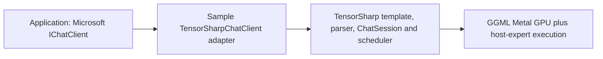

# Microsoft.Extensions.AI + TensorSharp: native Qwen3.8 Flash Next on Metal

Use Microsoft's `IChatClient` application contract while TensorSharp loads and runs the local model directly in the same .NET process. This example uses the exact **Qwen3.8 Flash Next** checkpoint through **`ggml_metal`** on Apple silicon. No HTTP listener or hosted OpenAI service is involved.



`Microsoft.Extensions.AI.Abstractions` supplies the common messages, options, streaming responses and `IChatClient` interface. The broader `Microsoft.Extensions.AI` package offers application middleware/DI integrations; this small example references the abstraction package. **TensorSharp performs inference.** The sample-local adapter translates the contract into TensorSharp's public `ModelService.ChatStreamWithMetricsAsync` API. It is example code, not an official Microsoft provider or a newly published TensorSharp package.

| Integration | Microsoft layer | TensorSharp layer |
| --- | --- | --- |
| This native example | `IChatClient` + this sample's adapter | Public .NET model/session APIs and native backend in the application process |
| [HTTP example](../dotnet-local-chat) | Microsoft's existing `Microsoft.Extensions.AI.OpenAI` adapter + official OpenAI HTTP transport | Separate TensorSharp server owns model loading, native inference and hosting |

Both approaches keep application code on `IChatClient`. The native types retain the `TensorSharp.Server` namespace but live in the host-neutral `TensorSharp.Chat` assembly; the project references the checked-out source. See [the adapter](TensorSharpChatClient.cs) and [TensorSharp's public service](../../TensorSharp.Chat/ModelService.cs).

## Prerequisites and run

Use .NET 10, the repository's [native build prerequisites](../../docs/getting_started.md), and an already-present supported checkpoint. For this demonstration the model path is the **first** file, `Qwen3.8-Flash-Next-UD-Q2_K_XL-00001-of-00003.gguf`; its two sibling shards must be beside it. The installed checkpoint totals **78,869,128,864 bytes**. The first shard is metadata-only; its small size is not the size of the model. `UD-Q2_K_XL` names a mixed-quantization profile. No model is downloaded by this example.

From the repository root:

```bash
dotnet build examples/tensorsharp-native-chat -c Release -p:TensorSharpSkipMlxNative=true
dotnet run --project examples/tensorsharp-native-chat -c Release --no-build -- --model /path/to/Qwen3.8-Flash-Next-UD-Q2_K_XL-00001-of-00003.gguf --backend ggml_metal --prompt "What is 2 + 2? Reply with just the single digit." --follow-up "Multiply that answer by 3. Reply with just the number." --mode mixed --max-tokens 64 --context-tokens 4096 --timeout-seconds 600
```

The build uses the repository's normal native GGML build. Skip MLX because this architecture's Mac backend is GGML Metal; TensorSharp explicitly refuses `mlx` for `qwen4exp`. If a matching native bridge is already built, add `-p:TensorSharpSkipGgmlNative=true`; the library must still be discoverable beside the application or in its native build tree. A managed-only build does not verify inference.

`--mode mixed` streams the first turn through `GetStreamingResponseAsync` and obtains the follow-up with `GetResponseAsync`. `stream` and `response` use that mode for both turns. `--model` can come from `TENSORSHARP_MODEL_PATH`. The CLI reports the loaded model/backend and refuses a backend substitution. `--help` lists the bounded token/context and generation-deadline settings.

## GPU placement and memory

On the tested **Apple M5 Pro, 20 GPU cores, 48 GiB unified memory**, all 78.87 GB cannot be GPU-resident. TensorSharp's automatic plan kept the routed experts of **15 layers on Metal** and ran **33 layers' routed experts on the host**, reading them from the SSD mapping as needed. The 28.8 GB PLE n-gram table is read on demand. This is **hybrid Metal/CPU execution**. Attention, routing and the accelerator graph still use Metal; it is not a CPU substitution.

Leave `--n-cpu-moe` unset for automatic placement; do not force zero to fit this checkpoint on a 48 GiB Mac. Capture your actual `[moe-offload]` plan and Metal device log. The observed counts depend on the checkpoint, context and hardware. See [the model's TensorSharp guide](../../docs/models/qwen38-flash-next.md#larger-than-memory), [the official model card](https://huggingface.co/Qwen/Qwen3.8-Flash-Next), and [the GGUF profile](https://huggingface.co/unsloth/Qwen3.8-Flash-Next-GGUF).

Run the HTTP and native examples **sequentially** on this machine. One loaded `ModelService` can be shared by several conversation adapters; creating a conversation must not load another copy of the large model.

## Adapter contract and lifetime

The caller owns the loaded `ModelService`. Each `TensorSharpChatClient` owns a dedicated `ChatSession` for **one conversation**; wrappers sharing a model serialize generation. Pass full, unchanged successful history plus the new user message on every call. A different conversation gets a new wrapper over the same loaded model. `ConversationId` is left null; this sample does not advertise delta-only or resumable conversations.

TensorSharp's public session pipeline records raw output token IDs and prompt-boundary metadata internally, so a later matching history can reuse the correct native state. Cancellation, a failed turn or an abandoned stream retires the affected session without reloading the model or adding the partial answer to successful history. Subsequent full-history requests use the same adapter/model. Consume or dispose the async enumerator; await active requests before disposing the caller-owned model. Adapter disposal cancels active work and does not wait on a model gate held by another conversation.

Supported input is unnamed text with system/user/assistant roles. Supported options include token limit, temperature, top-p/top-k, 32-bit seed, frequency/presence penalties, stop sequences and instructions. Model selection is bound to the already-loaded checkpoint. Tools, media, reasoning/structured-response controls, background/resumable requests and unsupported provider properties are explicitly rejected rather than silently ignored.

The family-aware output parser is primed with TensorSharp's generation suffix, flushed at completion and bypassed when output is already parsed. Native `eos`/stop reasons map to Microsoft `Stop`; native token/repetition budgets map to `Length`. Cancellation/error handling precedes that mapping. Standard `UsageDetails` reports input/output/cached tokens; `tensorsharp.*` additional properties preserve native finish reason, backend, KV-reused tokens and timing units. Usage and native metadata are also retained by non-streaming aggregation.

Model loading is synchronous and not cancellable through this public API. The CLI deadline applies to generation after loading; Ctrl+C returns `130`, a generation deadline returns `1`, and completed calls require actual nonempty answer text and terminal metrics. These capabilities do not imply competitor exclusivity or a throughput advantage.

## Validation

Model-free contract checks, after building the sample:

```bash
dotnet run --project eng/tests/NativeChatCompletion -c Release -- examples/tensorsharp-native-chat/bin/Release/net10.0/TensorSharp.NativeChat.dll
```

The **41 adapter checks and 7 completion-boundary checks passed**. They cover streaming/non-streaming aggregation, full-history isolation, shared-model serialization, options/media rejection, parser boundaries, usage/native metrics, cancellation precedence, abandonment/recovery and nonblocking disposal. They load no weights; keep this evidence separate from inference results.

The opt-in real-model suite uses one loaded model and one adapter throughout. After the model-free build, run it sequentially with any HTTP server stopped:

```bash
dotnet run --project eng/tests/NativeChatCompletion -c Release -- examples/tensorsharp-native-chat/bin/Release/net10.0/TensorSharp.NativeChat.dll --real-model /path/to/Qwen3.8-Flash-Next-UD-Q2_K_XL-00001-of-00003.gguf
```

### Verified Qwen/Metal run

On 2026-11-01, all **11 real adapter checks passed** on the Mac described above. Streaming returned `4`; `GetResponseAsync` with the complete history returned `12`. Standard usage and native properties were present. An invalid-model option was rejected before generation. Cancellation after actual output `1`, a one-second generation deadline, and early disposal of a stream each allowed a subsequent request to return `4` through the **same adapter and same loaded `ModelService`**. The failed session was retired; the model was not reloaded to claim recovery.

The literal README CLI command also returned `4` and `12`, with Microsoft finish `Stop` and native finish `eos`. The second turn reported 54 input / 3 generated / **0 reused KV tokens**. Zero is the observed value for this short Qwen case; no cache hit or speedup is claimed. A separate final CLI request counted `1…20` exactly, finished `eos` with 51 generated tokens, and emitted a native `[HOSTMOE-PASS]` trace with nonzero accelerator work and host-expert segments. Together with the Apple M5 Pro device log and 33/15 placement log, this verifies actual hybrid GPU execution rather than relying only on the backend name.

Validation used .NET SDK 10.0.302, the worktree based on `9a8d4e69e33810ebc039f14e77f1f7ce3ce28a29` plus the targeted startup-preflight CI repair and these example changes. The Metal bridge was rebuilt from unchanged native source with unchanged GGML `facdc44a67da17df4433adcc468b424f48e9ded2` (0.28.0). Bridge SHA256: `d9c6453b231451dfcf22b3ec7ea2c87f3167bae37df055246d4018bc31e5ee13`. Full weight-file checksums were not computed; model identity is recorded from local filenames, shard sizes and GGUF headers.

The real suite set `TS_HOST_MOE_TIMING=3` and bounded retained cache storage with `TS_Q4E_RETAINED_CACHE_MB=256`; CPU-expert overrides were unset so automatic placement applied. Context was 4096, concurrency one, F16 KV, greedy sampling and no projector/speculative draft. All test/model processes exited afterward. This is text-only functional coverage for the stated checkpoint, quantization, hardware and backend, not an all-model/all-backend claim or a performance comparison.

Generated evidence belongs in ignored `artifacts/` or `docs/validation/`; do not commit model files, private paths, binaries or machine logs.
